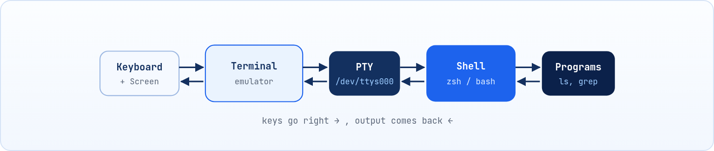
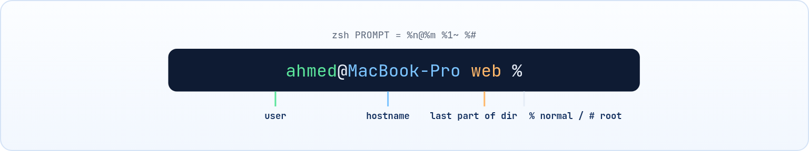

<small>المرحلة 1 · الأساسيات</small>

أول مرة تفتح فيها Terminal.app بتلاقي شباك فاضي وحرف % بيرمش ومستنيك. لا زراير ولا قوايم، ومش عارف تكتب إيه. الفصل ده هيحكيلك الحكاية من الأول: الشاشة دي جت منين، ومين اللي قاعد جواها بيفهم كلامك، وإيه اللي بيحصل من ساعة ما تدوس Enter لحد ما الرد يظهر. ولما تفهم ده، رسايل زي command not found هتبطّل تخوّفك.

:::note[بعد الفصل ده هتكون عارف]
- الفرق بين Terminal و Shell و Console و TTY
- الخطوات اللي بيعملها الـ Shell لما تدوس Enter
- يعني إيه Builtin ويعني إيه برنامج خارجي
- إزاي الـ Shell بيلاقي البرنامج عن طريق الـ PATH
- يعني إيه fork و exec
- تقرا الـ Prompt وتفهم كل حتة فيه
:::

<a id="s1-1"></a>

## 1.1 حكاية الشاشة السودا: جت منين أصلاً؟

خلينا نرجع بالزمن شوية. في الستينات والسبعينات الكمبيوتر كان أوضة كاملة، ومكانش فيه شاشة ولا ماوس. طب الناس كانت بتكلّمه إزاي؟ كانوا بيوصّلوا بيه آلة كاتبة كهربا اسمها **Teletype**: تكتب الأمر على الورق، والكمبيوتر يرد عليك ويطبع الرد على نفس الورقة. الآلة دي اختصارها **TTY**، وافتكر الاسم ده لأنه لسه عايش معانا لحد النهارده.

بعد كده الورق اتشال وبقى مكانه شاشة وكيبورد، والجهاز ده اتسمى **Terminal**، يعني "الطرف" اللي إنت قاعد عليه والكمبيوتر الحقيقي في حتة تانية. وبعدين جت الواجهات الرسومية والماوس والأيقونات، والمفروض إن الحكاية تخلص هنا، صح؟ بس اللي حصل إن المبرمجين لقوا إن الكتابة أسرع بكتير في حاجات كتير. تخيل كده إنك عايز تغيّر اسم 200 صورة في `Downloads`: بالماوس هتقعد ساعة، وبسطر واحد في الـ Terminal هتخلص في ثانية.

فعملوا برنامج بيقلّد الـ Terminal القديم جوه شباك عادي، وده اللي إنت بتفتحه على الماك وإسمه **Terminal.app**. طب مين بقى اللي بيفهم الكلام اللي بتكتبه؟ مش الشباك نفسه. جوه الشباك فيه برنامج تاني قاعد مستنيك اسمه **Shell**، وده "المخ". يعني عندنا 4 كلمات هتسمعهم كتير، وكل واحدة فيهم ليها شغلانة:

#### Terminal (Terminal Emulator)

البرنامج اللي بيرسم الشباك: بياخد الزراير اللي بتدوسها ويبعتها، ويعرض الحروف اللي راجعة بالألوان. على الماك عندك **Terminal.app** اللي جاي مع النظام (في `/Applications/Utilities`)، وبدايله المشهورة: iTerm2، Ghostty، Warp، kitty، WezTerm، Alacritty. هو "الشاشة والكيبورد" بس، ميعرفش يعني إيه `ls`.

#### Shell

البرنامج اللي شغال جوه الـ Terminal و**بيفهم** الكلام اللي بتكتبه: بيفك الأمر، يدور على البرنامج، يشغله، ويرجعلك النتيجة. على الماك الـ Shell الافتراضي هو **zsh** من أيام macOS Catalina، وفيه كمان bash قديم وfish و PowerShell لو سطبتهم. ده "المخ".

#### Console

الشاشة النصية "الحقيقية" اللي النظام نفسه بيوفرها من غير واجهة رسومية، على الماك مفيش Console نصي بتوصله بزرار في الاستخدام العادي؛ أقرب حاجة ليه هي الـ Terminal اللي جوه **Recovery Mode**. أما على Linux فبتظهر لو دست `Ctrl+Alt+F3`، أو شاشة السيرفر لو ملهوش Desktop.

#### TTY و PTY

الـ TTY اختصار **TeleTYpewriter**: أجهزة الطباعة القديمة اللي كانت بتتوصل بالكمبيوتر. النهارده هي "الجهاز" اللي الـ Kernel بيتعامل معاه كأنه طرف كتابة وقراية. أما الـ **PTY** (Pseudo-TTY) فهو TTY "وهمي" بيعمله الـ Kernel لكل شباك Terminal بتفتحه.



*الطبقات من الكيبورد لحد البرنامج: الـ Terminal بيرسم، والـ Shell بيفهم، والبرامج بتشتغل.*

**الأربع كلمات في سطر واحد**

| الكلمة | هو إيه؟ | تشبيه |
|---|---|---|
| Terminal | برنامج الشباك (إدخال وعرض) | التليفون نفسه |
| Shell | المفسّر اللي بيفهم الأوامر ويشغلها | الموظف اللي بيرد عليك |
| Console | شاشة النظام النصية الأساسية | التليفون الأرضي اللي في الشركة نفسها |
| TTY / PTY | الجهاز (الحقيقي أو الوهمي) اللي بيوصّل الاتنين بالـ Kernel | خط التليفون |

:::note[للتعمق]
الـ Teletype القديم لسه موجود جوه النظام كـ "جهاز وهمي". كل ما تفتح تابة جديدة، الـ Kernel بيعمل لها **PTY** (Pseudo-TTY) خاص بيها، والـ Terminal والـ Shell بيتكلموا من خلاله. تقدر تشوف اسمه بنفسك:

**تشريح الأمر**

```sh
tty
```

1. `tty`: أمر بيطبعلك اسم ملف الـ TTY اللي إنت متوصل بيه دلوقتي. على الماك هيطلع حاجة زي `/dev/ttys000` (يعني PTY رقم 000، والتابة اللي بعدها `/dev/ttys001`). على Linux نفس الفكرة بس اسمها `/dev/pts/0`. مالوش أي Flags محتاجها دلوقتي.
:::

:::note[معلومة مهمة]
عشان كده تقدر تغير الـ Terminal (مثلاً من Terminal.app لـ iTerm2) من غير ما تغير الـ Shell، وتغير الـ Shell (من zsh لـ bash) من غير ما تغير الـ Terminal. هما حاجتين منفصلتين تماماً.
:::

<a id="s1-2"></a>

## 1.2 إيه اللي بيحصل لما تدوس Enter؟

تخيل إنك داخل مطعم وقلت للجرسون: "عايز 2 شاورما، واحدة من غير ثومية، وابعتهم على الترابيزة اللي جنب الشباك". الجرسون مش بيجري على المطبخ على طول. الأول بيسمع الجملة كلها، وبعدين يقسمها في دماغه (2 شاورما، من غير ثومية، الترابيزة دي)، ويعرف هيبعت الأوردر لمين، وفي الآخر يرجعلك يقولك "تمام". الـ Shell بيعمل نفس الحكاية بالظبط مع كل سطر بتكتبه.

خلينا نمشي ورا أمر واحد ونشوف الـ Shell بيعمل فيه إيه خطوة خطوة. الأمر ده بيعمل لستة بكل ملفات الـ PDF اللي في `Downloads` ويحطها في ملف اسمه `list.txt`:

```sh title="Terminal"
ls -l ~/Downloads/*.pdf > list.txt
```

1. <strong>القراية (Read):</strong> الـ Shell بيستنى لحد ما تدوس Enter، وبياخد السطر كله كنص.
2. <strong>التقطيع (Tokenizing):</strong> بيقسم السطر لكلمات (Tokens) على المسافات، مع احترام علامات التنصيص: `ls` و `-l` و `~/Downloads/*.pdf` و `>` و `list.txt`. وبيتعرف على الرموز الخاصة زي `>` و `|` و `&&`.
3. <strong>التوسيعات (Expansions) بالترتيب:</strong> الـ `~` تتحول لـ `/Users/user`، والمتغيرات زي `$HOME` تتحط قيمتها، و `$( )` يتنفذ ويتحط ناتجه، وفي الآخر الـ `*.pdf` تتحول لأسماء الملفات الحقيقية (Globbing).
4. <strong>الـ Redirection:</strong> قبل التشغيل، الـ Shell بيفتح `list.txt` للكتابة ويوجّه الناتج ليه بدل الشاشة.
5. <strong>البحث عن الأمر:</strong> هل `ls` ده Alias؟ ولا Function؟ ولا Builtin جوه الـ Shell؟ ولا برنامج على الديسك؟ (هنفصّلها تحت).
6. <strong>التشغيل (fork + exec):</strong> لو برنامج خارجي، الـ Shell بيعمل نسخة من نفسه (**fork**)، والنسخة دي بتستبدل نفسها بالبرنامج `/bin/ls` (**exec**)، والـ Shell الأصلي بيستنى.
7. <strong>النهاية:</strong> البرنامج يخلص ويرجع رقم اسمه **Exit Code** (صفر = نجاح)، والـ Shell يحفظه في `$?` ويطبعلك الـ Prompt تاني.


*الرحلة من ساعة ما تدوس Enter لحد ما الـ Prompt يرجع.*

:::tip[حاجة مشتركة]
الترتيب ده هو سر حاجات كتير هتشوفها بعدين: ليه `"*.txt"` بين علامات تنصيص مبتتوسعش، وليه `echo $HOME` بيطبع المسار مش الكلمة، وليه `>` بيمسح الملف حتى لو الأمر فشل (لأن الـ Redirection بيحصل **قبل** التشغيل). كل ده متفصّل في [↩ 7.5](../ch07/#s7-5 "الـ Quoting: إمتى الـ Shell يفهم الرموز وإمتى لأ") و [↩ 7.2](../ch07/#s7-2 "الـ Redirection: وجّه الـ Streams").
:::

<a id="s1-3"></a>

## 1.3 الـ Builtin مقابل البرنامج الخارجي

هنا بقى فيه سؤال شكله بسيط بس إجابته هتفتحلك حاجات كتير: لما تكتب `ls`، هو فين الـ `ls` ده؟ الإجابة إنه ملف عادي على الديسك في `/bin/ls`، زيه زي أي برنامج. طب و `cd`؟ هنا المفاجأة: مفيش ملف اسمه `cd` بيشتغل. مش كل أمر بتكتبه برنامج على الديسك. فيه أوامر "مبنية جوه" الـ Shell نفسه اسمها **Builtins**. ليه؟ خد مثال `cd`: لو `cd` كان برنامج خارجي، الـ Shell هيعمل له fork، والبرنامج هيغير المجلد بتاع **نفسه**، ويخلص ويموت، والـ Shell بتاعك هيفضل في مكانه! عشان كده `cd` لازم يبقى جوه الـ Shell عشان يغيّر حالة الـ Shell نفسه.

**Builtin ولا خارجي؟**

|   | Builtin | برنامج خارجي |
|---|---|---|
| مكانه | جوه الـ Shell نفسه | ملف على الديسك، زي `/bin/ls` |
| بيحتاج fork؟ | لأ، أسرع | أيوه |
| يقدر يغير حالة الـ Shell؟ | أيوه (المجلد، المتغيرات) | لأ |
| أمثلة | `cd` `export` `alias` `source` `exit` `read` `type` `history` `jobs` | `ls` `grep` `cp` `find` `ssh` `curl` |
| المساعدة | `man zshbuiltins` في zsh، و `help cd` في bash | `man ls` (الـ `ls` بتاع الماك مبيفهمش `--help`) |

**تشريح الأمر**

```sh
type -a echo
```

1. `type`: Builtin بيقولك الأمر ده "نوعه إيه": alias ولا function ولا builtin ولا ملف.
2. `-a`: اختصار **all**: اعرض **كل** الأماكن اللي ممكن الاسم ده يتلاقى فيها، مش أول واحد بس.
3. `echo`: الاسم اللي بنسأل عليه.

```sh title="Terminal"
$ type -a echo
echo is a shell builtin
echo is /bin/echo
$ type ll
ll is an alias for ls -lAhG
$ type cd
cd is a shell builtin
```

<small>الـ `ll` هنا alias إنت اللي عامله (الماك مفيهوش `ll` جاهز زي Ubuntu)؛ هنعمله في [↩ 13.2](../ch13/#s13-2 "الـ Aliases: اختصارات").</small>

لاحظ إن `echo` موجود مرتين: Builtin وبرنامج. الـ Shell بيختار الـ Builtin الأول لأنه أسرع. وترتيب البحث في zsh (و bash نفس الفكرة) هو:

1. **Alias** (اختصارات إنت عاملها، [↩ 13.2](../ch13/#s13-2 "الـ Aliases: اختصارات"))
2. **Function** (دوال، [↩ 12.5](../ch12/#s12-5 "الدوال"))
3. **Builtin**
4. **برنامج في الـ PATH** (الجزء الجاي)

:::note[أوامر شبيهة: which و command -v]
في **zsh** الـ `which` نفسه Builtin وبيعرف الـ aliases والـ builtins (زي `whence -c`). لكن في **bash** هو برنامج خارجي بيدور في الـ PATH بس، فنتيجته ممكن تختلف من Shell للتاني. أما `command -v ls` فده الطريقة القياسية (POSIX) اللي بتشتغل في أي Shell، وأحسن حاجة تستخدمها جوه الـ Scripts عشان تتأكد إن برنامج موجود.
:::

<a id="s1-4"></a>

## 1.4 الـ PATH: إزاي الـ Shell بيلاقي البرنامج؟

لو حصلك قبل كده إنك سطبت حاجة، وكتبت اسمها، والـ Terminal قالك "مش لاقيها"، فإنت قابلت الـ PATH من غير ما تعرف. تخيل الماك فيه آلاف الملفات، والـ Shell مش هيقعد يدور فيهم كلهم كل ما تكتب أمر، كده هيفضل يدور للصبح. فبدل كده إنت بتديله لستة صغيرة بالأماكن اللي الـ برامج بتبقى فيها، ويقوله "دوّر هنا بس".

فلما تكتب `grep`، الـ Shell مش بيدور في الديسك كله. هو بيبص في متغير اسمه **PATH**: لستة مجلدات مفصولة بـ `:`، ويدور فيها بالترتيب، وأول ما يلاقي ملف اسمه `grep` وقابل للتشغيل، يشغله ويقف.

**تشريح الأمر**

```sh
echo $PATH
```

1. `echo`: اطبع اللي بعدي على الشاشة.
2. `$`: علامة الدولار قبل اسم متغير معناها "حط قيمة المتغير ده هنا". من غيرها هيطبع كلمة PATH نفسها.
3. `PATH`: اسم المتغير. الأسماء حساسة لحالة الحروف: `$path` حاجة تانية.

```sh title="Terminal"
$ echo $PATH
/Users/user/.local/bin:/opt/homebrew/bin:/opt/homebrew/sbin:/usr/local/bin:/usr/bin:/bin:/usr/sbin:/sbin
```

- الترتيب مهم: لو فيه `python3` متسطب من Homebrew في `/opt/homebrew/bin`، وواحد تاني جاي مع أدوات Apple في `/usr/bin`، اللي في `/opt/homebrew/bin` هو اللي هيشتغل لأنه جاي الأول.
- الـ Shell بيحفظ مكان الأوامر اللي لقاها في ذاكرة (hash table) عشان ميدورش كل مرة. لو نقلت برنامج أو سطبت واحد جديد والـ Shell لسه "مش لاقيه"، اعمل `rehash` في zsh (أو `hash -r` في bash) عشان تمسح الذاكرة دي.
- إزاي تضيف مجلد للـ PATH بشكل دايم؟ ده في [↩ 13.5](../ch13/#s13-5 "الـ PATH: ضيف مجلد صح").

:::caution[ليه لازم تكتب ./script.sh؟]
المجلد الحالي (`.`) **مش** موجود في الـ PATH عن قصد، عشان الأمان: لو حد حط ملف اسمه `ls` في مجلد، وإنت دخلت المجلد ده وكتبت `ls`، مش عايز ملفه هو اللي يشتغل! فعشان تشغل حاجة في المجلد الحالي لازم تقول صراحةً `./script.sh`، يعني "الملف ده اللي هنا".
:::

<a id="s1-5"></a>

## 1.5 شوف بعينك: مين "أبو" الأمر اللي شغّلته؟

الجزء ده للي حابب يشوف اللي جوه المطبخ. لو حاسس إنه تقيل عليك دلوقتي عدّيه عادي، وارجعله بعد فصل الـ Processes.

:::note[للتعمق]
فاكر خطوة الـ fork و exec؟ يعني الـ Shell بيعمل نسخة من نفسه، والنسخة تتحول للبرنامج. تعالى نتأكد إن ده بيحصل فعلاً. كل Process ليها رقم اسمه **PID**، ورقم أبوها اسمه **PPID**. خلينا نشوف إن الـ Shell هو "أبو" أي أمر بتشغله:

**تشريح الأمر**

```sh
ps -o pid,ppid,command
```

1. `ps`: اعرض الـ Processes (الشرح الكامل في [↩ 9.1](../ch09/#s9-1 "ps: صورة للعمليات دلوقتي")).
2. `-o`: اختصار **output format**: إنت اللي تحدد الأعمدة اللي عايزها.
3. `pid,ppid,command`: الأعمدة مفصولة بفاصلة من غير مسافات: رقم الـ Process، ورقم أبوها، والأمر نفسه. على الماك اسم العمود `command`؛ أما `cmd` فده اسمه في نسخة Linux.

```sh title="Terminal"
$ echo $$
4210
$ ps -o pid,ppid,command
  PID  PPID COMMAND
 4210  4198 -zsh
 4377  4210 ps -o pid,ppid,command
```

الـ `$$` متغير خاص فيه PID الـ Shell نفسه (4210). ولاحظ إن الـ `ps` رقم أبوه (PPID) هو 4210: يعني الـ Shell عمل fork، والنسخة عملت exec لـ `ps`. والشرطة اللي قبل `-zsh` معناها إنه **Login Shell**. وعلى الماك، Terminal.app بيفتح **كل** تابة جديدة كـ Login Shell، عكس Linux (هنعرف ليه ده مهم في [↩ 13.1](../ch13/#s13-1 "مين بيقرا إيه وإمتى؟")).
:::

<a id="s1-6"></a>

## 1.6 تشريح الـ Prompt

أول ما فتحت الـ Terminal شفت حاجة زي `ahmed@MacBook-Pro ~ %`، ويمكن قلت "إيه الكلام ده؟". السطر ده اسمه **Prompt**، وهو الـ Shell بيقولك "أنا جاهز، اتفضل". ومش مجرد ديكور، ده بطاقة تعريف صغيرة: بيقولك إنت مين، وعلى أنهي جهاز، وواقف فين دلوقتي. وده هيفرق معاك جداً لما تبقى فاتح 3 تابات، واحدة منهم متوصلة بسيرفر:



*كل حتة في الـ Prompt ومعناها.*

**رموز الـ Prompt في zsh (متغير PROMPT)، وقصادها bash**

| zsh | bash (PS1) | بيتحول لإيه |
|---|---|---|
| `%n` | `\u` | اسم المستخدم (user) |
| `%m` | `\h` | اسم الجهاز لحد أول نقطة (host) |
| `%~` | `\w` | المجلد الحالي كامل، والـ home بيتكتب `~` |
| `%1~` | `\W` | آخر جزء بس من المجلد الحالي (ده اللي الماك بيستخدمه افتراضياً) |
| `%#` | `\$` | `%` في zsh (أو `$` في bash) لو مستخدم عادي، و `#` لو root |
| `%*` | `\t` | الساعة HH:MM:SS |

:::note[على Linux]
الـ Prompt الافتراضي على Ubuntu (bash) شكله `ahmed@laptop:~/projects/web$`: فيه `:` بين الجهاز والمسار، والمسار كامل، وفي الآخر `$` بدل `%`. هتشوفه كتير لما تدخل على سيرفر بـ ssh.
:::

:::caution[الـ $ و # في الكتب والمواقع]
لما تشوف في أي شرح سطر بيبدأ بـ `$` (أو `%` زي الماك) فده معناه "اكتب الأمر ده كمستخدم عادي" والرمز نفسه **متتكتبش**. في الكتاب ده هنكتب الـ Prompt بشكل الماك `%`. ولو بيبدأ بـ `#` يبقى "لازم root". وجوه ملف أو Script، الـ `#` معناها تعليق (Comment). نفس الرمز، معاني مختلفة حسب المكان.
:::

ولو كتبت أمر ناقص (زي علامة تنصيص مفتوحة) هيظهرلك Prompt تاني؛ في zsh شكله `dquote>` (وفي bash `>` بس). ده اسمه **PS2**، ومعناه "كمّل، أنا مستني باقي الأمر". اخرج منه بـ `Ctrl+C`. وتخصيص الـ Prompt بالألوان هنعمله في [↩ 13.6](../ch13/#s13-6 "الـ Prompt على مزاجك").

<a id="s1-7"></a>

## 1.7 مشاكل شائعة

:::danger[مشكلة: command not found]
كتبت اسم أمر والـ Shell قالك `zsh: command not found: htop`. ده معناه إن الـ Shell دوّر في الـ alias والـ functions والـ builtins وكل مجلدات الـ PATH وملقاش حاجة بالاسم ده.

<strong>الحل:</strong> (1) اتأكد من الإملاء وحالة الحروف. (2) يمكن البرنامج مش متسطب: سطّبه بـ `brew install htop` ([↩ 11.1](../ch11/#s11-1 "الفكرة: المخزن والحزمة والاعتماديات")). (3) يمكن متسطب في مجلد مش في الـ PATH: لو لسه مسطب Homebrew ومش لاقي `brew` نفسه، غالباً ناقصك سطر `brew shellenv` في `~/.zprofile`. دور بـ `ls /opt/homebrew/bin` وضيفه للـ PATH، وبعدها `rehash`.
:::

:::danger[مشكلة: Permission denied وإنت بتشغل Script]
كتبت `./backup.sh` وطلع `Permission denied`. الملف موجود، بس مش عليه صلاحية التشغيل (x).

<strong>الحل:</strong> `chmod +x backup.sh` وبعدين شغله تاني. الصلاحيات متفصّلة في [↩ 6.1](../ch06/#s6-1 "الفكرة: 3 أسئلة × 3 أنواع ناس").
:::

:::tip[ملخص الفصل]
- الـ Terminal بيرسم ويستقبل الزراير، والـ Shell بيفهم الأوامر، والـ TTY/PTY هو الخط بينهم وبين الـ Kernel.
- مع كل Enter: قراية ← تقطيع ← توسيعات ← Redirection ← بحث ← fork/exec ← Exit Code في `$?`.
- ترتيب البحث: Alias ← Function ← Builtin ← PATH. واستخدم `type -a` عشان تعرف.
- `cd` لازم يبقى Builtin لأن الـ Process الابن ميقدرش يغيّر مجلد أبوه.
- الـ PATH لستة مجلدات بـ `:`، وأول ملف يتلاقي هو اللي يشتغل، والمجلد الحالي مش فيه.
:::

### صح ولا غلط؟

1. لو غيرت الـ Terminal من Terminal.app لـ iTerm2 لازم تغير الـ Shell كمان.
2. الـ Globbing (تحويل `*.pdf` لأسماء ملفات) بيعمله الـ Shell قبل ما البرنامج يشتغل.
3. `which` هو أدق طريقة تعرف بيها لو الأمر Builtin في أي Shell.

### أسئلة مراجعة

1. اشرح بكلامك الفرق بين الـ Terminal والـ Shell.
2. ليه `cd` مينفعش يبقى برنامج خارجي؟
3. عندك نسختين من `node` في مجلدين مختلفين في الـ PATH. مين هيشتغل؟ وإزاي تتأكد؟
4. ليه بنكتب `./script.sh` مش `script.sh` بس؟

### تحديات الفصل

<small>جرّبها بإيدك، والحلول في ملحق الإجابات.</small>

1. **[سهل]** شغّل `tty` في تابتين Terminal مختلفين (`Cmd+T` بتفتح تابة جديدة)، وقارن الناتج.
2. **[سهل]** استخدم `type` على: `cd` و `ls` و `pwd` و `type` نفسه. مين فيهم Builtin؟
3. **[متوسط]** اطبع الـ PATH كل مجلد في سطر لوحده. (تلميح: `echo $PATH | tr ':' '\n'`، وفكّر كل حتة بتعمل إيه بعد ما تقرا [↩ 8.5](../ch08/#s8-5 "tr: بدّل الحروف")).
4. **[صعب]** افتح bash جوه zsh (اكتب `bash`)، واطبع `$$` في كل واحد، واستخدم `ps -o pid,ppid,command` عشان ترسم "شجرة العيلة". اخرج بـ `exit`.
