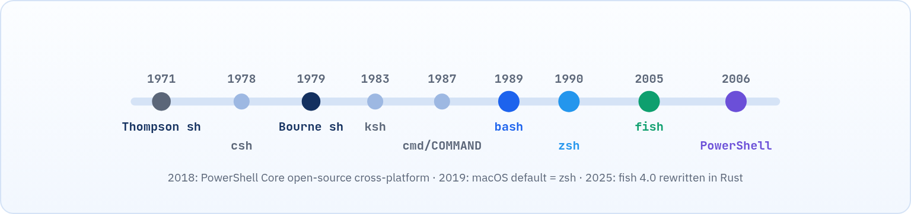

<small>المرحلة 1 · الأساسيات</small>

سنة 2019 الناس اللي فتحت الـ Terminal على الماك بعد تحديث Catalina لقت رسالة غريبة بتقول: The default interactive shell is now zsh. ناس كتير قالت "يعني إيه؟ هو أنا كنت شغال على إيه أصلاً؟". الفصل ده بيحكي حكاية الـ Shells: ليه فيه أكتر من واحد، وليه Apple سابت bash وراحت لـ zsh، وليه الـ bash اللي على جهازك قديم جداً، وإزاي تختار وتغيّر. وهتعرف كمان ليه أمر نسخته من صاحبك ممكن ميشتغلش عندك.

:::note[بعد الفصل ده هتكون عارف]
- تاريخ الـ Shells وليه فيه أكتر من واحد
- ليه الماك بيستخدم zsh و bash 3.2 القديم، وإزاي تسطب bash حديث
- يعني إيه POSIX وليه sh مهم
- الفروق العملية بين bash و zsh و fish
- إزاي PowerShell مختلف من الأساس (Objects مش نصوص)
- جدول مقارنة للكتابة والمميزات وملفات الإعدادات
- تعرف الـ Shell الحالي وتغيره بـ chsh
:::

<a id="s3-1"></a>

## 3.1 المشكلة: ليه مش Shell واحد وخلاص؟

سؤال منطقي جداً. يعني لو الـ Shell ده "المخ" اللي بيفهم الأوامر، ليه مش فيه واحد بس وكلنا نستخدمه؟ الإجابة شبه حكاية الموبايلات: كل جيل بيطلع عشان يحل حاجة كانت مضايقة الناس في اللي قبله.

الأول خالص كان فيه Shell بسيط جداً بيشغّل أوامر وخلاص. الناس استخدمته وبدأت تقول "طب عايزين نكتب برامج صغيرة بيه، فيها شروط و Loops"، فاتعمل Shell أقوى في الـ Scripting. وبعدها الناس قالت "طب إحنا قاعدين عليه طول اليوم، عايزين ألوان واقتراحات وهو يكمّل الكلام معانا"، فاتعمل Shell مريح أكتر في الاستخدام اليومي. ولما ويندوز احتاج حاجة بتفهم نظامه هو، اتعملت حاجة مختلفة خالص. والنتيجة: عيلة كبيرة، وكل فرد فيها اتولد علشان سبب.



*عيلة الـ Shells على خط زمني.*

<a id="s3-2"></a>

## 3.2 الجد الكبير: sh و POSIX

تخيل لو كل شركة عربيات عملت الدركسيون في مكان مختلف، مرة على اليمين ومرة في النص. هتحتاج تتعلم سواقة من الأول مع كل عربية. نفس المشكلة كانت هتحصل مع الـ Shells، فالناس اتفقت على "قواعد مشتركة". خلينا نشوف الحكاية دي:

الـ **Bourne Shell** (`sh`) اتعمل سنة 1979 وبقى الأساس. بعدين اتعمل معيار اسمه **POSIX** بيحدد "الحد الأدنى" اللي أي Shell متوافق لازم يفهمه. يعني لو كتبت Script بـ POSIX sh بس، هيشتغل على أي نظام Unix تقريباً.

:::caution[sh على جهازك مش هو نفسه في كل حتة]
على الماك، `/bin/sh` بيشغّل في الحقيقة **bash 3.2** في وضع اسمه "POSIX mode"، فحاجات زي `[[ ]]` هتعدّي معاك. وده فخ، لأن نفس الـ Script هيبوظ على السيرفر. اكتب `sh --version` وهتشوف بنفسك إنه بيقولك GNU bash.
:::

:::note[على Linux]
على Debian و Ubuntu، `/bin/sh` بيشاور على **dash**: Shell صغير وسريع جداً بيفهم POSIX بس. فلو كتبت Script فيه حاجات خاصة بـ bash (زي `[[ ]]` أو Arrays) وشغلته بـ `sh script.sh` هيبوظ. اعرف بـ `ls -l /bin/sh`. والماك نفسه فيه `/bin/dash` لو عايز تجرّب الـ Script عليه قبل ما ترفعه: `dash script.sh`.
:::

<a id="s3-3"></a>

## 3.3 كل Shell في كارت

خلينا نتعرّف على أفراد العيلة واحد واحد. مش مطلوب منك تحفظهم، المهم تعرف كل واحد بيتقال عليه إيه علشان لما تقابل اسمه في شرح متتلخبطش:

#### bash · Bourne Again SHell

اتعمل سنة 1989 كبديل حر لـ sh (مشروع GNU). الـ Default في أغلب توزيعات Linux، وهو اللي معظم الـ Scripts والشروحات مكتوبة بيه. آخر إصدار رئيسي **5.3** (يوليو 2025). خلي بالك: macOS لسه جاي معاه bash **3.2** القديم جداً لأسباب رخصة (الحكاية كاملة تحت).

#### zsh · Z shell

اتعمل سنة 1990. متوافق مع bash في 90% من الكتابة، بس أقوى في الاستخدام التفاعلي: Tab completion ذكي، Globbing متقدم، تصحيح أخطاء الكتابة، وPlugins (أشهرها Oh My Zsh). الـ Default على <strong>macOS من Catalina (2019)</strong>، ولحد النهارده في macOS 27 Golden Gate. الماك جاي معاه zsh **5.9**، وده الـ Shell اللي الكتاب ده ماشي بيه.

#### fish · Friendly Interactive SHell

اتعمل سنة 2005 وفلسفته "يشتغل حلو من غير أي إعدادات": اقتراحات أوتوماتيك من الـ History، ألوان للأوامر الصح والغلط، وإعدادات من المتصفح. **مش متوافق مع POSIX** عن قصد، فـ Scripts الـ bash مش هتشتغل عليه. من الإصدار 4.0 (فبراير 2025) اتكتب من جديد بلغة Rust.

#### PowerShell · pwsh

من Microsoft (2006)، ومن 2018 مفتوح المصدر وشغال على Linux و macOS كمان. الفرق الجوهري: الـ Pipe بيعدّي **Objects** مش نصوص. الإصدار الحالي **7.6 LTS** (مارس 2026). وعلى Windows فيه كمان "Windows PowerShell 5.1" القديم المدمج، ودول برنامجين منفصلين.

#### cmd.exe

الـ Command Prompt القديم بتاع Windows، وارث DOS. محدود جداً في الـ Scripting (ملفات `.bat`). موجود عشان التوافق مع الحاجات القديمة، ومايكروسوفت نفسها بتنصح بـ PowerShell.

#### والباقي

**dash** (sh سريع في Debian)، **ksh** (KornShell، لسه موجود في أنظمة Unix قديمة)، **csh/tcsh** (كتابة شبه لغة C، قديم)، و **nushell** (حديث، بيتعامل مع البيانات كجداول زي فكرة PowerShell).

<a id="s3-4"></a>

## 3.4 ليه الماك ساب bash وراح لـ zsh؟

دي حكاية فيها شوية قانون، بس هتفهم منها حاجات كتير. لحد سنة 2019 كان الـ Shell الافتراضي على الماك هو bash. وفي 2007 bash طلع بإصدار 3.2، وبعدها بشوية مشروع GNU غيّر الرخصة بتاعته لنسخة جديدة اسمها **GPLv3**. الرخصة دي فيها شروط Apple مكانتش مرتاحة لها. فـ Apple عملت إيه؟ وقفت عند bash 3.2 ومحدّثتهوش تاني خالص.

السنين عدّت، و bash وصل لـ 4 و 5، وفيه حاجات جديدة كتير، والماك لسه قاعد على نسخة من 2007. ففي Catalina، Apple قررت تخلّي **zsh** هو الافتراضي، لأن رخصته (MIT-like) مريحة ليها، وهو أصلاً أقوى في الاستخدام اليومي. بس سابت bash 3.2 موجود في `/bin/bash` علشان الـ Scripts القديمة متبوظش.

```sh title="Terminal"
$ zsh --version
zsh 5.9 (arm64-apple-darwin)
$ /bin/bash --version | head -n 1
GNU bash, version 3.2.57(1)-release (arm64-apple-darwin)
```

<small>آخر الكلام اللي بين القوسين بيختلف حسب جهازك وإصدار النظام.</small>

طب ده يفرق معاك في إيه؟ الحاجات دي **مش موجودة** في bash 3.2، وهتلاقيها في Scripts كتير على النت:

**حاجات ناقصة في bash 3.2 اللي على الماك**

| الحاجة | من bash رقم | بتعمل إيه |
|---|---|---|
| `declare -A` | 4.0 | Associative Arrays (مفتاح وقيمة، زي Object في JavaScript) |
| `mapfile` / `readarray` | 4.0 | تقرا ملف سطر سطر جوه Array |
| `${var,,}` و `${var^^}` | 4.0 | تحويل لحروف صغيرة أو كبيرة |
| `shopt -s globstar` (`**`) | 4.0 | الـ `**` اللي بتدخل جوه كل المجلدات (zsh عنده دي من غير أي إعداد) |
| `\|&` | 4.0 | اختصار `2>&1 \|` |
| `${arr[-1]}` | 4.3 | آخر عنصر في Array |

### تسطّب bash حديث بـ Homebrew

الحل سهل: سطّب نسخة حديثة جنب القديمة، ومتلمسش القديمة خالص (النظام ممكن يكون معتمد عليها). Homebrew متشرح بالتفصيل في [↩ 11.3](../ch11/#s11-3 "brew كل يوم: install و upgrade و info"):

**تشريح الأمر**

```sh
brew install bash
```

1. `brew`: مدير الحزم Homebrew.
2. `install`: Subcommand: سطّب.
3. `bash`: اسم الحزمة. هتتسطب في `/opt/homebrew/bin/bash` على أجهزة Apple Silicon (أو `/usr/local/bin/bash` على أجهزة Intel القديمة).

```sh title="Terminal"
$ which -a bash
/opt/homebrew/bin/bash
/bin/bash
$ bash --version | head -n 1
GNU bash, version 5.3.x(1)-release (aarch64-apple-darwin)
```

لاحظ إن `which -a` لقى الاتنين، والنسخة الجديدة جت الأول لأن `/opt/homebrew/bin` قبل `/bin` في الـ PATH (فاكر [↩ 1.4](../ch01/#s1-4 "الـ PATH: إزاي الـ Shell بيلاقي البرنامج؟")؟). وعشان كده أي Script أوله `#!/usr/bin/env bash` هيشتغل بالنسخة الجديدة، أما اللي أوله `#!/bin/bash` هيشتغل بالقديمة. الفرق ده متشرح في [↩ 12.1](../ch12/#s12-1 "أول Script: الـ Shebang").

<a id="s3-5"></a>

## 3.5 مقارنة الكتابة (Syntax)

دلوقتي بعد ما عرفت العيلة، تعالى نشوف "لهجة" كل واحد. نفس الفكرة بتتكتب إزاي في كل Shell؟ هتلاحظ إن bash و zsh و sh تقريباً نفس الكلام، وإن fish وعيلة Windows مختلفين:

**نفس الفكرة في كل Shell: عيلة Unix**

| الفكرة | bash / zsh / sh | fish |
|---|---|---|
| متغير | `name=Ali` (من غير مسافات) | `set name Ali` |
| استخدامه | `$name` | `$name` |
| Environment Variable | `export NAME=v` | `set -gx NAME v` |
| ناتج أمر | `$(date)` | `(date)` أو `$(date)` |
| شرط | `if [ -f a ]; then ...; fi` | `if test -f a; ...; end` |
| Loop | `for f in *; do ...; done` | `for f in *; ...; end` |
| و / أو | `&&` `\|\|` | `&&` `\|\|` أو `and` `or` |
| ملف الإعدادات | `~/.bashrc` / `~/.zshrc` | `~/.config/fish/config.fish` |
| امتداد الـ Script | `.sh` | `.fish` |

**نفس الفكرة في كل Shell: عيلة Windows**

| الفكرة | PowerShell | cmd |
|---|---|---|
| متغير | `$name = "Ali"` | `set name=Ali` |
| استخدامه | `$name` | `%name%` |
| Environment Variable | `$env:NAME = "v"` | `set NAME=v` |
| ناتج أمر | `$(Get-Date)` | معقد (`for /f`) |
| شرط | `if (Test-Path a) { ... }` | `if exist a ( ... )` |
| Loop | `foreach ($f in ls) { ... }` | `for %f in (*) do ...` |
| و / أو | `&&` `\|\|` (من 7.0) | `&&` `\|\|` |
| ملف الإعدادات | المسار في `$PROFILE` | مفيش (Registry) |
| امتداد الـ Script | `.ps1` | `.bat` / `.cmd` |

:::note[فروق صغيرة بين bash و zsh بتفرق]
- <strong>الـ Arrays:</strong> في bash أول عنصر رقمه 0 (`${arr[0]}`)، وفي zsh رقمه 1 افتراضياً.
- <strong>الـ Word splitting:</strong> في bash، `$var` من غير علامات تنصيص بيتقسم على المسافات. في zsh لأ. عشان كده Script شغال في zsh ممكن يبوظ في bash لو فيه أسماء ملفات بمسافات ([↩ 7.5](../ch07/#s7-5 "الـ Quoting: إمتى الـ Shell يفهم الرموز وإمتى لأ")).
- <strong>الـ Glob اللي مالوش نتيجة:</strong> `ls *.xyz` في bash بيعدّي النص `*.xyz` زي ما هو، وفي zsh بيدي Error اسمه `no matches found`.
:::

<a id="s3-6"></a>

## 3.6 PowerShell: عالم تاني (Objects مش نصوص)

إنت كمبرمج JavaScript هتفهم الجزء ده بسرعة. تخيل الفرق بين إنك تبعت لحد رسالة WhatsApp فيها "الاسم أحمد، السن 25"، وبين إنك تبعتله Object `{name, age}` جاهز. في الأولى هو لازم يقرا ويقص الكلام علشان يطلع منه المعلومة، وفي التانية المعلومة جاهزة. ده بالظبط الفرق بين bash و PowerShell.

في bash لما تعمل `ps aux | grep chrome` إنت بتعدّي **نص**، والأمر التاني لازم "يقص" النص عشان يفهمه. في PowerShell كل أمر (اسمه **Cmdlet**) بيطلع **Objects** ليها خصائص، فتقدر تفلتر وترتب بالاسم:

**تشريح الأمر**

```text
Get-Process | Where-Object CPU -gt 100 | Sort-Object CPU -Descending | Select-Object -First 5
```

1. `Get-Process`: هات كل الـ Processes كـ Objects. الأسماء دايماً **Verb-Noun** (فعل-اسم).
2. `|`: الـ Pipe، بس بيعدّي Objects كاملة مش سطور نص.
3. `Where-Object CPU -gt 100`: فلتر: خلّي بس اللي خاصية CPU بتاعته أكبر من 100. والـ `-gt` = greater than (بدل `>` اللي معناها Redirection).
4. `Sort-Object CPU -Descending`: رتّب حسب الـ CPU من الكبير للصغير.
5. `Select-Object -First 5`: خد أول 5 بس (زي `head -n 5`).

:::caution[الـ Aliases المضللة]
في PowerShell على Windows، `ls` و `cat` و `rm` شغالين، بس هما Aliases لـ `Get-ChildItem` و `Get-Content` و `Remove-Item`، والـ Flags بتاعتهم مختلفة: `rm -rf` مش هتشتغل، المقابل `Remove-Item -Recurse -Force`.
:::

<a id="s3-7"></a>

## 3.7 مقارنة المميزات

طب في الآخر، مين الأحسن؟ الإجابة الصريحة: مفيش "أحسن" على طول الخط. كل واحد شاطر في حاجة. الجدولين دول بيلخصوا الكلام اللي فات:

**المميزات وجهاً لوجه**

| الميزة | sh/dash | bash | zsh | fish | PowerShell |
|---|---|---|---|---|---|
| متوافق مع POSIX | ✓ | ✓ (تقريباً) | ✓ (تقريباً) | ✗ | ✗ |
| اقتراحات أوتوماتيك وانت بتكتب | ✗ | ✗ (بـ أدوات خارجية) | بـ Plugin | ✓ مدمجة | ✓ (PSReadLine) |
| ألوان للأوامر (Syntax highlighting) | ✗ | ✗ | بـ Plugin | ✓ مدمجة | ✓ |
| Tab completion ذكي | بسيط | كويس | ممتاز | ممتاز | ممتاز |
| Scripts تشتغل في كل حتة | الأفضل | ممتاز (Linux) | كويس | ضعيف | Windows أساساً |
| Objects في الـ Pipe | ✗ | ✗ | ✗ | ✗ | ✓ |

**إمتى تستخدم أنهي واحد؟**

| الموقف | الاختيار |
|---|---|
| Script هيشتغل على سيرفرات و Docker images صغيرة | **sh** (POSIX) |
| Script عادي هيشتغل على الماك والسيرفر | **bash**: هو المعيار الفعلي على السيرفرات، وده اللي الكتاب بيكتب بيه الـ Scripts |
| استخدامك اليومي على الماك | **zsh** (موجود جاهز، وده اللي الكتاب ماشي بيه) أو **fish** لو عايز حاجة جاهزة من غير إعدادات |
| إدارة Windows و Active Directory و Azure | **PowerShell** |
| Windows وعايز أدوات Linux | **WSL** وجواه bash |

:::tip[Best Practice]
القاعدة الذهبية: **استخدم اللي يريحك للشغل التفاعلي (zsh أو fish)، واكتب الـ Scripts بـ bash أو sh** وحط الـ Shebang في أول سطر ([↩ 12.1](../ch12/#s12-1 "أول Script: الـ Shebang")). كده الـ Script بيشتغل بالـ Shell الصح مهما كان الـ Shell اللي إنت قاعد فيه.
:::

<a id="s3-8"></a>

## 3.8 إنت شغال على أنهي Shell؟ وإزاي تغيره؟

ممكن حد يكون غيّر الـ Shell على جهازك قبل كده، أو إنت نفسك كتبت `bash` وانت مش واخد بالك ونسيت. خلينا نتأكد إحنا فين بالظبط:

**تشريح الأمر**

```sh
ps -p $$ -o comm=
```

1. `ps`: اعرض معلومات عن Process.
2. `-p`: Process ID: عايز Process معينة برقمها.
3. `$$`: متغير خاص فيه رقم الـ Shell الحالي ([↩ 7.8](../ch07/#s7-8 "المتغيرات الخاصة")).
4. `-o comm=`: اعرض عمود اسم الأمر بس، و `=` الفاضية بعده معناها "من غير عنوان للعمود".

```sh title="Terminal"
$ ps -p $$ -o comm=
-zsh
$ echo $SHELL
/bin/zsh
$ cat /etc/shells
# List of acceptable shells for chpass(1).
/bin/bash
/bin/csh
/bin/dash
/bin/ksh
/bin/sh
/bin/tcsh
/bin/zsh
```

:::caution[$SHELL مش الـ Shell الحالي]
المتغير `$SHELL` فيه الـ **Login Shell** الافتراضي بتاعك (اللي متسجل في حسابك؛ على الماك بتشوفه بـ `dscl . -read ~ UserShell`، وعلى Linux في `/etc/passwd`)، مش اللي شغال دلوقتي. لو كتبت `bash` جوه zsh، الـ `$SHELL` هيفضل zsh. الأدق هو `ps -p $$`. و `echo $0` بتديك فكرة سريعة برضه.
:::

### جرّب Shell مؤقتاً

اكتب اسمه بس: `zsh` أو `fish`، وهيفتح جوه الـ Shell الحالي. اخرج منه بـ `exit` أو `Ctrl+D`. لو مش متسطب: `brew install fish` ([↩ 11.1](../ch11/#s11-1 "الفكرة: المخزن والحزمة والاعتماديات")). والـ bash اللي جاي مع الماك تقدر تفتحه بـ `bash`، وهتلاحظ إن الـ Prompt بقى شكله `bash-3.2$`.

### غيّر الـ Default بشكل دايم

**تشريح الأمر**

```sh
chsh -s $(command -v bash)
```

1. `chsh`: CHange SHell: غيّر الـ Login Shell بتاعك.
2. `-s`: Shell: الكلمة الجاية هي مسار الـ Shell الجديد.
3. `$( )`: Command Substitution: نفّذ اللي جوه وحط ناتجه مكانه ([↩ 7.6](../ch07/#s7-6 "الـ Command Substitution: ‎$()‎")).
4. `command -v bash`: بيطبع المسار الكامل لأول bash في الـ PATH، زي `/opt/homebrew/bin/bash`. والمسار لازم يكون مكتوب في `/etc/shells`، وإلا chsh هيرفض بـ `non-standard shell`.

بس الـ bash بتاع Homebrew مش مكتوب في `/etc/shells`، فلازم تضيفه الأول:

**تشريح الأمر**

```sh
echo /opt/homebrew/bin/bash | sudo tee -a /etc/shells
```

1. `echo /opt/homebrew/bin/bash`: اطبع المسار ده.
2. `|`: الـ Pipe: ابعت الناتج للأمر اللي بعده ([↩ 7.3](../ch07/#s7-3 "الـ Pipe |: ركّب الأوامر")).
3. `sudo`: نفّذ اللي بعدي بصلاحيات الأدمن، لأن `/etc/shells` ملف نظام ([↩ 6.6](../ch06/#s6-6 "sudo و su")).
4. `tee`: اكتب اللي جايلك في ملف ([↩ 8.8](../ch08/#s8-8 "tee: شوف واحفظ في نفس الوقت")). استخدمناه بدل `>>` لأن `sudo echo ... >> file` مش هيشتغل: الـ Redirection بيعمله الـ Shell بتاعك العادي قبل الـ sudo.
5. `-a`: Append: ضيف في آخر الملف، متمسحش اللي فيه.

هيطلب الباسورد، والتغيير بيظهر في أي Terminal **جديد**. ولو حابب ترجع لـ zsh: `chsh -s /bin/zsh`. وتقدر كمان تغيّره من **System Settings ← Users & Groups**، كليك يمين (أو Control+Click) على اسمك ← **Advanced Options**. نصيحتي: سيب zsh هو الافتراضي، واستخدم bash الجديد للـ Scripts بس. وعلى Windows: نوع الـ Shell بتختاره من إعدادات Windows Terminal، ورقم إصدار PowerShell بيظهر بـ `$PSVersionTable`.

<a id="s3-9"></a>

## 3.9 مشاكل شائعة

:::danger[مشكلة: declare: -A: invalid option]
نزّلت Script من GitHub وشغلته، وطلعلك `declare: -A: invalid option` أو `mapfile: command not found`. السبب: الـ Script محتاج bash 4 أو أحدث، وإنت شغلته بـ bash 3.2 اللي جاي مع الماك.

<strong>الحل:</strong> `brew install bash`، وخلي أول سطر في الـ Script `#!/usr/bin/env bash` بدل `#!/bin/bash` علشان ياخد النسخة الجديدة من الـ PATH. اتأكد بـ `bash --version`.
:::

:::danger[مشكلة: [[: not found على السيرفر بس]
الـ Script شغال على الماك بـ `sh script.sh`، ولما رفعته على سيرفر Ubuntu طلع `[[: not found` أو `Syntax error: "(" unexpected`. السبب: `sh` على الماك هو bash متنكّر، وعلى Ubuntu هو dash اللي مبيفهمش حاجات bash.

<strong>الحل:</strong> حط `#!/usr/bin/env bash` في أول سطر، وشغله بـ `./script.sh` أو `bash script.sh`، أو اكتب الـ Script بـ POSIX بس (`[ ]` بدل `[[ ]]`) وجرّبه على الماك بـ `dash script.sh`.
:::

:::danger[مشكلة: نسخت أمر bash في fish ومشتغلش]
مثلاً `export PATH=$PATH:~/bin` أو `VAR=1 cmd` أو `for` بـ `do/done`.

<strong>الحل:</strong> استخدم كتابة fish (`fish_add_path ~/bin`، `for x in ...; end`)، أو شغّل الأمر جوه bash مؤقتاً: `bash -c '...'`.
:::

:::tip[ملخص الفصل]
- sh هو الأساس، و POSIX هو المعيار المشترك. على الماك الـ sh هو bash في وضع POSIX، وعلى Debian/Ubuntu هو dash.
- الماك جاي بـ zsh 5.9 كـ Default، و bash 3.2 قديم من 2007 بسبب الرخصة؛ سطّب bash حديث بـ `brew install bash`.
- bash هو المعيار الفعلي على السيرفرات، zsh أريح تفاعلياً (Default الماك)، fish أسهل بس مش POSIX.
- PowerShell بيعدّي Objects مش نصوص، وأسماء أوامره Verb-Noun.
- اعرف الـ Shell الحالي بـ `ps -p $$`، وغير الـ Default بـ `chsh -s`.
- اشتغل باللي يريحك، واكتب الـ Scripts بـ bash/sh مع Shebang.
:::

### صح ولا غلط؟

1. Script مكتوب بـ bash هيشتغل على fish من غير تعديل.
2. `echo $SHELL` دايماً بيقولك الـ Shell اللي شغال دلوقتي.
3. في PowerShell الـ Pipe بيعدّي Objects.

### أسئلة مراجعة

1. يعني إيه POSIX، وليه ممكن تكتب Script بـ sh بدل bash؟
2. اذكر فرقين بين bash و zsh ممكن يبوظوا Script.
3. اكتب تعريف متغير `NAME=Ali` كـ Environment Variable في bash و fish و PowerShell.
4. إيه الخطوات عشان تخلي bash بتاع Homebrew هو الـ Default بتاعك؟ وليه لازم تعدّل `/etc/shells`؟
5. ليه Apple وقفت عند bash 3.2؟ واذكر حاجتين مش هتشتغل فيه.

### تحديات الفصل

<small>جرّبها بإيدك، والحلول في ملحق الإجابات.</small>

1. **[سهل]** اعرف الـ Shell الحالي بـ 3 طرق مختلفة وقارن النتايج.
2. **[متوسط]** سطّب fish بـ `brew install fish` وجرّبه 10 دقايق: اكتب نص أمر قديم ولاحظ الاقتراح الرمادي، ودوس السهم اليمين لقبوله.
3. **[صعب]** اكتب Loop بتطبع الأرقام من 1 لـ 3 في bash وفي fish وفي PowerShell (`brew install --cask powershell` لو حابب).
4. **[صعب]** اكتب سطر فيه `declare -A` وجرّبه في `/bin/bash` وفي bash بتاع Homebrew، وقارن.
