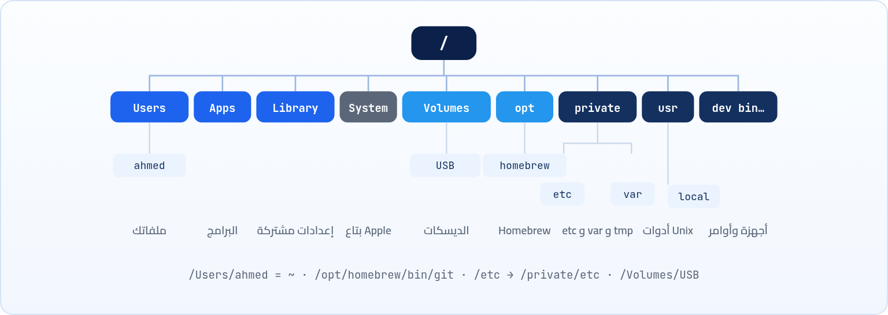
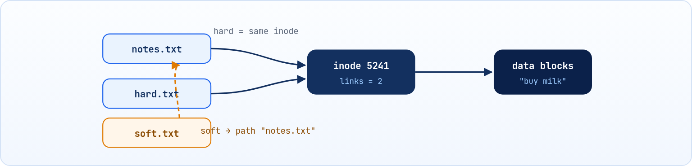

<small>المرحلة 2 · الملفات والصلاحيات</small>

إنت متعود تشوف ملفاتك من الـ Finder: Desktop و Downloads و Applications، وكله شكله مرتب ولطيف. بس أول ما تكتب ls / في الـ Terminal هتلاقي أسامي غريبة زي private و usr و Volumes و opt، وتقول "هو ده نفس الجهاز؟". أيوه هو، بس إنت كنت شايف نص الحقيقة. الفصل ده بيديك الخريطة الكاملة للماك: كل مجلد فيه إيه، وفين Homebrew بيسطّب حاجاته، وإزاي تكتب أي مسار صح، ويعني إيه inode، والفرق بين الـ Hard link والـ Soft link.

:::note[بعد الفصل ده هتكون عارف]
- فكرة الشجرة الواحدة و "كل حاجة ملف"
- خريطة الماك: /Users و /Applications و /Library و ~/Library و /System و /Volumes و /opt/homebrew و /private
- ليه /etc و /tmp على الماك Links لـ /private
- المسار المطلق والنسبي، و ~ و . و ..
- الملفات المخفية، وإن الماك مش حساس لحالة الحروف افتراضياً
- يعني إيه inode، والفرق بين Hard link و Soft link و Alias بتاع الـ Finder
- الديسكات على الماك: df و du و diskutil، ومقارنة بـ FHS بتاع Linux
:::

<a id="s4-1"></a>

## 4.1 المشكلة: الـ Finder مش بيقولك كل حاجة

افتح الـ Finder ودوس على **Macintosh HD**. هتلاقي 4 مجلدات بس تقريباً: `Applications` و `Library` و `System` و `Users`. شكلها نضيف وبسيط، صح؟ طب تعالى نسأل الـ Terminal نفس السؤال:

```sh title="Terminal"
$ ls /
Applications	System	Volumes	cores	etc	opt	sbin	usr
Library	Users	bin	dev	home	private	tmp	var
```

إيه ده كله؟ `bin` و `etc` و `private` و `usr`؟ دول كانوا فين؟ الحقيقة إن الماك تحت الواجهة الحلوة دي نظام **Unix** كامل (فاكر حكاية BSD في [↩ 2.6](../ch02/#s2-6 "ليه أوامر من النت مبتشتغلش على الماك؟ BSD ضد GNU")؟). و Apple عملت حاجة ذكية: سابت مجلدات Unix في مكانها علشان كل الأدوات تشتغل، بس خبّتها من الـ Finder علشان المستخدم العادي ميتلخبطش ولا يمسح حاجة بالغلط.

:::note[شوف الحاجات المخفية في الـ Finder]
في أي شباك Finder دوس <kbd>Cmd+Shift+.</kbd> (نقطة)، وهتلاقي المجلدات المخفية ظهرت باهتة. دوس نفس الزراير تاني علشان تخفيها. ولو عايز تروح لأي مسار بالكتابة: <kbd>Cmd+Shift+G</kbd> واكتب `/usr/local` مثلاً.
:::

وخلينا نتفق على فكرتين أساسيتين هتمشي معاك طول الكتاب. الأولى: فيه **شجرة واحدة بس** بتبدأ من الجذر `/` (اسمه Root). مفيش `C:` و `D:` زي Windows. أي ديسك أو فلاشة بتوصلها بتتركّب (Mount) كمجلد جوه الشجرة دي، وعلى الماك المكان ده هو `/Volumes`. والتانية قاعدة مشهورة في عالم Unix: <strong>"كل حاجة ملف"</strong>. الديسك نفسه ملف في `/dev` (زي `/dev/disk3`)، والـ Terminal اللي بتكتب فيه ملف (فاكر `/dev/ttys000`؟)، وحتى "الزبالة" اللي بترمي فيها الناتج اللي مش عايزه ملف اسمه `/dev/null`.

<a id="s4-2"></a>

## 4.2 خريطة المجلدات على الماك

تخيل الماك عمارة. فيه دور لـ Apple بس محدش يلمسه، وفيه شقة لكل ساكن، وفيه مخزن مشترك، وفيه جراج للعربيات اللي بتيجي وتمشي. خلينا نلف على العمارة دي دور دور:



*شجرة الماك: واحدة بتبدأ من /، وكل مجلد ليه دور.*

**أهم المجلدات على الماك وفيها إيه**

| المجلد | فيه إيه؟ | مثال |
|---|---|---|
| `/` | الجذر، أبو كل حاجة |   |
| `/Users` | مجلد لكل مستخدم ("شقته")، فيه Desktop و Documents و Downloads وإعداداته | `/Users/ahmed` (و `~` اختصاره) |
| `/Applications` | البرامج اللي بتشوفها في Launchpad. كل برنامج `.app` هو في الحقيقة **مجلد** | `/Applications/Safari.app` |
| `~/Library` | إعدادات وبيانات البرامج **بتاعتك إنت**: Preferences و Application Support و Caches و Logs و LaunchAgents. مخفي في الـ Finder | `~/Library/Application Support/Code` |
| `/Library` | نفس الفكرة بس لكل المستخدمين على الجهاز (محتاج أدمن) | `/Library/LaunchDaemons` |
| `/System` | النظام نفسه بتاع Apple. **للقراية بس** ومحمي، حتى root ميقدرش يعدّل فيه | `/System/Applications` |
| `/Volumes` | "الجراج": كل ديسك أو فلاشة أو ملف `.dmg` بتفتحه بيتركّب هنا | `/Volumes/USB` |
| `/opt/homebrew` | كل حاجة بتسطبها بـ Homebrew على أجهزة **Apple Silicon** (M1 وما بعدها) | `/opt/homebrew/bin/node` |
| `/usr/local` | برامج إنت سطّبتها بنفسك، ومكان Homebrew على أجهزة **Intel** القديمة | `/usr/local/bin` |
| `/usr/bin` و `/bin` و `/sbin` | أدوات Unix اللي جاية مع الماك (sbin = للأدمن). محمية زي `/System` | `/bin/zsh`، `/usr/bin/grep` |
| `/private/etc` | ملفات **الإعدادات** بتاعة Unix (نصوص عادية). و `/etc` مجرد Link ليه | `/etc/hosts`، `/etc/shells`، `/etc/ssh/` |
| `/private/var` | بيانات **بتتغير** (Variable): Logs و Caches. و `/var` Link ليه | `/var/log`، `/var/folders` |
| `/private/tmp` | ملفات مؤقتة لأي حد، بتتمسح مع الـ Restart. و `/tmp` Link ليه | `/tmp/test.txt` |
| `/dev` | الأجهزة كملفات | `/dev/disk3`، `/dev/null` |

طب ليه `/etc` و `/var` و `/tmp` جوه حاجة اسمها `private`؟ ده موروث من نظام قديم اسمه NeXTSTEP (اللي الماك اتولد منه)، وكانت الفكرة إن الحاجات الخاصة بكل جهاز تبقى في مكان واحد. ولما تبص بعينك هتلاقيها Links:

```sh title="Terminal"
$ ls -ld /etc /tmp /var
lrwxr-xr-x@ 1 root  wheel  11 Sep 14 09:00 /etc -> private/etc
lrwxr-xr-x@ 1 root  wheel  11 Sep 14 09:00 /tmp -> private/tmp
lrwxr-xr-x@ 1 root  wheel  11 Sep 14 09:00 /var -> private/var
```

**تشريح الأمر**

```sh
ls -ld /etc /tmp /var
```

1. `ls`: اعرض ([↩ 5.1](../ch05/#s5-1 "إنت فين؟ وفيه إيه هنا؟ pwd و ls")).
2. `-ld`: اتنين مدموجين: `-l` (Long: تفاصيل) و `-d` (Directory: اعرض المجلد نفسه مش اللي جواه).
3. `/etc /tmp /var`: تلات Arguments: اعرض التلاتة. والـ `l` في أول السطر والسهم `->` معناهم إنهم Soft links (هنفهمها في آخر الفصل)، والـ `@` بعد الصلاحيات معناها إن عليهم Extended attributes ([↩ 6.7](../ch06/#s6-7 "حماية الماك الزيادة: الـ Extended attributes والـ Quarantine")).

:::note[البرنامج .app ده مجلد!]
جرّب `ls /Applications/Safari.app/Contents`. هتلاقي مجلدات زي `MacOS` و `Resources` وملف `Info.plist`. الـ Finder بيعرض المجلد ده كأنه ملف واحد علشان يبقى سهل، والاسم الرسمي ليه **Bundle**. والبرنامج الحقيقي اللي بيشتغل جوه `Contents/MacOS`. وتقدر تفتح أي برنامج من الـ Terminal بـ `open -a Safari` ([↩ 14.3](../ch14/#s14-3 "أدوات الماك اللي مش في أي حتة تانية")).
:::

:::note[لو حابب تتعمق: مفيش /proc على الماك]
على Linux فيه مجلد سحري اسمه `/proc` فيه ملفات **وهمية** بيولّدها الـ Kernel لحظياً: الذاكرة والـ CPU وكل Process برقمها. الماك **معندوش** `/proc`. بدل كده بتسأل الـ Kernel مباشرة بأمر اسمه `sysctl`:

**تشريح الأمر**

```sh
sysctl -n hw.memsize machdep.cpu.brand_string
```

1. `sysctl`: SYStem ConTroL: اقرا (أو غيّر) إعدادات ومعلومات الـ Kernel.
2. `-n`: اطبع القيمة بس من غير اسم المفتاح قبلها.
3. `hw.memsize`: مفتاح: حجم الرامات بالـ Bytes (يعني `17179869184` = 16 GB).
4. `machdep.cpu.brand_string`: مفتاح تاني: اسم الـ CPU، زي `Apple M3`. والمفاتيح مكتوبة بنقط زي العناوين: `hw` = Hardware.

وفيه كمان `vm_stat` لتفاصيل الذاكرة، و `sysctl -a | grep cpu` لو عايز تتفرج على كل المفاتيح اللي فيها cpu.
:::

:::note[على Linux: خريطة FHS]
السيرفرات ماشية على معيار اسمه **FHS** (Filesystem Hierarchy Standard). أغلب الأسماء هتعرفها: `/etc` و `/var` و `/tmp` و `/usr` و `/dev` (بس من غير `private`). والمختلف: `/home/ahmed` بدل `/Users/ahmed`، و `/root` هو home بتاع root، و `/proc` و `/sys` للمعلومات اللحظية (`head -n 3 /proc/meminfo`)، و `/boot` للـ Kernel وملفات الإقلاع، و `/mnt` و `/media` بدل `/Volumes`، و `/opt` لبرامج الطرف التالت، و `/var/log/syslog` للـ Logs، و `/run` و `/srv`. والماك نفسه فيه مجلد `/home` بس فاضي ومش مستخدم.
:::

<a id="s4-3"></a>

## 4.3 المسارات: المطلق والنسبي

تخيل إنك بتوصف لصاحبك مكان بيتك. ممكن تقوله العنوان الكامل: "القاهرة، مدينة نصر، شارع عباس العقاد، عمارة 5". العنوان ده هيوصله من أي حتة في الدنيا. وممكن لو هو واقف قدام المسجد اللي جنبك تقوله "تاني شارع يمين". ده أقصر، بس مش هيفهم منه حاجة لو كان واقف في إسكندرية. المسارات (Paths) في الـ Terminal نفس الحكاية بالظبط، وفيه نوعين:

#### مسار مطلق (Absolute)

بيبدأ بـ `/` من الجذر، وبيوصل لنفس المكان مهما إنت فين: `/Users/ahmed/projects/web`. زي العنوان الكامل بالمحافظة والشارع.

#### مسار نسبي (Relative)

مبيبدأش بـ `/`، وبيتحسب من المجلد اللي إنت واقف فيه دلوقتي: `projects/web` أو `../docs`. زي "تاني شارع يمين من هنا".

**الرموز الخاصة في المسارات**

| الرمز | المعنى | مثال |
|---|---|---|
| `/` | في الأول: الجذر. في النص: فاصل بين المجلدات | `/etc/ssh` |
| `.` | المجلد الحالي | `./run.sh`، `cp a.txt .`، `open .` |
| `..` | المجلد اللي فوقي (الأب) | `cd ..`، `../../etc` |
| `~` | الـ home بتاعك (الـ Shell بيحولها لـ `/Users/ahmed`) | `~/Downloads` |
| `~sara` | الـ home بتاع مستخدم تاني | `ls ~sara` |
| `-` (مع cd بس) | المجلد اللي كنت فيه قبل كده | `cd -` |

**تشريح الأمر**

```sh
cd ../../etc
```

1. `cd`: Change Directory (Builtin، [↩ 1.3](../ch01/#s1-3 "الـ Builtin مقابل البرنامج الخارجي")).
2. `..`: اطلع مجلد لفوق.
3. `/`: فاصل بين خطوة والتانية.
4. `../`: اطلع مجلد كمان لفوق. (لو إنت في `/Users/ahmed` كده وصلت `/`).
5. `etc`: وبعدين ادخل `etc`. النتيجة: `/etc`، اللي هو في الحقيقة `/private/etc`. ولو كتبت `pwd -P` هيقولك المسار الحقيقي بعد ما يفك الـ Links.

:::tip[متكتبش المسار، اسحبه!]
أحلى حركة على الماك: اسحب أي ملف أو مجلد من الـ Finder وارميه جوه شباك الـ Terminal، وهيتكتب مساره الكامل لوحده، وكمان بيحط `\` قبل المسافات. والعكس: `open .` بتفتح المجلد اللي إنت واقف فيه في الـ Finder.
:::

:::caution[3 حاجات بتوقع الناس]
- <strong>الحروف مش حساسة على الماك، بس حساسة على السيرفر:</strong> الـ Filesystem بتاع الماك (اسمه **APFS**) افتراضياً <em>Case-insensitive</em>: يعني `Report.txt` و `report.txt` نفس الملف، رغم إنه بيحفظ الاسم بالشكل اللي كتبته. على Linux دول ملفين مختلفين. والفرق ده بيعمل مشاكل حقيقية: تعمل `import './Header.js'` والملف اسمه `header.js`، يشتغل عندك ويبوظ على السيرفر. اعرف نوع الديسك بتاعك بـ `diskutil info / | grep -i personality`.
- <strong>المسافات:</strong> ملف اسمه `my file.txt` لازم يتكتب `"my file.txt"` أو `my\ file.txt`، وإلا الـ Shell هيعتبره ملفين ([↩ 7.5](../ch07/#s7-5 "الـ Quoting: إمتى الـ Shell يفهم الرموز وإمتى لأ")). وعلى الماك هتقابل ده كتير، زي `~/Library/Application Support`.
- <strong>الامتداد مالوش لازمة للنظام:</strong> `.txt` و `.sh` مجرد جزء من الاسم. عشان تعرف الملف نوعه إيه بجد استخدم `file` ([↩ 5.6](../ch05/#s5-6 "تفاصيل الملف: file و stat و tree")).
:::

<strong>الملفات المخفية:</strong> أي ملف أو مجلد اسمه بيبدأ بنقطة (`.zshrc`، `.ssh/`) بيبقى مخفي، ومبيظهرش غير بـ `ls -a`. ده مجرد عُرف، مش حماية. وعشان كده ملفات الإعدادات اسمها "Dotfiles". والماك عنده كمان طريقة تانية للإخفاء بعلامة اسمها `hidden` (ده اللي مخبّي `~/Library`)، وتشيلها بـ `chflags nohidden ~/Library`. وهتلاقي في كل مجلد فتحته بالـ Finder ملف مخفي اسمه `.DS_Store`: ده الـ Finder بيحفظ فيه شكل الأيقونات وترتيبها، ودايماً حطه في `.gitignore`.

<a id="s4-4"></a>

## 4.4 جوه الملف: الـ inode

هنا هنعمل حاجة شبه ما تفك الموبايل وتشوف جواه. لما بتشوف ملف اسمه `notes.txt` في الـ Finder، إنت متخيل إن الاسم ده هو الملف. بس الحقيقة إن الاسم مجرد "يافطة". عشان تفهم الـ Links لازم تعرف إن اسم الملف **مش** هو الملف. الملف الحقيقي عبارة عن **inode**: رقم جوه الـ Filesystem مربوط بيه البيانات والصلاحيات والمالك والتواريخ والحجم. والاسم ده مجرد "يافطة" في المجلد بتشاور على الـ inode، زي اسم في الـ Contacts بيشاور على رقم تليفون. وينفع يبقى عندك اسمين بيشاوروا على نفس الرقم.



*الـ Hard link اسم تاني لنفس الـ inode. الـ Soft link ملف صغير فيه "مسار" لاسم تاني.*

**تشريح الأمر**

```sh
ls -li
```

1. `ls`: اعرض محتويات المجلد ([↩ 5.1](../ch05/#s5-1 "إنت فين؟ وفيه إيه هنا؟ pwd و ls")).
2. `-li`: اتنين مدموجين: `-l` (Long: تفاصيل) و `-i` (Inode: اعرض رقم الـ inode في أول عمود). لاحظ: `-i` هنا مش interactive، ده فخ تاني من فخاخ [↩ 2.5](../ch02/#s2-5 "الـ Flags المشتركة: القاموس الكبير").

<a id="s4-5"></a>

## 4.5 الـ Hard link والـ Soft link

طب الكلام ده هيفيدني في إيه؟ هتلاقيه في كل حتة من غير ما تاخد بالك. مثلاً لما بتسطّب `git` بـ Homebrew، البرنامج الحقيقي بيتحط في مجلد عميق جداً اسمه `Cellar`، و Homebrew بيعمل "يافطة" صغيرة في `/opt/homebrew/bin` بتشاور عليه، علشان الـ PATH يلاقيه. اتفرج:

```sh title="Terminal"
$ ls -l /opt/homebrew/bin/git
lrwxr-xr-x  1 ahmed  admin  29 Oct  2 11:20 /opt/homebrew/bin/git -> ../Cellar/git/2.51.0/bin/git
```

الحاجة دي اسمها **Soft link**. وتعالى نعمل الاتنين بإيدنا ونشوف الفرق:

```sh title="Terminal"
$ echo "buy milk" > notes.txt
$ ln notes.txt hard.txt
$ ln -s notes.txt soft.txt
$ ls -li
12893301 -rw-r--r--  2 ahmed  staff  9 Oct 22 10:01 hard.txt
12893301 -rw-r--r--  2 ahmed  staff  9 Oct 22 10:01 notes.txt
12893355 lrwxr-xr-x  1 ahmed  staff  9 Oct 22 10:01 soft.txt -> notes.txt
```

- `notes.txt` و `hard.txt` ليهم **نفس رقم الـ inode** (12893301)، والعمود التالت (2) هو عدد الأسماء اللي بتشاور عليه.
- `soft.txt` ليه inode مختلف، وأول حرف `l` (Link)، وبيشاور بـ `->` على الاسم.
- و `staff` هو الجروب الافتراضي لأي مستخدم على الماك (على Linux غالباً الجروب باسمك إنت). هنفهم الجروبات في [↩ 6.5](../ch06/#s6-5 "المستخدمين والجروبات").

**تشريح الأمر**

```sh
ln -s ~/tools/node-v22.11 ~/tools/node-current
```

1. `ln`: LiNk: اعمل Link. من غير Options بيعمل Hard link.
2. `-s`: Symbolic: اعمل Soft link بدل Hard. ودايماً الترتيب **زي cp**: الأصل الأول، وبعدين الاسم الجديد.
3. `~/tools/node-v22.11`: الهدف (Target): الحاجة الحقيقية.
4. `~/tools/node-current`: اسم الـ Link الجديد. ولو عايز تحدّثه بعدين لنسخة جديدة: `ln -sfn` (`-f` = اكتب فوق القديم، `-n` = متدخلش جوه الـ Link لو بيشاور على مجلد). والـ `-n` دي موجودة في `ln` بتاع الماك ومعناها نفس `-h`.

**Hard مقابل Soft مقابل Alias بتاع الـ Finder**

|   | Hard link | Soft (Symbolic) link | Finder Alias |
|---|---|---|---|
| بيتعمل إزاي | `ln target name` | `ln -s target name` | كليك يمين ← Make Alias |
| هو إيه | اسم تاني لنفس الـ inode | ملف صغير جواه مسار | ملف خاص بالماك بيفتكر الهدف حتى لو اتنقل |
| لو مسحت الأصل | البيانات فاضلة (لسه فيه اسم) | الـ Link يبوظ (Dangling) | يبوظ |
| على مجلد؟ | لأ | أيوه | أيوه |
| بين ديسكين مختلفين؟ | لأ (نفس الـ Filesystem بس) | أيوه | أيوه |
| الـ Terminal بيفهمه؟ | أيوه | أيوه | **لأ**: `cd` مش هيدخل جواه |
| استخدام شائع | Time Machine و Backups، نادر يدوياً | Homebrew، "current" لنسخة برنامج، Dotfiles | اختصارات في الـ Finder بس |

:::tip[حاجة مشتركة]
الـ Soft links بتظهر في أوامر كتير بخيارات مشتركة: `cp -L` و `find -L` و `ls -L` بيـ"تبعوا" الـ Links ويتعاملوا مع الهدف. ولو عايز المسار الحقيقي اللي الـ Link بيوصله: `readlink -f soft.txt` أو `realpath soft.txt`. ومن غير `-f`، `readlink` بيطبع اللي مكتوب جوه الـ Link بس.
:::

<a id="s4-6"></a>

## 4.6 الديسكات والمساحة

أكيد جالك قبل كده إشعار "Your disk is almost full"، وفتحت **System Settings ← General ← Storage** ولقيت لون رمادي كبير مكتوب عليه "System Data" ومحدش عارف فيه إيه. الـ Terminal هنا بيديك إجابات أوضح بكتير. خلينا نبدأ بالسؤال الأول: فاضل كام؟

**تشريح الأمر**

```sh
df -h ~
```

1. `df`: Disk Free: المساحة المستخدمة والفاضية لكل Filesystem متركّب.
2. `-h`: Human-readable: بـ Gi و Mi بدل أرقام الـ Blocks.
3. `~`: اختياري: اعرض بس الديسك اللي عليه المسار ده (الـ home). من غيره بيعرض كله.

```sh title="Terminal"
$ df -h ~
Filesystem      Size    Used   Avail Capacity iused ifree %iused  Mounted on
/dev/disk3s5   460Gi   201Gi   244Gi    46%  2.1M  2.5G    0%   /System/Volumes/Data
```

العمود الأخير **Mounted on** هو المجلد اللي الديسك ده متركّب عليه في الشجرة. ولاحظ حاجة غريبة: ملفاتك مش على `/`، دي على `/System/Volumes/Data`! والعواميد `iused` و `ifree` هي عدد الـ inodes المستخدمة والفاضية، اللي لسه فاهمينها فوق.

:::note[لو حابب تتعمق: الديسك متقسم لنصين]
من macOS Catalina، Apple قسمت الديسك لـ **Volumes** كذا جوه نفس الـ Container: Volume للنظام اسمه **Signed System Volume**، ده للقراية بس ومختوم بتوقيع Apple، فلو اتغير فيه حرف الجهاز مش هيقوم. و Volume تاني للبيانات (`Data`) فيه ملفاتك وبرامجك. والاتنين بيتعرضوا قدامك كأنهم شجرة واحدة بفضل حاجة اسمها **firmlinks**، علشان كده `/Users` شكله جوه `/` وهو في الحقيقة على الـ Data volume. شوف بنفسك بـ `diskutil list`، وبيان أي Volume بـ `diskutil info /`.
:::

وعشان تعرف مين واكل المساحة، استخدم `du` (Disk Usage):

**تشريح الأمر**

```sh
du -h -d 1 ~ | sort -h
```

1. `du`: Disk Usage: حجم الملفات والمجلدات.
2. `-h`: Human-readable زي اللي في df.
3. `-d 1`: Depth: ادخل مستوى واحد بس، يعني اديني رقم لكل مجلد جوه الـ home. (على Linux الشكل الطويل `--max-depth=1`، و `-d` شغالة برضه).
4. `~`: ابدأ من الـ home.
5. `| sort -h`: رتّب الناتج من الصغير للكبير، و `-h` هنا معناها "افهم الأحجام اللي فيها K و M و G" ([↩ 8.6](../ch08/#s8-6 "sort و uniq: رتّب وشيل المكرر")). فأكبر مجلد هيبقى آخر سطر.

ولو عايز رقم واحد بس لمجلد: `du -sh ~/Library/Caches` (`-s` = Summary). هتتفاجئ بحجم الـ Caches و `node_modules`!

:::note[على Linux]
على Linux الـ `df -h` بيطلع عمود `Use%` بدل `Capacity` ومن غير عواميد الـ inodes (بتشوفها بـ `df -i`)، والديسك اسمه حاجة زي `/dev/nvme0n1p2`، وبتشوف الديسكات وتقسيماتها بـ `lsblk` بدل `diskutil list`.
:::

<a id="s4-7"></a>

## 4.7 مشاكل شائعة

:::danger[مشكلة: No such file or directory مع إن الملف موجود]
غالباً بتكتب مسار نسبي وإنت واقف في مجلد غير اللي فاكره، أو فيه مسافة في الاسم زي `Application Support`.

<strong>الحل:</strong> `pwd` عشان تعرف إنت فين، و `ls` عشان تشوف الأسماء بالظبط، واستخدم <kbd>Tab</kbd> عشان الـ Shell يكمّل الاسم صح ([↩ 14.5](../ch14/#s14-5 "الـ Tab Completion"))، أو اسحب الملف من الـ Finder للـ Terminal.
:::

:::danger[مشكلة: Operation not permitted وإنت بتعمل ls على Desktop أو Downloads]
كتبت `ls ~/Desktop` أو `ls ~/Library/Mail` وطلع `Operation not permitted`، مع إنها ملفاتك إنت! ده مش نظام الصلاحيات العادي، ده نظام حماية الخصوصية بتاع الماك: كل برنامج (ومنهم Terminal.app) لازم ياخد إذن علشان يقرا المجلدات دي.

<strong>الحل:</strong> هتلاقي نافذة بتسألك "Terminal would like to access files in your Desktop folder"، دوس **Allow**. ولو رفضت قبل كده: **System Settings ← Privacy & Security ← Files and Folders** (أو **Full Disk Access**) وفعّل Terminal. التفاصيل في [↩ 6.8](../ch06/#s6-8 "SIP و Full Disk Access: حتى root ليه حدود").
:::

:::danger[مشكلة: Soft link بيقول No such file]
الهدف اتمسح أو اتنقل، أو الـ Link معمول بمسار نسبي واتنقل لمكان تاني. (وده بيحصل كتير مع Homebrew بعد ما برنامج يتحدّث).

<strong>الحل:</strong> `readlink soft.txt` تشوف بيشاور على إيه، وأعد عمله بـ `ln -sfn`. ولو هتنقل الـ Link، اعمله بمسار مطلق. ولو المشكلة في Homebrew: `brew link --overwrite اسم_الحزمة` أو `brew doctor`.
:::

:::tip[ملخص الفصل]
- شجرة واحدة من `/`، والديسكات بتتركّب في `/Volumes`، وكل حاجة ملف. والـ Finder بيخبّي مجلدات Unix (<kbd>Cmd+Shift+.</kbd> تظهرها).
- `/Users` ملفاتك، `/Applications` البرامج (كل `.app` مجلد)، `~/Library` إعداداتك، `/Library` مشترك، `/System` بتاع Apple ومقفول، `/opt/homebrew` لـ Homebrew على Apple Silicon (و `/usr/local` على Intel).
- `/etc` و `/var` و `/tmp` Links لـ `/private`. ومفيش `/proc`: استخدم `sysctl`.
- المطلق بيبدأ بـ `/`، والنسبي من مكانك. `.` هنا، `..` فوق، `~` الـ home. والماك مش حساس لحالة الحروف افتراضياً، والسيرفر حساس.
- الاسم بيشاور على inode. الـ Hard link اسم تاني لنفس الـ inode، والـ Soft link ملف فيه مسار، والـ Finder Alias الـ Terminal مبيفهموش.
- `df -h` للمساحة الفاضية، `du -h -d 1` لمين واكلها، `diskutil list` للديسكات.
:::

### صح ولا غلط؟

1. لو مسحت الملف الأصلي، الـ Hard link بيفضل شغال.
2. الماك فيه مجلد `/proc` زي Linux.
3. على الماك، `Report.txt` و `report.txt` افتراضياً نفس الملف.
4. `../a.txt` مسار مطلق.

### أسئلة مراجعة

1. فين تدوّر على ملف إعدادات SSH؟ وفين إعدادات VS Code بتاعتك؟ وفين برنامج سطبته بـ Homebrew على جهاز M2؟
2. إنت في `/Users/ahmed/projects/web`. اكتب مسار نسبي يوصلك لـ `/Users/ahmed/Downloads`.
3. ليه مينفعش تعمل Hard link لمجلد أو لملف على فلاشة تانية؟
4. ليه `ls -l /etc` بيوريك سهم؟ والمسار الحقيقي فين؟
5. إزاي تعرف أكبر 3 مجلدات جوه الـ home؟

### تحديات الفصل

<small>جرّبها بإيدك، والحلول في ملحق الإجابات.</small>

1. **[سهل]** ادخل كل مجلد من الجدول 4.1 بـ `cd` واعمل `ls`، وارجع بـ `cd -`. وجرّب `open .` في كل واحد.
2. **[سهل]** اعرف رقم الرامات واسم الـ CPU بـ `sysctl`، واعرف نوع الـ Filesystem بـ `diskutil info /`.
3. **[متوسط]** اعمل ملف، وHard link، وSoft link، وبعدين امسح الأصل، وجرّب `cat` على الاتنين. فسّر اللي حصل.
4. **[متوسط]** جرّب: `touch Test.txt` وبعدين `ls test.txt`. إيه اللي حصل؟ وليه ده ممكن يبوظ مشروع JavaScript على السيرفر؟
5. **[صعب]** ادخل جوه `/Applications/Calculator.app` (أو `/System/Applications/Calculator.app`) ولاقي الملف التنفيذي الحقيقي، وشغله من الـ Terminal بالمسار بتاعه.
