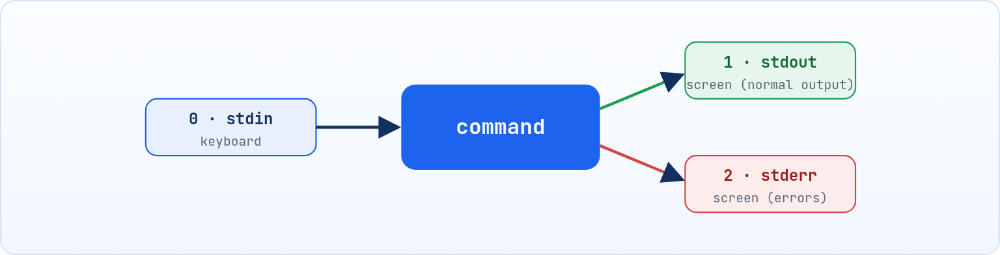

<small>المرحلة 3 · قوة الـ Shell</small>

لحد دلوقتي كنا بنستخدم الـ Terminal كأنه Finder بالكتابة: افتح، انسخ، امسح. الفصل ده هو اللحظة اللي هتقول فيها "آاااه، هو ده ليه الناس بتحبه!". هنا الأوامر الصغيرة بتتركب في بعض زي الليجو: أمر يطلّع داتا، والتاني يفلترها، والتالت يعدّها، والرابع يحفظها في ملف أو ينسخها على الـ Clipboard. والرموز اللي بتخوف في أوامر الناس (\<code\>&gt;\</code\> و \<code\>2&gt;&amp;1\</code\> و \<code\>|\</code\> و \<code\>$()\</code\> و \<code\>\*\</code\> و \<code\>&amp;&amp;\</code\>) كلها هتتفك هنا رمز رمز.

:::note[بعد الفصل ده هتكون عارف]
- الـ Streams التلاتة: stdin و stdout و stderr
- الـ Redirection و Here-doc: \<code\>&gt; &gt;&gt; &lt; 2&gt; 2&gt;&amp;1\</code\>
- الـ Pipe وإزاي الأوامر بتتركب
- الـ Globbing: \<code\>\* ? \[\] {}\</code\>
- الـ Quoting: \<code\>'' "" \\ $()\</code\> والـ Backticks
- الـ Exit codes و \<code\>&amp;&amp;\</code\> و \<code\>;\</code\> والـ OR
:::

:::tip[الفصل ده كله حاجة مشتركة]
كل الرموز هنا مش تبع أمر معين. ده شغل **الـ Shell نفسه** قبل ما الأمر يشتغل ([↩ 1.2](../ch01/#s1-2 "إيه اللي بيحصل لما تدوس Enter؟")). يعني `>` بتشتغل مع `ls` و `grep` و `python` وأي حاجة. اتعلمها مرة واحدة، واستخدمها مع كل الأوامر.
:::

<a id="s7-1"></a>

## 7.1 الـ Streams التلاتة

خلينا نبدأ بسؤال: لما تكتب `ls` والأسماء تظهر قدامك، هي "راحت" فين؟ وليه لما الأمر يفشل الرسالة الحمرا بتظهر في نفس المكان؟ تخيل كل برنامج كأنه مطبخ مطعم صغير: ليه شباك بيستلم منه الطلبات، وشباك بيطلّع منه الأكل، وشباك تالت بيطلّع منه الشكاوي لو حصلت مشكلة. الشبابيك دي موجودة في كل برنامج من غير استثناء، وده اللي بيخلي البرامج تقدر تتكلم مع بعض.

أي برنامج بيتولد ومعاه 3 "قنوات" مفتوحة، ولكل واحدة رقم اسمه **File Descriptor** (fd):



*كل أمر: مدخل واحد (0) ومخرجين (1 للنتيجة و 2 للأخطاء). الاتنين بيروحوا للشاشة افتراضياً.*

ليه مخرجين؟ عشان لو حولت النتيجة لملف، الأخطاء تفضل قدامك على الشاشة ومتتخلطش بالبيانات. وفيه ملف خاص اسمه `/dev/null`: "ثقب أسود" أي حاجة بتتكتب فيه بتختفي.

<a id="s7-2"></a>

## 7.2 الـ Redirection: وجّه الـ Streams

طب ما دام الأكل بيطلع من شباك، إيه رأيك نحط تحته علبة بدل ما يقع على الشاشة؟ ده بالظبط الـ Redirection. مثلاً عايز تبعت لزميلك لستة بكل الملفات اللي في مشروعك: بدل ما تعمل Screenshot أو تنسخ من الشاشة، بتكتب `ls > files.txt` والناتج يروح على طول في ملف. الجدول ده فيه كل الرموز اللي هتقابلها، وبعده هنشرّح أهمهم:

**كل رموز الـ Redirection**

| الرمز | المعنى | مثال |
|---|---|---|
| `>` | stdout لملف، **يمسح** القديم (= `1>`) | `ls > list.txt` |
| `>>` | stdout لملف، **يضيف** في الآخر | `date >> log.txt` |
| `<` | stdin من ملف بدل الكيبورد | `wc -l < list.txt` |
| `2>` | stderr لملف | `find / -name x 2> err.txt` |
| `2>/dev/null` | اخفي الأخطاء | `find / -name x 2>/dev/null` |
| `2>&1` | ودّي stderr لنفس مكان stdout | `cmd > all.log 2>&1` |
| `&>` | الاتنين لملف (bash/zsh اختصار) | `cmd &> all.log` |
| `<<EOF` | Here-doc: نص متعدد السطور كـ stdin | تحت |
| `<<<` | Here-string: سطر واحد كـ stdin | `wc -w <<< "a b c"` |
| `>\|` | اكتب فوق الملف حتى لو noclobber شغال (و zsh بيقبل كمان `>!`) | `ls >\| list.txt` |

**تشريح الأمر**

```sh
./backup.sh > backup.log 2>&1
```

1. `./backup.sh`: الأمر اللي هيتنفذ (`./` = من المجلد الحالي، [↩ 1.4](../ch01/#s1-4 "الـ PATH: إزاي الـ Shell بيلاقي البرنامج؟")).
2. `>`: وجّه stdout (fd 1) لـ...
3. `backup.log`: الملف ده. لو موجود بيتمسح ويتكتب من الأول.
4. `2>&1`: `2` = stderr، و `>` = وجّه، و `&1` = "لنفس مكان fd رقم 1". الـ `&` هنا معناها "ده رقم fd مش اسم ملف"؛ من غيرها هيعمل ملف اسمه `1`!

:::caution[الترتيب مهم]
`cmd > f 2>&1` صح: الأول stdout راح للملف، وبعدين stderr راح "لنفس مكان stdout" = الملف. لكن `cmd 2>&1 > f` غلط: stderr راح لمكان stdout **القديم** (الشاشة)، وبعدين stdout بس راح للملف. الـ Shell بيقرا من الشمال لليمين.
:::

**تشريح الأمر**

```sh
cat <<'EOF' > config.ini
[server]
port = $PORT
EOF
```

1. `cat`: اطبع اللي داخلك على stdin.
2. `<<`: Here-doc: اقرا stdin من السطور الجاية لحد ما تلاقي الكلمة الفاصلة.
3. `'EOF'`: الكلمة الفاصلة (أي كلمة، بس EOF متعارف عليها). الـ **Quotes** حواليها معناها "متفكش `$PORT`"؛ من غيرها الـ Shell هيحط قيمة المتغير ([↩ 7.5](#s7-5 "الـ Quoting: إمتى الـ Shell يفهم الرموز وإمتى لأ")).
4. `> config.ini`: والناتج يتكتب في الملف.
5. `EOF`: سطر النهاية: لازم يكون لوحده في السطر ومن غير مسافات قبله (إلا لو استخدمت `<<-` مع Tabs).

:::tip[احمي نفسك من الكتابة فوق الملفات بالغلط]
`setopt noclobber` في zsh (أو `set -o noclobber` في bash) بيخلي `>` ترفض تكتب فوق ملف موجود وتقولك `file exists`. حطها في `~/.zshrc`، وأكتر عن المخاطر في [↩ 15.5](../ch15/#s15-5 "‎> اللي بيمسح من غير ما يسأل").
:::

<a id="s7-3"></a>

## 7.3 الـ Pipe |: ركّب الأوامر

هنا بقى السحر الحقيقي. في السبعينات، واحد اسمه Doug McIlroy كان شغال في Bell Labs، وكان عنده فكرة بسيطة جداً: "بدل ما نعمل برنامج عملاق بيعمل كل حاجة، نعمل برامج صغيرة كل واحد بيعمل حاجة واحدة بس، ونوصلهم ببعض زي مواسير المية". والفكرة دي اتحولت لرمز واحد: `|`، واسمه **Pipe** يعني ماسورة. ولحد النهارده، بعد 50 سنة، ده أقوى رمز في الـ Terminal.

الـ `|` بتوصل **stdout** أمر بـ **stdin** الأمر اللي بعده. كل أمر بيعمل حاجة واحدة صغيرة كويس، والـ Pipe بيخليهم فريق. دي فلسفة Unix كلها.

**تشريح الأمر**

```sh
cat access.log | grep " 404 " | wc -l
```

1. `cat access.log`: اطبع اللوج كله على stdout.
2. `|`: Pipe: خد stdout اللي فات وخليه stdin للي جاي. الأوامر التلاتة بيشتغلوا **في نفس الوقت**، والبيانات بتعدي بينهم.
3. `grep " 404 "`: سيب السطور اللي فيها 404 بس ([↩ 8.1](../ch08/#s8-1 "grep: دوّر على سطور")).
4. `|`: Pipe تاني.
5. `wc -l`: عِد السطور ([↩ 8.7](../ch08/#s8-7 "wc: عِد السطور والكلمات")).

:::note[الـ cat الزيادة]
`grep " 404 " access.log | wc -l` نفس النتيجة من غير `cat`، لأن معظم الأوامر بتاخد اسم ملف. بل `grep -c " 404 " access.log` لوحده بيعد. بس `cat file |` مش جريمة وبتسهّل القراية.
:::

| الأمر | بيعمل إيه |
|---|---|
| `cmd 2>&1 \| less` | الـ Pipe بيوصل stdout بس؛ عشان الأخطاء كمان تعدي، حولها لـ stdout الأول. |
| `cmd \|& less` | اختصار zsh (و bash 4+) لـ `2>&1 \|`. مش شغال في bash 3.2 بتاع الماك. |
| `ls -1 \| pbcopy` | ماك بس: ابعت الناتج على الـ Clipboard علشان تلزقه بـ <kbd>Cmd+V</kbd> في أي حتة. والعكس `pbpaste \| wc -l` ([↩ 14.3](../ch14/#s14-3 "أدوات الماك اللي مش في أي حتة تانية")). |
| `cmd \| tee out.txt` | شوف الناتج **وكمان** احفظه ([↩ 8.8](../ch08/#s8-8 "tee: شوف واحفظ في نفس الوقت")). |

<a id="s7-4"></a>

## 7.4 الـ Globbing: النجمة وأخواتها

عندك 200 صورة في `Downloads` جاية من الموبايل، أساميها `IMG_0001.HEIC` لحد `IMG_0200.HEIC`، ومعاهم PDFs و Zips. وعايز تنقل الصور بس لمجلد لوحدها. هتختارهم واحدة واحدة؟ لأ طبعاً. هنا بييجي دور النجمة: `mv ~/Downloads/*.HEIC ~/Pictures/phone/`. سطر واحد وخلصت. الـ `*` دي اسمها Glob، وليها إخوات كتير.

قبل ما الأمر يشتغل، الـ Shell بيحول الـ Patterns لأسماء ملفات حقيقية. يعني `rm *.log`: الـ `rm` مبيشوفش نجمة خالص، بيشوف `rm a.log b.log c.log`.

**رموز الـ Globbing والـ Brace expansion**

| الرمز | بيطابق | مثال | النتيجة |
|---|---|---|---|
| `*` | أي عدد حروف (حتى صفر) | `*.jpg` | كل ملفات jpg |
| `?` | حرف واحد بالظبط | `img?.png` | img1.png، imgA.png |
| `[abc]` | حرف واحد من دول | `[Rr]eadme*` | Readme، readme.md |
| `[0-9]` | Range | `log[0-9].txt` | log0 لـ log9 |
| `[!a]` | أي حرف ماعدا | `[!.]*` | اللي مبيبدأش بنقطة |
| `**` | أي عمق من المجلدات | `**/*.py` | zsh افتراضي، bash 4+ بعد `shopt -s globstar` (مش موجود في bash 3.2) |
| `{a,b}` | Brace: يولد كلمات (مش بيدور) | `file.{txt,md}` | file.txt file.md |
| `{1..5}` | Brace: تسلسل | `day{1..5}` | day1 … day5 |

:::caution[فرق مهم بين * و {}]
الـ Glob (`*`) بيطابق ملفات **موجودة**. الـ Brace (`{}`) بيولّد كلمات سواء موجودة ولا لأ، وعشان كده `mkdir {css,js}` شغالة ([↩ 5.3](../ch05/#s5-3 "إنشاء: mkdir و touch")). والـ `*` مبيطابقش الملفات المخفية افتراضياً. ولو مفيش ولا ملف طابق، bash بيسيب النجمة زي ما هي (والأمر يشتكي)، و zsh بيطلع خطأ `no matches found`.
:::

:::note[لو حابب تتعمق: Glob qualifiers في zsh]
zsh عنده ميزة مش في bash خالص: تحط "شرط" بين قوسين في آخر الـ Glob. مثلاً `ls *(.)` = الملفات العادية بس (من غير مجلدات)، و `ls *(/)` = المجلدات بس، و `ls *(om[1,5])` = أحدث 5 ملفات (`o` = order، `m` = modification time، و `[1,5]` = من الأول للخامس)، و `ls **/*(.Lm+100)` = كل ملف أكبر من 100 ميجا في أي مجلد (`L` = Length، `m` = Megabytes، `+` = أكبر من). دي حاجات بتعملها في bash بـ `find` ([↩ 8.10](../ch08/#s8-10 "find و mdfind: دوّر على ملفات")).
:::

:::tip[جرّب قبل ما تمسح]
قبل `rm *.log` اكتب `echo rm *.log`: هيطبع الأمر الحقيقي بعد التوسيع من غير ما ينفذ. نفس الحيلة شغالة مع أي أمر خطير.
:::

<a id="s7-5"></a>

## 7.5 الـ Quoting: إمتى الـ Shell يفهم الرموز وإمتى لأ

على الماك المشكلة دي هتقابلك بدري جداً، لأن الماك بيحب المسافات في الأسماء: `Application Support` و `Screen Recording 2026-10-22.mov` و `My Project`. ولو كتبت `cd Application Support`، الـ Shell هيفهم إنك عايز تدخل مجلد اسمه `Application` وبعتّله كلمة زيادة اسمها `Support`. محتاج طريقة تقول بيها للـ Shell "ده كله اسم واحد، متقطعوش". وهنا بييجي دور الـ Quotes.

المسافة بتفصل الـ Arguments ([↩ 2.1](../ch02/#s2-1 "الشكل العام لأي أمر"))، والرموز زي `$` و `*` ليها معنى. الـ Quotes بتقول للـ Shell "ده نص، متلعبش فيه".

**أنواع الـ Quoting**

<table class="cmp">
<tr><th>الشكل</th><th>المتغيرات <code>$X</code></th><th><code>$(...)</code></th><th>Glob <code>*</code></th><th>الاستخدام</th></tr>
<tr><td><code>'...'</code> Single</td><td>لأ</td><td>لأ</td><td>لأ</td><td>نص حرفي 100%</td></tr>
<tr><td><code>"..."</code> Double</td><td><b>أيوه</b></td><td><b>أيوه</b></td><td>لأ</td><td>نص فيه متغيرات (الافتراضي الآمن)</td></tr>
<tr><td><code>\x</code> Backslash</td><td colspan="3">بيلغي معنى الحرف اللي بعده بس</td><td><code>my\ file.txt</code></td></tr>
<tr><td>من غير Quotes</td><td>أيوه + بيتقطع على المسافات</td><td>أيوه</td><td>أيوه</td><td>خطر مع المتغيرات</td></tr>
</table>

```sh title="Terminal"
$ name="Ahmed Ali"
$ echo 'Hi $name'
Hi $name
$ echo "Hi $name"
Hi Ahmed Ali
$ echo "Price: \$5"
Price: $5
```

**تشريح الأمر**

```sh
rm "$file"
```

1. `rm`: امسح.
2. `"$file"`: الـ `$` = هات قيمة المتغير، والـ Double quotes بتخلي القيمة **Argument واحد** حتى لو فيها مسافات. لو `file="my notes.txt"` وكتبت `rm $file` من غير Quotes في **bash**، هيمسح ملفين اسمهم `my` و `notes.txt`! (zsh مبيقطّعش المتغيرات افتراضياً فهتعدي معاك في الـ Terminal، وده بالظبط اللي بيخلّي الغلطة تستخبى لحد ما تكتب Script بـ bash).

:::tip[القاعدة الذهبية]
حط أي متغير جوه `"..."` دايماً: `"$var"` و `"$@"`. الاستثناء النادر هو لما تكون عايز التقطيع عن قصد. ودي أهم قاعدة في الـ Scripting ([↩ 12.2](../ch12/#s12-2 "المتغيرات والحساب")).
:::

<a id="s7-6"></a>

## 7.6 الـ Command Substitution: ‎$()‎

كل يوم بتعمل Backup لمجلد، وعايز اسم الملف فيه تاريخ النهارده. هتكتب التاريخ بإيدك كل يوم؟ وتنسى يوم وتكتب فوق نسخة إمبارح؟ الأحلى إنك تخلي أمر `date` هو اللي يكتب التاريخ، وتحط ناتجه جوه الاسم. `$(cmd)` معناها: نفّذ الأمر ده، وحط **ناتجه** مكانه في السطر.

**تشريح الأمر**

```sh
tar -czf "backup-$(date +%F).tar.gz" ~/docs
```

1. `tar -czf`: اعمل أرشيف مضغوط ([↩ 10.8](../ch10/#s10-8 "tar: أرشف واضغط")).
2. `"backup-`: بداية اسم الملف، والـ Double quotes بتسمح بالـ `$()` جواها.
3. `$(date +%F)`: نفّذ `date` بالشكل `%F` = `2026-10-22`، وحط الناتج هنا. الاسم النهائي: `backup-2026-10-22.tar.gz`.
4. `.tar.gz"`: باقي الاسم.
5. `~/docs`: اللي هيتأرشف.

:::note[الـ Backticks]
`` `date` `` هي الشكل القديم لـ `$(date)`. بتشتغل، بس صعب تتداخل (`$(dirname $(pwd))` سهلة، وبالـ Backticks لازم `` \` ``) وشكلها بيتلخبط مع الـ Single quote. استخدم `$()` دايماً. وفيه كمان `$((2+3))` بقوسين = حساب أرقام، مش أمر ([↩ 12.2](../ch12/#s12-2 "المتغيرات والحساب")).
:::

<a id="s7-7"></a>

## 7.7 الـ Exit Codes و && و || و ;

إنت كمبرمج JavaScript عارف الـ `try/catch` وإن الـ Function ممكن ترجع قيمة تقولك نجحت ولا لأ. الأوامر نفس الفكرة: كل أمر بيخلص بيسيب "ورقة صغيرة" فيها رقم بيقول نجح ولا فشل. ومحدش بيشوف الورقة دي غير لو سأل عليها. ودي اللي بتخلّي الأوامر تاخد قرارات: "لو البناء نجح شغّل المشروع، لو فشل ابعتلي رسالة".

كل أمر لما يخلص بيرجع رقم: **0 = نجح**، وأي رقم تاني (1 لـ 255) = فشل. الرقم ده بيتحفظ في المتغير الخاص `$?`.

```sh title="Terminal"
$ ls /etc/hosts
/etc/hosts
$ echo $?
0
$ ls /nope
ls: /nope: No such file or directory
$ echo $?
1
```

<small>على Linux نفس الأمر رسالته `ls: cannot access '/nope'` والكود بتاعه 2. الرقم بالظبط بيختلف من أداة لأداة، المهم إنه مش صفر.</small>

**Exit codes متعارف عليها**

| الكود | المعنى |
|---|---|
| `0` | نجاح |
| `1` | خطأ عام (grep: ملقاش حاجة) |
| `2` | استخدام غلط / Argument غلط |
| `126` | الملف موجود بس مش قابل للتشغيل (Permission، [↩ 6.1](../ch06/#s6-1 "الفكرة: 3 أسئلة × 3 أنواع ناس")) |
| `127` | command not found |
| `128+N` | اتقتل بـ Signal رقم N: `130` = Ctrl+C (2)، `137` = kill -9 ([↩ 9.3](../ch09/#s9-3 "الـ Signals و kill")) |

**ربط الأوامر**

| الرمز | المعنى | مثال |
|---|---|---|
| `a ; b` | نفّذ a وبعدها b **مهما حصل** | `cd /tmp ; ls` |
| `a && b` | b بس لو a **نجح** (AND) | `make && ./app` |
| `a \|\| b` | b بس لو a **فشل** (OR) | `ping -c1 x \|\| echo down` |
| `a &` | a في الخلفية ([↩ 9.4](../ch09/#s9-4 "الخلفية: & و jobs و fg و bg و nohup")) | `sleep 60 &` |
| `( a; b )` | في Subshell: الـ cd جوه ميأثرش بره | `(cd /tmp && ls)` |
| `{ a; b; }` | Group في نفس الـ Shell | `{ date; ls; } > out` |

**تشريح الأمر**

```sh
mkdir -p build && cd build || echo "failed"
```

1. `mkdir -p build`: اعمل المجلد ([↩ 5.3](../ch05/#s5-3 "إنشاء: mkdir و touch")).
2. `&&`: لو نجح بس، كمّل.
3. `cd build`: ادخله.
4. `||`: لو اللي قبلها فشل (أي حتة في السلسلة)، نفّذ اللي بعدها.
5. `echo "failed"`: رسالة الفشل. خد بالك: `a && b || c` مش if/else حقيقي؛ لو b نفسها فشلت، c هتتنفذ برضه.

:::caution[ليه ; خطيرة أحياناً]
`cd /old/project ; rm -rf *`: لو الـ cd فشل (مسار غلط)، الـ rm هيتنفذ في المجلد اللي إنت فيه دلوقتي! استخدم `&&` دايماً لما الأمر التاني معتمد على الأول ([↩ 15.1](../ch15/#s15-1 "rm -rf: المسح من غير رجعة")).
:::

<a id="s7-8"></a>

## 7.8 المتغيرات الخاصة

**متغيرات الـ Shell الخاصة**

| المتغير | بيرجع |
|---|---|
| `$?` | Exit code آخر أمر |
| `$$` | الـ PID بتاع الـ Shell الحالي ([↩ 9.1](../ch09/#s9-1 "ps: صورة للعمليات دلوقتي")) |
| `$!` | الـ PID بتاع آخر أمر اتبعت للخلفية بـ `&` |
| `$0` | اسم الـ Shell أو الـ Script |
| `$1 $2 …` و `$@` و `$#` | الـ Arguments بتاعة Script ([↩ 12.6](../ch12/#s12-6 "الـ Arguments: ‎$1 و $@ و $#")) |
| `$_` | آخر Argument في الأمر اللي فات (زي `!$`) |

<a id="s7-9"></a>

## 7.9 مشاكل شائعة

:::danger[مشكلة: الملف بقى فاضي بعد <code>sort file &gt; file</code>]
كتبت `sort names.txt > names.txt` والملف اتمسح! لأن الـ Shell بيفتح `> names.txt` ويفضّيه **قبل** ما sort يبدأ يقرا.

<strong>الحل:</strong> اكتب في ملف تاني وبعدين انقله: `sort names.txt > tmp && mv tmp names.txt`، أو استخدم `sort -o names.txt names.txt` ([↩ 8.6](../ch08/#s8-6 "sort و uniq: رتّب وشيل المكرر"))، أو `sponge` من `brew install moreutils`.
:::

:::danger[مشكلة: الـ Script بيتكسر على أسماء فيها مسافات]
كل حاجة شغالة لحد ما ييجي ملف اسمه `My Photo.jpg`.

<strong>الحل:</strong> Quotes حوالين كل متغير `"$f"`، واستخدم `find -print0 | xargs -0` ([↩ 8.9](../ch08/#s8-9 "xargs: من سطور لـ Arguments")).
:::

:::tip[ملخص الفصل]
- 0 = stdin، 1 = stdout، 2 = stderr، و `/dev/null` ثقب أسود.
- `>` يمسح و `>>` يضيف، و `> f 2>&1` بالترتيب ده.
- `|` يوصل stdout بـ stdin، والأوامر بتشتغل مع بعض.
- الـ Glob بيوسعه الـ Shell قبل الأمر، و `{}` بيولد كلمات.
- `'...'` حرفي، و `"..."` بيفك المتغيرات، و `"$var"` دايماً.
- `$()` ناتج أمر، و `$?` الـ Exit code، و `&&` لو نجح و `||` لو فشل.
:::

### صح ولا غلط؟

1. `cmd 2>&1 > f` بيحط الأخطاء في الملف.
2. في `rm *.txt`، الأمر rm هو اللي بيدور على الملفات.
3. `echo '$HOME'` بتطبع `$HOME` زي ما هي.
4. الـ Exit code 0 معناه إن الأمر فشل.

### أسئلة مراجعة

1. اكتب أمر يشغّل `find /` ويحفظ النتائج في ملف ويرمي الأخطاء.
2. إيه الفرق بين `>` و `>>` و `|`؟
3. اشرح ليه `rm $f` خطر و `rm "$f"` لأ.
4. إيه الفرق بين `a ; b` و `a && b`؟ امتى كل واحد؟
5. إيه هي `$?` و `$$` و `$!`؟

### تحديات الفصل

<small>جرّبها بإيدك، والحلول في ملحق الإجابات.</small>

1. **[سهل]** اعمل 10 ملفات `note1.txt` لـ `note10.txt` بأمر واحد، وبعدين اعرض اللي رقمها من 1 لـ 9 بس بـ Glob.
2. **[متوسط]** اكتب سطر واحد يعمل مجلد باسم تاريخ النهارده، ويدخله، ويكتب فيه ملف `info.txt` فيه اسمك والـ PID بتاع الـ Shell، ولو أي خطوة فشلت يطبع "failed".
3. **[صعب]** اعمل Here-doc بيكتب ملف فيه `$HOME` حرفياً في سطر، وقيمته الحقيقية في سطر تاني، في نفس الـ Here-doc.
