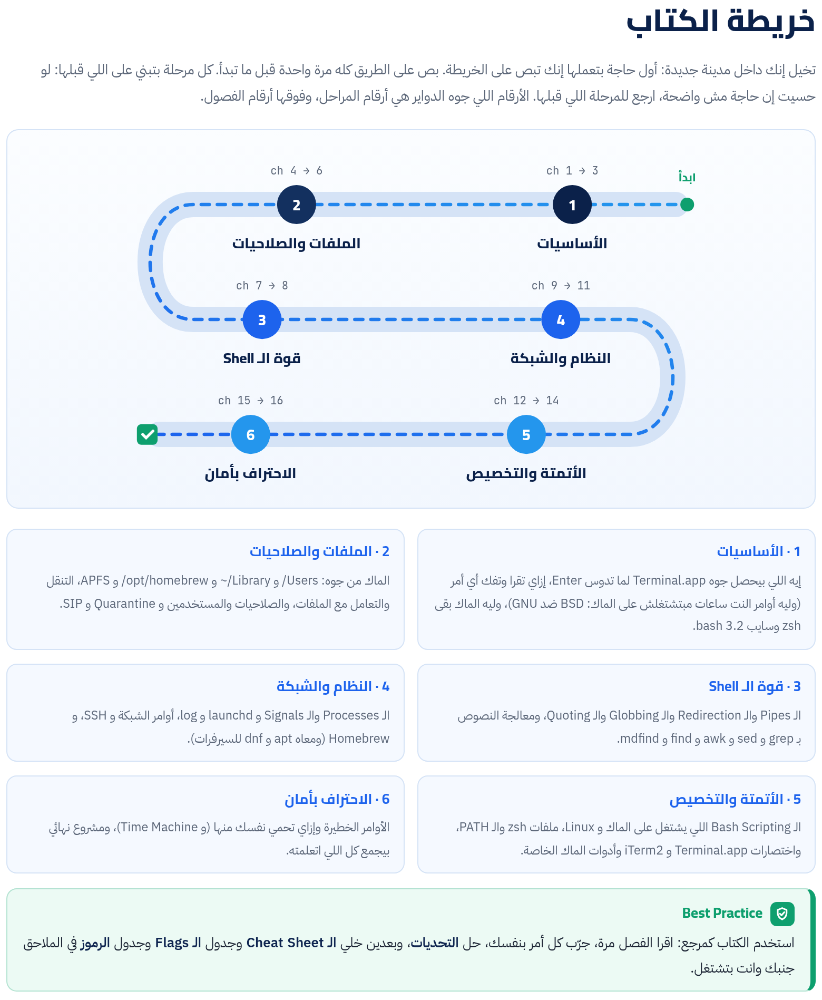

الكتاب ده مرجع ليك إنت، ومكتوب للماك: كل مثال وكل ناتج على macOS و zsh و Homebrew، والمقابل على سيرفرات Linux في صناديق لوحدها. ماشي على 6 مراحل من "يعني إيه Terminal أصلاً" لحد ما تكتب Scripts احترافية وتشتغل بأمان. كل أمر متشرّح حتة حتة، وكل Flag أو رمز بيتكرر بين الأوامر عليه علامة **حاجة مشتركة** وإحالة لمكانه الأصلي في الكتاب.

:::tip[تحميل]
- [الكتاب كامل PDF](/biginner-journey/downloads/01-terminal-book.pdf)
- [الـ Cheat Sheet PDF](/biginner-journey/downloads/01-terminal-cheatsheet.pdf)
:::

## خريطة الكتاب

- **1 · الأساسيات**: إيه اللي بيحصل جوه Terminal.app لما تدوس Enter، إزاي تقرا وتفك أي أمر (وليه أوامر النت ساعات مبتشتغلش على الماك: BSD ضد GNU)، وليه الماك بقى zsh وسايب bash 3.2.
- **2 · الملفات والصلاحيات**: الماك من جوه: /Users و ~/Library و /opt/homebrew و APFS، التنقل والتعامل مع الملفات، والصلاحيات والمستخدمين و Quarantine و SIP.
- **3 · قوة الـ Shell**: الـ Pipes والـ Redirection والـ Globbing والـ Quoting، ومعالجة النصوص بـ grep و sed و awk و find و mdfind.
- **4 · النظام والشبكة**: الـ Processes والـ Signals و launchd و log، أوامر الشبكة و SSH، و Homebrew (ومعاه apt و dnf للسيرفرات).
- **5 · الأتمتة والتخصيص**: الـ Bash Scripting اللي يشتغل على الماك و Linux، ملفات zsh والـ PATH، واختصارات Terminal.app و iTerm2 وأدوات الماك الخاصة.
- **6 · الاحتراف بأمان**: الأوامر الخطيرة وإزاي تحمي نفسك منها (و Time Machine)، ومشروع نهائي بيجمع كل اللي اتعلمته.

## الفصول

**المرحلة 1 · الأساسيات**

- [الفصل 1: جوه الـ Terminal: إيه اللي بيحصل بجد؟](./ch01/)
- [الفصل 2: تشريح أي أمر: إزاي تقرا وتفهم أي حاجة تتكتب](./ch02/)
- [الفصل 3: الـ Shells: sh و bash و zsh و fish و PowerShell](./ch03/)

**المرحلة 2 · الملفات والصلاحيات**

- [الفصل 4: الـ Filesystem على الماك: كل حاجة ليها مكان](./ch04/)
- [الفصل 5: التنقل والتعامل مع الملفات](./ch05/)
- [الفصل 6: الصلاحيات والمستخدمين](./ch06/)

**المرحلة 3 · قوة الـ Shell**

- [الفصل 7: قوة الـ Shell: الـ Pipes والـ Redirection والـ Quoting](./ch07/)
- [الفصل 8: معالجة النصوص والبحث](./ch08/)

**المرحلة 4 · النظام والشبكة**

- [الفصل 9: العمليات والخدمات](./ch09/)
- [الفصل 10: الشبكات والاتصال بالسيرفرات](./ch10/)
- [الفصل 11: Homebrew ومديري الحزم: تسطيب البرامج صح](./ch11/)

**المرحلة 5 · الأتمتة والتخصيص**

- [الفصل 12: الـ Bash Scripting: خلّي الأوامر تشتغل لوحدها](./ch12/)
- [الفصل 13: تخصيص الـ Shell: ملفات الإعدادات والـ Aliases والـ Prompt](./ch13/)
- [الفصل 14: السرعة والإنتاجية: الاختصارات والـ History و tmux](./ch14/)

**المرحلة 6 · الاحتراف بأمان**

- [الفصل 15: الأوامر الخطيرة وإزاي تحمي نفسك](./ch15/)
- [الفصل 16: المشروع النهائي: أداة opskit](./ch16/)

**الملاحق**

- [ملحق أ: Cheat Sheet وجدول الـ Flags وجدول الرموز](./appendix-1/)
- [ملحق ب: قاموس المصطلحات](./appendix-2/)
- [ملحق ج: الإجابات والحلول](./appendix-3/)
