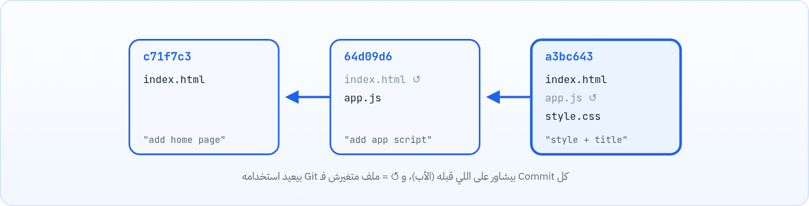

<small>المرحلة 1 · البداية</small>

قبل أي أمر، لازم تحس بالمشكلة اللي Git بيحلها. لو عمرك سميت ملف final\_v2\_FINAL.js، أو الـ AI غيّر في مشروعك حاجات ومبقتش عارف ترجع، يبقى الفصل ده بتاعك. هنفهم يعني إيه Version Control، Git بيفكر إزاي، والفرق بين Git و GitHub.

:::note[بعد الفصل ده هتكون عارف]
- المشكلة اللي Version Control بيحلها
- الفرق بين الأنظمة المحلية والمركزية والموزّعة
- إن Git بيحفظ Snapshots كاملة مش فروقات
- يعني إيه Commit و Hash بشكل مبدئي
- الفرق بين Git و GitHub
- ليه هنتعلمه من الـ Terminal مش من الأزرار بس
:::

<a id="s1-1"></a>

## 1.1 المشكلة: الساعة 2 بالليل والكود باظ

تخيل إنك ماشي في كورس الـ JavaScript، وبقالك أسبوع بتبني تطبيق البنك الصغير بتاع الكورس. أخيراً الـ Login شغال، والحركات بتظهر، والرصيد بيتحسب صح. إحساس جميل. قلت لنفسك: "طب أخلّي الـ AI يضيف خاصية تحويل الفلوس وأنام". كتبتله الطلب، وفي ثانيتين غيّر في 4 ملفات. شغّلت الصفحة... شاشة بيضا. ولا Login ولا حركات ولا أي حاجة.

طبيعي أول حاجة تعملها `Ctrl+Z`. بس الـ AI كان كاتب في ملفات انت مش فاتحها أصلاً، والـ Undo مش فاكر حاجة. وبتحاول تفتكر الكود كان شكله إيه الصبح... ومش فاكر. والأسوأ: مش عارف هو غيّر إيه بالظبط عشان ترجعه.

لو الموقف ده حصلك (أو هيحصلك، صدقني)، فانت مش لوحدك. وأغلبنا عمل الحل البدائي اللي جه في دماغه بعدها: "خلاص، من النهارده قبل أي تعديل كبير هنسخ الفولدر".


*"نظام النسخ اليدوي": بعد أسبوعين هيبقى عندك ده، ومحدش عارف إيه الفرق بين نسخة والتانية.*

وبعد أسبوعين، يبقى عندك فولدر اسمه `bankist-final`، وجنبه `bankist-final-v2-WORKING`، وجوه واحد فيهم ملف اسمه `script_final_v2_FINAL.js`. وكلمة FINAL دي، زي ما كلنا عارفين، عمرها ما بتبقى الأخيرة.

المشكلة إن الطريقة دي بتحل نص المشكلة بس. عندك نسخة قديمة، تمام، بس **مش عارف إيه اللي اتغير** بينها وبين الحالية غير لما تفتح الملفين جنب بعض وتقارن بعينك سطر سطر. و**مش عارف ليه** اتغير: مفيش ولا ملاحظة بتقول "النسخة دي فيها إصلاح زرار التحويل". وكل نسخة فيها المشروع كله، ومع `node_modules` ممكن الفولدر الواحد يبقى مئات الميجات. ولو حد تاني عاوز يشتغل معاك على نفس المشروع؟ هتبعتوا Zip لبعض على الواتساب وكل واحد يدمج بإيده؟

الناس واجهت المشكلة دي من بدري جداً، قبلنا بكتير، وطلعوا بحل اسمه **Version Control**. خلينا نشوف الفكرة.

<a id="s1-2"></a>

## 1.2 يعني إيه Version Control؟

**Version Control System** (أو VCS) = برنامج بيسجّل تاريخ مشروعك. كل ما توصل لنقطة كويسة، تقوله "احفظ اللحظة دي"، ومعاها رسالة بتقول عملت إيه. وبعدين تقدر:

- ترجع لأي لحظة قديمة في ثانية.
- تشوف إيه اللي اتغير بالظبط بين أي لحظتين، سطر بسطر.
- تعرف مين غيّر السطر ده، وإمتى، وليه.
- تجرّب فكرة مجنونة في "خط موازي" من غير ما تلمس النسخة الشغالة.

:::note[التشبيه اللي هنفضل نستخدمه]
فكّر فيه زي **الـ Save Points في لعبة فيديو**. قبل الوحش الكبير بتعمل Save. لو خسرت، بترجع للـ Save مش لأول اللعبة. في Git، الـ Save Point ده اسمه **Commit**.
:::

### الحكاية من الأول: 3 أجيال

أول حل ظهر كان بسيط: برنامج على جهازك بيحفظ نسخ قديمة من كل ملف في مكان مخفي. ده أحسن من النسخ اليدوي، بس لسه على جهاز واحد. ولما الفرق كبرت، ظهرت فكرة السيرفر المركزي (زي SVN): التاريخ كله على سيرفر واحد، وكل مبرمج بيسحب منه ويبعتله. حلو، لحد ما السيرفر يقع أو النت يقطع، وساعتها الفريق كله يقعد يشرب شاي لأن محدش يقدر يعمل Commit ولا يشوف التاريخ.

وبعدين جه الجيل التالت، اللي Git منه: **الموزّع**. الفكرة إن كل واحد عنده نسخة **كاملة** من المشروع بالتاريخ كله على جهازه. تشتغل في القطر من غير نت عادي، وكل حاجة سريعة لأنها محلية، ولو السيرفر اتحرق فأي نسخة عند أي حد ترجّعه.


*من نسخ على جهازك بس، لسيرفر واحد الكل معتمد عليه، لـ Git: كل نسخة فيها التاريخ كله.*

**الأجيال التلاتة في جدول (ملخص الحكاية)**

| النوع | أمثلة | الميزة | العيب |
|---|---|---|---|
| محلي | RCS، والنسخ اليدوي | بسيط | على جهاز واحد، ومفيش شغل جماعي |
| مركزي | SVN، CVS | الفريق كله على سيرفر واحد | من غير إنترنت أو لو السيرفر وقع، مفيش Commits ولا تاريخ |
| موزّع | **Git**، Mercurial | كل نسخة كاملة، وبتشتغل Offline وسريع جداً | محتاج تفهم فكرة الأماكن التلاتة (الفصل 3) |

:::note[لو حابب تتعمق: Git اتولد إزاي]
Git اتعمل سنة **2005** على إيد Linus Torvalds (صاحب Linux) عشان يدير كود الـ Linux Kernel، بعد ما الأداة اللي كانوا بيستخدموها اتسحبت منهم. كان عاوزه سريع، وموزّع، ويستحمل آلاف المطورين. ودلوقتي هو الأداة الأساسية في العالم كله تقريباً.
:::

<a id="s1-3"></a>

## 1.3 Git بيفكر إزاي: Snapshots مش فروقات

أهم فكرة في الكتاب كله: كل **Commit** هو <strong>صورة كاملة (Snapshot)</strong> لمشروعك في اللحظة دي، مش مجرد "الفرق عن اللي قبله". والملفات اللي متغيرتش، Git مش بيخزّنها تاني، بيعمل إشارة للنسخة القديمة، فالموضوع خفيف جداً.



*سلسلة Commits: كل واحد صورة كاملة للمشروع + رسالة + بيشاور على أبوه.*

كل Commit جواه:

**محتويات أي Commit**

| الحتة | يعني إيه | مثال |
|---|---|---|
| Snapshot | شكل كل ملفات المشروع في اللحظة دي | index.html و app.js |
| Message | رسالة إنت بتكتبها: عملت إيه | `feat: add home page` |
| Author و Date | مين عمله وإمتى | `Sara <sara@example.com>` |
| Parent | الـ Commit اللي قبله (أبوه) | `c71f7c3` |
| Hash | بصمة فريدة محسوبة من كل اللي فوق | `64d09d60f21e…` |

### الـ Hash: بصمة الـ Commit

كل Commit ليه اسم عبارة عن 40 حرف ورقم (Hexadecimal) زي `64d09d60f21e2d9e543ea9afe345c927b6db3c58`. Git بيحسبه من محتوى الـ Commit نفسه، فلو أي حرف اتغير، الـ Hash كله يتغير. وعشان كده التاريخ في Git صعب يتلعب فيه من غير ما يبان. وفي الحياة اليومية بنستخدم أول 7 حروف بس: `64d09d6`.

:::note[لو حابب تتعمق: SHA-1 و SHA-256]
الـ Hash ده معمول بخوارزمية اسمها SHA-1. Git بيجهّز للتحويل لـ SHA-256 (64 حرف) كافتراضي في **Git 3.0**، اللي لسه منزلش ومالوش ميعاد رسمي لحد أكتوبر 2026 (آخر نسخة مستقرة 2.56). بالنسبالك مفيش أي فرق في الاستخدام.
:::

<a id="s1-4"></a>

## 1.4 Git مش GitHub

دي أكتر لخبطة عند المبتدئين، وطبيعي جداً، لأن الاسمين شبه بعض والناس بتستخدمهم مكان بعض. فكّر فيها كده: **Git** هو الكاميرا اللي في إيدك. بتصوّر بيها لحظات مشروعك (الـ Commits) وبتحتفظ بالصور على جهازك، ومش محتاج نت عشان تصوّر. أما **GitHub** فهو زي ألبوم صور على النت: بترفع عليه الصور عشان تبقى في أمان، وعشان تشاركها مع ناس، وهما يعلّقوا عليها ويضيفوا صورهم.

يعني Git برنامج مجاني ومفتوح المصدر على جهازك، و GitHub موقع (بقى تبع Microsoft من 2018) بيستضيف نسخ من مشاريع Git، وبيضيف حاجات Git نفسه معندوش: Pull Requests للمراجعة، و Issues للمهام، و Pages لنشر المواقع، و Actions للأتمتة. وفيه مواقع تانية بتعمل نفس دور GitHub زي GitLab و Bitbucket، بس Git نفسه واحد في كل الحالات.

**Git مقابل GitHub (ملخص)**

|   | Git | GitHub |
|---|---|---|
| هو إيه | أداة (برنامج) | خدمة (موقع) |
| فين | على جهازك | على النت |
| محتاج إنترنت؟ | لأ | أيوه |
| بديله | مفيش بديل منتشر بنفس القوة | GitLab و Bitbucket و Codeberg |
| التشبيه | الكاميرا اللي بتصور | ألبوم الصور على النت اللي بتشاركه |

:::caution[خلي بالك]
ممكن تستخدم Git سنين من غير GitHub خالص. وممكن تستخدم GitHub من غير ما تفهم Git، بس هتتلخبط أول ما حاجة تبوظ. عشان كده الكتاب بيبدأ بـ Git على جهازك (المراحل 2 و 3) وبعدين GitHub (المرحلة 4).
:::

<a id="s1-5"></a>

## 1.5 Git هيفرق معاك إزاي إنت بالذات؟

#### وانت بتتعلم JavaScript

كل محاضرة أو خطوة في مشروع الكورس = Commit. لو بوّظت حاجة، ترجع. ولو عاوز تقارن الكود بتاعك بكود المحاضرة، `git diff` هيوريك الفرق.

#### كـ Content Engineer

Git مش للكود بس: أي ملفات نصية (Markdown، HTML، JSON، توثيق) ليها تاريخ ومراجعة. وفرق كتير بتدير المحتوى والتوثيق بـ Git و Pull Requests.

#### مع الـ AI

الـ AI ممكن يغيّر 10 ملفات في ثانية. لو عامل Commit قبلها، الرجوع أمر واحد. ولو مش عامل، ربنا يسترها. ده موضوع الفصل 18 كله.

#### للشغل والـ Portfolio

GitHub بقى "السي في" بتاع المبرمج. مشاريعك عليه، ومواقعك تتنشر ببلاش بـ GitHub Pages، وأي شركة هتفترض إنك عارف Git.

<a id="s1-6"></a>

## 1.6 ليه من الـ Terminal مش من الأزرار بس؟

VS Code فيه تاب **Source Control**، وفيه برامج زي GitHub Desktop. وده كويس جداً وهنستخدمهم. بس كل زرار فيهم في الآخر بيشغّل أمر Git. لو فاهم الأوامر:

- هتفهم الزرار بيعمل إيه قبل ما تدوس عليه.
- لما حاجة تبوظ، رسايل الخطأ هتبقى مفهومة، وهي غالباً بتقولك الحل.
- هتعرف تتعامل مع أي سيرفر أو أداة مفيهاش واجهة.
- والـ AI نفسه لما يقترح عليك أمر Git، هتعرف هل هو آمن ولا هيمسح شغلك.

:::tip[حاجة مشتركة مع كتاب الـ Terminal]
كل اللي اتعلمته في كتاب الـ Terminal شغال هنا: `git` برنامج عادي في الـ PATH، والكلمة اللي بعده (`status` و `add` و `commit`) اسمها **Subcommand**، وبعدها Options و Arguments بنفس القواعد بالظبط (فصل "تشريح أي أمر"). `-m` قصيرة، `--message` طويلة، و `--` معناها "خلصت الـ Options". هنفكّر بالقواعد دي في كل فصل.
:::

**تشريح الأمر**

```sh
git commit --message "feat: add home page"
```

1. `git`: البرنامج نفسه (الأمر الرئيسي).
2. `commit`: الـ Subcommand: "اعمل Save Point". Git فيه عشرات الـ Subcommands، وكل واحد ليه Options خاصة بيه.
3. `--message`: Option طويلة معناها "دي رسالة الـ Commit"، واختصارها `-m`.
4. `"feat: add home page"`: قيمة الـ Option. الـ Quotes عشان الـ Shell يعتبر الجملة كلها كلمة واحدة رغم المسافات (زي ما شرحنا الـ Quoting في كتاب الـ Terminal).

:::tip[ملخص الفصل]
- Version Control = تاريخ لمشروعك: ترجع لأي لحظة، وتشوف إيه اتغير ومين وليه.
- Git نظام **موزّع**: كل نسخة فيها التاريخ كامل، وبيشتغل من غير إنترنت.
- الـ Commit = Snapshot كاملة + رسالة + كاتب + تاريخ + أب، وليه Hash فريد.
- Git برنامج على جهازك، و GitHub موقع بيستضيف الـ Repos ويضيف أدوات تعاون.
- هنتعلم من الـ Terminal عشان نفهم الأزرار، مش عشان نستغنى عنها.
:::

### صح ولا غلط؟

1. Git محتاج إنترنت عشان تعمل Commit.
2. كل Commit بيخزن الفرق عن اللي قبله بس.
3. GitHub هو نفس Git بس على النت.

### أسئلة مراجعة

1. اذكر 3 مشاكل في طريقة "نسخ الفولدر قبل أي تعديل".
2. إيه ميزة النظام الموزّع على المركزي؟
3. إيه 5 حاجات موجودة جوه كل Commit؟
4. ليه لو حرف واحد اتغير في Commit قديم، الـ Hash بتاعه يتغير؟ وده بيفيد في إيه؟

### تحديات الفصل

<small>جرّبها بإيدك، والحلول في ملحق الإجابات.</small>

1. **[سهل]** افتح الـ Terminal واكتب `git --version`. لو طلعلك رقم، Git متسطب. لو `command not found`، الفصل الجاي هيحلها.
2. **[متوسط]** دوّر على جهازك على أي ملفات أو فولدرات بأسماء زي `copy` أو `final` أو `old` (افتكر `find . -iname "*final*"` من كتاب الـ Terminal). دي المشاريع اللي محتاجة Git.
3. **[صعب]** افتح أي Repo مشهور على GitHub (زي مشروع مفتوح المصدر بتستخدمه)، ودوّر على عدد الـ Commits والـ Contributors. اكتب جملة: ليه مشروع زي ده مستحيل يتعمل بالنسخ اليدوي؟
