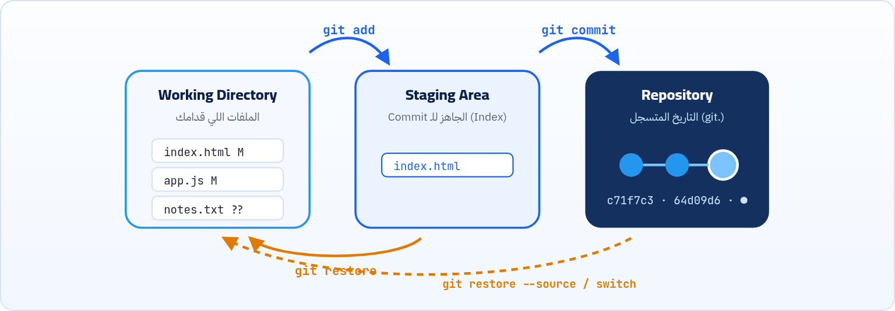
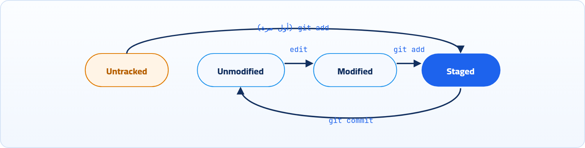

<small>المرحلة 2 · الأساس على جهازك</small>

ده أهم فصل في الكتاب. لو فهمت الأماكن التلاتة (Working Directory و Staging Area و Repository)، كل أوامر Git بعد كده هتبقى منطقية. هنعمل أول Repo، ونمشي ملف من أول ما يتعمل لحد ما يدخل التاريخ، ونقرا رسايل git status كلمة كلمة.

:::note[بعد الفصل ده هتكون عارف]
- git init وإيه اللي جوه فولدر .git
- الأماكن التلاتة وليه Git محتاج Staging Area
- حالات الملف: untracked و modified و staged و committed
- قراية git status بالتفصيل والنسخة المختصرة -s
- git add بكل أشكاله و git commit بكل أشكاله
- إمتى تعمل Commit وقد إيه يبقى حجمه
:::

<a id="s3-1"></a>

## 3.1 git init: حوّل فولدر لـ Repo

خلينا نبدأ من الصفر خالص، بمشروع Portfolio صغير هتعمله وانت بتتعلم: صفحة `index.html` وملف `script.js`. لحد دلوقتي ده فولدر عادي جداً، زيه زي فولدر الصور. Git مش شايفه ومش مهتم بيه. عشان Git يبدأ يسجّل تاريخ الفولدر ده، لازم تقوله صراحة: "الفولدر ده بقى مشروع، تابعه". والفولدر بعد كده اسمه **Repository** (أو Repo اختصاراً): فولدر مشروعك + التاريخ بتاعه.

```sh title="Terminal"
$ mkdir portfolio && cd portfolio
$ git init
Initialized empty Git repository in /home/sara/portfolio/.git/
```

**تشريح الأمر**

```sh
mkdir portfolio && cd portfolio && git init
```

1. `mkdir portfolio`: اعمل فولدر جديد (من كتاب الـ Terminal).
2. `&&`: كمّل بالأمر اللي بعده **لو** اللي قبله نجح.
3. `cd portfolio`: ادخل الفولدر.
4. `git init`: INITialize: اعمل Repo فاضي هنا. عملياً بيعمل فولدر مخفي اسمه `.git` وبس. ملفاتك مبتتلمسش.

:::note[git init باسم فولدر]
`git init my-app` بيعمل الفولدر `my-app` ويحوّله Repo في خطوة واحدة. ولو عندك مشروع موجود فعلاً، ادخله واعمل `git init` عادي: الملفات هتفضل زي ما هي، بس Git لسه مش بيتابعها (هتظهر Untracked).
:::

:::caution[متعملش git init جوه Repo تاني]
أشهر غلطة: تعمل `git init` في الـ Home كله (`~`) أو في فولدر فوق مشاريعك، فيبقى عندك Repo جوه Repo. قبل `git init` اتأكد بـ `pwd` إنت فين، وبـ `git status` إن الفولدر مش Repo أصلاً (المفروض يقولك `not a git repository`).
:::

<a id="s3-2"></a>

## 3.2 فولدر .git: المخزن

الـ `.git` مخفي لأن اسمه بيبدأ بنقطة (افتكر `ls -a`). ده المكان اللي فيه **كل** التاريخ:

```sh title="Terminal"
$ ls -a
.  ..  .git
$ ls .git
HEAD  config  description  hooks  info  objects  refs
```

**أهم حاجات جوه .git**

| الحاجة | فيها إيه |
|---|---|
| `objects/` | كل الـ Snapshots والملفات والـ Commits، متخزنة بالـ Hash بتاعها |
| `refs/` | أسماء الـ Branches والـ Tags (كل واحد ملف فيه Hash) |
| `HEAD` | إنت واقف فين دلوقتي (الفصل 7) |
| `config` | إعدادات الـ Repo ده بس (الـ `--local`) |
| `index` | الـ Staging Area (بيظهر بعد أول `git add`) |

:::note[لو حابب تتعمق: جوه objects فيه إيه؟]
Git في الحقيقة "قاعدة بيانات" بسيطة جداً: كل حاجة متخزنة كـ **Object** اسمه هو الـ Hash بتاع محتواه. وفيه 4 أنواع: **blob** = محتوى ملف واحد (من غير اسمه)، و **tree** = فولدر: قايمة أسماء ملفات وكل اسم بيشاور على blob أو tree، و **commit** = بيشاور على tree الجذر + الأب + الكاتب + الرسالة، و **tag** = للـ Annotated tags (الفصل 14). تقدر تتفرج بنفسك:

```sh title="Terminal"
$ git cat-file -t HEAD
commit
$ git cat-file -p HEAD
tree 7d2f9a3c1b...
parent c71f7c3e71...
author Sara <sara@example.com> 1792483200 +0300
committer Sara <sara@example.com> 1792483200 +0300

feat: add app script
$ git cat-file -p 7d2f9a3
100644 blob d914c60...	app.js
100644 blob 986a4a1...	index.html
```

الـ `-t` = Type (نوع الـ Object)، و `-p` = Pretty-print (اعرض المحتوى بشكل مقروء). وعشان كده الـ Branch مجرد ملف فيه Hash commit، والـ commit بيشاور على tree، والـ tree على blobs. ولو ملفين محتواهم واحد، هيبقوا blob واحد. والأرقام `1792483200` دي الوقت بالثواني من 1970 (Unix time).
:::

:::caution[خلي بالك]
متعدلش حاجة جوه `.git` بإيدك. ولو مسحت فولدر `.git`، الملفات بتاعتك هتفضل، بس **التاريخ كله هيضيع** والفولدر يرجع فولدر عادي. وده برضه الطريقة لو عاوز "تلغي" Repo عملته بالغلط: `rm -rf .git` (بحذر، زي ما اتعلمنا في فصل الأوامر الخطيرة).
:::

<a id="s3-3"></a>

## 3.3 الأماكن التلاتة

هنا بقى الفكرة اللي بتفرق Git عن "Save" العادي، واللي لو فهمتها كويس نص الكتاب هيبقى سهل. لما بتعمل Save في VS Code، الملف بيتحفظ على الديسك وخلاص. لكن Git مش بيسجّل كل Save. Git بيستناك انت تقوله "اللحظة دي تستاهل تتسجّل"، وبيسيبك كمان تختار **أنهي تعديلات** بالظبط تدخل اللحظة دي. وعشان كده ملفاتك بتعدي على 3 أماكن:



*الأماكن التلاتة: بتعدّل في الـ Working Directory، تختار بـ git add، وتسجّل بـ git commit.*

#### 1 · Working Directory

الفولدر اللي إنت شايفه وبتعدّل فيه في VS Code. ده "ورشة الشغل".

#### 2 · Staging Area

منطقة تحضير: بتحط فيها التغييرات اللي **عاوزها** في الـ Commit الجاي بس. اسمها التقني **Index**.

#### 3 · Repository

التاريخ المتسجل جوه `.git`: كل Commit عملته. ده "الأرشيف".

:::note[ليه Staging Area؟ مش كفاية Save؟]
تخيل إنك صلّحت Bug في `app.js`، وفي نفس الوقت بدأت تجرّب لون جديد في `style.css` ولسه مش متأكد منه. الـ Staging بيخليك تعمل Commit لإصلاح الـ Bug **لوحده**، والتجربة تفضل في الورشة. يعني كل Commit يحكي حكاية واحدة. فكّر فيها زي التصوير: الـ Staging = الناس اللي واقفين قدام الكاميرا، والـ Commit = لحظة الضغط على الزرار.
:::

<a id="s3-4"></a>

## 3.4 حالات الملف



*دورة حياة الملف: يتعمل (Untracked)، تضيفه، تعدّله، تجهّزه، تسجّله، ويرجع Unmodified.*

**حالات الملف وإزاي تعرفها**

| الحالة | يعني إيه | بيظهر في status تحت |
|---|---|---|
| Untracked | ملف جديد، Git عمره ما سجّله | `Untracked files` |
| Unmodified | زي آخر Commit بالظبط | مبيظهرش خالص |
| Modified | اتغير عن آخر Commit ولسه مش في الـ Staging | `Changes not staged for commit` |
| Staged | متحضّر للـ Commit الجاي | `Changes to be committed` |

<a id="s3-5"></a>

## 3.5 git status: أهم أمر في Git

لو هتحفظ أمر واحد بس من الكتاب كله، احفظ ده. `git status` زي ما تسأل Git "إحنا فين دلوقتي؟"، وهو بيرد بكل أدب: إنت على أنهي Branch، وكل ملف في أنهي مكان من التلاتة، وكمان بيقترح عليك الأمر الجاي. المبرمجين المتمرسين بيكتبوه كل دقيقتين من غير ما ياخدوا بالهم، زي ما بتبص في المراية قبل ما تخرج. `git status` بيقولك إنت فين، وكل ملف في أنهي حالة، والأمر الجاي المفروض يبقى إيه. اعمله قبل وبعد أي حاجة.

```sh title="Terminal"
$ git status
On branch main
Changes to be committed:
  (use "git restore --staged <file>..." to unstage)
	new file:   index.html

Changes not staged for commit:
  (use "git add <file>..." to update what will be committed)
  (use "git restore <file>..." to discard changes in working directory)
	modified:   app.js

Untracked files:
  (use "git add <file>..." to include in what will be committed)
	notes.txt
```

```sh title="قراية git status"
On branch main
Changes to be committed:
Changes not staged for commit:
Untracked files:
(use "git ..." to ...)
```

1. `On branch main`: إنت واقف على Branch اسمه `main`.
2. `Changes to be committed:`: **الـ Staging Area**: دول اللي هيدخلوا الـ Commit الجاي. (`new file` = جديد، `modified` = متعدل، `deleted` = اتمسح).
3. `Changes not staged for commit:`: **الورشة**: ملفات Git عارفها واتعدلت، بس لسه مش في الـ Staging.
4. `Untracked files:`: ملفات جديدة Git مش بيتابعها خالص.
5. `(use "git ..." to ...)`: نصايح Git: الأمر اللي ينقلك للخطوة الجاية أو يرجعك. الـ `<file>` معناها "اكتب اسم الملف هنا" (مش بتكتب الأقواس).

### النسخة المختصرة: -s و -b

```sh title="Terminal"
$ git status -sb
## main
A  index.html
 M app.js
?? notes.txt
```

**تشريح الأمر**

```sh
git status -sb
```

1. `git status`: اعرض الحالة.
2. `-s`: Short: سطر واحد لكل ملف بكود من حرفين (الجدول تحت).
3. `b`: Branch: ضيف سطر `##` فيه اسم الـ Branch. ولأن الـ Flags القصيرة بتتجمع (`-s -b` = `-sb`) زي `ls -la` بالظبط.

**أكواد git status -s**

<table class="cmp keep">
<tr><th>الكود</th><th>العمود الشمال (Staging)</th><th>العمود اليمين (الورشة)</th><th>المعنى</th></tr>
<tr><td><code>??</code></td><td>؟</td><td>؟</td><td>Untracked</td></tr>
<tr><td><code>A </code></td><td>A</td><td>فاضي</td><td>ملف جديد متجهّز (Added)</td></tr>
<tr><td><code> M</code></td><td>فاضي</td><td>M</td><td>متعدل ولسه مش متجهّز</td></tr>
<tr><td><code>M </code></td><td>M</td><td>فاضي</td><td>متعدل ومتجهّز</td></tr>
<tr><td><code>MM</code></td><td>M</td><td>M</td><td>اتجهّز، وبعدين اتعدل تاني (جزء متجهّز وجزء لأ)</td></tr>
<tr><td><code> D</code> / <code>D </code></td><td colspan="2">نفس الفكرة</td><td>اتمسح (Deleted)</td></tr>
<tr><td><code>R </code></td><td>R</td><td></td><td>اتغير اسمه (Renamed)</td></tr>
</table>

<a id="s3-6"></a>

## 3.6 git add: حط في الـ Staging

**تشريح الأمر**

```sh
git add index.html app.js
```

1. `git add`: انقل **الشكل الحالي** للملفات دي للـ Staging Area.
2. `index.html app.js`: Arguments: ملف أو أكتر، أو فولدرات، أو Patterns. اسمها في Git **Pathspec**.

**أشكال git add**

| الأمر | بيضيف إيه |
|---|---|
| `git add file.js` | ملف واحد |
| `git add src/` | فولدر بكل اللي جواه |
| `git add .` | كل التغييرات في الفولدر الحالي واللي جواه (جديد ومتعدل وممسوح) |
| `git add -A` | All: كل التغييرات في الـ Repo كله، حتى لو إنت في فولدر فرعي |
| `git add -u` | Update: المتعدل والممسوح بس، من غير الملفات الجديدة |
| `git add '*.js'` | كل ملفات js (بالـ Quotes عشان Git هو اللي يفك النجمة في كل الفولدرات) |
| `git add -p` | Patch: يسألك على كل حتة اتغيرت، تختار تضيفها ولا لأ (الفصل 13) |

:::tip[حاجة مشتركة: . و * زي الـ Terminal]
الـ `.` هنا هي هي "الفولدر الحالي" من كتاب الـ Terminal. والـ `*` من غير Quotes الـ Shell هو اللي بيفكها (Globbing) قبل ما Git يشوفها، فـ `git add *.js` هتجيب ملفات الفولدر الحالي بس. ومع Quotes (`'*.js'`) الـ Shell بيسيبها زي ما هي و Git يفكها في كل الفولدرات.
:::

:::caution[git add . مش دايماً صاحبك]
`git add .` مريح، بس بيضيف **أي حاجة**: ملف `.env` فيه باسوردات، أو `node_modules` كله. عشان كده لازم `.gitignore` (الفصل 5)، ولازم تبص على `git status` قبل الـ Commit دايماً.
:::

<a id="s3-7"></a>

## 3.7 git commit: سجّل اللحظة

**تشريح الأمر**

```sh
git commit -m "feat: add home page"
```

1. `git commit`: خد اللي في الـ Staging Area، واعمل منه Snapshot جديدة في التاريخ. اللي برا الـ Staging مش هيدخل.
2. `-m`: Message: الرسالة جاية بعدي على طول. من غيرها Git هيفتح الـ Editor.
3. `"feat: add home page"`: الرسالة. (الـ `feat:` دي صيغة اسمها Conventional Commits، الفصل 13).

```sh title="Terminal"
$ git commit -m "feat: add home page"
[main (root-commit) c71f7c3] feat: add home page
 1 file changed, 1 insertion(+)
 create mode 100644 index.html
```

```sh title="قراية ناتج git commit"
[main (root-commit) c71f7c3]
1 file changed, 1 insertion(+)
create mode 100644 index.html
```

1. `[main (root-commit) c71f7c3]`: الـ Commit اتعمل على `main`، و `root-commit` = أول Commit في التاريخ (مالوش أب)، و `c71f7c3` أول 7 حروف من الـ Hash.
2. `1 file changed, 1 insertion(+)`: إحصائية: ملف واحد اتغير، وسطر واحد اتضاف.
3. `create mode 100644 index.html`: ملف جديد، والـ `100644` = ملف عادي صلاحياته `644` (افتكر الصلاحيات من كتاب الـ Terminal). لو Script قابل للتشغيل هتشوف `100755`.

### أشكال تانية للـ Commit

| الأمر | بيعمل إيه |
|---|---|
| `git commit` | يفتح الـ Editor: أول سطر = العنوان، وسطر فاضي، وبعده شرح أطول. الأحسن للـ Commits المهمة. |
| `git commit -m "title" -m "body"` | كل `-m` بتعمل فقرة: الأولى عنوان والتانية تفاصيل. |
| `git commit -am "fix: typo"` | `-a` = All tracked: اعمل add لكل الملفات **المتابَعة** المتعدلة واعمل Commit مرة واحدة. **مش بتضيف الملفات الجديدة** (Untracked). |
| `git commit -v` | Verbose: يحطلك الـ diff جوه الـ Editor وانت بتكتب الرسالة، عشان تفتكر غيرت إيه. |

:::danger[مشكلة: Author identity unknown]
أول Commit طلع: `Please tell me who you are` ومعاه `fatal: unable to auto-detect email address`.

<strong>الحل:</strong> مظبطتش اسمك وإيميلك. ارجع لـ [↩ 2.3](../ch02/#s2-3 "إنت مين؟ user.name و user.email") واعمل `git config --global user.name` و `user.email`، وبعدين أعد الـ Commit.
:::

:::danger[مشكلة: nothing added to commit]
عملت `git commit -m "..."` وطلع `nothing added to commit but untracked files present`.

<strong>الحل:</strong> نسيت `git add`. الـ Commit بياخد من الـ Staging بس، والـ Staging فاضي. اعمل `git add` للملفات الأول.
:::

<a id="s3-8"></a>

## 3.8 مثال كامل: أول مشروع JS

:::note[جرّب بإيدك من الأول للآخر]
هنمشي على مشروع صغير خطوة بخطوة، وبعد كل خطوة بنعمل `git status`.
:::

1. <strong>اعمل المشروع:</strong> `git init portfolio` و `cd portfolio`.
2. <strong>اكتب ملفين:</strong> `index.html` و `script.js` فيه `console.log("hi")`. الـ status: الاتنين `??` Untracked.
3. <strong>جهّز واحد بس:</strong> `git add index.html`. الـ status: `A index.html` و `?? script.js`.
4. <strong>سجّل:</strong> `git commit -m "feat: add home page"`. الـ status: `script.js` لسه Untracked.
5. <strong>الباقي:</strong> `git add script.js` ثم `git commit -m "feat: add script"`. الـ status: `nothing to commit, working tree clean`.
6. <strong>عدّل:</strong> غيّر سطر في `script.js`. الـ status: ` M script.js`. وكرر الدورة.

```sh title="Terminal"
$ git status
On branch main
nothing to commit, working tree clean
```

الجملة دي (`working tree clean`) معناها إن الأماكن التلاتة متطابقة: كل حاجة متسجلة. دي أأمن حالة تكون فيها قبل أي تجربة كبيرة أو قبل ما تخلي الـ AI يلمس الكود.

:::tip[إمتى أعمل Commit؟]
القاعدة: **كل ما توصل لحاجة شغالة وليها معنى**. خلصت جزء من محاضرة؟ Commit. صلّحت Bug؟ Commit. قبل ما تجرّب حاجة ممكن تبوّظ؟ Commit. الـ Commits الصغيرة الكتير أحسن بكتير من Commit واحد ضخم آخر اليوم اسمه "stuff". وكل Commit يحكي حكاية واحدة.
:::

:::tip[ملخص الفصل]
- `git init` بيعمل فولدر `.git` فيه التاريخ كله. متلمسوش، ومسحه = مسح التاريخ.
- 3 أماكن: **Working Directory** (بتعدّل) ← `git add` ← **Staging** (بتختار) ← `git commit` ← **Repository** (التاريخ).
- حالات الملف: Untracked و Unmodified و Modified و Staged.
- `git status` قبل وبعد كل حاجة، و `-sb` للنسخة المختصرة.
- `git commit -m` بياخد من الـ Staging بس، و `-am` مبيضيفش الملفات الجديدة.
:::

### صح ولا غلط؟

1. `git commit -am` بيضيف الملفات الجديدة اللي Git مش بيتابعها.
2. لو عدّلت ملف بعد ما عملتله `git add`، التعديل الجديد هيدخل الـ Commit تلقائياً.
3. مسح فولدر `.git` بيمسح ملفات المشروع.

### أسئلة مراجعة

1. اشرح الأماكن التلاتة بمثال من مشروعك.
2. ليه Git محتاج Staging Area؟ إيه المشكلة لو الـ Commit بياخد كل التغييرات على طول؟
3. إيه معنى `MM` في `git status -s`؟ وإزاي توصلها؟
4. إيه الفرق بين `git add .` و `git add -A` و `git add -u`؟

### تحديات الفصل

<small>جرّبها بإيدك، والحلول في ملحق الإجابات.</small>

1. **[سهل]** اعمل Repo اسمه `git-playground` فيه 3 ملفات، واعمل لكل ملف Commit لوحده.
2. **[متوسط]** وصّل ملف لحالة `MM`: عدّله، `git add`، عدّله تاني. اعمل `git commit -m` وبعدين `git status`: إيه اللي دخل وإيه اللي فضل؟
3. **[صعب]** بعد أول Commit، اعمل `ls .git/objects` وبعدين `git cat-file -p HEAD`. اوصف اللي شايفه: فين الـ tree، والـ author، والرسالة؟
