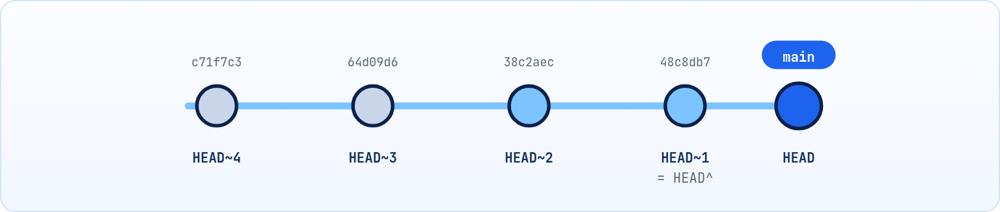

<small>المرحلة 2 · الأساس على جهازك</small>

عملنا Commits، طب نشوفها إزاي؟ ونعرف اتغير إيه بين النهارده وإمبارح؟ وإيه اللي الـ AI غيّره بالظبط قبل ما نوافق عليه؟ الفصل ده عن تلات أوامر هتعيش معاهم: git log للتاريخ، و git diff للفروقات، و git show لتفاصيل Commit واحد. وهنتعلم نسمّي أي Commit بـ HEAD~1 وأخواتها.

:::note[بعد الفصل ده هتكون عارف]
- git log وأهم الـ Flags بتاعته (oneline و graph و all و stat و p)
- الفلترة بالكاتب والتاريخ والرسالة والملف
- تسمية الـ Commits: Hash و HEAD و HEAD~n و HEAD^
- git diff بين الأماكن التلاتة وبين أي Commits
- قراية ناتج الـ diff سطر سطر
- git show لـ Commit أو لملف في نسخة قديمة
:::

<a id="s4-1"></a>

## 4.1 git log: شريط التاريخ

فاكر تطبيق البنك اللي وقع في أول فصل؟ تخيل نفس الموقف، بس المرة دي المشروع عليه Git. الصبح التطبيق كان شغال، وبالليل مش شغال. أول سؤال هيجي في دماغك: "إيه اللي حصل من الصبح لحد دلوقتي؟". زمان كنت هتحاول تفتكر. دلوقتي هتسأل Git، وهو بيحتفظ بشريط كامل لكل لحظة سجلتها: مين، وإمتى، وكتب إيه في الرسالة. الشريط ده بنشوفه بـ `git log`:

```sh title="Terminal"
$ git log
commit 64d09d60f21e2d9e543ea9afe345c927b6db3c58 (HEAD -> main)
Author: Sara <sara@example.com>
Date:   Tue Oct 20 10:00:00 2026 +0300

    feat: add app script

commit c71f7c3e7148d9c2cc6969c611f0f386ec3b6491
Author: Sara <sara@example.com>
Date:   Tue Oct 20 09:41:12 2026 +0300

    feat: add home page
```

```sh title="قراية git log"
commit 64d09d60f21e…
(HEAD -> main)
Author: / Date:
    feat: add app script
```

1. `commit 64d09d60f21e…`: الـ Hash الكامل (40 حرف). الأحدث فوق.
2. `(HEAD -> main)`: "إنت هنا": HEAD بيشاور على `main`، و main بيشاور على الـ Commit ده (الفصل 7).
3. `Author: / Date:`: مين وإمتى (من `user.name` و `user.email`). `+0300` = فرق التوقيت عن UTC.
4. `feat: add app script`: الرسالة، بمسافة في الأول.

:::tip[حاجة مشتركة: الـ Pager]
لو التاريخ طويل، Git بيعرضه في `less` زي ما اتعلمنا في كتاب الـ Terminal: `Space` صفحة، `/كلمة` للبحث، و `q` للخروج. ده نفس الكلام في `git diff` و `git show` و `git branch`. ولو عاوز الناتج يتطبع على طول من غير Pager: `git --no-pager log`.
:::

### أهم Flags لـ git log

الشكل الطويل ده مفيد، بس بعد 50 Commit هيبقى مرهق. في الحياة اليومية محدش بيستخدمه كده. الشكل اللي هتكتبه كل يوم هو ده، وخليه في دماغك كأنه "الخريطة":

**تشريح الأمر**

```sh
git log --oneline --graph --all -n 10
```

1. `git log`: اعرض التاريخ.
2. `--oneline`: كل Commit في سطر: Hash قصير + العنوان. أكتر Flag هتستخدمه.
3. `--graph`: ارسم خطوط الـ Branches والـ Merges بحروف (`*` و `|` و `/`) على الشمال.
4. `--all`: اعرض كل الـ Branches، مش بس اللي إنت عليه.
5. `-n 10`: آخر 10 Commits بس. ويتكتب `-10` برضه.

```sh title="Terminal"
$ git log --oneline --graph --all
* 4ea67eb (feature/title) feat: change title
| *   48c8db7 (HEAD -> main) Merge branch 'x2'
| |\
| | * 0dd1b27 docs: add notes
| |/
| * 38c2aec fix: title text
|/
* 64d09d6 feat: add app script
* c71f7c3 feat: add home page
```

ودي بقى شجرة التاريخ: كل `*` = Commit، والخطوط بتوريك مين جه من مين. متقلقش لو الرسمة مش واضحة دلوقتي، هنفهمها خطوة خطوة في فصول الـ Branches.

وأحياناً انت مش عاوز التاريخ كله، عاوز تدوّر على حاجة معينة: "إيه اللي عملته الأسبوع ده؟"، "مين لمس ملف app.js؟"، "أنهي Commit ضاف كلمة transfer أول مرة؟". `git log` عنده Flag لكل سؤال من دول، ودي أهمهم في جدول تفتكره بيه:

**Flags مهمة لـ git log**

| الـ Flag | بيعمل إيه | مثال |
|---|---|---|
| `--stat` | تحت كل Commit: الملفات اللي اتغيرت وعدد السطور | `git log --stat -3` |
| `-p` | Patch: اعرض الـ diff الكامل لكل Commit | `git log -p -1` |
| `--author=` | Commits كاتب معين (جزء من الاسم يكفي) | `git log --author=Sara` |
| `--since=` / `--until=` | من / لحد تاريخ | `git log --since="2 weeks ago"` |
| `--grep=` | دوّر في رسايل الـ Commits | `git log --grep=fix -i` |
| `-S` | الـ Commits اللي ضافت أو شالت نص معين من الكود | `git log -S "transfer"` |
| `-- file` | الـ Commits اللي لمست الملف ده بس | `git log --oneline -- app.js` |
| `--follow` | تابع الملف حتى لو اسمه اتغير | `git log --follow -- src/app.js` |

**تشريح الأمر**

```sh
git log --oneline --since="2 weeks ago" --author=Sara -- app.js
```

1. `git log --oneline`: تاريخ مختصر.
2. `--since="2 weeks ago"`: من أسبوعين لحد دلوقتي. Git بيفهم إنجليزي بسيط (`yesterday`، `3 days ago`) أو تاريخ (`2026-10-01`). والـ `=` بتربط الـ Option بقيمتها.
3. `--author=Sara`: اللي كاتبهم فيه "Sara".
4. `--`: "خلصت الـ Options، اللي بعدي أسماء ملفات". نفس معنى `--` في كتاب الـ Terminal. مهمة لو اسم ملف شبه اسم Branch.
5. `app.js`: الملف.

<a id="s4-2"></a>

## 4.2 إزاي تسمّي أي Commit

أوامر كتير (diff و show و reset و revert) محتاجة تقولها "أنهي Commit". عندك كذا طريقة:



*العد لورا من HEAD: الـ ~1 الأب، والـ ~2 الجد، وهكذا.*

**طرق تسمية الـ Commit**

| الطريقة | يعني إيه |
|---|---|
| `64d09d6` | الـ Hash القصير (أول 7 حروف، أو أكتر لو فيه تشابه) |
| `HEAD` | الـ Commit اللي إنت واقف عليه دلوقتي |
| `HEAD~1` أو `HEAD~` | الأب (اللي قبله بواحد) |
| `HEAD~3` | تلات خطوات لورا |
| `HEAD^` | الأب الأول (زي `~1`). و `HEAD^2` = الأب التاني في Merge Commit |
| `main` / `main~2` | آخر Commit في main / اتنين قبله |
| `v1.0` | Tag (الفصل 14) |

:::caution[خلي بالك من ^ في zsh على الـ Mac]
في zsh (الافتراضي على الـ Mac من 2019) لو مفعّل `extendedglob` (زي كتير من إعدادات oh-my-zsh)، ممكن `HEAD^` تطلّع `no matches found` لأن الـ `^` ليها معنى Globbing هناك. الحل: استخدم `HEAD~1` (أسهل) أو حط Quotes: `"HEAD^"`.
:::

<a id="s4-3"></a>

## 4.3 git diff: إيه اللي اتغير بالظبط؟

الـ log بيقولك **إمتى** اتغيرت حاجة، بس مش بيقولك **إيه** اللي اتغير بالظبط. هنا ييجي أهم أمر هتستخدمه مع أدوات الـ AI تحديداً: `git diff`. لما الـ AI يقولك "عدّلت الملف عشان أصلّح المشكلة"، الـ diff هو اللي بيوريك الحقيقة سطر سطر: إيه اللي اتشال وإيه اللي اتضاف. ومحدش محترم بيعمل Commit لحاجة من غير ما يبص على الـ diff بتاعها.

بس فيه حتة صغيرة بتلخبط الناس: انت عندك 3 أماكن (الورشة والـ Staging والتاريخ)، فـ "الفرق" ممكن يكون بين أي اتنين فيهم. والمهم تعرف كل شكل من `git diff` بيقارن مين بمين:


*تلات أشكال لـ git diff بين الأماكن التلاتة.*

**أشكال git diff**

| الأمر | بيقارن | بيجاوب على |
|---|---|---|
| `git diff` | الورشة مقابل الـ Staging | "إيه اللي عدلته ولسه معملتلوش add؟" |
| `git diff --staged` | الـ Staging مقابل آخر Commit | "إيه اللي هيدخل الـ Commit الجاي؟" (`--cached` نفس المعنى) |
| `git diff HEAD` | الورشة مقابل آخر Commit | "كل اللي اتغير من آخر Commit" |
| `git diff a1b2c3d HEAD` | Commit مقابل Commit | "إيه الفرق بين النسختين دول؟" |
| `git diff main feature` | Branch مقابل Branch | "الـ Branch ده فيه إيه زيادة؟" |

:::caution[أشهر لخبطة]
عملت `git add` وبعدين `git diff` وملقيتش حاجة؟ طبيعي! `git diff` العادي بيقارن الورشة بالـ Staging، وانت لسه حاطط كل حاجة في الـ Staging فمفيش فرق. استخدم `git diff --staged`.
:::

### قراية ناتج الـ diff

```sh title="Terminal"
$ git diff
diff --git a/app.js b/app.js
index d914c60..1000cb0 100644
--- a/app.js
+++ b/app.js
@@ -1,3 +1,4 @@
 const balance = 100;
-console.log("hi");
+console.log("Welcome!");
+const rate = 0.05;
 export default balance;
```

```sh title="تشريح الـ diff"
diff --git a/app.js b/app.js
index d914c60..1000cb0 100644
--- a/app.js
+++ b/app.js
@@ -1,3 +1,4 @@
 const balance = 100;
-console.log("hi");
+console.log("Welcome!");
```

1. `diff --git a/app.js b/app.js`: بنقارن `a/` (النسخة القديمة) بـ `b/` (الجديدة) لنفس الملف.
2. `index d914c60..1000cb0 100644`: Hash نسخة الملف القديمة..الجديدة، وصلاحياته. مش هتحتاجه غالباً.
3. `--- a/app.js`: الـ `---` = القديم، والـ `+++` = الجديد. ولو ملف جديد هتلاقي `/dev/null` مكان القديم.
4. `@@ -1,3 +1,4 @@`: عنوان الحتة (Hunk): في القديم من سطر 1 لمدة 3 سطور، وفي الجديد من سطر 1 لمدة 4 سطور.
5. `const balance = 100;`: سطر بمسافة في الأول = متغيرش (Context عشان تفهم المكان).
6. `-console.log("hi");`: `-` = سطر اتشال (بيبان أحمر).
7. `+console.log("Welcome!");`: `+` = سطر اتضاف (بيبان أخضر). و"تعديل" سطر في Git = شيل القديم + ضيف الجديد.

### Flags مفيدة لـ git diff

| الأمر | بيعمل إيه |
|---|---|
| `git diff --stat` | ملخص: كل ملف وعدد السطور اللي اتضافت واتشالت (`+++--`). ممتاز لما الـ AI يغيّر حاجات كتير. |
| `git diff --name-only` | أسماء الملفات اللي اتغيرت بس. |
| `git diff --word-diff` | الفروق بالكلمة مش بالسطر (`[-قديم-]{+جديد+}`). ممتاز للنصوص و Markdown. |
| `git diff -- app.js` | ملف واحد بس (الـ `--` تاني). |
| `git diff HEAD~3 HEAD --stat` | إيه اللي اتغير في آخر 3 Commits. |

:::tip[شوف الـ diff في VS Code]
تاب **Source Control** في VS Code بيعرض نفس الـ diff بس جنب بعض وملوّن. استخدم اللي يريحك، المهم **متعملش Commit لحاجة مقريتهاش**. ولو عاوز VS Code يبقى أداة الـ diff بتاعة Git: `git config --global diff.tool vscode` و `git config --global difftool.vscode.cmd 'code --wait --diff $LOCAL $REMOTE'`، وبعدين `git difftool`.
:::

<a id="s4-4"></a>

## 4.4 git show: تفاصيل Commit واحد

**تشريح الأمر**

```sh
git show 64d09d6 --stat
```

1. `git show`: اعرض حاجة واحدة بالتفصيل. من غير Argument = `HEAD`.
2. `64d09d6`: الـ Commit (أي طريقة تسمية من [↩ 4.2](#s4-2 "إزاي تسمّي أي Commit")).
3. `--stat`: بدل الـ diff الكامل، ملخص الملفات. من غيرها هيعرض الـ diff كله.

**تشريح الأمر**

```sh
git show HEAD~2:src/app.js
```

1. `git show`: اعرض.
2. `HEAD~2`: من نسخة المشروع من تلات Commits.
3. `:`: النقطتين هنا معناها "ملف جوه الـ Commit ده".
4. `src/app.js`: مسار الملف من أول الـ Repo. الناتج: الملف زي ما كان ساعتها، من غير ما تغيّر حاجة عندك. وتقدر تحفظه: `git show HEAD~2:src/app.js > old-app.js`.

:::note[مثال من الحياة]
الـ Bankist app كان شغال إمبارح والنهارده لأ؟ `git log --oneline --since=yesterday` يوريك الـ Commits من إمبارح، وبعدين `git diff HEAD~3 --stat` يوريك الملفات اللي اتلمست، و `git show` على كل واحد يوريك التغيير بالظبط. في الفصل 16 هنشوف `git bisect` اللي بيعمل التدوير ده أوتوماتيك.
:::

:::tip[ملخص الفصل]
- `git log --oneline --graph --all` أكتر شكل مفيد، و `q` للخروج من الـ Pager.
- فلترة: `--author` و `--since` و `--grep` و `-S` و `-- file`.
- التسمية: Hash قصير، `HEAD`، `HEAD~n`، اسم Branch أو Tag.
- `git diff` = ورشة/Staging، و `--staged` = Staging/Commit، و `HEAD` = ورشة/Commit.
- `-` اتشال، `+` اتضاف، و `git show HEAD~2:file` يوريك ملف في نسخة قديمة.
:::

### صح ولا غلط؟

1. بعد `git add` لكل حاجة، `git diff` العادي هيبقى فاضي.
2. `HEAD~1` و `HEAD^` نفس الـ Commit في التاريخ العادي من غير Merge.
3. `git show HEAD~2:app.js` بيرجّع الملف لنسخته القديمة في الورشة.

### أسئلة مراجعة

1. اكتب أمر يعرض آخر 5 Commits لمس فيهم أي حد ملف `index.html`، سطر لكل واحد.
2. عاوز تشوف اللي هيدخل الـ Commit الجاي قبل ما تعمله. أنهي أمر؟
3. اشرح `@@ -10,4 +10,6 @@`.
4. إيه فايدة `--` في `git log -- app.js`؟

### تحديات الفصل

<small>جرّبها بإيدك، والحلول في ملحق الإجابات.</small>

1. **[سهل]** في الـ playground، اعمل 5 Commits صغيرة وبعدين جرّب `git log` بأشكاله: `--oneline`، `--stat`، `-p -1`.
2. **[متوسط]** عدّل ملف، اعمل `git add`، عدّله تاني. جرّب `git diff` و `git diff --staged` و `git diff HEAD` واشرح الفرق بين التلاتة من الناتج.
3. **[صعب]** استخدم `git log -S` عشان تلاقي الـ Commit اللي ضاف كلمة معينة في الكود لأول مرة، وبعدين `git show` عليه.
