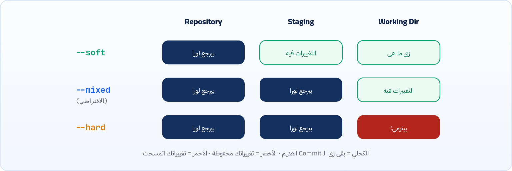
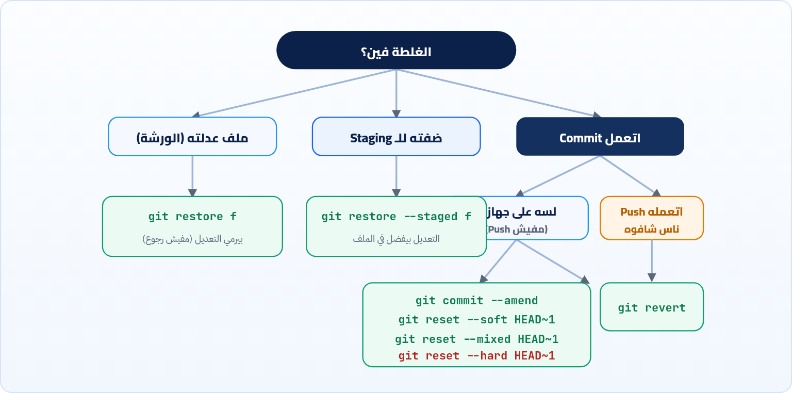

<small>المرحلة 2 · الأساس على جهازك</small>

ده الفصل اللي هيخليك متخافش من Git. عدّلت ملف وعاوز ترجعه؟ ضفت حاجة للـ Staging بالغلط؟ نسيت ملف في آخر Commit؟ عاوز تلغي آخر 3 Commits؟ عاوز تلغي Commit اتعمله Push؟ كل حالة ليها أمر، ولكل أمر درجة خطورة. وفي الآخر خريطة قرار تختار منها في ثانية.

:::note[بعد الفصل ده هتكون عارف]
- أول سؤال قبل أي تراجع: الغلطة في أنهي مكان؟ واتعملها Push ولا لأ؟
- git restore للورشة و git restore --staged للـ Staging
- git commit --amend لتصليح آخر Commit
- git reset بأنواعه التلاتة soft و mixed و hard بالرسم
- git revert لإلغاء Commit بأمان حتى بعد الـ Push
- git clean للملفات الجديدة، وخريطة قرار التراجع
:::

<a id="s6-1"></a>

## 6.1 قبل أي تراجع: سؤالين

خليني أحكيلك 4 مواقف هيحصلولك كلهم في أول شهر. الأول: الـ AI عدّل `script.js` والتعديل وحش، وانت عاوز ترجع الملف زي ما كان. التاني: عملت `git add .` ولقيت إن ملف `notes.txt` الشخصي دخل في الـ Staging. التالت: عملت Commit وبعدها على طول افتكرت إنك نسيت تضيف ملف. والرابع، وده الأصعب: عملت Commit فيه Bug، وعملته Push، وزميلك عمل Pull وبدأ يشتغل عليه.

الأربع مواقف اسمهم "عاوز أتراجع"، بس كل واحد فيهم حله مختلف تماماً. وده السبب إن أوامر التراجع في Git كتير وبتلخبط: مش لأن Git معقد، لأن "التراجع" نفسه ليه معاني كتير. فالسر إنك قبل أي أمر تسأل نفسك سؤالين:

#### 1 · الغلطة في أنهي مكان؟

في الورشة (ملف عدلته)؟ في الـ Staging (ضفت حاجة غلط)؟ ولا في التاريخ (Commit اتعمل)؟ افتكر الأماكن التلاتة ([↩ 3.3](../ch03/#s3-3 "الأماكن التلاتة")).

#### 2 · اتعملها Push؟

لو الـ Commit لسه على جهازك بس، تقدر تعدّل التاريخ براحتك. لو اتعمله Push وحد تاني ممكن يكون خده، **متعدلش التاريخ**: استخدم `revert`.

:::note[الخبر الحلو]
أي حاجة اتعملها **Commit** مرة، تقريباً مستحيل تضيع، حتى بعد `reset --hard`. الـ `reflog` (الفصل 16) بيرجّعها. اللي ممكن يضيع بجد هو التعديلات اللي **عمرها ما اتعملها Commit ولا add**. وعشان كده: Commit كتير.
:::

<a id="s6-2"></a>

## 6.2 git restore: ارجع ملف في الورشة أو الـ Staging

### ارمي تعديلاتك على ملف

**تشريح الأمر**

```sh
git restore app.js
```

1. `git restore`: رجّع ملفات لنسخة متسجلة.
2. `app.js`: الملف. من غير Options، بيرجّع نسخة الورشة لنسخة الـ **Staging** (واللي هي نفس آخر Commit لو معملتش add). يعني تعديلاتك اللي مش متعملها add هتتمسح.

:::caution[ده مفيهوش رجوع]
`git restore file` و `git restore .` بيمسحوا تعديلات **عمرها ما اتسجلت**، فمفيش reflog ولا أي حاجة ترجّعها (يمكن Undo الـ Editor أو Local History في VS Code لو محظوظ). اتأكد بـ `git diff` الأول إنك عاوز ترميها.
:::

### شيل حاجة من الـ Staging (من غير ما تضيع)

**تشريح الأمر**

```sh
git restore --staged app.js
```

1. `git restore`: رجّع.
2. `--staged`: المرة دي رجّع **الـ Staging** (مش الورشة) لنسخة آخر Commit. يعني "ألغي الـ git add". تعديلاتك في الملف نفسه **مش هتتلمس**، آمن 100%.
3. `app.js`: الملف، أو `.` للكل.

### جيب ملف من نسخة قديمة

**تشريح الأمر**

```sh
git restore --source=HEAD~2 -- src/app.js
```

1. `git restore`: رجّع.
2. `--source=HEAD~2`: من الـ Commit ده بدل الـ Staging (افتكر [↩ 4.2](../ch04/#s4-2 "إزاي تسمّي أي Commit")).
3. `--`: خلصت الـ Options.
4. `src/app.js`: الملف هيرجع زي ما كان من تلات Commits، في الورشة. وبعدها تعمل `git add` و Commit عادي لو عاجبك.

**git restore وأمثاله القديمة**

| عاوز | الجديد (2.23+) | القديم اللي هتلاقيه في شروحات |
|---|---|---|
| ارمي تعديلات الورشة | `git restore f` | `git checkout -- f` |
| شيل من الـ Staging | `git restore --staged f` | `git reset HEAD f` |
| الاتنين مرة واحدة | `git restore --staged --worktree f` | `git checkout HEAD -- f` |

:::tip[حاجة مشتركة: --]
الـ `--` تاني! في `git restore -- f` و `git log -- f` و `git diff -- f` و `git checkout -- f`، معناها في كل مرة: "اللي بعدي ملفات". وده بيفرق جداً في `git checkout` لو عندك Branch وملف بنفس الاسم.
:::

<a id="s6-3"></a>

## 6.3 git commit --amend: صلّح آخر Commit

عملت Commit ولقيت غلطة في الرسالة، أو نسيت تضيف ملف:

**تشريح الأمر**

```sh
git add forgotten.js && git commit --amend --no-edit
```

1. `git add forgotten.js`: حط الملف المنسي في الـ Staging.
2. `&&`: لو نجح، كمّل.
3. `git commit --amend`: بدل ما تعمل Commit جديد، **استبدل** آخر Commit بواحد جديد فيه محتواه + اللي في الـ Staging دلوقتي.
4. `--no-edit`: خلي الرسالة زي ما هي ومتفتحش الـ Editor.

| الأمر | بيعمل إيه |
|---|---|
| `git commit --amend -m "fix: correct message"` | غيّر رسالة آخر Commit بس (لو الـ Staging فاضي). |
| `git commit --amend --reset-author --no-edit` | لو الـ Commit اتعمل باسم أو إيميل غلط وبعدين ظبطتهم. |

:::caution[amend = Commit جديد]
الـ amend بيعمل Commit **جديد بـ Hash جديد** ويرمي القديم. لو القديم كان اتعمله Push، التاريخ عندك هيختلف عن GitHub وهتحتاج Force push (الفصل 15). القاعدة: **amend للي لسه على جهازك بس**.
:::

<a id="s6-4"></a>

## 6.4 git reset: رجّع الـ Branch لورا

ده الأمر اللي سمعته أكيد واتخوّفت منه، وليك حق جزئياً. خلينا نفهمه بهدوء. افتكر إن الـ Branch مجرد لافتة على Commit (هنشرحها بالتفصيل في الفصل 7، بس الفكرة دلوقتي كفاية). `git reset` بيشيل اللافتة ويحطها على Commit أقدم، كأن الـ Commits اللي بعده متعملتش. والسؤال: التغييرات اللي كانت فيهم تروح فين؟ ده اللي الـ Flag بيحدده:



*الأنواع التلاتة لـ git reset: كل نوع بيرجّع أماكن أكتر من اللي قبله.*

**تشريح الأمر**

```sh
git reset --soft HEAD~1
```

1. `git reset`: حرّك الـ Branch الحالي (و HEAD معاه).
2. `--soft`: حرّك التاريخ بس. التغييرات اللي كانت في الـ Commit الملغي **تفضل في الـ Staging**، جاهزة لـ Commit تاني.
3. `HEAD~1`: لحد فين: الأب. يعني "ألغي آخر Commit". و `HEAD~3` = آخر 3.

**أنواع git reset وإمتى تستخدم كل واحد**

| النوع | التغييرات تروح فين | استخدامه | الخطورة |
|---|---|---|---|
| `--soft` | الـ Staging | "عاوز أعيد الـ Commit ده بشكل تاني" أو أجمع آخر 3 Commits في واحد | آمن |
| `--mixed` | الورشة (مش متجهزة) | "عاوز ألغي الـ Commit وأختار تاني أضيف إيه" | آمن |
| `--hard` | بتترمي | "عاوز أرجع للنسخة القديمة بالظبط وأرمي كل اللي بعدها" | **خطر** |

:::note[مثال: جمّع آخر 3 Commits في واحد]
عملت 3 Commits صغيرين: `wip` و `wip2` و `fix typo`. عاوزهم Commit واحد محترم:

```sh title="Terminal"
git reset --soft HEAD~3
git commit -m "feat: add transfer form"
```

الـ `--soft` رجّع التاريخ 3 خطوات وساب كل التغييرات متجهزة، فـ Commit واحد جمعهم.
:::

:::caution[قبل reset --hard]
اعمل `git status`. لو فيه تعديلات مش متعملها Commit، `--hard` هيمسحها **من غير رجعة**. لو مش متأكد: `git stash` الأول (الفصل 14)، أو اعمل Branch احتياطي `git branch backup`. والـ Commits نفسها بترجع بـ reflog، وكمان Git بيحفظ مكانك القديم في `ORIG_HEAD`: `git reset --hard ORIG_HEAD` بيلغي آخر reset.
:::

:::note[git reset على ملف]
`git reset file.js` (من غير soft/mixed/hard ومع اسم ملف) = شيل الملف من الـ Staging. ده نفس `git restore --staged file.js`. ولو شفته في رسايل Git القديمة متتخضش.
:::

<a id="s6-5"></a>

## 6.5 git revert: الإلغاء الآمن

`reset` بيمسح Commits من التاريخ، وده مشكلة لو اتعملهم Push. `revert` بيعمل العكس: بيضيف **Commit جديد** بيعكس التغيير. التاريخ بيفضل زي ما هو، وبيتضاف عليه.


*الـ revert بيضيف Commit جديد بيعكس C، و D فضل زي ما هو.*

**تشريح الأمر**

```sh
git revert 38c2aec --no-edit
```

1. `git revert`: اعمل Commit جديد بيعكس التغييرات اللي في الـ Commit ده (اللي اتضاف يتشال، واللي اتشال يرجع).
2. `38c2aec`: الـ Commit اللي عاوز تلغيه، مش لازم يكون الأخير.
3. `--no-edit`: استخدم الرسالة الجاهزة (`Revert "fix: title text"`) من غير ما تفتح الـ Editor.

:::tip[القاعدة]
Commit **على جهازك بس**؟ `reset` أو `amend` براحتك. Commit **اتعمله Push**؟ `revert`. ولو الـ revert عمل Conflict، هتحله بنفس طريقة الفصل 8، وبعدين `git revert --continue`.
:::

:::note[revert لـ Merge Commit]
الـ Merge Commit ليه أبين، فـ Git محتاج تقوله ترجع لأنهي واحد: `git revert -m 1 <merge-hash>`. الـ `-m 1` = Mainline: الأب الأول، يعني الـ Branch اللي كنت عليه وقت الـ Merge (غالباً main). هنفهم الـ Merge في الفصل 8.
:::

<a id="s6-6"></a>

## 6.6 git clean: الملفات الجديدة Untracked

`restore` و `reset` مبيلمسوش الملفات **Untracked**. لو عاوز تمسحها (مثلاً ملفات عملها الـ AI ومش عاوزها):

**تشريح الأمر**

```sh
git clean -n -d
```

1. `git clean`: امسح الملفات اللي Git مش بيتابعها.
2. `-n`: Dry run: **اعرض** اللي هيتمسح من غير ما تمسح. ابدأ بيها دايماً (زي `--dry-run` في rsync).
3. `-d`: Directories: الفولدرات الجديدة كمان، مش الملفات بس.

| الأمر | بيعمل إيه |
|---|---|
| `git clean -n -d` | شوف الأول. |
| `git clean -f -d` | `-f` = Force: امسح بجد (Git بيرفض من غيرها كأمان). |
| `git clean -i` | Interactive: يسألك ملف ملف. |
| `git clean -fdx` | `-x` = حتى المتجاهَل في .gitignore: هيمسح `node_modules` و <strong>.env</strong>! استخدمها لو فاهم. |

:::tip[حاجة مشتركة: -n و -f]
الـ `-n` = جرّب من غير تنفيذ (Dry run) في `git clean` و `git add -n` و `git rm -n` و `git push -n`، زي `rsync -n` في كتاب الـ Terminal. والـ `-f` = Force في `git clean` و `git push -f` و `git branch -f`، زي `rm -f`. أي `-f` في Git = "فكّر مرتين".
:::

<a id="s6-7"></a>

## 6.7 خريطة قرار التراجع



*خريطة القرار: ابدأ من فوق، وجاوب على السؤالين.*

**عاوز إيه؟ استخدم إيه؟**

| الموقف | الأمر | الخطورة |
|---|---|---|
| ارمي تعديلاتي على ملف | `git restore f` | بيمسح التعديل |
| ارمي كل التعديلات في المشروع | `git restore .` | بيمسح التعديلات |
| ألغي git add | `git restore --staged f` | آمن |
| غيّر رسالة آخر Commit / ضيف ملف نسيته | `git commit --amend` | آمن لو مش Pushed |
| ألغي آخر Commit وخلي التغييرات متجهزة | `git reset --soft HEAD~1` | آمن |
| ألغي آخر Commit وخلي التغييرات في الملفات | `git reset HEAD~1` | آمن |
| ارجع لـ Commit قديم وارمي كل حاجة بعده | `git reset --hard <hash>` | **خطر** على اللي مش متعمله Commit |
| ألغي Commit اتعمله Push | `git revert <hash>` | آمن |
| جيب ملف واحد من نسخة قديمة | `git restore --source=<hash> f` | بيكتب فوق الملف |
| امسح الملفات الجديدة اللي مش متابَعة | `git clean -n` ثم `-fd` | بيمسح نهائي |
| عملت reset غلط | `git reset --hard ORIG_HEAD` أو `git reflog` | بينقذك (الفصل 16) |

:::tip[ملخص الفصل]
- سؤالين: الغلطة فين (ورشة/Staging/Commit)؟ واتعملها Push؟
- `git restore f` يرمي تعديل الورشة (مفيش رجوع)، و `--staged` يلغي الـ add بأمان.
- `--amend` يصلّح آخر Commit، بس بيعمل Hash جديد.
- `reset --soft` للـ Staging، و `--mixed` (الافتراضي) للورشة، و `--hard` يرمي.
- `revert` للي اتعمله Push، و `git clean -n` قبل `-f` دايماً.
:::

### صح ولا غلط؟

1. `git restore --staged f` بيمسح التعديلات اللي في الملف.
2. `git revert` بيمسح الـ Commit من التاريخ.
3. `git reset` من غير Flag بيشتغل كـ `--mixed`.

### أسئلة مراجعة

1. عملت Commit ونسيت ملف، ولسه معملتش Push. إيه أسهل حل؟
2. اشرح الفرق بين `reset --soft` و `--mixed` و `--hard` من حيث الأماكن التلاتة.
3. زميلك عمل Pull لـ Commit فيه Bug انت عملته. تلغيه إزاي؟ وليه مش reset؟
4. إيه الفرق بين `git restore f` و `git clean -f`؟

### تحديات الفصل

<small>جرّبها بإيدك، والحلول في ملحق الإجابات.</small>

1. **[سهل]** عدّل ملف وارمي التعديل بـ `git restore`. وبعدين عدّله، اعمل add، وشيله من الـ Staging بـ `--staged`، واتأكد إن التعديل لسه في الملف.
2. **[متوسط]** اعمل 3 Commits، وبعدين جمّعهم في Commit واحد بـ `reset --soft`. قارن `git log --oneline` قبل وبعد.
3. **[صعب]** اعمل Commit، وبعدين `git reset --hard HEAD~1`، وحاول ترجّعه بـ `git reset --hard ORIG_HEAD`. (ولو فشلت، استنى الفصل 16 وارجعلها بـ reflog).
