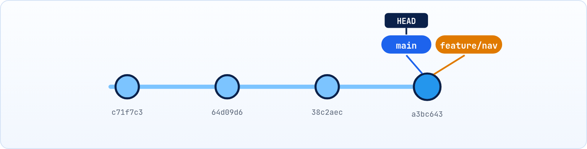
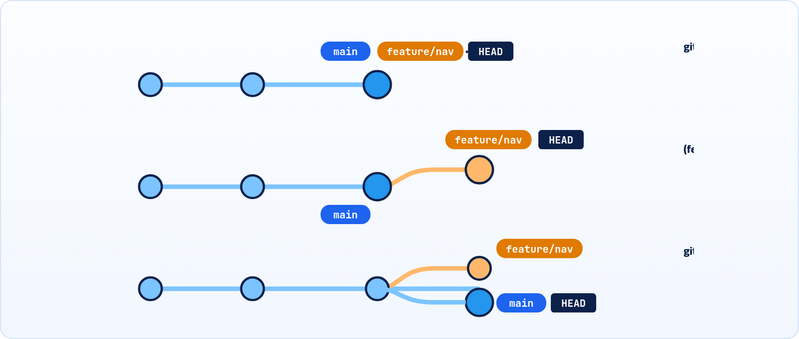

<small>المرحلة 3 · الـ Branches</small>

عاوز تجرّب Navbar جديد أو تخلّي الـ AI يعيد كتابة ملف كامل، من غير ما تلمس النسخة الشغالة؟ ده بالظبط اللي الـ Branch معمول عشانه. هنفهم إن الـ Branch مجرد لافتة صغيرة على Commit، وإن HEAD هو سهم إنت واقف فين، وبعدين نعمل ونتنقل ونمسح Branches بأمان.

:::note[بعد الفصل ده هتكون عارف]
- المشكلة اللي الـ Branches بتحلها
- إن الـ Branch مجرد مؤشر (لافتة) على Commit، مش نسخة من المشروع
- يعني إيه HEAD وإزاي بيتحرك
- git branch و git switch بكل الـ Flags المهمة
- إيه اللي بيحصل لتعديلاتك لما تتنقل بين Branches
- الـ Detached HEAD: يعني إيه ومتخافش منه
- مسح وتغيير أسماء الـ Branches بأمان
:::

<a id="s7-1"></a>

## 7.1 المشكلة: عاوز أجرّب من غير ما أبوّظ

موقع الـ Portfolio بتاعك شغال ومنشور. عاوز تعمل تصميم جديد للـ Navbar، وده هياخد كام يوم. في النص، اكتشفت Bug في صفحة Contact لازم يتصلح النهارده. لو كل شغلك على خط واحد، الإصلاح هيتخلط بتصميم الـ Navbar اللي لسه مش جاهز.

الحل: **خطوط شغل متوازية**. خط للـ Navbar، وخط للإصلاح، والخط الأساسي `main` فاضل نضيف وشغال. كل خط اسمه **Branch**.

<a id="s7-2"></a>

## 7.2 الـ Branch = لافتة على Commit

ده أهم حاجة تفهمها: الـ Branch في Git **مش نسخة** من المشروع. هو مجرد **اسم بيشاور على Commit**، زي لافتة أو Sticky note. عشان كده عمل Branch جديد بياخد جزء من الثانية ومبياخدش مساحة. (فعلياً، كل Branch ملف صغير جوه `.git/refs/heads/` فيه 40 حرف: الـ Hash).



*بعد git branch feature/nav: لافتتين على نفس الـ Commit، و HEAD على main.*

#### الـ Branch

اسم بيشاور على آخر Commit في خط شغل. ولما تعمل Commit وانت عليه، **اللافتة بتتحرك لقدام لوحدها** للـ Commit الجديد.

#### HEAD

سهم "إنت هنا". عادةً بيشاور على Branch (مش على Commit مباشرة). الـ Branch اللي HEAD عليه هو اللي هيتحرك مع الـ Commit الجاي.

<a id="s7-3"></a>

## 7.3 HEAD بيتحرك إزاي

خلينا نتابع 3 لحظات:



*الـ Branch اللي عليه HEAD هو بس اللي بيتحرك مع كل Commit، وكده الخطين اتفرعوا.*

1. <strong>تنقّلت لـ feature/nav:</strong> HEAD بقى بيشاور عليه. الاتنين على نفس الـ Commit، فالملفات زي ما هي.
2. <strong>عملت Commit:</strong> اللافتة `feature/nav` اتحركت للـ Commit الجديد، و `main` فضلت مكانها.
3. <strong>رجعت لـ main وعملت Commit:</strong> main اتحرك في اتجاه تاني. دلوقتي الخطين **اتفرعوا** (Diverged)، وده بالظبط سبب كلمة Branch (فرع شجرة).

:::note[إزاي تعرف HEAD فين]
`git status` أول سطر: `On branch main`. أو `git branch` (اللي جنبه `*`). أو `git log --oneline -1` هتلاقي `(HEAD -> main)`. وكمان في الـ Prompt لو بتستخدم oh-my-zsh أو Starship (من كتاب الـ Terminal)، اسم الـ Branch بيظهر على طول.
:::

<a id="s7-4"></a>

## 7.4 git branch: اعرض واعمل

```sh title="Terminal"
$ git branch
  feature/title
* main
  notes
$ git branch -vv
  feature/title 4ea67eb feat: change title
* main          e9db4ff [origin/main] docs: update readme
  notes         0dd1b27 docs: add notes
```

| الأمر | بيعمل إيه |
|---|---|
| `git branch` | اعرض الـ Branches المحلية، و `*` = اللي إنت عليه. |
| `git branch -v` | Verbose: ومع كل واحد آخر Commit فيه. و `-vv` كمان بيوريك مربوط بأنهي Branch على GitHub (الفصل 10). |
| `git branch -a` | All: المحلية + اللي على الـ Remote. |
| `git branch feature/nav` | اعمل Branch جديد **من غير ما تتنقل له**. |
| `git branch --merged` | الـ Branches اللي اتدمجت خلاص في اللي إنت عليه (آمن تمسحها). |

:::tip[تسمية الـ Branches]
استخدم أسماء بتوصف الشغل، بحروف صغيرة وشرطة: `feature/dark-mode` و `fix/contact-form` و `docs/readme` و `ai/refactor-api`. الـ `/` مجرد جزء من الاسم بيخلي الأدوات تجمّعهم، مش فولدر حقيقي. وابعد عن المسافات والحروف العربي في أسماء الـ Branches.
:::

<a id="s7-5"></a>

## 7.5 git switch: اتنقّل بين الـ Branches

**تشريح الأمر**

```sh
git switch -c feature/nav
```

1. `git switch`: غيّر الـ Branch اللي إنت عليه (حرّك HEAD)، وحدّث ملفات الورشة عشان تبقى زي آخر Commit فيه.
2. `-c`: Create: اعمل Branch جديد بالاسم ده الأول، وبعدين اتنقل له. من غيرها لازم يكون موجود.
3. `feature/nav`: الاسم. هيبدأ من الـ Commit اللي إنت عليه دلوقتي.

| الأمر | بيعمل إيه |
|---|---|
| `git switch main` | اتنقل لـ Branch موجود. |
| `git switch -` | ارجع للـ Branch اللي كنت عليه قبل كده (زي `cd -` في كتاب الـ Terminal). |
| `git switch -c fix/form main` | اعمل Branch جديد يبدأ من `main` مهما كنت واقف فين. |
| `git switch -C feature/nav` | كبيرة = اعمله، ولو موجود **اكتب فوقه** (خطر شوية). |

**git switch مقابل git checkout**

| عاوز | الجديد | القديم |
|---|---|---|
| اتنقل لـ Branch | `git switch main` | `git checkout main` |
| اعمل واتنقل | `git switch -c new` | `git checkout -b new` |
| ارجع لملف قديم | `git restore f` | `git checkout -- f` |

:::note[ليه أمرين جداد؟]
`git checkout` كان بيعمل حاجات كتير مختلفة (يتنقل بين Branches ويرجّع ملفات)، وده كان بيلخبط الناس ويعمل كوارث. فـ Git 2.23 (2019) قسّمه لـ `switch` (للـ Branches) و `restore` (للملفات). استخدم الجداد، بس اعرف القديم لأنه في كل حتة على النت وفي اقتراحات الـ AI.
:::

### إيه اللي بيحصل لتعديلاتي لما أتنقل؟

Git بيغيّر الملفات في الورشة عشان تطابق الـ Branch الجديد. وتعديلاتك اللي مش متعملها Commit:

- <strong>لو مفيش تعارض:</strong> بتتنقل معاك للـ Branch الجديد كما هي (ودي بتلخبط ناس: التعديل مش "تبع" Branch لحد ما تعمله Commit).
- <strong>لو الملف نفسه مختلف في الـ Branch التاني:</strong> Git بيرفض عشان ميضيعش شغلك:

```sh title="Terminal"
$ git switch main
error: Your local changes to the following files would be overwritten by checkout:
	index.html
Please commit your changes or stash them before you switch branches.
Aborting
```

<strong>الحل:</strong> يا تعمل Commit للشغل ده على الـ Branch بتاعه، يا تعمل `git stash` (تشيله على جنب مؤقتاً، الفصل 14). وأحسن عادة: <strong>اتنقل وانت `working tree clean`</strong>.

<a id="s7-6"></a>

## 7.6 الـ Detached HEAD: متتخضش

لو اتنقلت لـ **Commit** مش لـ Branch (مثلاً عشان تتفرج على نسخة قديمة)، HEAD بيشاور على الـ Commit مباشرة، من غير لافتة:

```sh title="Terminal"
$ git switch --detach 38c2aec
HEAD is now at 38c2aec fix: title text
$ git status
HEAD detached at 38c2aec
```

**تشريح الأمر**

```sh
git switch --detach 38c2aec
```

1. `git switch`: حرّك HEAD.
2. `--detach`: "عارف إن ده مش Branch، وده قصدي". `git switch` بيرفض يروح لـ Commit من غيرها كأمان، أما `git checkout 38c2aec` بيروح على طول ويطبعلك تحذير طويل.
3. `38c2aec`: الـ Commit.


*Detached HEAD: السهم على Commit قديم مباشرة، من غير Branch.*

الوضع ده آمن تماماً للتفرج والتجربة. المشكلة الوحيدة: لو عملت Commits هنا ورجعت لـ main، الـ Commits دي ملهاش لافتة، وهتبقى "تايهة" (والـ reflog يقدر يلاقيها). الحل بسيط:

| الأمر | بيعمل إيه |
|---|---|
| `git switch -` | مجرد تفرج؟ ارجع للـ Branch اللي كنت عليه. |
| `git switch -c experiment` | عملت Commits وعاوز تحتفظ بيها؟ اعمل Branch هنا، وهيبقى ليهم لافتة. |

<a id="s7-7"></a>

## 7.7 مسح وتغيير اسم الـ Branches

بعد شهر شغل، هتكتب `git branch` وتلاقي قايمة طويلة: Branches اتدمجت من زمان، وتجارب فشلت، وواحد اسمه `test2` مش فاكر عملته ليه. مسح الـ Branch مش بيمسح أي Commit اتدمج، هو بيشيل اللافتة بس. وعشان كده Git عنده نوعين مسح: واحد حذر بيرفض لو فيه شغل هيضيع، وواحد "أنا عارف أنا بعمل إيه":

**تشريح الأمر**

```sh
git branch -d feature/nav
```

1. `git branch`: إدارة الـ Branches.
2. `-d`: Delete: امسح اللافتة، **بس لو** شغلها اتدمج (Merged). لو لأ، Git بيرفض: `error: the branch 'feature/nav' is not fully merged`.
3. `feature/nav`: الـ Branch. ومينفعش تمسح الـ Branch اللي إنت عليه.

| الأمر | بيعمل إيه |
|---|---|
| `git branch -D experiment` | كبيرة = امسح حتى لو مش متدمج (= `-d --force`). الـ Commits لسه في الـ reflog لفترة. |
| `git branch -m old-name new-name` | Move: غيّر الاسم. ومن غير الاسم القديم = غيّر اسم الحالي. |
| `git branch -m master main` | مثال مشهور: غيّر master لـ main في Repo قديم. |

:::tip[حاجة مشتركة: الحرف الصغير والكبير]
في Git كتير: الصغير = النسخة الآمنة، والكبير = "متأكد، نفّذ". `-d` / `-D` في branch، و `-c` / `-C` في switch، و `-m` / `-M` في branch. نفس فكرة `rm -i` و `rm -f`.
:::

:::note[مثال كامل: Branch للتجربة]
عاوز تجرّب مكتبة Animation جديدة:

```sh title="Terminal"
git status                      # اتأكد إن مفيش تعديلات
git switch -c try/gsap          # خط تجربة جديد
# ... عدّل واعمل Commits ...
git switch main                 # ارجع للنسخة الشغالة، كأن مفيش حاجة حصلت
git branch -D try/gsap          # التجربة فشلت؟ ارميها
# أو: نجحت؟ ادمجها (الفصل الجاي)
```
:::

:::tip[ملخص الفصل]
- الـ Branch = لافتة على Commit، بتتحرك لقدام لوحدها مع كل Commit.
- HEAD = إنت هنا، وعادةً بيشاور على Branch.
- `git switch -c name` تعمل وتتنقل، و `git switch -` ترجع، و `git branch -vv` تعرض.
- اتنقل وانت clean، وإلا Commit أو stash.
- Detached HEAD = على Commit من غير Branch، والحل `switch -` أو `switch -c`. و `-d` تمسح بأمان و `-D` بالقوة.
:::

### صح ولا غلط؟

1. عمل Branch جديد بينسخ كل ملفات المشروع.
2. لما تعمل Commit، كل الـ Branches بتتحرك لقدام.
3. `git branch -d` بيرفض يمسح Branch شغله لسه مش متدمج.

### أسئلة مراجعة

1. اشرح بالرسم إيه اللي بيحصل لـ main و feature و HEAD لما تعمل Commit على feature.
2. إيه الفرق بين `git branch x` و `git switch -c x`؟
3. يعني إيه Detached HEAD؟ وإزاي تحتفظ بـ Commits عملتها وانت فيه؟
4. ليه Git رفض يعمل switch وقالك `would be overwritten`؟ واذكر حلين.

### تحديات الفصل

<small>جرّبها بإيدك، والحلول في ملحق الإجابات.</small>

1. **[سهل]** اعمل `feature/footer`، اعمل عليه Commit، ارجع لـ main، وبص على الملفات: التعديل اختفى؟ ارجع تاني واتأكد إنه رجع.
2. **[متوسط]** اعمل Commit على main وكمان على feature/footer، وبعدين اعرض الشجرة بـ `git log --oneline --graph --all` واشرحها.
3. **[صعب]** روح Detached على Commit قديم، اعمل Commit تجريبي، ارجع لـ main من غير ما تعمل Branch. حاول تلاقي الـ Commit ده تاني بـ `git reflog` واعمله Branch.
