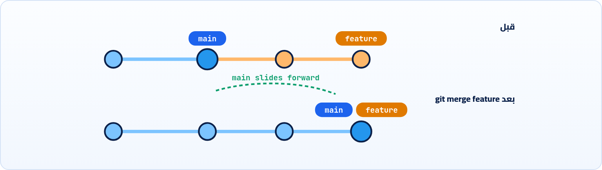
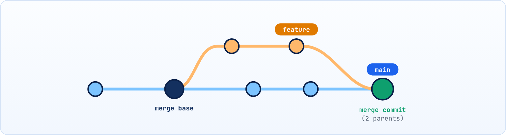

<small>المرحلة 3 · الـ Branches</small>

خلصت الـ Navbar على Branch لوحده واشتغل. دلوقتي عاوز ترجّعه لـ main. ده اسمه Merge. أحياناً Git بيعملها لوحده في ثانية، وأحياناً بيقف ويقولك CONFLICT لأن الخطين عدّلوا نفس السطر. الفصل ده بيشرح نوعين الـ Merge بالرسم، وبيمشي معاك في حل الـ Conflict خطوة بخطوة من غير رعب.

:::note[بعد الفصل ده هتكون عارف]
- git merge بيعمل إيه وبيتعمل من أنهي Branch
- الـ Fast-forward والـ 3-way merge بالرسم، والـ Merge Commit
- --no-ff و --ff-only وإمتى تستخدمهم
- ليه الـ Conflict بيحصل وشكل علامات الـ Conflict
- حل الـ Conflict خطوة بخطوة في الـ Terminal وفي VS Code
- git merge --abort، وإزاي تقلل الـ Conflicts من الأساس
:::

<a id="s8-1"></a>

## 8.1 git merge: رجّع الشغل للخط الأساسي

تخيل إنك بقالك يومين على `feature/nav`، والـ Navbar الجديد بقى تحفة: Dropdown وبيتقفل على الموبايل وكل حاجة. دلوقتي عاوزه يدخل النسخة الأساسية `main` عشان يتنشر. انت محتاج تقول لـ Git: "خد الشغل اللي على الخط ده وحطه في الخط ده". ده الـ Merge.

والقاعدة الأهم: إنت **بتقف على الـ Branch اللي عاوز تستقبل فيه**، وبتقول اسم الـ Branch اللي جاي منه.

**تشريح الأمر**

```sh
git switch main && git merge feature/nav
```

1. `git switch main`: اقف على المستقبِل (اللي عاوزه يتحدّث).
2. `&&`: لو نجح، كمّل.
3. `git merge`: هات التغييرات اللي في الـ Branch ده وادمجها في اللي أنا عليه.
4. `feature/nav`: المصدر. هو نفسه مش بيتغير، وتقدر تمسحه بعدها بـ `git branch -d`.

:::caution[أشهر لخبطة]
"ادمج main في feature" غير "ادمج feature في main". اللي إنت واقف عليه هو اللي بيتغير. لو مش متأكد، `git status` الأول.
:::

وفيه نوعين Merge حسب شكل التاريخ:

<a id="s8-2"></a>

## 8.2 النوع 1: Fast-forward

لو `main` متحركش من ساعة ما عملت `feature`، يبقى مفيش حاجة "تتدمج" فعلاً: Git بيحرّك لافتة main لقدام لحد آخر Commit في feature. خلاص.



*Fast-forward: مفيش Commit جديد، اللافتة بس اتزحلقت لقدام.*

```sh title="Terminal"
$ git merge feature
Updating 48c8db7..a3bc643
Fast-forward
 nav.js | 12 ++++++++++++
 1 file changed, 12 insertions(+)
```

<a id="s8-3"></a>

## 8.3 النوع 2: الـ 3-way Merge و Merge Commit

لو الخطين اتحركوا (عملت Commits على main وعلى feature)، Git مش هيقدر يزحلق. هيعمل **Merge Commit**: Commit جديد ليه **أبين**، بيجمع الاتنين. واسمه 3-way لأن Git بيقارن 3 نسخ: آخر Commit في main، وآخر Commit في feature، و**الجد المشترك** (Merge Base) اللي اتفرعوا منه.



*3-way merge: Git قارن الجد المشترك بالطرفين، وعمل Commit جديد بأبين.*

```sh title="Terminal"
$ git merge feature/title
Merge made by the 'ort' strategy.
 index.html | 2 +-
 1 file changed, 1 insertion(+), 1 deletion(-)
```

الـ `'ort'` ده اسم الخوارزمية اللي Git بيدمج بيها (الافتراضية من Git 2.34). ولو الـ Merge محتاج رسالة، Git هيفتح الـ Editor برسالة جاهزة `Merge branch 'feature/title'`، احفظ واقفل وخلاص.

### التحكم في نوع الـ Merge

| الأمر | بيعمل إيه |
|---|---|
| `git merge --no-ff feature` | No Fast-forward: اعمل Merge Commit حتى لو ينفع Fast-forward، عشان التاريخ يوضح إن فيه Feature اتدمجت كوحدة. |
| `git merge --ff-only feature` | ادمج بس لو Fast-forward، غير كده ارفض. آمن لما تكون عاوز تحدّث بس من غير Merge Commits. |
| `git merge --squash feature` | جمّع كل تغييرات feature في الـ Staging من غير Commit، وانت تعمل Commit واحد. (نفس فكرة زرار Squash على GitHub، الفصل 11). |
| `git merge feature -m "msg"` | رسالة الـ Merge Commit من غير Editor. |

<a id="s8-4"></a>

## 8.4 الـ Conflict: ليه بيحصل؟

الكلمة دي (CONFLICT) بحروف كبيرة حمرا بترعب أي حد أول مرة. بس خليني أطمنك بحكاية: تخيل انت وزميلك بتكتبوا نفس المقال في Google Doc. انت عدّلت العنوان، وهو عدّل آخر فقرة، مفيش مشكلة. لكن لو انتوا الاتنين غيرتوا **نفس الجملة** بشكلين مختلفين في نفس الوقت، مين فيكم الصح؟ محدش يقدر يقرر غير بني آدم.

Git بالظبط كده. هو ذكي جداً في الدمج: لو main عدّل سطر 5 و feature عدّل سطر 40، بيدمج لوحده. المشكلة بس لما **الاتنين يعدلوا نفس السطر** (أو واحد يعدّل ملف والتاني يمسحه). ساعتها Git مش هيخمن مين الصح، وبيقف ويسألك:

```sh title="Terminal"
$ git merge feature/title
Auto-merging index.html
CONFLICT (content): Merge conflict in index.html
Automatic merge failed; fix conflicts and then commit the result.
```

:::note[الـ Conflict مش غلطة]
الـ Conflict مش Bug ولا إنك عملت حاجة غلط. ده Git بيقولك بأدب: "فيه قرار محتاج بني آدم". ومحدش هيتأذي: الـ Merge واقف في النص، وتقدر تلغيه في أي لحظة بـ `git merge --abort`.
:::

### شكل الملف وقت الـ Conflict

```sh title="Terminal"
$ cat index.html
<<<<<<< HEAD
<h1>Hello</h1>
=======
<h1>Welcome</h1>
>>>>>>> feature/title
```

```sh title="علامات الـ Conflict"
<<<<<<< HEAD
<h1>Hello</h1>
=======
<h1>Welcome</h1>
>>>>>>> feature/title
```

1. `<<<<<<< HEAD`: بداية الـ Conflict. اللي تحتها = **نسختك** (الـ Branch اللي إنت واقف عليه، هنا main). اسمها "Current".
2. `<h1>Hello</h1>`: السطر زي ما هو في main.
3. `=======`: الفاصل بين النسختين.
4. `<h1>Welcome</h1>`: السطر زي ما هو في الـ Branch الجاي. اسمها "Incoming".
5. `>>>>>>> feature/title`: نهاية الـ Conflict، واسم الـ Branch الجاي.

<a id="s8-5"></a>

## 8.5 حل الـ Conflict خطوة بخطوة

1. <strong>متتخضش، واعرف مين فيه مشكلة:</strong> `git status` هيوريك `both modified: index.html` تحت `Unmerged paths`.
2. **افتح الملف** ودوّر على `<<<<<<<` (ممكن يبقى فيه كذا Conflict في نفس الملف).
3. <strong>قرر:</strong> نسختك؟ ولا الجاية؟ ولا مزيج من الاتنين؟ ولا حاجة جديدة خالص؟ عدّل لحد ما الكود يبقى الشكل النهائي اللي عاوزه.
4. **امسح العلامات التلاتة** (`<<<` و `===` و `>>>`) كلها. لو نسيت واحدة، الكود هيبوظ.
5. <strong>جرّب:</strong> شغّل المشروع واتأكد إنه شغال.
6. <strong>قول لـ Git إنك حليت:</strong> `git add index.html`. الـ add هنا معناها "اتحل".
7. <strong>كمّل الـ Merge:</strong> `git commit` (هيفتح برسالة جاهزة) أو `git merge --continue`.

```sh title="Terminal"
$ git status
On branch main
You have unmerged paths.
  (fix conflicts and run "git commit")
  (use "git merge --abort" to abort the merge)

Unmerged paths:
  (use "git add <file>..." to mark resolution)
	both modified:   index.html
$ code index.html            # عدّل وامسح العلامات
$ git add index.html
$ git commit --no-edit
[main 7b1e2c9] Merge branch 'feature/title'
```

:::tip[في VS Code أسهل بكتير]
VS Code بيلوّن الـ Conflict وبيحط فوقه أزرار: **Accept Current Change** (نسختك) و **Accept Incoming Change** (الجاية) و **Accept Both Changes** (الاتنين تحت بعض) و **Compare Changes**. وفيه كمان **Merge Editor** بـ 3 أعمدة (زرار `Resolve in Merge Editor`). بس افهم الأول العلامات بإيدك، عشان تعرف الزراير بتعمل إيه.
:::

**حالات الـ Conflict الشائعة**

| الرسالة في status | يعني | الحل |
|---|---|---|
| `both modified` | الاتنين عدلوا نفس الحتة | عدّل الملف وامسح العلامات، ثم add |
| `both added` | الاتنين عملوا ملف بنفس الاسم | نفس الكلام |
| `deleted by us` / `deleted by them` | واحد مسح والتاني عدّل | عاوزه؟ `git add f`. مش عاوزه؟ `git rm f` |

**تشريح الأمر**

```sh
git checkout --theirs -- package-lock.json
```

1. `git checkout`: هنا بنستخدمه عشان يجيب نسخة ملف.
2. `--theirs`: خد نسخة **الـ Branch الجاي** كلها للملف ده. وعكسها `--ours` = نسختك. (وتتكتب كمان `git restore --theirs`).
3. `--`: اللي بعدي ملفات.
4. `package-lock.json`: ملف مولّد مش هتحله بإيدك أبداً. بعدها الأحسن: `npm install` عشان يتولد صح، ثم `git add package-lock.json`.

<a id="s8-6"></a>

## 8.6 خط الرجوع: git merge --abort

**تشريح الأمر**

```sh
git merge --abort
```

1. `git merge`: الـ Merge اللي شغال دلوقتي.
2. `--abort`: الغيه، ورجّع كل حاجة زي ما كانت قبل ما تكتب `git merge`. مفيش أي ضرر. (لو كان عندك تعديلات مش متعملها Commit قبل الـ Merge، ممكن متعرفش ترجعها كويس، وعشان كده: Merge وانت clean).

:::tip[حاجة مشتركة: --abort و --continue]
أي عملية في Git ممكن تقف في النص عشان Conflict ليها الزوج ده: `git merge --abort / --continue`، و `git rebase --abort / --continue`، و `git cherry-pick --abort / --continue`، و `git revert --abort / --continue`. و `git status` دايماً بيقولك إنت جوه أنهي عملية.
:::

<a id="s8-7"></a>

## 8.7 إزاي تقلل الـ Conflicts

#### Branches قصيرة العمر

Branch بيعيش يوم أو اتنين أحسن من Branch عايش شهر. كل ما يطوّل، main بيتحرك أكتر والـ Conflicts بتكبر.

#### هات main كل شوية

وانت شغال على feature، ادمج main فيه من وقت للتاني (`git merge main`) عشان تحل Conflicts صغيرة بدري.

#### Commits صغيرة ومركّزة

متعملش "Format" للملف كله في نفس الـ Commit اللي فيه تعديل حقيقي: ده بيعمل Conflict في كل سطر.

#### اتفقوا على Formatter

Prettier بنفس الإعدادات للفريق كله، عشان محدش يغيّر المسافات والـ Quotes في سطور مش بتاعته.

:::caution[مع الـ AI]
أدوات الـ AI ساعات بتعيد كتابة ملف كامل عشان تغيير صغير. لو اتنين (أو إنت والـ AI على Branchين) عملوا كده، الـ Conflict هيبقى على الملف كله. اطلب من الـ AI تغييرات صغيرة ومحددة، وبص على `git diff --stat` (الفصل 18).
:::

:::tip[ملخص الفصل]
- اقف على المستقبِل، و `git merge source`.
- Fast-forward = اللافتة بتتزحلق، و 3-way = Merge Commit بأبين.
- `--no-ff` دايماً Merge Commit، و `--ff-only` زحلقة بس أو ارفض.
- الـ Conflict: `<<<<<<< HEAD` نسختك، `=======` فاصل، `>>>>>>>` الجاي. عدّل، امسح العلامات، add، commit.
- `git merge --abort` يرجّع كل حاجة، و Branches قصيرة = Conflicts أقل.
:::

### صح ولا غلط؟

1. `git merge feature` وانت على main بيغيّر feature.
2. الـ Fast-forward بيعمل Merge Commit جديد.
3. بعد ما تحل الـ Conflict في الملف، لازم `git add` عشان تقول لـ Git إنه اتحل.

### أسئلة مراجعة

1. إمتى Git يعمل Fast-forward وإمتى 3-way؟ ارسم الحالتين.
2. إيه هو الـ Merge Base؟ وليه Git محتاجه؟
3. اشرح كل علامة من علامات الـ Conflict.
4. اكتب الخطوات من أول ما تشوف CONFLICT لحد ما الـ Merge يخلص.

### تحديات الفصل

<small>جرّبها بإيدك، والحلول في ملحق الإجابات.</small>

1. **[سهل]** اعمل Branch، اعمل عليه Commit، ارجع لـ main وادمجه. اتأكد إن الرسالة `Fast-forward`.
2. **[متوسط]** اعمل Conflict بإيدك: نفس السطر في `index.html` اتعدل بشكلين على Branchين. ادمج وحل الـ Conflict بمزيج من النسختين.
3. **[صعب]** اعمل Conflict تاني، والمرة دي الغيه بـ `--abort`. وبعدين أعد الـ Merge وحل بـ `--theirs` للملف كله. قارن `git log --graph` في الحالتين.
