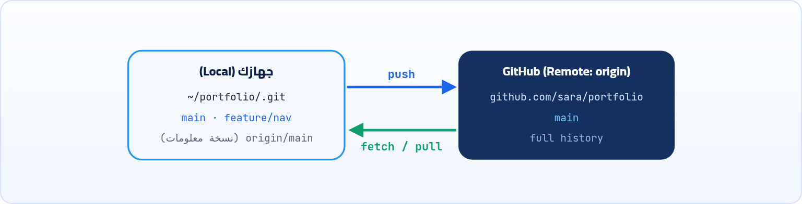

<small>المرحلة 4 · GitHub والتعاون</small>

لحد دلوقتي كل حاجة على جهازك. لو الـ Laptop وقع أو اتسرق، التاريخ كله راح. ولو عاوز تشارك مشروعك أو تنشره، محتاج نسخة على النت. هنا ييجي GitHub. الفصل ده عن الحساب، وفكرة الـ Remote، وأهم حتة بتوقع المبتدئين: إزاي جهازك يثبت لـ GitHub إنك إنت، بـ SSH أو بـ HTTPS و Token.

:::note[بعد الفصل ده هتكون عارف]
- عمل حساب GitHub وتأمينه بـ 2FA
- عمل Repo على GitHub وربطه بمشروع موجود
- يعني إيه Remote و origin، و git remote بكل أشكاله
- الفرق بين روابط HTTPS و SSH
- عمل مفتاح SSH وإضافته لـ GitHub واختباره
- HTTPS على الـ Mac بـ gh أو Keychain و Token، وليه الباسورد مبقاش ينفع
:::

<a id="s9-1"></a>

## 9.1 الحساب على GitHub

1. **اعمل حساب** على github.com. اختار Username محترم، لأنه هيبقى في روابط مشاريعك وموقعك (`sara.github.io`).
2. **فعّل 2FA** (Two-factor authentication) من **Settings ← Password and authentication**، بتطبيق Authenticator أو Passkey. GitHub بيلزم بيه أي حد بيساهم بكود، فعّله من الأول واحفظ الـ Recovery codes في مكان آمن.
3. **ظبّط الإيميل الخاص** لو عاوز ([↩ 2.3](../ch02/#s2-3 "إنت مين؟ user.name و user.email")).

:::note[الخطة المجانية كفاية جداً]
الـ Free plan فيه Repos عامة وخاصة بلا عدد، و GitHub Pages للـ Repos العامة، و GitHub Actions مجانية للـ Repos العامة (وللخاصة فيه دقايق شهرية محدودة). يعني كل اللي في الكتاب ده ببلاش.
:::

<a id="s9-2"></a>

## 9.2 يعني إيه Remote؟

**Remote** = نسخة تانية من نفس الـ Repo في مكان تاني (غالباً على GitHub)، ليها اسم مختصر عندك. والاسم المتعارف عليه للنسخة الأساسية: <strong>`origin`</strong>. يعني `origin` مش كلمة سحرية، مجرد Nickname بدل ما تكتب الرابط الطويل كل مرة.



*الـ Local والـ Remote: نسختين كاملتين، والـ push والـ pull بيزامنوهم.*

### ربط مشروع موجود بـ Repo جديد على GitHub

1. على GitHub: **New repository**، اكتب الاسم (`portfolio`)، اختار Public أو Private، و**متختارش** README أو .gitignore لو المشروع عندك فيه Commits (عشان الـ Repo يبدأ فاضي ومحصلش تعارض).
2. GitHub هيوريك الرابط. انسخ رابط SSH أو HTTPS (تحت).
3. عندك في الـ Terminal:

**تشريح الأمر**

```sh
git remote add origin git@github.com:sara/portfolio.git
```

1. `git remote`: إدارة الـ Remotes.
2. `add`: ضيف Remote جديد.
3. `origin`: الاسم المختصر اللي هتستخدمه بعد كده.
4. `git@github.com:sara/portfolio.git`: الرابط (هنا SSH). `sara` = صاحب الـ Repo، و `portfolio.git` = اسمه.

وبعدها أول Push (هنشرحه بالتفصيل في الفصل الجاي): `git push -u origin main`.

| الأمر | بيعمل إيه |
|---|---|
| `git remote -v` | Verbose: اعرض الـ Remotes وروابطهم (سطر للـ fetch وسطر للـ push). |
| `git remote set-url origin <url>` | غيّر رابط Remote (مثلاً من HTTPS لـ SSH، أو لو غيرت اسم الـ Repo). |
| `git remote rename origin old` | غيّر الاسم المختصر. |
| `git remote remove old` | امسح الربط (مش بيمسح حاجة على GitHub). |

```sh title="Terminal"
$ git remote -v
origin	git@github.com:sara/portfolio.git (fetch)
origin	git@github.com:sara/portfolio.git (push)
```

<a id="s9-3"></a>

## 9.3 HTTPS ولا SSH؟

هنا بقى الحتة اللي بتوقّع ناس كتير. انت عملت Repo على GitHub، وربطته، وكتبت `git push` بكل ثقة، فالـ Terminal سألك `Username`، كتبته، وبعدين `Password`، كتبت باسورد GitHub بتاعك... و `Authentication failed`. تجرّب تاني وتتأكد من الباسورد، ونفس الرسالة. الباسورد صح والله! المشكلة مش فيك: GitHub مبقاش بيقبل الباسورد خالص في أوامر Git. محتاج طريقة تانية يثبت بيها جهازك إنه انت.

كل Repo على GitHub ليه رابطين. الاتنين بيوصلوا لنفس المكان، الفرق في **إزاي بتثبت إنك إنت**:

**HTTPS مقابل SSH**

|   | HTTPS | SSH |
|---|---|---|
| شكل الرابط | `https://github.com/sara/portfolio.git` | `git@github.com:sara/portfolio.git` |
| بتثبت نفسك بـ | Token أو تسجيل دخول من المتصفح (مش الباسورد) | مفتاح SSH على جهازك |
| الإعداد | أسهل في الأول (GCM أو gh بيعملوه) | خطوات مرة واحدة |
| بعد الإعداد | مفيش أسئلة لو الـ Credential helper شغال | مفيش أسئلة خالص |
| شبكات بتقفل البورتات | شغال دايماً (بورت 443) | محتاج بورت 22 (أو 443 عن طريق `ssh.github.com`) |

:::caution[دقة: الباسورد مبقاش بيشتغل]
من **13 أغسطس 2021**، GitHub بطّل يقبل باسورد الحساب في أوامر Git على HTTPS. لو Terminal طلب منك `Password` وكتبت باسوردك، هيطلع `Authentication failed`. اللي بيتكتب مكان الباسورد هو **Personal Access Token**، أو الأحسن تسيب Git Credential Manager أو `gh` يتصرفوا.
:::

<a id="s9-4"></a>

## 9.4 الطريق 1: مفتاح SSH

افتكر من كتاب الـ Terminal (فصل الشبكات و SSH): المفتاح زوج: **Private** بيفضل على جهازك ومحدش يشوفه، و **Public** بتديه لأي حد (هنا GitHub). لو عندك مفتاح أصلاً (`ls ~/.ssh` فيه `id_ed25519.pub`)، تقدر تستخدمه.

### 1 · اعمل المفتاح

**تشريح الأمر**

```sh
ssh-keygen -t ed25519 -C "sara@example.com"
```

1. `ssh-keygen`: برنامج عمل مفاتيح SSH (جزء من OpenSSH، موجود على Mac و Linux و Git Bash و Windows 10+).
2. `-t ed25519`: Type: نوع المفتاح. Ed25519 حديث وقصير وآمن، وهو اللي GitHub بينصح بيه.
3. `-C "sara@example.com"`: Comment: تعليق بيتحط في آخر المفتاح العام عشان تعرفه بعدين. مش لازم يكون إيميل GitHub.

هيسألك فين يحفظه (Enter للافتراضي `~/.ssh/id_ed25519`)، وعلى **Passphrase**: باسورد للمفتاح نفسه، يحميه لو حد سرق الملف. حط واحد، والـ ssh-agent هيفتكره عشان متكتبوش كل مرة.

### 2 · خلي الـ ssh-agent يفتكره

```sh title="Terminal"
eval "$(ssh-agent -s)"
ssh-add ~/.ssh/id_ed25519
```

**تشريح الأمر**

```sh
eval "$(ssh-agent -s)"
```

1. `ssh-agent -s`: شغّل الـ Agent (برنامج بيحفظ المفاتيح المفتوحة في الذاكرة)، و `-s` = اطبع أوامر بصيغة sh/bash بتظبط متغيرات البيئة.
2. `$( )`: Command substitution: خد ناتج الأمر اللي جوه (من كتاب الـ Terminal).
3. `eval`: نفّذ الناتج ده كأوامر في الـ Shell الحالي، فالمتغير `SSH_AUTH_SOCK` يتظبط.

:::note[على الـ Mac: خلي الـ Keychain يفتكر الـ Passphrase]
عشان متكتبش الـ Passphrase كل ما تفتح الجهاز: `ssh-add --apple-use-keychain ~/.ssh/id_ed25519`، وضيف في `~/.ssh/config`:

```ini title="~/.ssh/config"
Host github.com
  AddKeysToAgent yes
  UseKeychain yes
  IdentityFile ~/.ssh/id_ed25519
```

`UseKeychain yes` دي خاصة بنسخة OpenSSH بتاعة Apple، ومعناها "هات الـ Passphrase من الـ Keychain"، و `AddKeysToAgent yes` = ضيف المفتاح للـ Agent أول ما يتستخدم. ولو بتستخدم الـ Mac بس، الإعداد ده كفاية ومش محتاج `eval` كل مرة لأن macOS بيشغّل الـ ssh-agent لوحده.
:::

### 3 · حط المفتاح العام على GitHub

```sh title="Terminal"
$ cat ~/.ssh/id_ed25519.pub
ssh-ed25519 AAAAC3NzaC1lZDI1NTE5AAAAIG3x...k9 sara@example.com
```

انسخ السطر ده كله (<strong>الـ .pub بس!</strong>)، وروح GitHub: **Settings ← SSH and GPG keys ← New SSH key**، اختار Type: Authentication Key، والصقه واحفظ.

:::caution[خلي بالك]
الملف اللي **من غير** `.pub` (`id_ed25519`) ده المفتاح الخاص. ده متبعتهوش لحد، ومتلصقوش في أي موقع أو Chat (ولا للـ AI)، ومتعملوش Commit أبداً.
:::

### 4 · اختبر

```sh title="Terminal"
$ ssh -T git@github.com
Hi sara! You've successfully authenticated, but GitHub does not provide shell access.
```

**تشريح الأمر**

```sh
ssh -T git@github.com
```

1. `ssh`: اتصل.
2. `-T`: متطلبش Terminal (TTY) على الناحية التانية، لأن GitHub مش بيديك Shell، إحنا بنختبر الدخول بس.
3. `git@github.com`: اليوزر `git` (ثابت لكل الناس) على السيرفر `github.com`. GitHub بيعرفك من المفتاح مش من اليوزر.

أول مرة هيسألك `Are you sure you want to continue connecting (yes/no)?`: اكتب `yes` (اتأكد إن الـ Fingerprint زي اللي في توثيق GitHub). ولو الرسالة فيها `Hi sara!` يبقى تمام.

:::danger[مشكلة: Permission denied (publickey)]
الـ push أو `ssh -T` طلع `git@github.com: Permission denied (publickey).`

<strong>الحل:</strong> GitHub مش لاقي مفتاح يعرفه. اتأكد: (1) المفتاح العام متضاف في GitHub؟ (2) `ssh-add -l` بيعرض المفتاح؟ لو لأ `ssh-add ~/.ssh/id_ed25519`. (3) `ssh -vT git@github.com` (الـ `-v` Verbose) يوريك أنهي مفتاح بيجرّبه. (4) صلاحيات `~/.ssh` = 700 والمفتاح = 600.
:::

<a id="s9-5"></a>

## 9.5 الطريق 2: HTTPS على الـ Mac بالـ Keychain

لو مش عاوز تتعامل مع مفاتيح SSH، HTTPS سهل جداً على الـ Mac، والسر في حاجة اسمها **Credential helper**: برنامج صغير Git بيسأله "معاك بيانات دخول لـ github.com؟"، فيجيبها من مكان آمن بدل ما يسألك. وعلى الـ Mac المكان الآمن ده هو **Keychain**، نفس المكان اللي Safari بيحفظ فيه باسوردات المواقع.

### الأسهل: gh يعمل كل حاجة

**تشريح الأمر**

```sh
gh auth login --git-protocol https --web
```

1. `gh`: أداة GitHub الرسمية للـ Terminal (`brew install gh`، وهنشرحها في الفصل 17).
2. `auth login`: سجّل دخول.
3. `--git-protocol https`: خلي `git` يستخدم HTTPS (أو `ssh`، وساعتها `gh` ممكن يعملك مفتاح SSH ويرفعه بنفسه).
4. `--web`: سجّل من المتصفح: هيديك كود من 8 حروف، تفتح الصفحة وتكتبه وتوافق. ومن غير ما تلصق أي Token.

بعدها `gh` بيحفظ الدخول في الـ Keychain، وبيسجّل نفسه كـ Credential helper لـ Git على github.com. يعني `git push` هيشتغل على طول.

### من غير gh: osxkeychain

Git على الـ Mac (نسخة Apple ونسخة Homebrew الاتنين) جاي معاه helper اسمه `osxkeychain`، وغالباً متفعّل من الأول. اتأكد:

```sh title="Terminal"
$ git config --show-origin credential.helper
file:/opt/homebrew/etc/gitconfig	osxkeychain
```

**تشريح الأمر**

```sh
git config --global credential.helper osxkeychain
```

1. `credential.helper`: البرنامج اللي Git يسأله عن بيانات الدخول.
2. `osxkeychain`: خزّنها في Keychain بتاع macOS. أول push هيسألك Username وPassword: في الـ Password **الصق Token** (تحت) مش الباسورد، والـ Keychain هيفتكره.

### Personal Access Token (لو محتاجه يدوي)

لو محتاج Token (مع osxkeychain، أو لسيرفر أو أداة)، اعمله من **Settings ← Developer settings ← Personal access tokens**. فيه نوعين:

**أنواع الـ Tokens**

| النوع | الميزة | نصيحة |
|---|---|---|
| Fine-grained | بتحدد Repos معينة وصلاحيات معينة (مثلاً Contents: Read and write) | **المفضّل**، وحط له تاريخ انتهاء |
| Classic | صلاحيات واسعة على كل الـ Repos (`repo`) | بس لو أداة مش بتدعم الجديد |

:::tip[عاملها زي الباسورد]
الـ Token يتشاف مرة واحدة: احفظه في Password manager. أقل صلاحيات تكفي، وتاريخ انتهاء. ومتحطهوش في كود ولا في رابط الـ Remote (`https://TOKEN@github.com/...`) لأنه بيتحفظ نص عادي في `.git/config`.
:::

:::note[لو حابب تتعمق: الـ Token اتغير أو الـ Keychain فاكر حاجة غلط]
لو غيرت الـ Token والـ Keychain لسه بيبعت القديم (وتطلع `Authentication failed`)، امسحه: افتح **Keychain Access** ودوّر على `github.com` وامسح الـ Internet password، أو من الـ Terminal: `printf "protocol=https\nhost=github.com\n" | git credential-osxkeychain erase`. الأمر ده بيكلّم الـ helper بنفس البروتوكول اللي Git بيستخدمه: سطور `key=value` على الـ stdin (افتكر الـ Pipes من كتاب الـ Terminal). وعلى Windows، نفس الدور بيعمله **Git Credential Manager** اللي بييجي مع Git for Windows.
:::

:::tip[حاجة مشتركة: كتاب الـ Terminal]
كل اللي في فصل SSH هناك شغال هنا: `~/.ssh/config` و `ssh-add` والصلاحيات 700/600 و `-v` للتشخيص. والفرق الوحيد إن GitHub مش بيديك Shell.
:::

:::tip[ملخص الفصل]
- Remote = نسخة تانية من الـ Repo، و `origin` مجرد اسم مختصر للرابط.
- `git remote add origin URL` و `-v` و `set-url`.
- HTTPS على الـ Mac: `gh auth login` أو `osxkeychain` مع Token، والباسورد العادي مبقاش بيشتغل من 2021.
- SSH: `ssh-keygen -t ed25519` ← `ssh-add` ← الـ .pub على GitHub ← `ssh -T git@github.com`.
- المفتاح الخاص والـ Token أسرار: مفيش Commit، ولا لصق في Chat.
:::

### صح ولا غلط؟

1. `origin` اسم محجوز في Git ومينفعش تغيره.
2. بتحط المفتاح اللي من غير `.pub` على GitHub.
3. لو `ssh -T` قالك `does not provide shell access` يبقى فيه مشكلة.

### أسئلة مراجعة

1. إيه الفرق بين رابط HTTPS ورابط SSH لنفس الـ Repo؟
2. ليه بنحط Passphrase على مفتاح SSH؟
3. عندك Repo مربوط بـ HTTPS وعاوز تحوّله لـ SSH. أنهي أمر؟
4. إيه الفرق بين Fine-grained token و Classic؟

### تحديات الفصل

<small>جرّبها بإيدك، والحلول في ملحق الإجابات.</small>

1. **[سهل]** اعمل حساب GitHub، فعّل 2FA، واعمل Repo فاضي اسمه `git-playground`.
2. **[متوسط]** اعمل مفتاح SSH، ضيفه على GitHub، واختبره بـ `ssh -T`.
3. **[صعب]** اربط الـ playground بالـ Repo على GitHub بـ HTTPS الأول، وبعدين حوّله لـ SSH بـ `set-url`، واتأكد بـ `git remote -v`.
