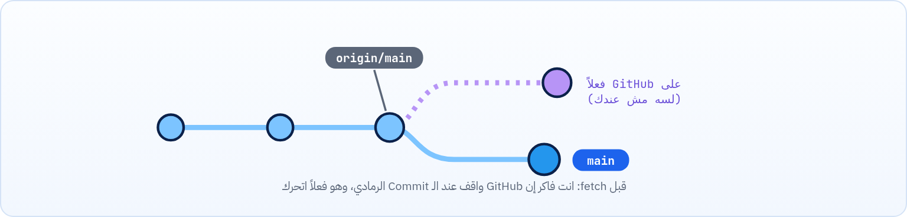

<small>المرحلة 4 · GitHub والتعاون</small>

عندك Repo على جهازك ونسخته على GitHub. محتاج تبعت شغلك، وتجيب شغل غيرك، وتبدأ من Repo موجود. أربع أوامر: clone تجيب Repo لأول مرة، و push تبعت، و fetch تجيب المعلومات من غير ما تلمس شغلك، و pull تجيب وتدمج. وهنفهم الـ Upstream ورسالة rejected الشهيرة.

:::note[بعد الفصل ده هتكون عارف]
- git clone وإيه اللي بيعمله بالظبط
- git push و -u والـ Upstream (Tracking branch)
- الـ Remote-tracking branches زي origin/main
- الفرق بين fetch و pull بالرسم
- قراية ahead و behind و diverged
- حل رسالة rejected (fetch first) وخطأ divergent branches
:::

خليني أحكيلك عن يوم عادي لما تبقى شغال على مشروع مع حد. الصبح بتفتح الـ Mac، وأول حاجة محتاج تعرفها: "زميلي عمل إيه امبارح بالليل؟". تجيب شغله. تشتغل شوية، وبعدين تبعت شغلك عشان هو كمان يشوفه. وفي يوم جه واحد جديد للفريق، محتاج ياخد نسخة من المشروع كله لأول مرة. التلات مواقف دول هم كل اللي الفصل ده عنه، وكل موقف ليه أمر. ونبدأ باللي جديد:

<a id="s10-1"></a>

## 10.1 git clone: هات Repo لأول مرة

**تشريح الأمر**

```sh
git clone git@github.com:sara/portfolio.git my-site
```

1. `git clone`: انسخ Repo كامل (كل التاريخ) من Remote لجهازك.
2. `git@github.com:sara/portfolio.git`: الرابط (SSH أو HTTPS، زرار **Code** الأخضر على GitHub).
3. `my-site`: اختياري: اسم الفولدر. من غيره هياخد اسم الـ Repo (`portfolio`).

الـ clone بيعمل 4 حاجات في أمر واحد: يعمل الفولدر، و `git init` جواه، ويضيف Remote اسمه `origin` بالرابط، ويجيب كل التاريخ ويعمل `switch` للـ Branch الافتراضي (main). يعني مش محتاج `git remote add` بعد الـ clone.

:::caution[بعد clone لمشروع JS]
`node_modules` مش موجود (افتكر الـ .gitignore). أول حاجة: `cd my-site` ثم `npm install`. ولو فيه `.env.example`، انسخه لـ `.env` وحط قيمك.
:::

| الأمر | بيعمل إيه |
|---|---|
| `git clone --depth 1 URL` | Shallow: آخر Commit بس من غير التاريخ. أسرع للمشاريع الضخمة لو عاوز تجرّب بس. |
| `git clone -b dev URL` | Branch: ابدأ على Branch معين بدل الافتراضي. |

<a id="s10-2"></a>

## 10.2 git push: ابعت شغلك

**تشريح الأمر**

```sh
git push -u origin main
```

1. `git push`: ابعت الـ Commits اللي عندك ومش على الـ Remote.
2. `-u`: اختصار `--set-upstream`: افتكر إن `main` المحلي مربوط بـ `main` على origin. بتعملها **أول مرة بس** لكل Branch.
3. `origin`: لأنهي Remote.
4. `main`: أنهي Branch. وبيتبعت لـ Branch بنفس الاسم على GitHub (ولو مش موجود بيتعمل).

```sh title="Terminal"
$ git push -u origin main
Enumerating objects: 6, done.
Writing objects: 100% (6/6), 512 bytes | 512.00 KiB/s, done.
To github.com:sara/portfolio.git
 * [new branch]      main -> main
branch 'main' set up to track 'origin/main'.
```

```sh title="قراية ناتج push"
* [new branch]      main -> main
branch 'main' set up to track 'origin/main'.
   a3bc643..25190db  main -> main
```

1. `* [new branch]      main -> main`: Branch جديد اتعمل على GitHub: `main` المحلي ← `main` البعيد.
2. `branch 'main' set up to track 'origin/main'.`: ده بتاع `-u`: الربط اتعمل. من دلوقتي `git push` و `git pull` من غير أي حاجة.
3. `a3bc643..25190db  main -> main`: ده شكل push عادي بعد كده: الـ Remote كان عند `a3bc643` وبقى عند `25190db`.

:::note[يعني إيه Upstream؟]
كل Branch محلي ممكن يبقى "متابع" Branch على الـ Remote، اسمه **Upstream** أو Tracking branch. ده بيخلي Git يعرف يقارن ويقولك ahead و behind، ويخليك تكتب `git push` و `git pull` من غير تفاصيل. شوف الربط بـ `git branch -vv`.
:::

| الأمر | بيعمل إيه |
|---|---|
| `git push` | بعد `-u`: ابعت الـ Branch الحالي للـ Upstream بتاعه. |
| `git push -u origin feature/nav` | أول push لـ Branch جديد (عشان تعمل بيه Pull Request، الفصل 11). |
| `git push origin --delete feature/nav` | امسح Branch من GitHub (المحلي مش بيتلمس). |
| `git push --tags` | ابعت الـ Tags (الفصل 14)، لأن push العادي مش بيبعتها. |

:::tip[خليها أسهل: push.autoSetupRemote]
`git config --global push.autoSetupRemote true` (من Git 2.37): أول `git push` لأي Branch جديد يعمل الـ `-u` لوحده. مش هتشوف تاني رسالة `has no upstream branch`.
:::

<a id="s10-3"></a>

## 10.3 origin/main: صورة آخر مرة شفت فيها GitHub

دي أكتر حتة بتلخبط في الموضوع ده كله، فخليني أشبّهها: تخيل إنك بتتابع ماتش على تويتر مش على التلفزيون. آخر تويتة شفتها قالت "النتيجة 1-0". ده مش معناه إن النتيجة دلوقتي 1-0، معناه إن دي **آخر معلومة وصلتك**. لحد ما تعمل Refresh. جوه الـ Repo عندك فيه Branches خاصة اسمها **Remote-tracking branches** زي `origin/main`. دي مش GitHub نفسه، دي **آخر معلومة** عندك عن مكان main على GitHub. مبتتحدثش لوحدها، بتتحدث بس مع `fetch` و `pull` و `push`. ومينفعش تعمل عليها Commits.



*origin/main = معلومتك القديمة عن GitHub لحد ما تعمل fetch.*

<a id="s10-4"></a>

## 10.4 git fetch: هات المعلومات بس

**تشريح الأمر**

```sh
git fetch origin
```

1. `git fetch`: نزّل أي Commits جديدة من الـ Remote، وحدّث `origin/main` وأخواتها. **مش بيلمس** الـ Branches بتاعتك ولا ملفاتك خالص. آمن 100%.
2. `origin`: من أنهي Remote. من غيرها = origin.

بعد الـ fetch تقدر "تتفرج" قبل ما تدمج:

```sh title="Terminal"
git fetch
git status                         # ahead/behind
git log --oneline main..origin/main  # اللي جديد على GitHub
git diff main origin/main --stat     # الملفات اللي هتتغير
```

**تشريح الأمر**

```sh
git log --oneline main..origin/main
```

1. `git log --oneline`: تاريخ مختصر.
2. `main..origin/main`: النقطتين = "الـ Commits اللي في `origin/main` ومش في `main`". يعني اللي هتاخده لو عملت pull. والعكس `origin/main..main` = اللي عندك ولسه ما اتبعتش.

<a id="s10-5"></a>

## 10.5 git pull = fetch + merge

**تشريح الأمر**

```sh
git pull
```

1. `git pull`: خطوتين: `git fetch` للـ Upstream، وبعدين يدمج `origin/main` في `main` بتاعك (Merge، أو Rebase لو ظبطت كده، الفصل 15). لو انت مغيرتش حاجة، الدمج هيبقى Fast-forward.

**fetch مقابل pull**

|   | `git fetch` | `git pull` |
|---|---|---|
| بيجيب الـ Commits الجديدة | أيوه | أيوه |
| بيحدّث origin/main | أيوه | أيوه |
| بيغيّر main والملفات بتاعتك | **لأ** | أيوه (بيدمج) |
| ممكن يعمل Conflict | لأ | أيوه |
| استخدمه لما | عاوز تشوف الأول | عاوز تتحدث على طول |

:::tip[العادة الصح]
<strong>ابدأ يومك بـ `git pull`</strong> وانت على main وفي حالة clean. وقبل ما تعمل Branch جديد: `git switch main && git pull && git switch -c feature/x`، عشان تبدأ من آخر نسخة.
:::

<a id="s10-6"></a>

## 10.6 ahead و behind و diverged

```sh title="Terminal"
$ git status
On branch main
Your branch and 'origin/main' have diverged,
and have 1 and 1 different commits each, respectively.
  (use "git pull" if you want to integrate the remote branch with yours)
```

**رسايل الـ Upstream في git status**

| الرسالة | يعني | تعمل إيه |
|---|---|---|
| `up to date with 'origin/main'` | متطابقين (حسب آخر fetch) | ولا حاجة |
| `ahead of 'origin/main' by 2 commits` | عندك 2 لسه ما اتبعتوش | `git push` |
| `behind 'origin/main' by 3 commits` | GitHub عنده 3 جداد | `git pull` |
| `have diverged` | الاتنين عندهم Commits جديدة | `git pull` (دمج) وبعدين `git push` |

<a id="s10-7"></a>

## 10.7 لما الـ push يترفض

```sh title="Terminal"
$ git push
To github.com:sara/portfolio.git
 ! [rejected]        main -> main (fetch first)
error: failed to push some refs to 'github.com:sara/portfolio.git'
hint: Updates were rejected because the remote contains work that you do not
hint: have locally. This is usually caused by another repository pushing to
hint: the same ref. If you want to integrate the remote changes, use
hint: 'git pull' before pushing again.
```

معناها: حد (أو إنت من جهاز تاني، أو من موقع GitHub نفسه لما عدلت README) عمل push قبلك. Git مش هيمسح شغله عشان شغلك. الحل: `git pull` (حل أي Conflict لو ظهر) وبعدين `git push` تاني.

:::danger[مشكلة: fatal: Need to specify how to reconcile divergent branches]
عملت `git pull` وطلعلك `hint: You have divergent branches` وقايمة بـ 3 اختيارات.

<strong>الحل:</strong> Git محتاج تقوله يدمج إزاي مرة واحدة. للمبتدئين: `git config --global pull.rebase false` (Merge)، أو لمرة واحدة `git pull --no-rebase`. (لو ظبطته في الفصل 2 مش هتشوفها). والاختيارات التانية: `--rebase` (الفصل 15) و `--ff-only` (ارفض لو مش Fast-forward).
:::

:::danger[مشكلة: has no upstream branch]
عملت `git push` على Branch جديد وطلع `fatal: The current branch feature/nav has no upstream branch.`

<strong>الحل:</strong> أول push محتاج `-u`: `git push -u origin feature/nav` (Git نفسه بيكتبهولك في الرسالة). أو ظبّط `push.autoSetupRemote`.
:::

:::caution[git push --force: مش حل]
لو قريت على النت "اعمل `git push -f`"، ده معناه "امسح اللي على GitHub وحط اللي عندي مكانه". لو حد تاني عمل push، شغله هيضيع. استخدامه الوحيد المقبول: على Branch بتاعك إنت لوحدك بعد rebase أو amend، وبالنسخة الأأمن `--force-with-lease` (الفصل 15).
:::

:::tip[ملخص الفصل]
- `git clone URL` = mkdir + init + remote add origin + fetch + switch.
- `git push -u origin main` أول مرة، وبعدين `git push` وبس.
- `origin/main` = آخر معلومة عندك عن GitHub، وبتتحدث بالـ fetch.
- `fetch` يجيب بس (آمن)، و `pull` = fetch + merge.
- `rejected (fetch first)` = اعمل pull الأول، و `--force` مش الحل.
:::

### صح ولا غلط؟

1. `git fetch` ممكن يغيّر ملفات في الورشة.
2. بعد `git clone` لازم تعمل `git remote add origin`.
3. `origin/main` بيتحدث لوحده كل ما حد يعمل push على GitHub.

### أسئلة مراجعة

1. إيه الـ 4 حاجات اللي `git clone` بيعملها؟
2. اشرح `-u` في `git push -u origin main`.
3. إيه الفرق بين `main..origin/main` و `origin/main..main`؟
4. الـ push اترفض بـ `fetch first`. إيه السبب والحل؟

### تحديات الفصل

<small>جرّبها بإيدك، والحلول في ملحق الإجابات.</small>

1. **[سهل]** ابعت الـ playground لـ GitHub بـ `push -u`، وافتح صفحة الـ Repo واتأكد إن الـ Commits ظهرت.
2. **[متوسط]** عدّل README من موقع GitHub نفسه (زرار القلم) واعمل Commit هناك. عندك: اعمل `git fetch` ثم `git status` ثم `git log main..origin/main`، وبعدين `git pull`.
3. **[صعب]** اعمل `git clone` للـ Repo في فولدر تاني (كأنه جهاز تاني). اعمل Commit من كل نسخة على نفس الملف، و push من الأولى، وبعدين حاول push من التانية، وحل الموقف لحد ما الاتنين يتطابقوا.
