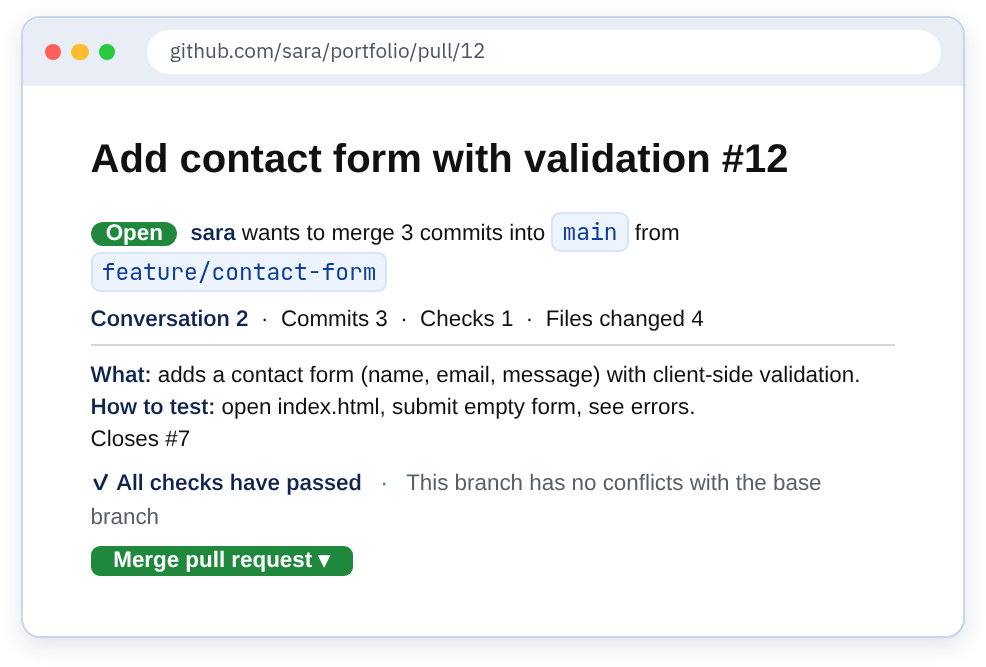
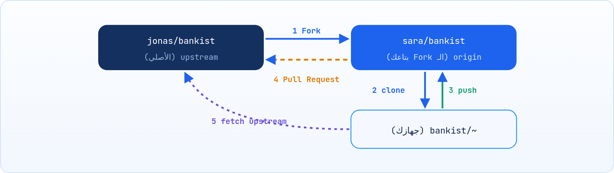

<small>المرحلة 4 · GitHub والتعاون</small>

GitHub مش مجرد مكان تحفظ فيه الكود، ده مكان الناس بتشتغل فيه مع بعض. الـ Pull Request هو الطريقة اللي بتقول بيها: خلصت شغل على Branch، ممكن حد يراجعه قبل ما يدخل main؟ والـ Fork هو إزاي تساهم في مشروع مش بتاعك. والـ Issues هي قايمة المهام والمشاكل. وكل ده مفيد حتى لو بتشتغل لوحدك.

:::note[بعد الفصل ده هتكون عارف]
- يعني إيه Pull Request وإزاي تعمله خطوة بخطوة
- صفحة الـ PR: Conversation و Commits و Checks و Files changed
- الـ Code Review: تعليقات و Suggestions و Approve و Request changes
- طرق الدمج التلاتة على GitHub: Merge و Squash و Rebase
- الـ Fork والـ upstream remote ومزامنة الـ Fork
- الـ Issues والـ Labels وربطها بالـ PR بـ Closes #12
:::

<a id="s11-1"></a>

## 11.1 الـ Pull Request: "ممكن تدمجوا شغلي؟"

تخيل إنك خلصت الـ Contact form في البورتفوليو. شكله حلو، والـ Validation شغالة، فدمجته في main وعملت push وقفلت اللابتوب مبسوط. تاني يوم صاحبك بيقولك: "بعتلك رسالة من الموقع بس قالي الإيميل غلط". تفتح الكود تلاقي إن الـ Validation بترفض أي إيميل فيه `+` أو حروف كبيرة. غلطة صغيرة، وكان أي حد بصّ على الكود دقيقتين هيشوفها. بس محدش شاف، لأن الكود راح من دماغك لـ main على طول.

الشركات اتعلمت الدرس ده من زمان، وعشان كده مفيش كود بيدخل main من غير ما يعدّي على "بوابة": صفحة فيها التعديلات كلها، وحد تاني بيقراها ويعلّق، واختبارات بتشتغل لوحدها، وبعد كده بس زرار الدمج. البوابة دي اسمها **Pull Request**.

الـ **Pull Request** (PR) = طلب على GitHub إن Branch يتدمج في Branch تاني (غالباً main)، ومعاه صفحة نقاش ومراجعة. الاسم معناه "اسحب (Pull) تغييراتي عندك". (في GitLab اسمه Merge Request، نفس الفكرة). وخد بالك: الـ PR مش حاجة في Git نفسه، دي ميزة في GitHub مبنية فوق الـ Branches اللي انت فاهمها خلاص من الفصل 7.

:::note[ليه PR حتى لو شغال لوحدك؟]
الـ PR بيوريك الـ diff كله في صفحة واحدة مرتبة قبل ما يدخل main، وبيشغّل الاختبارات (Actions، الفصل 17)، وبيحفظ "ليه" عملت التغيير ده. وده كمان تمرين على الشغل الحقيقي: أي شركة هتشتغل فيها هتشتغل بالـ PRs.
:::

### خطوات أول PR

1. <strong>ابدأ من آخر main:</strong> `git switch main && git pull`.
2. <strong>Branch للشغل:</strong> `git switch -c feature/contact-form`.
3. **اشتغل واعمل Commits** صغيرة برسايل واضحة.
4. <strong>ابعت الـ Branch:</strong> `git push -u origin feature/contact-form`. GitHub هيطبعلك في الـ Terminal رابط `Create a pull request`.
5. <strong>افتح الـ PR:</strong> من الرابط، أو من الموقع زرار **Compare & pull request**. اختار **base: main** ← **compare: feature/contact-form**.
6. <strong>اكتب عنوان ووصف:</strong> عملت إيه، وليه، وإزاي تجرّبه، وصورة لو فيه تغيير في الشكل.
7. **Create pull request**، واستنى المراجعة (أو راجع بنفسك)، وبعدين **Merge**.
8. <strong>نضّف:</strong> امسح الـ Branch من GitHub (زرار Delete branch)، وعندك: `git switch main && git pull && git branch -d feature/contact-form`.

أول مرة تعمل push لـ Branch جديد، GitHub نفسه بيرد عليك في الـ Terminal ويقولك "تحب تفتح PR؟". السطور اللي بتبدأ بـ `remote:` دي جاية من GitHub مش من Git:

```sh title="Terminal"
$ git push -u origin feature/contact-form
...
remote: Create a pull request for 'feature/contact-form' on GitHub by visiting:
remote:      https://github.com/sara/portfolio/pull/new/feature/contact-form
To github.com:sara/portfolio.git
 * [new branch]      feature/contact-form -> feature/contact-form
```

<a id="s11-2"></a>

## 11.2 صفحة الـ PR

فتحت الـ PR. الصفحة اللي قدامك دي هي أوضة الاجتماعات بتاعة التغيير ده: كل حاجة عنه في مكان واحد. فوق العنوان ورقم الـ PR (`#12`، وهو نفس عدّاد الـ Issues)، وتحته جملة بتقول مين عاوز يدمج كام Commit من أنهي Branch لأنهي Branch، وبعدين 4 تابات، وفي الآخر خالص زرار الدمج. وزرار الدمج ده مش بيبقى أخضر غير لما الـ Checks تعدّي ومفيش Conflicts.

**تابات صفحة الـ PR**

| التاب | فيه إيه |
|---|---|
| Conversation | الوصف والنقاش والمراجعات، وزرار الـ Merge تحت |
| Commits | الـ Commits اللي في الـ Branch ومش في main |
| Checks | نتايج GitHub Actions (اختبارات، Build) |
| Files changed | الـ diff كامل، وهنا بتعمل المراجعة سطر بسطر |



*شكل توضيحي لصفحة PR على GitHub (رسمة مش Screenshot).*

:::note[لو حابب تتعمق: الـ PR من جوه]
GitHub بيحفظ كل PR كـ Ref مخفي على الـ Remote اسمه `refs/pull/12/head`. يعني تقدر تجيب أي PR لجهازك بـ Git عادي من غير `gh`: `git fetch origin pull/12/head:pr-12` ثم `git switch pr-12`. و `pull/12/head` = المصدر على GitHub، و `:pr-12` = اسم الـ Branch اللي هيتعمل عندك. ده بالظبط اللي `gh pr checkout 12` بيعمله ورا الكواليس (الفصل 17).
:::

:::tip[PR صغير = مراجعة حقيقية]
PR فيه 50 سطر هيتراجع بجد. PR فيه 2000 سطر هياخد "LGTM" من غير ما حد يقراه. خلي كل PR يعمل حاجة واحدة. ولو لسه شغال وعاوز رأي بدري، اعمله **Draft pull request** (من السهم جنب زرار Create).
:::

<a id="s11-3"></a>

## 11.3 الـ Code Review

أول مرة حد يكتب تعليق على كودك، هتحس إنه بيقولك "انت مش فاهم". وده إحساس طبيعي جداً وبيروح بسرعة، لما تفهم إن المراجعة مش امتحان: دي اتنين بيبصوا على نفس الكود عشان يطلع أحسن. والمراجع اللي بيكتبلك 10 تعليقات غالباً اهتم بشغلك أكتر من اللي كتب "LGTM" (Looks Good To Me) من غير ما يقرا.

المراجع بيفتح **Files changed**، وبيدوس على `+` جنب أي سطر يكتب تعليق. وفي الآخر **Review changes** ويختار واحدة من 3:

**أنواع المراجعة**

| النوع | معناه |
|---|---|
| Comment | ملاحظات عامة من غير قرار |
| Approve | "تمام، ادمج" |
| Request changes | "فيه حاجات لازم تتصلح قبل الدمج" |

### الـ Suggestion: اقترح الكود نفسه

وانت بتعلّق على سطر، فيه زرار **Add a suggestion** (أيقونة ±). بتكتب الكود المقترح جوه بلوك كده:

````md title="تعليق مراجعة"
```suggestion
const isValid = email.includes("@") && email.length > 3;
```
````

وصاحب الـ PR يدوس **Commit suggestion** فيتعمل Commit على الـ Branch من غير ما يفتح الكود.

### لما حد يطلب تعديلات

متقفلش الـ PR وتعمل واحد جديد. اعمل التعديلات على **نفس الـ Branch** عندك، Commit و `git push`، والـ PR هيتحدث لوحده. وبعدين رد على التعليق أو دوس **Resolve conversation**.

#### وانت بتراجع

اسأل بدل ما تأمر ("إيه رأيك لو...؟")، وعلّق على الكود مش على الشخص، وقول الحاجة الحلوة كمان، وفرّق بين "لازم" و"اقتراح" (بيكتبوا `nit:` للحاجات الصغيرة).

#### وانت بتتراجع

المراجعة على الكود مش عليك. اشكر، واسأل لو مش فاهم، ولو مختلف اشرح ليه بهدوء. وكل تعليق اترد عليه أو اتصلح.

<a id="s11-4"></a>

## 11.4 طرق الدمج على GitHub

الـ PR اتوافق عليه، والـ Checks خضرا، وانت رايح تدوس Merge. تلاحظ إن جنب الزرار فيه سهم صغير، ولو دوست عليه تلاقي 3 اختيارات. معظم الناس بتتجاهله وتدوس الافتراضي، بس الاختيار ده هو اللي بيحدد شكل تاريخ main بعد سنة: هل هيبقى مليان `wip` و `fix typo again`، ولا كل سطر فيه Feature كاملة؟

والحلو إنك فاهم الـ 3 خلاص، لأنهم نفس أفكار الفصل 8 (وواحدة من الفصل 15) بس بزرار:

**Merge مقابل Squash مقابل Rebase**

| الاختيار | بيعمل إيه في main | إمتى |
|---|---|---|
| Create a merge commit | كل الـ Commits + Merge Commit (زي `--no-ff`) | لما الـ Commits نضيفة وعاوز تاريخها |
| Squash and merge | كل الـ Commits تتجمع في **Commit واحد** على main | الأشهر في الفرق: الـ Branch فيه `wip` و `fix typo` |
| Rebase and merge | الـ Commits تتحط ورا بعض على main من غير Merge Commit | تاريخ مستقيم والـ Commits نضيفة (الفصل 15) |

:::note[لو حابب تتعمق: Squash بيعمل إيه بالظبط؟]
GitHub بياخد الـ Snapshot النهائي للـ Branch، ويعمل منه Commit **جديد** على main ليه Parent واحد بس (آخر main). الرسالة الافتراضية = عنوان الـ PR + رقمه زي `feat: add contact form (#12)`، وتحتها رسايل الـ Commits القديمة كقايمة (تقدر تعدّلها قبل التأكيد). والـ Author = صاحب الـ PR. والـ Commits الأصلية بتفضل موجودة في صفحة الـ PR بس، مش في تاريخ main. ده بالظبط زي `git merge --squash` + `git commit` على جهازك.
:::

:::caution[بعد Squash]
بعد Squash، الـ Commits اللي على الـ Branch عندك مش هي اللي في main (اتجمعت في واحد جديد). فـ `git branch -d` ممكن يقولك `not fully merged`. ده طبيعي هنا: اتأكد إن الـ PR اتدمج، وامسحه بـ `-D`. ومتكملش شغل جديد على نفس الـ Branch، ابدأ واحد جديد من main.
:::

<a id="s11-5"></a>

## 11.5 الـ Fork: تساهم في مشروع مش بتاعك

وانت بتذاكر من Repo بتاع الكورس، لقيت غلطة إملائية في الـ README، أو لينك مكسور. قلت أصلّحها: دوست على القلم في GitHub، وبدل ما يفتحلك الملف، GitHub قالك: `You need to fork this repository to propose changes`. وده منطقي: لو أي حد على النت يقدر يعمل push على Repo Jonas، المشروع هيبقى خرابة في يوم.

طب إزاي آلاف الناس بيساهموا في مشاريع زي React و VS Code وهم مش في الفريق؟ مش هتقدر تعمل push لـ Repo مش بتاعك، فالحل: **Fork** = نسخة من الـ Repo في حسابك إنت على GitHub. تشتغل عليها براحتك، وبعدين تعمل PR من الـ Fork بتاعك للـ Repo الأصلي.



*دورة الـ Fork: انسخ على GitHub، هات لجهازك، ابعت للـ Fork، واعمل PR للأصلي.*

1. على صفحة المشروع الأصلي: زرار **Fork**.
2. اعمل clone لـ **الـ Fork بتاعك**: `git clone git@github.com:sara/bankist.git`.
3. ضيف الأصلي كـ Remote تاني اسمه `upstream` (عشان تجيب تحديثاته):

**تشريح الأمر**

```sh
git remote add upstream https://github.com/jonas/bankist.git
```

1. `git remote add`: ضيف Remote.
2. `upstream`: اسم متعارف عليه للـ Repo الأصلي (زي ما `origin` للـ Fork بتاعك). مجرد اسم.
3. `https://github.com/jonas/bankist.git`: رابط الأصلي. HTTPS كفاية لأنك هتقرا منه بس.

### مزامنة الـ Fork مع الأصلي

```sh title="Terminal"
git switch main
git fetch upstream
git merge upstream/main      # أو: git pull upstream main
git push origin main         # حدّث الـ Fork على GitHub
```

أو من موقع GitHub: زرار **Sync fork** في صفحة الـ Fork، وبعدين `git pull` عندك. أو `gh repo sync`.

:::tip[أول مساهمة Open Source]
دوّر على Issues عليها Label `good first issue`، واقرا `CONTRIBUTING.md` قبل أي حاجة، واكتب في الـ Issue إنك هتشتغل عليها. تصحيح غلطة في التوثيق مساهمة محترمة جداً، وأنسب حاجة لـ Content Engineer.
:::

<a id="s11-6"></a>

## 11.6 الـ Issues: قايمة المهام والمشاكل

عندك 7 أفكار للبورتفوليو: Dark mode، وصفحة للمشاريع، وتصليح الـ Navbar على الموبايل... ومكتوبين فين؟ 3 في Notes على الموبايل، وواحدة في رسالة لنفسك على WhatsApp، والباقي في دماغك. وبعد شهر نسيت نصهم، ومش فاكر الـ Bug اللي صاحبك قالك عليه كان بيحصل إزاي. المشكلة إن الأفكار والمشاكل عايشة بعيد عن الكود. الـ Issues بتحطهم جنب الكود بالظبط، وبتربطهم بالـ Commits والـ PRs اللي حلّتهم.

**Issue** = تذكرة لمشكلة أو فكرة أو مهمة. ليها رقم (`#7`)، وعنوان، ووصف، و**Labels** (`bug` و `enhancement` و `documentation`)، وممكن تتعيّن لشخص.

#### Bug report كويس

عملت إيه بالظبط (خطوات)، كنت متوقع إيه، حصل إيه، Screenshot أو رسالة الخطأ، والمتصفح أو النسخة.

#### لنفسك

استخدم Issues كـ To-do list لمشروعك: كل Feature في Issue، وكل PR يقفل Issue. و GitHub Projects يعرضهم كـ Board.

### ربط PR بـ Issue

لو كتبت في وصف الـ PR (أو رسالة Commit بيدخل main) كلمة من دول ورقم الـ Issue، الـ Issue هيتقفل لوحده لما الـ PR يتدمج:

**كلمات قفل الـ Issues**

| الكلمة | مثال |
|---|---|
| `close` / `closes` / `closed` | `Closes #7` |
| `fix` / `fixes` / `fixed` | `Fixes #12` |
| `resolve` / `resolves` / `resolved` | `Resolves #3` |

ومجرد كتابة `#7` في أي مكان بتعمل لينك للـ Issue، و `@username` بتعمل Mention للشخص.

:::tip[ملخص الفصل]
- PR = Branch + طلب دمج + صفحة مراجعة. الخطوات: Branch ← Commits ← push -u ← Open PR ← Review ← Merge ← نضّف.
- المراجعة: Comment و Approve و Request changes، و Suggestions بتتعمل Commit بزرار.
- التعديلات بتتعمل على نفس الـ Branch والـ PR بيتحدث لوحده.
- Merge commit و Squash و Rebase: نفس أفكار الفصل 8 بزرار.
- Fork = نسختك على GitHub، و `upstream` = الأصلي، و `Closes #7` يقفل الـ Issue.
:::

### صح ولا غلط؟

1. لو المراجع طلب تعديلات، لازم تقفل الـ PR وتعمل واحد جديد.
2. الـ Fork بيتعمل على GitHub، والـ clone على جهازك.
3. Squash and merge بيحط كل Commits الـ Branch في main زي ما هي.

### أسئلة مراجعة

1. اكتب كل خطوات PR من أول `git switch main` لحد مسح الـ Branch.
2. إيه الفرق بين `origin` و `upstream` في حالة الـ Fork؟
3. إمتى تختار Squash and merge؟
4. إزاي تخلي Issue يتقفل لوحده لما الـ PR يتدمج؟

### تحديات الفصل

<small>جرّبها بإيدك، والحلول في ملحق الإجابات.</small>

1. **[سهل]** في الـ playground على GitHub، اعمل Issue "Add README"، واعمل Branch و PR فيه `Closes #1`، وادمجه. اتأكد إن الـ Issue اتقفل.
2. **[متوسط]** في PR تاني، راجع نفسك: اعمل تعليق Suggestion على سطر، و Commit suggestion، وبعدين Squash and merge. قارن `git log` قبل وبعد `git pull`.
3. **[صعب]** اعمل Fork لأي Repo عام بسيط، ضيف `upstream`، وزامن الـ Fork بالأوامر. لو لقيت غلطة في التوثيق، اعمل PR حقيقي.
