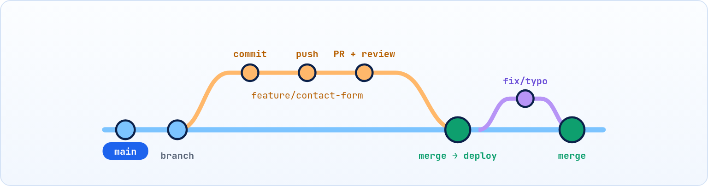

<small>المرحلة 5 · الشغل المنظّم</small>

دلوقتي عندك كل الأدوات: Commits و Branches و Merge و Push و PR. بس إمتى تعمل Branch؟ وإمتى تدمج؟ وتعمل إيه كل يوم؟ الـ Workflow هو الروتين اللي بيربط الأدوات دي. هنمشي على أبسط Workflow منتشر في العالم: GitHub Flow، ونطبّقه على مشروع شخصي وعلى شغل مع فريق.

:::note[بعد الفصل ده هتكون عارف]
- يعني إيه Workflow وليه محتاجه
- قواعد GitHub Flow الست
- تسمية الـ Branches وإزاي Git بيخزنها
- الروتين اليومي من أول pull لحد مسح الـ Branch
- حماية main بـ Branch protection rules
- مقارنة سريعة مع Git Flow و Trunk-based
:::

<a id="s12-1"></a>

## 12.1 ليه Workflow؟

تخيل انت وصاحبك أحمد قررتوا تعملوا مشروع Weather app سوا. يوم الأحد أحمد عمل push على main لحتة نص مخلّصة "عشان متضيعش". يوم الاتنين انت عملت pull، والمشروع مبقاش بيفتح، وقعدت ساعة تدوّر على الـ Bug اللي انت مش عامله. يوم التلات انت فتحت Branch اسمه `new` وفضلت شغال عليه أسبوعين من غير ما تدمج، ولما جيت تدمج لقيت 14 Conflict لأن أحمد غيّر نص الملفات في الوقت ده. ويوم الأربع حد سأل "مين غيّر الألوان؟" وكل الـ Commits اسمها `update`.

محدش فيكم غلط في Git. كل الأوامر اتكتبت صح. المشكلة إن مفيش **اتفاق**: إمتى نعمل Branch؟ إمتى ندمج؟ مين يعمل push على main؟ والاتفاق ده اسمه **Workflow**: شوية قواعد بسيطة الكل ماشي عليها، فالأدوات اللي اتعلمتها تشتغل مع بعض بدل ما تتخانق.

<a id="s12-2"></a>

## 12.2 قواعد GitHub Flow

فيه Workflows كتير، وأشهرها للمواقع وتطبيقات الويب هو اللي GitHub نفسه بيستخدمه ونشره: **GitHub Flow**. سرّه إنه بسيط لدرجة إنه بيتقال في جملة: "main دايماً شغال، وأي حاجة جديدة بتيجي من Branch قصير عن طريق PR". وكل القواعد الست تحت مجرد تفصيل للجملة دي. لاحظ إن كل قاعدة بتحل واحدة من مشاكل أسبوع أحمد:

#### 1 · main دايماً شغال

أي حاجة على main لازم تبقى شغالة وجاهزة تتنشر. محدش يعمل push مباشر عليه.

#### 2 · كل شغل في Branch

Feature، إصلاح، تجربة، حتى تعديل كلمة في README: Branch جديد من main باسم واضح.

#### 3 · Commit و push كتير

Commits صغيرة، و push للـ Branch كل شوية (ده Backup كمان).

#### 4 · افتح PR

لما تخلص (أو تحتاج رأي بدري كـ Draft)، افتح PR لـ main.

#### 5 · مراجعة واختبارات

حد يراجع (أو إنت تراجع نفسك بعين جديدة)، والـ Checks تعدي.

#### 6 · Merge ونشر ونضافة

ادمج، والموقع يتنشر من main، وامسح الـ Branch.



*GitHub Flow: main واحد شغال دايماً، و Branches قصيرة بتطلع وترجع بـ PR.*

<a id="s12-3"></a>

## 12.3 تسمية الـ Branches

بعد شهر في مشروع فيه فريق، هتعمل `git branch -a` وتلاقي 20 Branch. لو أسماءهم `new` و `test2` و `sara-stuff`، محدش هيعرف إيه اللي ينفع يتمسح. الاسم الكويس بيقول **نوع** الشغل و**موضوعه** من غير ما تفتح ولا Commit:

**اتفاق تسمية منتشر (مش قاعدة في Git)**

| البادئة | إمتى | مثال |
|---|---|---|
| `feature/` أو `feat/` | ميزة جديدة | `feature/dark-mode` |
| `fix/` | تصليح Bug | `fix/12-email-validation` |
| `docs/` | توثيق و README | `docs/setup-steps` |
| `chore/` | صيانة (مكتبات، إعدادات) | `chore/update-vite` |
| `ai/` أو `try/` | تجربة ممكن ترميها (الفصل 18) | `ai/refactor-modules` |

والقواعد: حروف صغيرة، وشَرطة `-` بدل المسافات (المسافة ممنوعة أصلاً في اسم Branch)، ورقم الـ Issue في الأول لو فيه. والـ `/` مش مجرد شكل: Git بيخزن `feature/dark-mode` كملف جوه فولدر `.git/refs/heads/feature/`، وأدوات زي VS Code بتعرضهم كفولدرات. وعشان كده مينفعش يبقى عندك Branch اسمه `feature` وكمان `feature/x` في نفس الوقت: واحد ملف والتاني فولدر بنفس الاسم.

<a id="s12-4"></a>

## 12.4 الروتين اليومي

القواعد حلوة على الورق، بس شكلها إيه في يوم شغل حقيقي؟ تعال نمشي على يوم كامل: الصبح عاوز تضيف Dark mode للبورتفوليو. كل خطوة تحت هي أوامر انت عارفها خلاص، الجديد بس هو **الترتيب**. ولو حفظت الترتيب ده، 90% من شغلك اليومي بـ Git هيبقى أوتوماتيك:

```sh title="يوم شغل عادي"
git switch main
git pull
git switch -c feature/dark-mode
git status
git diff
git add -p
git commit -m "feat: add theme toggle button"
git push -u origin feature/dark-mode
git fetch
git merge origin/main
# Open PR → review → Merge (on GitHub)
git switch main
git pull
git branch -d feature/dark-mode
```

1. `git switch main`: ابدأ من آخر نسخة. لو فيه تعديلات مش متعملها Commit، الـ switch هيقولك.
2. `git switch -c feature/dark-mode`: Branch للشغل الجديد، من main المحدّث.
3. `git status`: اشتغل، وكل خطوة شغالة = Commit. شوف قبل ما تضيف (الفصل 13 لـ `add -p`).
4. `git push -u origin feature/dark-mode`: أول push بـ `-u`، وبعد كده `git push` بس.
5. `git fetch`: لو الشغل طوّل وmain اتحرك: هات الجديد في الـ Branch بتاعك بدري عشان الـ Conflicts تبقى صغيرة.
6. `# Open PR → review → Merge (on GitHub)`: افتح الـ PR من الموقع أو بـ `gh pr create` (الفصل 17).
7. `git switch main`: بعد الدمج: حدّث main وامسح الـ Branch المحلي.

:::tip[نضّف الـ Branches القديمة]
`git fetch --prune` (أو `-p`) بيمسح من عندك الـ `origin/...` لـ Branches اتمسحت على GitHub. وتقدر تخليها دايماً: `git config --global fetch.prune true`. وفي إعدادات الـ Repo على GitHub فعّل **Automatically delete head branches** عشان الـ Branch يتمسح بعد الـ Merge.
:::

<a id="s12-5"></a>

## 12.5 وانت شغال لوحدك؟

ممكن تقول: "أنا لوحدي، مين هيراجعلي؟ ليه كل ده؟". سؤال منطقي. بس افتكر إن "انت بعد 3 شهور" شخص تاني مش فاكر حاجة، وإن الـ AI اللي بيساعدك بيعدّل كود كأنه زميل في الفريق (ومن أكتر الزملاء اللي محتاجين مراجعة). وكمان لو موقعك منشور من main على GitHub Pages، أي Commit بايظ على main = الموقع بايظ قدام أي حد بيفتحه.

فمش لازم تعمل PR لكل سطر، بس على الأقل:

- main يفضل شغال (خصوصاً لو الموقع منشور منه على GitHub Pages).
- أي حاجة كبيرة أو تجربة أو شغل AI = Branch.
- PR لنفسك للحاجات المهمة: هتشوف الـ diff كله في مكان واحد قبل ما يدخل.
- للحاجات التافهة (typo في README) Commit مباشر على main مقبول.

<a id="s12-6"></a>

## 12.6 حماية main على GitHub

رجعنا لأحمد. اتفقتوا على GitHub Flow، وبعد أسبوع، الساعة 1 بالليل وهو مستعجل، عمل push على main "مرة واحدة بس". الاتفاقات بتتكسر لما الناس تتعب، وعشان كده الأحسن إن القاعدة متبقاش اتفاق، تبقى **قفل**. عشان القاعدة الأولى (main دايماً شغال) متبقاش مجرد اتفاق، GitHub بيخليك تفرضها: **Settings ← Rules ← Rulesets** (أو Branches ← Branch protection rules) على `main`:

**أهم قواعد حماية الـ Branch**

| القاعدة | بتعمل إيه |
|---|---|
| Require a pull request before merging | ممنوع push مباشر، لازم PR |
| Required approvals | عدد المراجعين اللي لازم يوافقوا |
| Require status checks to pass | الـ Actions لازم تنجح قبل الدمج |
| Block force pushes | ممنوع `push --force` على main |
| Restrict deletions | محدش يمسح main بالغلط |

```sh title="Terminal"
$ git push
remote: error: GH013: Repository rule violations found for refs/heads/main.
remote: - Changes must be made through a pull request.
 ! [remote rejected] main -> main (push declined due to repository rule violations)
```

لو شفت ده، مفيش حاجة باظت: القاعدة شغالة. اعمل Branch من اللي عندك (`git switch -c fix/x`)، وابعته، وافتح PR. وبعدين رجّع main المحلي زي GitHub: `git switch main && git reset --hard origin/main` (الـ Commits لسه في الـ Branch الجديد).

<a id="s12-7"></a>

## 12.7 Workflows تانية هتسمع عنها

لما تدخل أول شغل، ممكن تسمع "إحنا شغالين Git Flow" أو "Trunk-based". متقلقش: دي مش أدوات جديدة، دي اتفاقات تانية بنفس الأوامر. والفرق بينهم جاي من سؤال واحد: المشروع بيتنشر إزاي؟ موقع بيتنشر 10 مرات في اليوم غير تطبيق موبايل بيطلع إصدار كل شهر ولازم يستنى موافقة الـ App Store.

**مقارنة سريعة بين الـ Workflows**

| الـ Workflow | الفكرة | مناسب لـ |
|---|---|---|
| **GitHub Flow** | main + Branches قصيرة + PR | مواقع وتطبيقات ويب ومشاريع شخصية. **ابدأ بيه** |
| Git Flow | main و develop و release/\* و hotfix/\* و feature/\* | برامج ليها إصدارات رسمية متعددة. معقد على المبتدئ |
| Trunk-based | الكل بيدمج في main كذا مرة في اليوم، و Branches عمرها ساعات | فرق خبيرة عندها اختبارات أوتوماتيك قوية |

:::note[الخلاصة]
لو حد قالك "إحنا شغالين Git Flow"، الأوامر نفسها هي هي: switch و merge و push و PR. الفرق بس في **أسماء الـ Branches** ومين يتدمج في مين. فاللي اتعلمته شغال مع أي Workflow.
:::

:::tip[ملخص الفصل]
- GitHub Flow: main شغال دايماً، كل شغل في Branch، PR، مراجعة، Merge، امسح.
- الروتين: switch main ← pull ← switch -c ← Commits ← push -u ← PR ← Merge ← pull ← branch -d.
- لوحدك: Branch للتجارب والـ AI، و PR لنفسك للمهم.
- حماية main بالـ Rulesets: PR إجباري و Checks ومنع Force push.
- Git Flow و Trunk-based نفس الأوامر بقواعد مختلفة.
:::

### صح ولا غلط؟

1. في GitHub Flow بنعمل push مباشر على main للحاجات الصغيرة في الفرق.
2. `git fetch --prune` بيمسح Branches من GitHub.
3. الـ Branch protection ممكن يمنع `push --force` على main.

### أسئلة مراجعة

1. اذكر قواعد GitHub Flow الست بكلامك.
2. ليه بنعمل `git pull` على main قبل ما نعمل Branch جديد؟
3. الـ push اترفض بـ `GH013`. تعمل إيه بالظبط عشان شغلك ميضيعش؟
4. إيه الفرق الأساسي بين GitHub Flow و Git Flow؟

### تحديات الفصل

<small>جرّبها بإيدك، والحلول في ملحق الإجابات.</small>

1. **[سهل]** طبّق الروتين اليومي كامل مرة واحدة على الـ playground (Branch ← PR ← Merge ← تنضيف).
2. **[متوسط]** فعّل Ruleset على main يمنع الـ push المباشر، وجرّب تعمل push عليه عشان تشوف الرفض. وبعدين صلّح الموقف بالطريقة اللي في الفصل.
3. **[صعب]** اعمل Branchين في نفس الوقت (`feature/a` و `feature/b`) بيعدلوا ملفات مختلفة، ادمج الأول بـ PR، وبعدين حدّث التاني بـ `git merge origin/main` قبل ما تدمجه.
