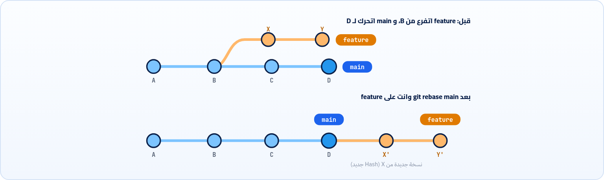

<small>المرحلة 6 · أدوات متقدمة بهدوء</small>

ناس كتير بيتكلموا عن الـ Rebase كأنه سحر أسود. هو في الحقيقة فكرة بسيطة: بدل ما تدمج خطين بـ Merge Commit، بتنقل الـ Commits بتاعتك كأنك بدأتها من آخر نسخة. وفيه نسخة تفاعلية بتخليك تنضّف تاريخك قبل ما تعمل PR. وهنشوف Cherry-pick: إزاي تاخد Commit واحد بعينه من Branch تاني. كل ده بالرسم، ومع القاعدة الذهبية اللي هتحميك.

:::note[بعد الفصل ده هتكون عارف]
- الـ Rebase بيعمل إيه بالرسم، وإزاي بيختلف عن الـ Merge
- إمتى تستخدم Rebase وإمتى Merge
- القاعدة الذهبية: متعملش Rebase لحاجة اتشاركت
- حل الـ Conflicts أثناء الـ Rebase و --continue و --abort
- الـ Interactive rebase: pick و reword و squash و fixup و drop
- git pull --rebase و push --force-with-lease
- git cherry-pick وإمتى يفيد
:::

<a id="s15-1"></a>

## 15.1 الحكاية: تاريخ مليان عُقد

افتكر الفصل 13: وانت شغال على `feature/dark-mode` لمدة 3 أيام، main اتحرك، فعملت `git merge origin/main` جوه الـ Branch بتاعك عشان تتحدث. وعملتها تاني اليوم اللي بعده. وتالت يوم. كل مرة Merge Commit جديد اسمه `Merge branch 'main' into feature/dark-mode`. وبعدين عملت PR، و `git log --graph` بقى شكله زي سلك سماعات اتلخبط في الشنطة.

مفيش أي حاجة غلط في كده، والكود شغال. بس فيه ناس بتحب التاريخ يبقى "خط مستقيم" سهل يتقري. وهنا ييجي الـ Rebase بسؤال مختلف: بدل ما "أدمج" الجديد اللي في main جوه شغلي، ليه ما "أعيدش بناء" شغلي كأني بدأته النهارده من آخر main؟

<a id="s15-2"></a>

## 15.2 الـ Rebase بالرسم

اللي Git بيعمله بالظبط: بياخد الـ Commits بتاعتك (X و Y) "على جنب"، وبيحرّك الـ Branch لآخر main (D)، وبعدين بيعيد تطبيق تغييرات X فوق D كـ Commit جديد (X')، وبعدين Y فوقه (Y'). كأنك بدأت الشغل النهارده. وده بالظبط معنى الاسم: **Re-base** = غيّر القاعدة اللي الـ Branch مبني عليها.



*الـ Rebase بيعيد عمل X و Y فوق D، فالتاريخ يبقى خط واحد. و X' مش X: محتواها نفس التغيير بس Hash مختلف.*

**تشريح الأمر**

```sh
git switch feature && git rebase main
```

1. `git switch feature`: اقف على الـ Branch اللي **هيتنقل** (عكس الـ Merge: هنا انت واقف على اللي هيتغير).
2. `&&`: لو نجح، كمّل.
3. `git rebase`: أعد بناء الـ Commits بتاعتي.
4. `main`: القاعدة الجديدة: فوق آخر Commit في main.

```sh title="Terminal"
$ git rebase main
Successfully rebased and updated refs/heads/feature.
```

وبعدها لو رجعت لـ main وعملت `git merge feature`، هيبقى **Fast-forward** ([↩ 8.2](../ch08/#s8-2 "النوع 1: Fast-forward")) لأن feature بقى قدام main على نفس الخط. ومفيش Merge Commit خالص.

**Merge مقابل Rebase (بعد ما فهمنا الاتنين)**

|   | Merge | Rebase |
|---|---|---|
| شكل التاريخ | بيحتفظ بالفروع زي ما حصلت، ومعاها Merge Commits | خط مستقيم كأن كل حاجة حصلت ورا بعض |
| الـ Commits القديمة | زي ما هي (نفس الـ Hash) | بتتعمل من جديد (Hash جديد) |
| الـ Conflicts | مرة واحدة | ممكن مع كل Commit بيتطبق |
| آمن على Branch مشترك؟ | أيوه دايماً | **لأ** (القاعدة الذهبية تحت) |
| مناسب للمبتدئ | أيوه، ابدأ بيه | على Branch بتاعك بس، لما تتعود |

<a id="s15-3"></a>

## 15.3 القاعدة الذهبية

:::caution[متعملش Rebase لـ Commits حد تاني ممكن يكون عنده]
الـ Rebase بيرمي الـ Commits القديمة ويعمل جداد. لو الـ Commits دي اتعملها Push وزميلك عمل Pull، هيبقى عنده النسخة القديمة وعندك الجديدة، وهتحصل لخبطة كبيرة (الـ Commits تظهر مرتين، و Conflicts غريبة). فالقاعدة: **Rebase على Branch بتاعك انت لوحدك**، اللي لسه محدش بنى عليه. <strong>ومتعملش Rebase لـ main أبداً.</strong>
:::

طب ولو الـ Branch بتاعي واتعمله Push عشان الـ PR، وعملت Rebase؟ هنا الـ push العادي هيترفض (لأن التاريخ اختلف)، ومحتاج Force push. بس بالنسخة الآمنة:

**تشريح الأمر**

```sh
git push --force-with-lease
```

1. `git push`: ابعت.
2. `--force-with-lease`: اكتب فوق اللي على GitHub، **بشرط** إنه لسه زي آخر مرة شفته (آخر fetch). لو حد ضاف Commit على الـ Branch من وراك، هيرفض بدل ما يمسح شغله. ده بديل `--force` اللي بيكتب فوق أي حاجة من غير ما يسأل. وعلى main الـ Rulesets ([↩ 12.6](../ch12/#s12-6 "حماية main على GitHub")) غالباً بتمنع الاتنين.

<a id="s15-4"></a>

## 15.4 Conflict أثناء الـ Rebase

لأن الـ Rebase بيطبّق Commits واحد واحد، ممكن يقف عند أي واحد فيهم بـ Conflict. والحل شبه الـ Merge بالظبط مع اختلاف بسيط:

1. `git status` هيقولك `interactive rebase in progress` أو `You are currently rebasing` والملف اللي فيه المشكلة.
2. حل الـ Conflict في الملف وامسح العلامات ([↩ 8.5](../ch08/#s8-5 "حل الـ Conflict خطوة بخطوة")).
3. `git add file`.
4. <strong>`git rebase --continue`</strong> (مش `git commit`). هيكمل باقي الـ Commits، وممكن يقف تاني.
5. اتلخبطت؟ `git rebase --abort` يرجّع كل حاجة زي ما كانت قبل الـ Rebase.

:::note[ours و theirs بيتقلبوا في الـ Rebase]
في الـ Merge، "Current/ours" = الـ Branch اللي انت عليه. في الـ Rebase بيتعكسوا: Git واقف على main وبيطبّق Commits بتاعتك عليه، فـ `HEAD`/ours = main، و theirs = الـ Commit بتاعك. ده بيلخبط الكل، فبص على المحتوى نفسه مش على الاسم.
:::

<a id="s15-5"></a>

## 15.5 الـ Interactive rebase: نضّف تاريخك

ده بقى أحلى استخدام للـ Rebase للمبتدئ، وأأمنهم. تخيل إنك قبل ما تفتح PR، بصيت على الـ Commits بتاعتك ولقيت: `feat: add toggle`، و `wip`، و `fix typo`، و `oops`. مش منظر محترم. الـ Interactive rebase بيخليك "تعيد كتابة" آخر كام Commit: تدمجهم، وتغيّر رسايلهم، وترتّبهم، وتمسح منهم.

**تشريح الأمر**

```sh
git rebase -i HEAD~4
```

1. `git rebase`: أعد بناء.
2. `-i`: Interactive: افتحلي قايمة في الـ Editor أقرر فيها هعمل إيه في كل Commit.
3. `HEAD~4`: القاعدة: آخر 4 Commits هيظهروا في القايمة ([↩ 4.2](../ch04/#s4-2 "إزاي تسمّي أي Commit")).

هيفتحلك الـ Editor (عشان كده ظبطنا `core.editor`) بقايمة **الأقدم فوق** (عكس git log):

```gitignore title="git-rebase-todo"
pick 83e5807 feat: add theme toggle
squash 58b4791 wip
fixup e44f2a7 fix typo
reword 9a1b2c3 oops
# d, drop <commit> = remove commit
```

1. `pick 83e5807 feat: add theme toggle`: `pick` = سيبه زي ما هو.
2. `squash 58b4791 wip`: `squash` (أو `s`) = ادمجه في اللي فوقه، واسألني على الرسالة المجمعة.
3. `fixup e44f2a7 fix typo`: `fixup` (أو `f`) = ادمجه في اللي فوقه وارمي رسالته.
4. `reword 9a1b2c3 oops`: `reword` (أو `r`) = سيب التغيير بس هغيّر الرسالة.
5. `# d, drop <commit> = remove commit`: وفيه كمان `drop` (امسح الـ Commit) و `edit` (اقف عنده أعدّل فيه). وتقدر تغيّر **ترتيب السطور** عشان ترتّب الـ Commits. ولو مسحت كل السطور، الـ Rebase بيتلغي.

احفظ واقفل. Git هيمشي على القايمة من فوق لتحت، وهيفتحلك الـ Editor تاني لرسالة الـ squash ورسالة الـ reword. والنتيجة: Commitين نضاف بدل 4.

:::note[لو حابب تتعمق: fixup أوتوماتيك]
لو عرفت من الأول إن التعديل ده تصليح لـ Commit معين: `git commit --fixup=83e5807` بيعمل Commit رسالته `fixup! feat: add theme toggle`. وبعدين `git rebase -i --autosquash HEAD~5` هيرتّبهم ويحط `fixup` لوحده. وتقدر تخليها دايماً: `git config --global rebase.autoSquash true`.
:::

:::tip[مع الـ Squash and merge]
لو الفريق بيستخدم **Squash and merge** على GitHub ([↩ 11.4](../ch11/#s11-4 "طرق الدمج على GitHub"))، فالـ Commits الصغيرة بتتجمع لوحدها في الآخر، ومش محتاج تنضّف بإيدك. الـ Interactive rebase مفيد أكتر لما الفريق بيحتفظ بكل Commit.
:::

<a id="s15-6"></a>

## 15.6 git pull --rebase

فاكر لما الـ pull عمل Merge Commit لأن انت وGitHub عندكم Commits جديدة ([↩ 10.6](../ch10/#s10-6 "ahead و behind و diverged"))؟ تقدر بدل كده تخلي pull يعمل fetch وبعدين **Rebase** للـ Commits المحلية بتاعتك فوق اللي جه. وده آمن هنا لأن الـ Commits دي لسه محدش شافها:

**تشريح الأمر**

```sh
git pull --rebase
```

1. `git pull`: fetch + دمج.
2. `--rebase`: الدمج يبقى بـ Rebase: حط Commits بتاعتي اللي لسه ما اتبعتتش فوق اللي على GitHub. ولو عاوزها دايماً: `git config --global pull.rebase true`.

<a id="s15-7"></a>

## 15.7 git cherry-pick: Commit واحد بعينه

موقف تاني: انت على `feature/redesign`، وفي النص صلّحت Bug مهم في الفورم في Commit لوحده. الـ redesign لسه قدامه أسبوع، بس الإصلاح لازم يروح main النهارده. مش عاوز تدمج الـ Branch كله. عاوز الـ Commit ده بس. زي ما تقطف كرزة واحدة من الشجرة، ومن هنا الاسم:

**تشريح الأمر**

```sh
git switch main && git cherry-pick 4f2a9c1
```

1. `git switch main`: اقف على المكان اللي عاوز الـ Commit يتضاف فيه.
2. `&&`: لو نجح، كمّل.
3. `git cherry-pick`: خد التغيير اللي في الـ Commit ده، وطبّقه هنا كـ Commit جديد (Hash جديد، ونفس الرسالة).
4. `4f2a9c1`: الـ Commit (تلاقيه بـ `git log --oneline feature/redesign`). وتقدر تحط أكتر من واحد، أو مدى `A..B`.

| الأمر | بيعمل إيه |
|---|---|
| `git cherry-pick -x 4f2a9c1` | ضيف سطر في الرسالة `(cherry picked from commit ...)` عشان تعرف جه منين. |
| `git cherry-pick -n 4f2a9c1` | No commit: طبّق التغيير في الورشة والـ Staging بس، وانت تعمل Commit. |
| `git cherry-pick --continue / --abort` | لو وقف بـ Conflict (نفس الزوج، [↩ 8.6](../ch08/#s8-6 "خط الرجوع: git merge --abort")). |

:::caution[متعملهوش عادة]
الـ Cherry-pick بيعمل نسخة من التغيير، فنفس التغيير هيبقى موجود في Commitين مختلفين. لو بتعمله كتير، غالباً الـ Workflow محتاج يتظبط (Branches أصغر). استخدامه الطبيعي: Hotfix، أو Commit اتعمل على الـ Branch الغلط (الفصل 19).
:::

:::tip[ملخص الفصل]
- الـ Rebase بيعيد عمل Commits بتاعتك فوق قاعدة جديدة، فالتاريخ يبقى خط، والـ Hashes تتغير.
- القاعدة الذهبية: Rebase لـ Branch بتاعك بس، ومتعملوش لـ main أبداً، و `--force-with-lease` مش `--force`.
- في الـ Conflict: حل، add، `git rebase --continue`، أو `--abort`.
- `git rebase -i HEAD~n`: pick و reword و squash و fixup و drop.
- `git pull --rebase` للـ Commits المحلية، و `git cherry-pick` لـ Commit واحد.
:::

### صح ولا غلط؟

1. بعد الـ Rebase الـ Commits بتحتفظ بنفس الـ Hash.
2. في الـ Rebase بتقف على الـ Branch اللي هيتنقل.
3. `--force-with-lease` بيرفض لو حد ضاف Commits على الـ Remote من آخر fetch.

### أسئلة مراجعة

1. ارسم التاريخ قبل وبعد `git rebase main`، وقارنه بـ `git merge main`.
2. ليه الـ Rebase على Branch مشترك بيعمل مشاكل؟
3. إيه الفرق بين `squash` و `fixup`؟
4. إمتى تستخدم `cherry-pick`؟ وليه متعملهوش عادة؟

### تحديات الفصل

<small>جرّبها بإيدك، والحلول في ملحق الإجابات.</small>

1. **[سهل]** اعمل Branch بـ 2 Commits، واعمل Commit على main، وبعدين `git rebase main` من الـ Branch. قارن `git log --graph` قبل وبعد.
2. **[متوسط]** اعمل 4 Commits صغيرة بأسماء وحشة، ونضّفهم بـ `git rebase -i HEAD~4` لـ Commitين بأسماء Conventional.
3. **[صعب]** اعمل Conflict أثناء Rebase، حله بـ `--continue`. وبعدين خد Commit واحد من Branch تاني بـ `cherry-pick -x`.
