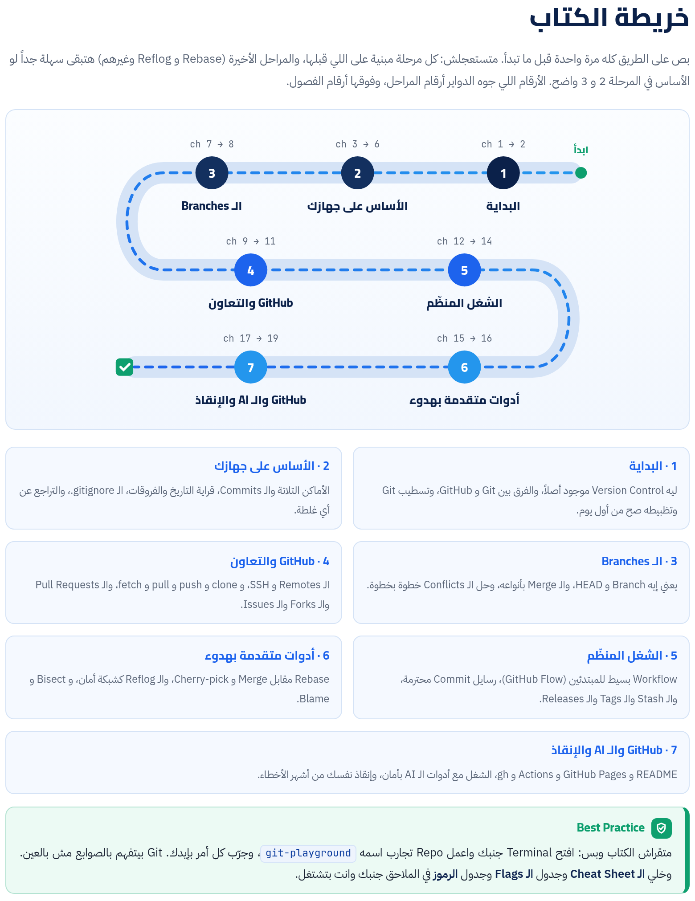

الكتاب ده ماشي معاك بالتدريج على 7 مراحل: من "يعني إيه Version Control أصلاً" لحد ما تشتغل على GitHub مع ناس تانية ومع أدوات الـ AI من غير ما تخاف تبوّظ حاجة. كل مرحلة بتبني على اللي قبلها، وكل أمر متشرّح حتة حتة، والحاجات اللي بتتكرر عليها علامة **حاجة مشتركة** وإحالة لمكانها.

:::tip[تحميل]
- [الكتاب كامل PDF](/biginner-journey/downloads/02-git-book.pdf)
- [الـ Cheat Sheet PDF](/biginner-journey/downloads/02-git-cheatsheet.pdf)
:::

## خريطة الكتاب

- **1 · البداية**: ليه Version Control موجود أصلاً، والفرق بين Git و GitHub، وتسطيب Git وتظبيطه صح من أول يوم.
- **2 · الأساس على جهازك**: الأماكن التلاتة والـ Commits، قراية التاريخ والفروقات، الـ .gitignore، والتراجع عن أي غلطة.
- **3 · الـ Branches**: يعني إيه Branch و HEAD، والـ Merge بأنواعه، وحل الـ Conflicts خطوة بخطوة.
- **4 · GitHub والتعاون**: الـ Remotes و SSH، و clone و push و pull و fetch، والـ Pull Requests والـ Forks والـ Issues.
- **5 · الشغل المنظّم**: Workflow بسيط للمبتدئين (GitHub Flow)، رسايل Commit محترمة، والـ Stash والـ Tags والـ Releases.
- **6 · أدوات متقدمة بهدوء**: Rebase مقابل Merge و Cherry-pick، والـ Reflog كشبكة أمان، و Bisect و Blame.
- **7 · GitHub والـ AI والإنقاذ**: README و GitHub Pages و Actions و gh، الشغل مع أدوات الـ AI بأمان، وإنقاذ نفسك من أشهر الأخطاء.

## الفصول

**المرحلة 1 · البداية**

- [الفصل 1: ليه Git أصلاً؟](./ch01/)
- [الفصل 2: تسطيب Git وتظبيطه صح](./ch02/)

**المرحلة 2 · الأساس على جهازك**

- [الفصل 3: أول Repo: الأماكن التلاتة والـ Commit](./ch03/)
- [الفصل 4: قراية التاريخ: log و diff و show](./ch04/)
- [الفصل 5: الـ .gitignore: حاجات Git ميشوفهاش](./ch05/)
- [الفصل 6: التراجع عن أي غلطة](./ch06/)

**المرحلة 3 · الـ Branches**

- [الفصل 7: الـ Branches و HEAD](./ch07/)
- [الفصل 8: الـ Merge وحل الـ Conflicts](./ch08/)

**المرحلة 4 · GitHub والتعاون**

- [الفصل 9: GitHub والـ Remotes والدخول بأمان](./ch09/)
- [الفصل 10: clone و push و fetch و pull](./ch10/)
- [الفصل 11: التعاون: Pull Requests و Forks و Issues](./ch11/)

**المرحلة 5 · الشغل المنظّم**

- [الفصل 12: Workflow للمبتدئين: GitHub Flow](./ch12/)
- [الفصل 13: رسايل Commit محترمة و Commits مركّزة](./ch13/)
- [الفصل 14: الـ Stash والـ Tags والـ Releases](./ch14/)

**المرحلة 6 · أدوات متقدمة بهدوء**

- [الفصل 15: الـ Rebase والـ Cherry-pick بهدوء](./ch15/)
- [الفصل 16: الـ Reflog شبكة الأمان، و Bisect و Blame](./ch16/)

**المرحلة 7 · GitHub والـ AI والإنقاذ**

- [الفصل 17: GitHub كمنصة: README و Pages و Actions و gh](./ch17/)
- [الفصل 18: Git والـ AI: اشتغل بأمان](./ch18/)
- [الفصل 19: الإنقاذ: الغلطات الشائعة وحلها](./ch19/)

**الملاحق**

- [ملحق أ: Cheat Sheet وجدول الـ Flags وجدول الرموز](./appendix-1/)
- [ملحق ب: قاموس المصطلحات](./appendix-2/)
- [ملحق ج: الإجابات والحلول](./appendix-3/)
