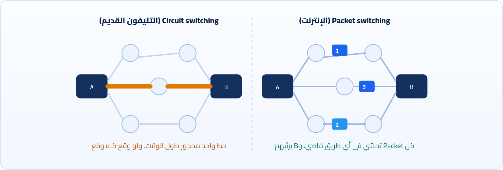
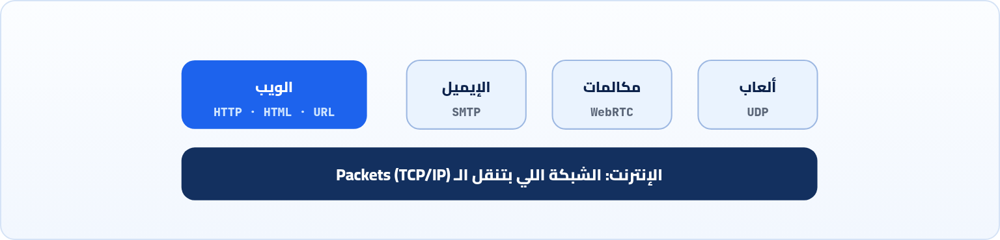
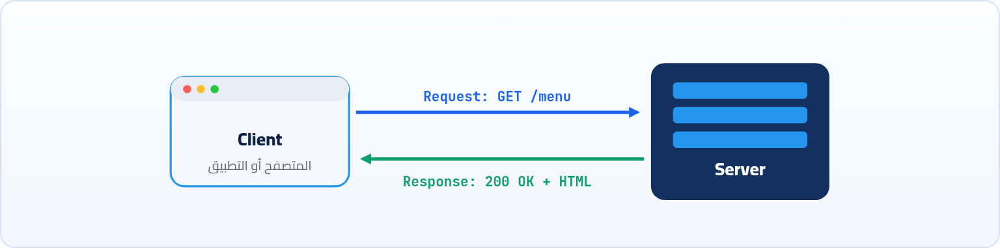

<small>المرحلة 1 · الصورة الكبيرة</small>

قبل ما نتكلم عن IP و HTTP و DevTools، لازم نعرف الحكاية. مين احتاج يوصّل كمبيوتر بكمبيوتر أصلاً؟ وإيه المشكلة اللي خلّت الناس تقطّع الرسايل لحتت صغيرة؟ وليه الإنترنت والويب حاجتين مختلفتين؟ الفصل ده هيديك الخريطة اللي كل الفصول الجاية هتتعلق عليها.

:::note[بعد الفصل ده هتكون عارف]
- المشكلة اللي اتعمل الإنترنت عشان يحلها، وفكرة الـ Packet switching
- الفرق بين الإنترنت (الشبكة) والويب (خدمة فوقها)
- يعني إيه Client ويعني إيه Server بالظبط
- يعني إيه Protocol وليه كل حاجة في الكتاب ده Protocol
- مين بيدير الإنترنت ومين بيكتب القواعد (RFCs)
- ليه الموضوع ده مهم ليك كمبرمج JavaScript
:::

## 1.1 قبل الإنترنت: كل جهاز جزيرة

خلينا نرجع لستينيات القرن اللي فات. الكمبيوتر وقتها كان أوضة كاملة، وغالي جداً، وكل جامعة أو مركز أبحاث عنده واحد أو اتنين بالكتير. لو انت باحث في جامعة في كاليفورنيا ومحتاج برنامج أو بيانات موجودة على كمبيوتر في جامعة تانية في ولاية تانية، الحل كان بسيط ومرهق: تسافر، أو تستنى حد يبعتلك شريط بالبريد. كل كمبيوتر كان **جزيرة** لوحده، والمعلومة اللي عليه محبوسة جواه.

والحل الأولاني اللي يجي في دماغ أي حد: طب نوصّل الكمبيوترات ببعض بسلك، زي التليفون. وهنا كانت المشكلة. شبكة التليفون وقتها كانت شغالة بطريقة اسمها **Circuit switching**: لما تتصل بحد، السنترال بيحجزلك خط كامل من أولك لآخرك طول المكالمة، حتى لو انتو الاتنين ساكتين. الطريقة دي معقولة للكلام، بس للكمبيوترات مضيعة كبيرة: الكمبيوتر بيبعت حتة بيانات، ويسكت شوية، ويبعت تاني، والخط محجوز على الفاضي. وفيه مشكلة أخطر: لو سنترال واحد في النص وقع، المكالمة كلها بتقع.

## 1.2 الفكرة العبقرية: قطّع الرسالة حتت

في نفس الفترة تقريباً، كذا باحث وصلوا لنفس الفكرة كل واحد لوحده (منهم Paul Baran في أمريكا و Donald Davies في إنجلترا): بدل ما نحجز خط كامل، **نقطّع الرسالة لحتت صغيرة**، كل حتة عليها عنوان الرايح والجاي ورقمها، ونرميها في الشبكة. كل حتة تمشي لوحدها في أي طريق فاضي، وممكن حتتين من نفس الرسالة يمشوا في طريقين مختلفين، وفي الآخر الجهاز اللي مستلم يرتّبهم بالأرقام ويركّب الرسالة تاني. الحتة دي اسمها **Packet**، والطريقة دي اسمها **Packet switching**.

*الفرق بين حجز خط كامل وتقطيع الرسالة لـ Packets بتمشي في أي طريق.*

أحلى حاجة في الفكرة دي إنها حلّت المشكلتين مرة واحدة. الخطوط بقت متشاركة بين كل الناس، فمفيش خط محجوز على الفاضي. والشبكة بقت **بتعالج نفسها**: لو حتة من الشبكة وقعت، الـ Packets تلف من طريق تاني وخلاص. والفكرة دي لسه هي أساس كل حاجة لحد النهارده: الصورة اللي بتفتحها على Instagram دلوقتي واصلالك مقطّعة لمئات الـ Packets، وكل واحدة فيهم ممكن تكون مشيت في طريق مختلف.

## 1.3 من ARPANET لـ TCP/IP: لغة واحدة لكل الشبكات

سنة 1969 اتعملت أول شبكة حقيقية بالفكرة دي، اسمها **ARPANET**، ووصّلت في الأول 4 جامعات بس في أمريكا. أول رسالة اتبعتت عليها كانت المفروض كلمة `LOGIN`، بس الشبكة وقعت بعد أول حرفين، فأول رسالة في تاريخ الإنترنت كانت `LO`. ومن هنا بدأت الشبكة تكبر.

بس ظهرت مشكلة جديدة. في السبعينيات بقى فيه شبكات كتير: شبكة جامعات، وشبكة بالراديو، وشبكة بالأقمار الصناعية. كل شبكة ليها طريقتها وقواعدها، ومفيش شبكة تعرف تكلم التانية. زي ما يكون كل بلد بيتكلم لغة، ومفيش مترجم. فاتطور حل: اتنين باحثين اسمهم **Vint Cerf** و **Bob Kahn** صمموا مجموعة قواعد واحدة أي شبكة تقدر تتكلمها فوق طريقتها الخاصة، وسموها **TCP/IP**. ويوم 1 يناير 1983 كل ARPANET اتحولت ليها في يوم واحد. اليوم ده بيعتبره ناس كتير "عيد ميلاد الإنترنت".

وكلمة **Internet** نفسها جاية من هنا: inter-network، يعني "شبكة بين الشبكات". الإنترنت مش شبكة واحدة كبيرة، ده آلاف الشبكات (شبكة شركة الإنترنت بتاعتك، وشبكة Google، وشبكة الجامعة) متوصلة ببعض وكلها بتتكلم نفس اللغة.

:::note[يعني إيه Protocol؟]
الكلمة دي هتتكرر في الكتاب كله: TCP و IP و HTTP و TLS و DNS، كلهم **Protocols**. الـ Protocol ببساطة **اتفاق على شكل الكلام**: مين يبدأ، ويقول إيه، والرد يبقى شكله إيه، ولو حصلت مشكلة نعمل إيه. زي لما تكلم حد في التليفون: "ألو" الأول، وبعدين الكلام، وبعدين "مع السلامة". لو واحد اتكلم بطريقة والتاني مستني طريقة تانية، مفيش تفاهم. وعشان كده الكتاب ده كله في الحقيقة كتاب عن اتفاقيات: كل فصل بيشرح اتفاق، وليه اتعمل كده.
:::

## 1.4 الإنترنت مش هو الويب

لحد آخر الثمانينيات، الإنترنت كان موجود وشغال، بس كان مكان للباحثين والمهندسين. تبعت إيميل، وتنقل ملفات بأوامر معقدة، وتدخل على كمبيوتر تاني من بعيد. مفيش "مواقع"، ومفيش حاجة تدوس عليها.

سنة 1989، مهندس في مركز أبحاث CERN في سويسرا اسمه **Tim Berners-Lee** كانت عنده مشكلة: آلاف الباحثين بيكتبوا أوراق ومستندات على أجهزة مختلفة، ومحدش عارف يلاقي حاجة. ففكر: طب ليه كل مستند ميبقاش فيه **روابط** لمستندات تانية، تدوس عليها توصلك للمستند التاني حتى لو على جهاز في آخر الدنيا؟ وعشان الفكرة دي تشتغل، اخترع تلات حاجات مع بعض، وهي التلات حاجات اللي الكتاب ده هيشرحهم بالتفصيل:

#### HTML

لغة لكتابة المستند نفسه، وفيها الروابط. ده اللي بتكتبه في كورس JavaScript.

#### URL

عنوان فريد لكل مستند في الدنيا، عشان الرابط يعرف يروح فين (الفصل 6).

#### HTTP

الـ Protocol اللي المتصفح يطلب بيه المستند، والسيرفر يرد بيه (الفصول 7 لـ 11).

وعمل كمان أول متصفح وأول سيرفر ويب في الدنيا. والاختراع ده اسمه **World Wide Web**، أو الويب. فخلي الفرق ده في دماغك عشان هيفرق معاك: **الإنترنت هو الطرق والكباري**، الشبكة اللي بتنقل الـ Packets من أي جهاز لأي جهاز. و**الويب خدمة من الخدمات اللي ماشية فوقه**، زي الإيميل وزي ألعاب الأونلاين وزي مكالمات الفيديو. الويب ركب على الإنترنت، مش هو الإنترنت.

*الويب واحد من خدمات كتير ماشية فوق الإنترنت.*

## 1.5 مين بيطلب ومين بيرد: الـ Client والـ Server

أهم فكرة في الويب كله إن فيه طرفين في أي كلام. طرف **بيطلب** حاجة، اسمه **Client**. وطرف **بيستنى الطلبات ويرد عليها**، اسمه **Server**. زي المطعم بالظبط: انت الزبون بتطلب من الجرسون، والمطبخ بيجهّز الطلب ويرجعهولك. انت مبتدخلش المطبخ، والمطبخ مبيجيش يسألك جعان ولا لأ.

وفيه حاجة بتلخبط ناس كتير في الأول: **الـ Server مش نوع جهاز خاص**. هو مجرد برنامج شغال على أي كمبيوتر، قاعد مستني حد يكلمه. وأحلى دليل على كده إنك هتعمل Server على اللابتوب بتاعك قريب جداً: أول ما تشغّل مشروع React بـ `npm run dev` أو Node بـ `node server.js`، اللابتوب بتاعك بقى Server، والمتصفح اللي على نفس اللابتوب هو الـ Client. ونفس الجهاز ممكن يبقى الاتنين في نفس الوقت: السيرفر بتاعك وهو بيرد على المتصفح، ممكن هو نفسه يبقى Client لسيرفر تاني (زي API بتاع الطقس).

*الـ Client بيبدأ دايماً بطلب (Request)، والـ Server بيرد (Response).*

ولاحظ حاجة مهمة في الرسمة: **الـ Client هو اللي بيبدأ دايماً**. السيرفر في HTTP العادي مبيبعتش حاجة لحد من نفسه، هو بيرد بس. والمعلومة دي هتفسرلك حاجات كتير بعدين، زي ليه الشات محتاج تقنيات زي WebSockets عشان السيرفر يقدر يبعت رسالة جديدة من غير ما تسأله.

:::tip[حاجة مشتركة: نفس الفكرة في كل مكان]
فكرة "واحد بيطلب وواحد بيرد" مش للويب بس. الـ Terminal نفسه بيعمل كده لما تكتب `git push`: الـ Git اللي على جهازك Client، و GitHub هو الـ Server. ولما تعمل `docker pull`، الـ Docker Client بيكلم Registry هو Server. وفي كتاب Docker، الـ Docker CLI نفسه Client بيكلم الـ Docker daemon اللي هو Server على نفس الجهاز. أول ما تفهم النمط ده هتلاقيه في كل حتة.
:::

## 1.6 مين بيدير الإنترنت؟ ومين بيكتب القواعد؟

سؤال منطقي: لو الإنترنت آلاف الشبكات، مين صاحبه؟ الإجابة: **محدش لوحده**. كل شبكة ليها صاحب (شركة الاتصالات بتاعتك عندها شبكتها، و Google عندها شبكتها)، والشبكات دي بتتفق مع بعض إنها تنقل لبعض. بس فيه كام جهة مهمة لازم تعرف أساميها عشان هتقابلها في المصادر:

**الجهات اللي هتقابل أساميها**

| الجهة | بتعمل إيه |
|---|---|
| **IETF** | بتكتب قواعد الإنترنت نفسه (TCP و IP و HTTP و TLS و DNS) في مستندات اسمها **RFC**. مثلاً HTTP مكتوب في `RFC 9110`. |
| **W3C** و **WHATWG** | بيكتبوا قواعد الويب في المتصفح: HTML و CSS والـ APIs زي `fetch`. |
| **ICANN** و **IANA** | بيديروا أسماء الدومينات وتوزيع عناوين الـ IP وأرقام الـ Ports المشهورة. |
| **ISP** | شركة الإنترنت بتاعتك (WE أو Vodafone أو Orange مثلاً): الشبكة اللي بتوصّلك بباقي الإنترنت. |

:::note[لو حابب تتعمق: يعني إيه RFC؟]
الـ RFC اختصار Request for Comments، يعني "طلب آراء". الاسم ده من أيام ARPANET لما الباحثين كانوا بيكتبوا أفكارهم ويقولوا للباقيين "إيه رأيكم؟". النهارده الـ RFC مستند رسمي بيوصف Protocol بالتفصيل، وكل واحد ليه رقم مبيتغيرش. ولو اتعدل الـ Protocol بيطلع RFC جديد برقم جديد. مش محتاج تقرا RFCs دلوقتي، بس لما تشوف `RFC 9110` في MDN، تعرف إنه "المرجع الرسمي اللي كل المتصفحات والسيرفرات ماشية عليه". وفي ملحق المصادر هتلاقي روابط أهمهم.
:::

## 1.7 طب وأنا كمبرمج JavaScript، ده يفرق معايا في إيه؟

سؤال في محله. انت دلوقتي في كورس Jonas، وكتير من الكلام ده ممكن يبان بعيد عن `let` و`function`. بس استنى لحد ما توصل لجزء الـ **Asynchronous JavaScript** و`fetch`. ساعتها هتكتب سطر زي `fetch('https://restcountries.com/v3.1/name/egypt')`، وحاجات كتير ممكن تبوظ: الـ URL غلط، أو السيرفر رد بـ 404، أو المتصفح منع الرد بسبب CORS، أو الرد جه بس شكله مش زي ما انت متوقع. ومن غير الكتاب ده، كل المشاكل دي هتبان ليك "الكود مش شغال" وخلاص. ومع الكتاب ده، هتفتح تابة الـ Network، وتبص على الطلب، وتعرف في ثانية المشكلة فين.

#### في كورس JavaScript

`fetch` و `async/await` والـ Promises هيبقوا منطقيين، لأنك عارف إيه اللي بيحصل ورا السطر ده على الشبكة.

#### في Node بعد كده

هتبقى انت اللي بتكتب السيرفر: هتختار الـ Status code وتحط الـ Headers وتظبط الـ CORS والكوكيز بنفسك.

#### في React

كل صفحة بتجيب بيانات من API. ولما الصفحة تفضل فاضية، هتعرف تفرّق بين مشكلة في الـ Component ومشكلة في الطلب.

#### في شغلك كـ Content Engineer

الـ SEO والكاش والـ CDN والـ Redirects وسرعة الصفحة، كلها مفاهيم من الكتاب ده، وهتتكلم فيها مع المبرمجين بلغتهم.

:::tip[ملخص الفصل]
- الإنترنت اتعمل عشان يوصّل كمبيوترات كانت جزر منفصلة، والفكرة الأساسية **Packet switching**: الرسالة بتتقطع حتت كل واحدة تمشي لوحدها.
- **TCP/IP** هو اللغة الواحدة اللي خلت كل الشبكات تكلم بعض، والإنترنت = شبكة الشبكات.
- الويب (HTML و URL و HTTP) خدمة فوق الإنترنت، مش هو الإنترنت.
- الـ Client بيبدأ بطلب، والـ Server برنامج مستني يرد. واللابتوب بتاعك هيبقى Server أول ما تشغّل مشروع.
- الـ Protocol = اتفاق على شكل الكلام، وقواعد الإنترنت مكتوبة في RFCs.
:::

### صح ولا غلط؟

1. الإنترنت والويب اسمين لنفس الحاجة.
2. في Packet switching، كل الـ Packets بتاعة رسالة واحدة لازم تمشي في نفس الطريق.
3. الـ Server لازم يبقى جهاز خاص غالي في Data center.

### أسئلة مراجعة

1. إيه المشكلتين اللي في Circuit switching، و Packet switching حلّهم إزاي؟
2. Tim Berners-Lee اخترع تلات حاجات عشان الويب يشتغل. إيه هما، وكل واحدة بتعمل إيه؟
3. اشرح بمثال من عندك ليه نفس الجهاز ممكن يبقى Client و Server في نفس الوقت.
4. يعني إيه Protocol؟ واذكر 3 Protocols هتتعلمهم في الكتاب.

### تحديات الفصل

<small>جرّبها بإيدك، والحلول في ملحق الإجابات.</small>

1. **[سهل]** اكتب في ورقة 5 خدمات بتستخدمها كل يوم، وقسّمهم: أنهي واحدة "ويب" (بتفتحها في متصفح) وأنهي واحدة خدمة تانية فوق الإنترنت.
2. **[متوسط]** افتح `https://info.cern.ch` في المتصفح. دي نسخة من أول موقع في التاريخ. لاحظ إن كله HTML وروابط بس، وفكّر: إيه اللي ناقص عن مواقع النهارده؟
3. **[صعب]** افتح `https://www.rfc-editor.org/rfc/rfc9110` واقرا الـ Abstract (أول فقرة). حاول تلخصها بالعامي في سطرين.
