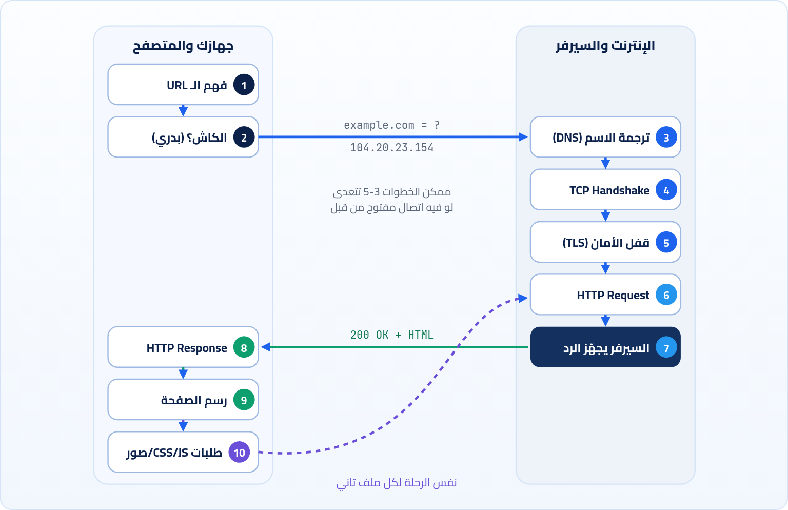

<small>المرحلة 1 · الصورة الكبيرة</small>

بتكتب example.com وتدوس Enter، وفي أقل من ثانية الصفحة قدامك. في الثانية دي بيحصل أكتر من عشر خطوات، كل خطوة فيهم ليها فصل كامل في الكتاب ده. الفصل ده هو الخريطة: هنمشي الرحلة كلها مرة واحدة بسرعة، عشان لما ندخل في تفاصيل كل محطة تبقى عارف هي فين من الصورة الكبيرة.

:::note[بعد الفصل ده هتكون عارف]
- الخطوات الكاملة من ما تدوس Enter لحد ما الصفحة تترسم
- كل خطوة بتحل مشكلة إيه، وفين تفاصيلها في الكتاب
- ليه الصفحة الواحدة بتعمل عشرات الطلبات مش طلب واحد
- أول تجربة ليك تشوف الرحلة دي بعينك في الـ Terminal وفي DevTools
:::

<a id="s2-1"></a>

## 2.1 السؤال اللي بيتسأل في كل Interview

فيه سؤال مشهور جداً في مقابلات الشغل لأي مبرمج ويب: "إيه اللي بيحصل لما تكتب `google.com` في المتصفح وتدوس Enter؟". السؤال ده مشهور لأنه بيكشف في دقيقتين إذا كنت فاهم الويب ولا حافظ كود وخلاص. والحلو إن الإجابة عليه هي الكتاب ده كله بالظبط. فخلينا نجاوبه دلوقتي مرة بسرعة، وبعدين كل فصل هيفتح محطة من المحطات دي ويشرحها بالتفصيل.

تخيل إنك قاعد على اللابتوب، فتحت Chrome، وكتبت `https://example.com/products`، ودوست Enter. من وجهة نظرك الموضوع خطوة واحدة. من وجهة نظر المتصفح، هو لسه عنده مشكلة كبيرة: هو عارف **اسم** الموقع بس، ومحتاج يوصل لجهاز معين في مكان ما في الدنيا، ويكلمه بأمان، ويطلب منه الصفحة، ويفهم الرد، ويرسمه. يلا نمشي معاه.



*الرحلة كلها في رسمة واحدة. كل رقم هنا ليه فصل كامل في الكتاب.*

<a id="s2-2"></a>

## 2.2 المحطة 1 و 2: المتصفح يفهم انت عاوز إيه

أول حاجة المتصفح بيعملها إنه يقرا اللي كتبته. هل ده **عنوان** ولا **كلمة بحث**؟ لو كتبت `pizza near me` هيبعتها لمحرك البحث. لو كتبت `example.com` هيفهم إنه عنوان، وهيكمّله لوحده لـ `https://example.com/`. وبعدين يفصّص العنوان لحتت: البروتوكول `https`، واسم الجهاز `example.com`، والمسار `/products`. التفصيص ده مهم جداً عشان كل حتة هتستخدم في خطوة مختلفة، وده موضوع **الفصل 6**.

بعدين يسأل نفسه: "هل أنا جبت الصفحة دي قبل كده ولسه معايا نسخة صالحة؟". لو أيوه، ممكن يعرضها على طول من غير ما يكلم حد خالص. ده **الكاش**، وهو سبب إن المواقع اللي بتفتحها كل يوم بتفتح بسرعة. وده موضوع **الفصل 15**.

<a id="s2-3"></a>

## 2.3 المحطة 3: DNS، دليل التليفونات

هنا أول مشكلة حقيقية. الأجهزة على الإنترنت مبتعرفش بعض بالأسماء، بتعرف بعض بالأرقام، اسمها **IP addresses**، زي `104.20.23.154`. والبشر مش هيحفظوا أرقام لكل موقع. فاتعمل نظام اسمه **DNS** شغلته يترجم الاسم لرقم، زي دليل التليفونات بالظبط: انت عارف اسم المطعم، والدليل يديك رقمه. المتصفح بيسأل: "`example.com` رقمه كام؟"، والسؤال ده بيلف على كذا سيرفر لحد ما يلاقي الإجابة. الرحلة دي هنرسمها خطوة خطوة في **الفصل 5**، والـ IP نفسه موضوع **الفصل 3**.

<a id="s2-4"></a>

## 2.4 المحطة 4 و 5: نفتح خط، ونأمّنه

دلوقتي المتصفح معاه الرقم. بس مينفعش يرمي الطلب كده في الشبكة ويتمنى إنه يوصل. محتاج الأول **يفتح اتصال** مع السيرفر ويتأكد إن فيه حد على الطرف التاني بيسمع. ده بيحصل بحاجة اسمها **TCP Handshake**، تلات رسايل صغيرة زي "سامعني؟" و"سامعك، وانت سامعني؟" و"أيوه". ومعاها رقم مهم اسمه **Port** بيحدد أنهي برنامج على السيرفر هيرد (443 للـ HTTPS). ده **الفصل 4**.

وبعدين، عشان العنوان فيه `https` بـ `s`، لازم الخط يبقى مقفول بحيث محدش في النص يقدر يقرا أو يعدّل الكلام (لا شركة الإنترنت ولا اللي قاعد معاك على نفس الواي فاي في الكافيه). ده الـ **TLS Handshake**: السيرفر بيثبت إنه فعلاً `example.com` بشهادة، والطرفين بيتفقوا على مفتاح تشفير. وده **الفصل 12**.

<a id="s2-5"></a>

## 2.5 المحطة 6 و 7 و 8: الطلب والرد

أخيراً الخط جاهز ومتأمّن. المتصفح بيكتب رسالة بلغة **HTTP**، شكلها تقريباً كده:

```http title="الطلب (مبسّط)"
GET /products HTTP/1.1
Host: example.com
User-Agent: Mozilla/5.0 (Macintosh; Intel Mac OS X 10_15_7) ...
Accept: text/html
```

يعني: "هاتلي `/products` من `example.com`، وأنا متصفح على Mac، وعاوز HTML". السيرفر بيستلم الرسالة، وبيشغّل الكود بتاعه (ممكن يجيب بيانات من Database، أو يقرا ملف)، وبيرجّع رد:

```http title="الرد (مبسّط)"
HTTP/1.1 200 OK
Content-Type: text/html; charset=UTF-8
Content-Length: 1256
Cache-Control: max-age=600

<!doctype html><html>...
```

أول سطر فيه رقم `200` معناه "تمام، أهو". وبعده سطور اسمها **Headers** بتوصف الرد، وبعد سطر فاضي جسم الرد نفسه (الـ HTML). كل سطر من دول هنفصّصه حتة حتة في الفصول 7 و 8 و 9. ومش هتصدق قد إيه هتستفيد لما تعرف تقرا السطور دي، لأنها أول حاجة هتبص عليها في DevTools لما حاجة تبوظ.

<a id="s2-6"></a>

## 2.6 المحطة 9 و 10: المتصفح يرسم، ويطلب تاني

المتصفح بيبدأ يقرا الـ HTML من فوق لتحت ويبني منه شجرة اسمها **DOM** (اللي هتتعامل معاها في JavaScript بـ `document.querySelector`). وأثناء القراية بيلاقي سطور زي `<link href="style.css">` و`<script src="app.js">` و``. كل سطر من دول معناه **طلب HTTP جديد**، وكل طلب ممكن يعدّي على نفس الرحلة (أو جزء منها لو الاتصال لسه مفتوح). وعشان كده لما تفتح تابة الـ Network هتلاقي الصفحة الواحدة عملت 30 أو 80 أو حتى 200 طلب، مش طلب واحد. وفي الآخر، لما يتجمع الـ HTML والـ CSS، المتصفح بيحسب مكان كل حاجة ويلوّنها على الشاشة. ده **الفصل 16**.

:::note[الرحلة دي بتاخد قد إيه؟]
على اتصال كويس، الرحلة كلها لموقع قريب ممكن تاخد أقل من 100 ملي ثانية. والجزء الأكبر من الوقت غالباً مش في السيرفر، في **المسافة**: كل رسالة لازم تروح وترجع، والضوء نفسه في الألياف الضوئية محتاج حوالي 100 ملي ثانية عشان يروح من القاهرة لكاليفورنيا ويرجع. وده سبب ظهور حاجات زي الـ CDN (سيرفرات قريبة منك) و HTTP/3 (رسايل handshake أقل). هتشوف الأوقات دي بعينك في تابة Timing في الفصل 19.
:::

<a id="s2-7"></a>

## 2.7 شوف الرحلة بعينك دلوقتي

كفاية كلام. افتح الـ Terminal على الـ Mac وجرّب الأمر ده. متقلقش لو الناتج مش مفهوم كله دلوقتي، هنرجعله في الفصل 10 ونفصّصه سطر سطر. المهم دلوقتي إنك تشوف إن المحطات اللي اتكلمنا عنها حقيقية:

**تشريح الأمر**

```sh
curl -v https://example.com -o /dev/null
```

1. `curl`: برنامج بيعمل طلبات HTTP من الـ Terminal. زي متصفح من غير شاشة. موجود على الـ Mac من غير تسطيب.
2. `-v`: Verbose: "احكيلي كل حاجة بتعملها". هيطبع الـ DNS والاتصال والـ TLS والطلب والرد.
3. `https://example.com`: العنوان اللي هنطلبه. `example.com` دومين محجوز رسمياً للأمثلة، فآمن تجرب عليه.
4. `-o /dev/null`: `-o` = Output: "اكتب جسم الرد في الملف ده". و `/dev/null` ملف خاص في أي نظام Unix بيبلع أي حاجة تتكتب فيه (زي البلاعة)، فالـ HTML مش هيتطبع ويزحم الشاشة.

```sh title="Terminal"
$ curl -v https://example.com -o /dev/null
* Host example.com:443 was resolved.
* IPv4: 104.20.23.154
*   Trying 104.20.23.154:443...
* Connected to example.com (104.20.23.154) port 443
* SSL connection using TLSv1.3 / AEAD-AES256-GCM-SHA384
* Server certificate:
*  subject: CN=example.com
> GET / HTTP/2
> Host: example.com
> User-Agent: curl/8.7.1
> Accept: */*
>
< HTTP/2 200
< content-type: text/html; charset=utf-8
< server: cloudflare
< cf-cache-status: HIT
<
```

```sh title="المحطات في ناتج curl -v"
* Host ... was resolved / IPv4:
* Trying ...:443 / Connected
* SSL connection using TLSv1.3
> GET / HTTP/2 ...
< HTTP/2 200 ...
```

1. `* Host ... was resolved / IPv4:`: المحطة 3: الـ DNS رجّع الرقم. السطور اللي بتبدأ بـ `*` معلومات من curl نفسه.
2. `* Trying ...:443 / Connected`: المحطة 4: فتح اتصال TCP على Port `443`.
3. `* SSL connection using TLSv1.3`: المحطة 5: الـ TLS خلص، والخط متأمّن. والشهادة باسم السيرفر.
4. `> GET / HTTP/2 ...`: المحطة 6: الطلب اللي curl بعته. السطور اللي بتبدأ بـ `>` = رايح للسيرفر.
5. `< HTTP/2 200 ...`: المحطة 8: الرد. السطور اللي بتبدأ بـ `<` = جاي من السيرفر.

<small>الأرقام اللي عندك (الـ IP ونسخة curl) ممكن تختلف، ده طبيعي. و example.com نفسه دلوقتي ورا Cloudflare، فالـ IP اللي هيطلعلك ممكن يتغير من وقت للتاني.</small>

:::note[مثال عملي: نفس الرحلة في المتصفح]
افتح Chrome، ودوس <kbd>Cmd</kbd>+<kbd>Option</kbd>+<kbd>I</kbd> عشان تفتح DevTools، واختار تابة **Network**، وبعدين افتح `https://example.com`. هتلاقي سطر للطلب. دوس عليه وبص على تابة **Timing**: هتلاقي نفس المحطات بأساميها: **DNS Lookup** و**Initial connection** و**SSL** و**Waiting for server response** و**Content Download**. ده بالظبط اللي هنتعلم نقراه في المرحلة الأخيرة من الكتاب.
:::

:::tip[حاجة مشتركة: الرموز > و < و *]
الرموز دي هتشوفها كتير مع `curl -v` في الكتاب كله: `>` = حاجة رايحة منك للسيرفر، و`<` = حاجة جاية من السيرفر ليك، و`*` = curl بيحكيلك بيعمل إيه. وخلي بالك إن معناهم هنا **مختلف** عن معنى `>` في الـ Terminal نفسه (اللي بيحوّل الناتج لملف زي `ls > files.txt`). هنا هي مجرد علامة مطبوعة في الناتج، مش أمر.
:::

:::tip[ملخص الفصل]
- الرحلة: فهم الـ URL، الكاش، DNS، TCP، TLS، HTTP Request، السيرفر، HTTP Response، الرسم، وطلبات للملفات التانية.
- كل محطة بتحل مشكلة: الاسم لرقم (DNS)، خط مضمون (TCP)، خط متأمّن (TLS)، لغة مشتركة (HTTP).
- الصفحة الواحدة = عشرات الطلبات، كل ملف CSS و JS وصورة طلب لوحده.
- `curl -v` وتابة Timing في DevTools بيوروك المحطات دي بعينك.
:::

### صح ولا غلط؟

1. المتصفح بيعمل طلب HTTP واحد بس لكل صفحة.
2. الـ DNS بيحصل بعد ما المتصفح يبعت طلب الـ HTTP.
3. في ناتج `curl -v`، السطور اللي بتبدأ بـ `<` جاية من السيرفر.

### أسئلة مراجعة

1. رتّب المحطات دي: TLS، DNS، HTTP Request، TCP، الرسم.
2. ليه المتصفح محتاج DNS أصلاً؟ ما هو عارف اسم الموقع.
3. إيه فايدة `-o /dev/null` في أمر الـ curl اللي جربناه؟
4. اذكر سببين يخلّوا الموقع يفتح أسرع تاني مرة تفتحه.

### تحديات الفصل

<small>جرّبها بإيدك، والحلول في ملحق الإجابات.</small>

1. **[سهل]** جرّب `curl -v https://example.com -o /dev/null` وعلّم بقلم على كل محطة في الناتج بتاعك.
2. **[متوسط]** افتح تابة Network في DevTools وافتح موقع بتستخدمه كل يوم. شوف في الشريط اللي تحت عدد الطلبات (requests). كام طلب؟
3. **[صعب]** اكتب بإيدك إجابة سؤال الـ Interview ("إيه اللي بيحصل لما تكتب google.com؟") في 10 سطور من غير ما تبص في الكتاب. احتفظ بيها وقارنها بعد ما تخلص الكتاب.
