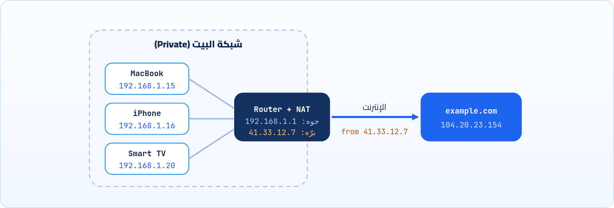
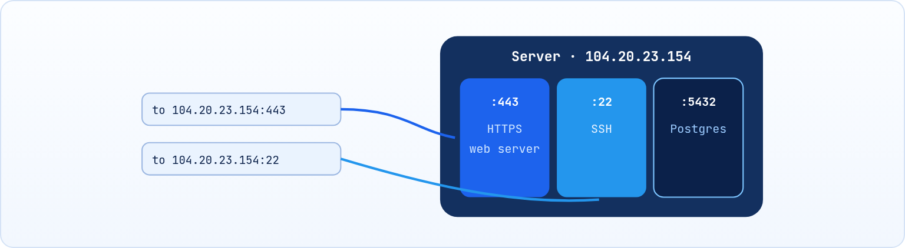

<small>المرحلة 2 · العناوين والتوصيل</small>

عشان Packet توصل لجهاز معين في وسط مليارات الأجهزة، لازم يبقى لكل جهاز عنوان. وعشان توصل لبرنامج معين جوه الجهاز ده، لازم يبقى فيه رقم شقة كمان. الفصل ده عن العنوان (IP) ورقم الشقة (Port)، وعن أشهر عنوان هتقابله في حياتك كمبرمج: localhost:3000.

:::note[بعد الفصل ده هتكون عارف]
- IPv4 شكله إيه وليه العناوين خلصت
- الـ Private IP والـ Public IP والـ Router والـ NAT
- IPv6 وليه موجود
- يعني إيه Port، وأشهر الأرقام اللي هتقابلها
- localhost و 127.0.0.1 و 0.0.0.0 والفرق بينهم
- تعرف IP جهازك على الـ Mac، وتشغّل سيرفر، وتعرف مين ماسك Port بـ lsof
:::

<a id="s3-1"></a>

## 3.1 المشكلة: الـ Packet رايحة فين؟

في الفصل الأول قلنا إن الرسالة بتتقطع لـ Packets، وكل Packet بتمشي لوحدها. طب إزاي كل جهاز في النص (اسمه **Router**) يعرف يوديها فين؟ نفس المشكلة اللي عند البوسطة: الجواب لازم يبقى عليه **عنوان** واضح، وكل مكتب بريد يبص على العنوان ويقرر يبعته للمكتب اللي بعده. فاتطور حل: كل جهاز متوصل بالإنترنت ياخد رقم فريد اسمه **IP address** (الـ IP هو الـ Protocol اللي اتكلمنا عنه، Internet Protocol). وكل Packet بيبقى مكتوب عليها IP المرسل و IP المستلم، زي الجواب بالظبط.

<a id="s3-2"></a>

## 3.2 IPv4: أربع أرقام بنقط

الشكل اللي هتشوفه أغلب الوقت اسمه **IPv4**، وشكله كده: `192.168.1.15`. أربع أرقام، بينهم نقط، وكل رقم من `0` لـ `255`.

**تشريح الأمر**

```sh
192.168.1.15
```

1. `192`: أول "Octet". كل رقم من الأربعة اسمه Octet لأنه 8 Bits. و 8 Bits تقدر تعدّ من 0 لـ 255، عشان كده مفيش رقم أكبر من 255.
2. `.`: النقطة مجرد فاصل للقراية. الكمبيوتر شايف العنوان رقم واحد طويل من 32 Bit.
3. `168.1`: الـ Octet التاني والتالت. في الشبكات البيتي، الجزء الأول ده (`192.168.1`) غالباً بيبقى "اسم الشبكة" نفسها.
4. `15`: آخر Octet: غالباً ده رقم جهازك جوه الشبكة. موبايلك ممكن يبقى `.16` والتلفزيون `.20`.

32 Bit يعني حوالي 4.3 مليار عنوان. رقم كان يبان مهول في السبعينيات، لما الإنترنت كان كام ألف جهاز. بس النهارده كل بني آدم معاه موبايل ولابتوب وساعة وتلفزيون ذكي. وهنا كانت المشكلة: **العناوين خلصت**. المنظمات اللي بتوزع العناوين أعلنت إن مخزون IPv4 الجديد خلص فعلاً من سنين. والناس طلعت بحلّين، واحد "ترقيع" شغال من زمان، وواحد حل جذري لسه بينتشر.

<a id="s3-3"></a>

## 3.3 الحل الأول: Private IP والـ NAT

الفكرة: مش لازم كل جهاز في البيت ياخد عنوان عام على الإنترنت. البيت كله ياخد **عنوان عام واحد** (اسمه **Public IP**) والـ Router بتاعك هو اللي ماسكه. وجوه البيت، كل جهاز ياخد عنوان **خاص** (اسمه **Private IP**) من نطاقات محجوزة مخصوص للشبكات الداخلية، ومحدش برّه بيشوفها. وعشان كده ممكن تلاقي جهازك `192.168.1.15` وجهاز صاحبك في بيته برضه `192.168.1.15`، ومفيش أي مشكلة، زي ما ممكن يبقى فيه "شقة 5" في كل عمارة في الشارع.



*الـ Router بيبدّل العنوان الخاص بالعنوان العام وهو خارج، وبيفتكر يرجّع الرد لمين. ده الـ NAT. (الأرقام توضيحية)*

طب السيرفر هيرد على مين، لو كل الأجهزة طالعة باسم الـ Router؟ هنا شغل **NAT** (Network Address Translation): الـ Router وهو بيطلّع الـ Packet بيشيل عنوانك الخاص ويحط عنوانه العام، ويكتب في جدول عنده "الطلب ده بتاع الـ MacBook". ولما الرد يرجع، يبص في الجدول ويوديه للجهاز الصح. عشان كده موقع زي `example.com` عمره ما بيشوف `192.168.1.15`، بيشوف عنوان الـ Router بس.

**النطاقات المحجوزة اللي هتقابلها**

| النطاق | يعني إيه | هتقابله فين |
|---|---|---|
| `192.168.0.0 → 192.168.255.255` | Private | أغلب راوترات البيوت |
| `10.0.0.0 → 10.255.255.255` | Private | شبكات الشركات، والـ VPN، والـ Cloud |
| `172.16.0.0 → 172.31.255.255` | Private | شبكات Docker الداخلية (`172.17.0.x`) |
| `127.0.0.0 → 127.255.255.255` | Loopback: الجهاز نفسه | `127.0.0.1` = localhost |
| `169.254.x.x` | عنوان طوارئ: الجهاز ملقاش Router يديله عنوان | لو شفته على جهازك يبقى الواي فاي فيه مشكلة |

:::note[لو حابب تتعمق: يعني إيه /24؟]
هتشوف كتير كتابة زي `192.168.1.0/24`. ده اسمه **CIDR**. الرقم بعد الـ `/` معناه "أول كام Bit من الـ 32 ثابتين وبيمثّلوا الشبكة". `/24` = أول 24 Bit (يعني أول 3 أرقام `192.168.1`) ثابتين، والباقي (آخر رقم) متاح للأجهزة، يعني 256 عنوان. و`/16` = أول رقمين ثابتين، يعني 65,536 عنوان. وكل ما الرقم بعد الـ `/` يصغر، الشبكة تكبر. ودي نفس الكتابة اللي ممكن تقابلها في إعدادات Docker أو Cloud.
:::

<a id="s3-4"></a>

## 3.4 الحل الجذري: IPv6

الـ NAT شغال، بس ترقيع. الحل الحقيقي إن العناوين تكبر. فاتعمل **IPv6**، وبدل 32 Bit بقى 128 Bit. الرقم ده كبير لدرجة صعب تتخيلها: يكفي تدي عنوان لكل حبة رمل على الأرض وتفضل معاك عناوين. وشكله مختلف، بيتكتب بالـ Hex (أرقام من 0 لـ 9 وحروف من a لـ f) في 8 مجموعات بينهم `:`:

**تشريح الأمر**

```sh
2606:4700:10::6814:179a
```

1. `2606:4700`: كل مجموعة 4 خانات Hex = 16 Bit. أول مجموعات غالباً بتحدد الشبكة (هنا شبكة Cloudflare).
2. `:`: الفاصل بين المجموعات بدل النقطة في IPv4.
3. `::`: اختصار معناه "هنا شوية مجموعات كلها أصفار". ومينفعش يتكتب غير مرة واحدة في العنوان، عشان الجهاز يعرف يحسب الأصفار كام.
4. `6814:179a`: آخر المجموعات. والأصفار اللي على الشمال في أي مجموعة ممكن تتشال: `0db8` = `db8`.

وده العنوان الحقيقي (واحد منهم) لـ `example.com` على IPv6. والـ localhost في IPv6 بيتكتب `::1`، يعني "كله أصفار وآخره 1". أغلب الأجهزة النهارده بتشتغل بالاتنين مع بعض (اسمها Dual stack)، والمتصفح بيجرب الاتنين ويستخدم الأسرع.

:::caution[خلي بالك: localhost ممكن يبقى ::1 مش 127.0.0.1]
من Node 17 وطالع، كلمة `localhost` ممكن تتحول لـ `::1` (IPv6) الأول. فلو سيرفر شغال على `127.0.0.1` بس، وأداة تانية بتحاول توصله على `localhost`، ممكن تاخد `ECONNREFUSED ::1:3000` وتستغرب. الحل: استخدم نفس الكلمة في الحتتين، أو اكتب `127.0.0.1` صريحة. هتقابل المشكلة دي غالباً لما تبدأ Node.
:::

<a id="s3-5"></a>

## 3.5 اعرف عناوينك على الـ Mac

خلينا نشوف الكلام ده على جهازك. أول حاجة: العنوان الخاص بتاعك جوه الشبكة.

**تشريح الأمر**

```sh
ipconfig getifaddr en0
```

1. `ipconfig`: أداة في macOS لإعدادات الشبكة. (خلي بالك: ده مش نفس `ipconfig` بتاع Windows، الاسم بس متشابه.)
2. `getifaddr`: اختصار get interface address: "هاتلي عنوان الـ IPv4 لكارت شبكة معين".
3. `en0`: اسم كارت الشبكة. على أغلب أجهزة الـ MacBook، `en0` هو الواي فاي. لو مطلعش حاجة جرّب `en1`.

```sh title="Terminal"
$ ipconfig getifaddr en0
192.168.1.15
$ route -n get default | grep gateway
    gateway: 192.168.1.1
$ curl -4 ifconfig.me
41.33.12.7
```

```sh title="التلات أوامر"
ipconfig getifaddr en0
route -n get default
curl -4 ifconfig.me
```

1. `ipconfig getifaddr en0`: عنوانك الخاص (Private) جوه شبكة البيت.
2. `route -n get default`: `route get default` = "الـ Packets اللي رايحة لأي حتة برّه بتروح على مين؟". و`-n` = Numeric: اطبع أرقام من غير ما تحاول تجيب أسامي. و`| grep gateway` بياخد سطر الـ `gateway` بس: ده عنوان الراوتر.
3. `curl -4 ifconfig.me`: بنكلم موقع بيرد بالعنوان اللي شايفك بيه، يعني الـ Public IP بتاع الراوتر. و`-4` = استخدم IPv4 بس.

:::tip[حاجة مشتركة: الـ Pipe |]
الـ `|` في `route -n get default | grep gateway` هو نفس الـ Pipe اللي اتعلمناه في كتاب الـ Terminal: بياخد ناتج الأمر اللي على شماله ويدخّله للأمر اللي على يمينه. وهنستخدمه كتير في الكتاب ده مع `curl` و`dig` و`lsof` عشان نفلتر ناتج طويل.
:::

<a id="s3-6"></a>

## 3.6 الـ Port: رقم الشقة

تمام، الـ Packet وصلت للجهاز الصح. بس الجهاز ده شغال عليه برامج كتير: سيرفر ويب، وسيرفر Database، وبرنامج إيميل. الـ Packet دي لمين فيهم؟ نفس الجواب اللي وصل للعمارة الصح: لازم يبقى مكتوب عليه رقم الشقة. فاتطور حل: كل برنامج بيستنى اتصالات ياخد رقم اسمه **Port**، من `0` لـ `65535`. وكل Packet مكتوب عليها الـ Port اللي رايحة له. والـ IP مع الـ Port بيتكتبوا كده: `104.20.23.154:443`، يعني "العمارة دي، الشقة دي".



*نفس الـ IP، بس كل Port بيوصّلك لبرنامج مختلف.*

وفيه أرقام اتفق عليها العالم كله لخدمات معينة، عشان لما تكتب `https://example.com` المتصفح يعرف لوحده إنه يروح على 443 من غير ما تكتبها. وفيه أرقام اتعودت عليها أدوات البرمجة لسيرفرات التطوير. الجدول ده هترجعله كتير:

**أشهر الـ Ports**

| الـ Port | مين | ملاحظة |
|---|---|---|
| `80` | HTTP | الويب من غير تشفير. المتصفح بيفترضه لو كتبت `http://` |
| `443` | HTTPS | الويب المتأمّن. الافتراضي لـ `https://` |
| `53` | DNS | السؤال عن عناوين الأسماء (الفصل 5) |
| `22` | SSH | اللي بتستخدمه مع `git@github.com` في كتاب Git |
| `3000` | Node / Express / Next.js / React (CRA) | أشهر Port هتشوفه وانت بتتعلم |
| `5173` | Vite | لما تعمل مشروع React بـ Vite |
| `8000` / `8080` | سيرفرات تطوير تانية | `python3 -m http.server` بيفتح 8000 |
| `5432` / `27017` / `6379` | Postgres / MongoDB / Redis | قواعد بيانات هتقابلها مع Node |

:::note[يعني إيه Database أصلاً؟]
الـ **Database** (قاعدة البيانات) برنامج متخصص في إنه يحفظ البيانات ويرجّعها بسرعة: المستخدمين، والطلبات، والمقالات. بدل ما الكود يحفظ في ملفات بإيده، بيكلّم الـ Database على Port بتاعها ويقولها "احفظ" أو "هات". **Postgres** و MySQL بيحفظوا في جداول (صفوف وأعمدة زي Excel)، و **MongoDB** بيحفظ Documents شبه JSON، و **Redis** بيحفظ في الذاكرة فبيبقى سريع جداً (غالباً للكاش). هتقابل أساميهم كتير في Docker و Kubernetes، ومش محتاج تعرف أكتر من كده دلوقتي.
:::

:::note[الـ Ports تحت 1024]
الأرقام من 0 لـ 1023 اسمها **Well-known ports**، ومحجوزة للخدمات الرسمية، وأغلب الأنظمة كانت بتطلب صلاحيات Admin عشان برنامج يفتحها. عشان كده أدوات التطوير بتختار أرقام فوق 1024 زي 3000 و 5173. وعلى الناحية التانية، لما المتصفح بتاعك يكلم سيرفر، هو كمان بيفتح Port عشوائي عالي عنده (زي `54821`) عشان الرد يرجعله. الأرقام دي اسمها **Ephemeral ports** يعني "مؤقتة".
:::

<a id="s3-7"></a>

## 3.7 localhost: الجهاز بيكلم نفسه

أول ما تشغّل مشروع وانت بتتعلم، هتلاقي الـ Terminal بيقولك حاجة زي `Local: http://localhost:5173/`. والسؤال: localhost ده فين؟ الإجابة: هو **جهازك نفسه**. فيه عنوان خاص اسمه **Loopback**، أي Packet رايحة له مبتطلعش من الجهاز أصلاً، بتلف وترجع جوه نفس الجهاز. والعنوان ده `127.0.0.1` في IPv4 و`::1` في IPv6، والاسم بتاعه `localhost`. ليه ده مفيد؟ لأنه بيخليك تجرب سيرفر وClient على نفس الجهاز، من غير إنترنت خالص، ومن غير ما حد برّه يشوف شغلك.

وفيه عنوان تالت هتقابله وبيلخبط: `0.0.0.0`. ده مش عنوان تروح له، ده معناه عند السيرفر "اسمع على **كل** العناوين اللي عندي". والفرق ده عملي جداً:

#### السيرفر سامع على 127.0.0.1

محدش يقدر يوصله غير من نفس الجهاز. موبايلك على نفس الواي فاي مش هيقدر يفتح الموقع. ده الافتراضي في أغلب أدوات التطوير، وده أأمن.

#### السيرفر سامع على 0.0.0.0

أي جهاز على نفس الشبكة يقدر يوصله بعنوانك الخاص، زي `http://192.168.1.15:5173`. مفيد لما تجرب الموقع على الموبايل. في Vite بتعمله بـ `npm run dev -- --host`.

<a id="s3-8"></a>

## 3.8 معمل: شغّل سيرفر واعرف مين ماسك الـ Port

يلا نعمل سيرفر حقيقي على جهازك في ثانية. الـ Mac فيه Python 3 لو كنت سطبت أدوات المطورين (لو سطبت Homebrew فأنت عندك). اعمل فولدر فيه ملف HTML صغير وشغّل:

**تشريح الأمر**

```sh
python3 -m http.server 8000 --bind 127.0.0.1
```

1. `python3`: شغّل Python.
2. `-m http.server`: `-m` = Module: "شغّل الـ Module ده كأنه برنامج". و`http.server` سيرفر ويب بسيط جاي مع Python بيعرض ملفات الفولدر الحالي.
3. `8000`: الـ Port اللي يسمع عليه.
4. `--bind 127.0.0.1`: اسمع على localhost بس. من غيرها هيسمع على كل العناوين (زي `0.0.0.0`).

افتح `http://localhost:8000` في المتصفح، هتلاقي ملفاتك. وبص على الـ Terminal: هتلاقي سطر لكل طلب، زي `"GET / HTTP/1.1" 200 -`. ده السيرفر بيكتب كل طلب جاله. ودلوقتي افتح Terminal تاني وخلينا نسأل: مين ماسك Port 8000؟

**تشريح الأمر**

```sh
lsof -nP -iTCP:8000 -sTCP:LISTEN
```

1. `lsof`: List Open Files. في Unix كل حاجة "ملف"، حتى الاتصالات، فـ lsof بيعرض الاتصالات المفتوحة كمان.
2. `-nP`: حرفين مع بعض: `-n` = متحوّلش الـ IP لأسامي، و`-P` = متحوّلش رقم الـ Port لاسم (يعني اكتب `8000` مش `irdmi`). الاتنين بيخلوا الأمر أسرع وأوضح.
3. `-iTCP:8000`: `-i` = Internet: اعرض اتصالات الشبكة بس، و`TCP:8000` = اللي على TCP وعلى Port 8000.
4. `-sTCP:LISTEN`: `-s` = State: اعرض اللي في حالة `LISTEN` بس، يعني البرنامج اللي "فاتح الباب ومستني"، مش الاتصالات العادية.

```sh title="Terminal"
$ lsof -nP -iTCP:8000 -sTCP:LISTEN
COMMAND   PID USER   FD   TYPE  DEVICE SIZE/OFF NODE NAME
Python  48213 user    4u  IPv4  0x9a...      0t0  TCP 127.0.0.1:8000 (LISTEN)
```

```sh title="قراية ناتج lsof"
COMMAND  Python
PID  48213
TYPE  IPv4
127.0.0.1:8000 (LISTEN)
```

1. `COMMAND  Python`: اسم البرنامج اللي ماسك الـ Port.
2. `PID  48213`: رقم العملية. ده اللي هتستخدمه مع `kill` لو عاوز توقفه.
3. `TYPE  IPv4`: سامع على IPv4. لو `IPv6` يبقى على `::1` أو `*`.
4. `127.0.0.1:8000 (LISTEN)`: سامع على localhost بس، Port 8000. لو مكتوب `*:8000` يبقى سامع على كل العناوين.

::::danger[مشكلة: Error: listen EADDRINUSE: address already in use :::3000]
شغّلت `npm run dev` أو `node server.js` والـ Terminal رمى الخطأ ده. معناه إن فيه برنامج تاني ماسك نفس الـ Port (غالباً نسخة قديمة من نفس المشروع نسيتها مفتوحة في تابة تانية). و`:::3000` = "كل عناوين IPv6، Port 3000".

<strong>الحل:</strong> اعرف مين ماسكه: `lsof -nP -iTCP:3000 -sTCP:LISTEN`. خد الـ PID ووقّفه: `kill 48213` (ولو معاندش: `kill -9 48213`). أو ببساطة شغّل مشروعك على Port تاني، زي `PORT=3001 npm start`.
::::

:::tip[اختصار يستاهل تحفظه]
بدل ما تحفظ الأمر الطويل، حط Function صغيرة في `~/.zshrc` زي ما اتعلمنا في كتاب الـ Terminal: `whoport() { lsof -nP -iTCP:"$1" -sTCP:LISTEN; }`. وبعد `source ~/.zshrc` تكتب `whoport 3000` وخلاص. و`$1` = أول Argument بتكتبه بعد اسم الـ Function، والـ Quotes حواليه عشان لو القيمة فاضية أو فيها مسافة متبوظش الأمر.
:::

:::tip[ملخص الفصل]
- الـ IP = عنوان الجهاز. IPv4 أربع أرقام من 0 لـ 255 (32 Bit)، وعناوينه خلصت.
- الحل الأول: Private IPs جوه البيت (`192.168.x.x`) وعنوان عام واحد للراوتر، والـ NAT بيترجم بينهم.
- الحل الجذري: IPv6 (128 Bit، Hex، و`::` اختصار للأصفار).
- الـ Port = رقم البرنامج جوه الجهاز. 80 لـ HTTP، 443 لـ HTTPS، 3000 و 5173 للتطوير.
- `localhost` = `127.0.0.1` أو `::1` = جهازك. و`0.0.0.0` عند السيرفر = اسمع على كل العناوين.
- `lsof -nP -iTCP:PORT -sTCP:LISTEN` يعرّفك مين ماسك أي Port.
:::

### صح ولا غلط؟

1. `192.168.1.300` عنوان IPv4 صحيح.
2. المواقع اللي بتفتحها بتشوف الـ Private IP بتاعك.
3. سيرفر سامع على `127.0.0.1` تقدر تفتحه من موبايلك على نفس الواي فاي.

### أسئلة مراجعة

1. ليه ممكن جهازك وجهاز صاحبك يبقى ليهم نفس الـ IP من غير مشكلة؟
2. إيه الفرق بين `localhost:3000` و`localhost:5173` لو الاتنين على نفس الجهاز؟
3. اكتب العنوان `2001:0db8:0000:0000:0000:0000:0000:0001` بأقصر شكل.
4. اشرح كل حرف في `lsof -nP -iTCP:3000 -sTCP:LISTEN`.

### تحديات الفصل

<small>جرّبها بإيدك، والحلول في ملحق الإجابات.</small>

1. **[سهل]** اعرف الـ Private IP والـ Gateway والـ Public IP بتوعك بالتلات أوامر اللي في الفصل.
2. **[متوسط]** شغّل `python3 -m http.server 8000` (من غير `--bind`) وافتحه من موبايلك على `http://IP-بتاعك:8000`. وبعدين شغّله بـ `--bind 127.0.0.1` وجرب تاني. إيه اللي حصل وليه؟
3. **[صعب]** شغّل سيرفرين على نفس الـ Port في تابتين. اقرا رسالة الخطأ، وبعدين استخدم `lsof` و`kill` عشان تحرر الـ Port.
