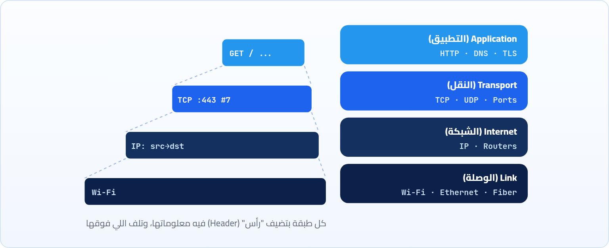
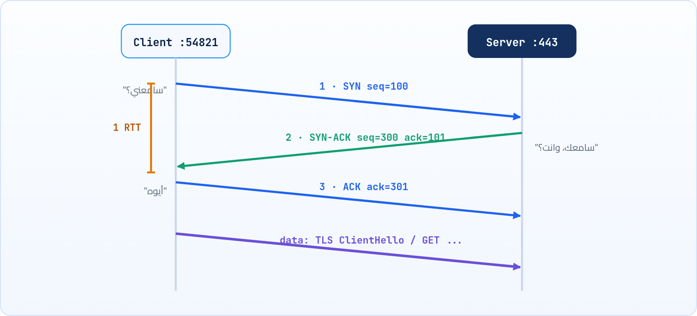

<small>المرحلة 2 · العناوين والتوصيل</small>

الـ IP بيوصّل الـ Packet للعنوان الصح، بس من غير أي ضمان. ممكن تضيع، أو توصل مرتين، أو توصل بالعكس. طب إزاي صفحة فيها آلاف الـ Packets بتوصلك كاملة ومترتبة؟ هنا ييجي دور TCP. وهنفهم كمان ليه فيه حاجة تانية اسمها UDP بتضحي بالضمان ده عن قصد، وإزاي كل الـ Protocols دي راكبة فوق بعض في طبقات.

:::note[بعد الفصل ده هتكون عارف]
- فكرة الطبقات (Layers) وإزاي كل طبقة بتلف اللي فوقها زي الظرف
- ليه IP لوحده مش كفاية، و TCP بيضيف إيه
- الـ TCP Handshake خطوة خطوة (SYN و SYN-ACK و ACK) ويعني إيه RTT
- UDP إمتى أحسن من TCP، و QUIC
- تستخدم ping و traceroute و nc على الـ Mac وتقرا ناتجهم
- تكلم سيرفر ويب بإيدك بـ nc وتشوف إن HTTP مجرد نص
:::

<a id="s4-1"></a>

## 4.1 المشكلة: الـ IP مبيضمنش حاجة

الـ IP اللي اتكلمنا عنه في الفصل اللي فات شغلته واحدة: يوصّل الـ Packet للعنوان. بس هو بيعملها بطريقة اسمها **Best effort**، يعني "هحاول وماعرفش". كل Router في السكة ممكن يكون زحمة فيرمي Packets. وممكن Packet تمشي في طريق أطول فتوصل بعد اللي بعدها. وممكن Packet تتكرر. تخيل بقى إنك بتحمّل ملف JavaScript مقطّع 50 حتة، وحتة رقم 23 ضاعت، والحتة 40 وصلت قبل 39. الملف هيبوظ، وصفحتك مش هتشتغل.

فاتطور حل: نحط فوق الـ IP طبقة تانية مسؤولة عن **الضمان**: ترقّم الحتت، وتتأكد إن كل حتة وصلت، وتعيد بعت اللي ضاع، وترتّب اللي وصل بالعكس. الطبقة دي اسمها **TCP** (Transmission Control Protocol). وعشان كده الاسم بيتقال دايماً مع بعض: **TCP/IP**. الـ IP بيوصّل، والـ TCP بيضمن.

<a id="s4-2"></a>

## 4.2 الطبقات: ظرف جوه ظرف

الفكرة دي، إن كل طبقة بتحل مشكلة واحدة وتسيب الباقي للي تحتها، هي أهم فكرة في تصميم الشبكات. وأسهل طريقة تتخيلها بيها: **ظرف جوه ظرف**. المتصفح بيكتب رسالة HTTP (الجواب نفسه)، وبيديها لـ TCP اللي بيحطها في ظرف مكتوب عليه رقم الـ Port ورقم الحتة، وبعدين IP بيحط الظرف ده في ظرف أكبر مكتوب عليه عناوين الـ IP، وبعدين كارت الواي فاي بيحط الكل في ظرف أخير يناسب الموجات اللاسلكية. وعند السيرفر بيحصل العكس: كل طبقة تفتح الظرف بتاعها وتدي اللي جواه للي فوقها.



*الطبقات الأربعة في نموذج TCP/IP، وإزاي الرسالة بتتلف ظرف جوه ظرف (Encapsulation).*

الجميل في الفكرة إن كل طبقة **مش مهتمة** باللي فوقها ولا اللي تحتها. الـ HTTP مش فارق معاه انت على واي فاي ولا كابل ولا 5G. والـ Router في النص مش بيفتح غير ظرف الـ IP، ومش فارق معاه جواه HTTP ولا لعبة ولا إيميل. وده اللي خلّى الإنترنت يكبر بالشكل ده: تقدر تخترع تطبيق جديد فوق، أو نوع كابل جديد تحت، من غير ما تغيّر حاجة في النص.

:::note[هتسمع عن OSI و 7 طبقات]
في الكتب والمقابلات هتسمع عن نموذج اسمه **OSI** فيه 7 طبقات، وكلام زي "Layer 7" و"Layer 4". ده نموذج نظري أقدم وأكتر تفصيلاً، والنموذج اللي فوق (4 طبقات) هو اللي الإنترنت ماشي بيه فعلاً. اللي محتاج تفتكره: **Layer 7** = التطبيق (HTTP)، و**Layer 4** = النقل (TCP/UDP)، و**Layer 3** = الشبكة (IP). فلو حد قال "Load balancer بيشتغل على Layer 7" يبقى قصده إنه بيفهم HTTP ويقدر يقرا الـ URL والـ Headers.
:::

<a id="s4-3"></a>

## 4.3 الـ TCP Handshake: "سامعني؟"

قبل ما TCP يبعت أي بيانات، لازم الطرفين يتفقوا إن الاتصال موجود، ويتفقوا على أرقام يبدأوا يعدّوا منها الحتت. ده بيحصل في تلات رسايل، والعملية اسمها **Three-way handshake**، زي مكالمة تليفون في شبكة ضعيفة: "ألو، سامعني؟" … "أيوه سامعك، وانت سامعني؟" … "أيوه، يلا نتكلم".



*التلات رسايل قبل أي بيانات. أول بيانات حقيقية بتتبعت بعد رحلة رايح جاي كاملة (RTT).*

**تشريح الأمر**

```sh
SYN seq=100 → SYN-ACK seq=300 ack=101 → ACK ack=301
```

1. `SYN`: Synchronize: "عاوز أفتح اتصال، وأنا هبدأ أعدّ من 100". الرقم ده عشوائي عشان محدش يخمّنه.
2. `seq=100`: Sequence number: رقم أول Byte هيبعته الـ Client. كل Byte بعد كده ليه رقم، وكده السيرفر يعرف يرتّب ويعرف لو حاجة ناقصة.
3. `SYN-ACK`: السيرفر بيقول حاجتين في رسالة واحدة: "أنا كمان عاوز أفتح (SYN) وهبدأ من 300"، و"استلمت رسالتك (ACK)".
4. `ack=101`: Acknowledgment: "استلمت لحد 100، ومستني 101". الـ ACK دايماً رقم **الجاي** المتوقع.
5. `ACK ack=301`: الـ Client: "استلمت بداية عدّك، ومستني 301". وكده الطرفين متفقين، والاتصال مفتوح.

وبعد كده، طول الكلام، كل ما طرف يستلم حتت يرد بـ ACK. ولو الطرف التاني ماستلمش ACK لحتة معينة في وقت معين، يفترض إنها ضاعت **ويبعتها تاني** (اسمها Retransmission). وكمان TCP بيراقب الزحمة: لو حس إن حتت كتير بتضيع، يبطّأ البعت عشان ميخنقش الشبكة (Congestion control). وفي الآخر، لما الكلام يخلص، كل طرف بيبعت `FIN` ("خلصت") والتاني يرد بـ ACK، وده قفل الاتصال بأدب.

:::note[الـ RTT: أهم رقم في سرعة الويب]
**RTT** = Round-Trip Time، الوقت اللي رسالة بتاخده رايح جاي. ولاحظ في الرسمة إن أول بيانات مبتتبعتش غير بعد RTT كامل للـ Handshake. ولو الموقع HTTPS، الـ TLS محتاج RTT تاني (أو أكتر في النسخ القديمة). يعني لو السيرفر في أمريكا والـ RTT من مصر 150 ملي ثانية، انت دفعت 300 ملي ثانية قبل ما تبعت حرف واحد من الطلب. عشان كده المتصفحات بتحاول **تعيد استخدام الاتصال المفتوح** بدل ما تفتح جديد كل مرة، وعشان كده اتعمل HTTP/3 (الفصل 11).
:::

<a id="s4-4"></a>

## 4.4 UDP: ابعت وخلاص

طب كل الضمان ده حلو، بس له تمن: وقت. تخيل مكالمة فيديو. لو حتة صغيرة من الصوت ضاعت، هل عاوز البرنامج يوقف ويستنى يعيد بعتها؟ لأ طبعاً، لما توصل هتبقى قديمة ومالهاش لازمة، وانت عاوز الكلام اللي بيتقال **دلوقتي**. نفس الكلام في الألعاب الأونلاين: مكان اللاعب من نص ثانية مش مهم، المهم مكانه دلوقتي.

عشان كده فيه بروتوكول نقل تاني اسمه **UDP** (User Datagram Protocol)، فكرته عكس TCP بالظبط: مفيش Handshake، ومفيش ترقيم، ومفيش إعادة، ومفيش ضمان. بتحط الرسالة في ظرف عليه الـ Port وترميها. سريع وخفيف، وأي ضمان محتاجه التطبيق يعمله بنفسه. والـ DNS نفسه بيستخدم UDP في أغلب الأحوال، لأن السؤال والإجابة صغيرين، ولو السؤال ضاع ابعته تاني وخلاص، أرخص من Handshake كامل.

**TCP و UDP جنب بعض**

|   | TCP | UDP |
|---|---|---|
| اتصال قبل البيانات | أيوه (Handshake) | لأ |
| الحتت بتوصل كلها ومترتبة | مضمون | مش مضمون |
| السرعة والتأخير | أبطأ شوية | أسرع وأخف |
| بيستخدمه | HTTP/1.1 و HTTP/2، والإيميل، و SSH، و Git | DNS، ومكالمات الفيديو، والألعاب، و**QUIC** (اللي تحت HTTP/3) |

:::note[لو حابب تتعمق: QUIC، أحسن ما في الاتنين]
المهندسين في Google سألوا: ليه منعملش بروتوكول فيه ضمان TCP بس من غير بطئه؟ فعملوا **QUIC**، وبقى Standard رسمي (`RFC 9000`). QUIC شغال **فوق UDP**، وبيعمل الترقيم والإعادة بنفسه، وبيدمج الـ Handshake بتاع الاتصال والتشفير في رحلة واحدة. وده الأساس اللي HTTP/3 راكب عليه. هنرجعله في الفصل 11. وأحلى حاجة إنك هتشوف في DevTools عمود Protocol فيه `h3` لمواقع زي Google و YouTube.
:::

<a id="s4-5"></a>

## 4.5 ping: "انت عايش؟"

كفاية نظري، يلا نلعب بالشبكة. أبسط أداة هي `ping`، وفكرتها زي السونار في الغواصات: بتبعت رسالة صغيرة لجهاز وتستنى ترجع، وتقيس الوقت.

**تشريح الأمر**

```sh
ping -c 4 example.com
```

1. `ping`: ابعت رسايل ICMP Echo Request واستنى الرد (Echo Reply). ICMP بروتوكول صغير جنب IP للرسايل الإدارية والأخطاء.
2. `-c 4`: `-c` = Count: ابعت 4 بس واقف. من غيرها `ping` على الـ Mac هيفضل شغال لحد ما تدوس <kbd>Ctrl</kbd>+<kbd>C</kbd>.
3. `example.com`: الهدف. ممكن تكتب IP على طول زي `1.1.1.1`.

```sh title="Terminal"
$ ping -c 4 example.com
PING example.com (104.20.23.154): 56 data bytes
64 bytes from 104.20.23.154: icmp_seq=0 ttl=57 time=21.4 ms
64 bytes from 104.20.23.154: icmp_seq=1 ttl=57 time=19.8 ms
64 bytes from 104.20.23.154: icmp_seq=2 ttl=57 time=20.3 ms
64 bytes from 104.20.23.154: icmp_seq=3 ttl=57 time=22.0 ms

--- example.com ping statistics ---
4 packets transmitted, 4 packets received, 0.0% packet loss
round-trip min/avg/max/stddev = 19.8/20.9/22.0/0.8 ms
```

```sh title="قراية ناتج ping"
(104.20.23.154)
icmp_seq=0
ttl=57
time=21.4 ms
0.0% packet loss
min/avg/max/stddev
```

1. `(104.20.23.154)`: ping عمل DNS الأول وطلّع الـ IP، وكده تعرف إن الـ DNS شغال.
2. `icmp_seq=0`: رقم الرسالة. لو لقيت رقم ناقص (0 و 1 و 3) يبقى 2 ضاعت.
3. `ttl=57`: عدّاد بيقل واحد مع كل Router في السكة (هنشرحه مع traceroute تحت).
4. `time=21.4 ms`: ده الـ RTT اللي اتكلمنا عنه، رايح جاي.
5. `0.0% packet loss`: نسبة الرسايل اللي ضاعت. أي رقم فوق 1-2% على اتصال ثابت يبقى فيه مشكلة.
6. `min/avg/max/stddev`: أقل وأوسط وأعلى RTT، والـ stddev بيقيس قد إيه الأرقام متذبذبة (الـ Jitter).

:::caution[خلي بالك: ping فاشل مش معناه إن الموقع واقع]
سيرفرات وشركات كتير بتقفل ICMP عن قصد لأسباب أمنية. فممكن `ping` يطلعلك `Request timeout` والموقع نفسه شغال عادي في المتصفح. ping مفيد يقولك "الشبكة عندي شغالة؟" (جرّب `ping -c 3 1.1.1.1`)، بس مش حكم نهائي على موقع معين. الحكم النهائي على موقع ويب هو `curl`.
:::

<a id="s4-6"></a>

## 4.6 traceroute: السكة فيها كام محطة؟

عمرك سألت نفسك الـ Packet بتاعتك بتعدّي على كام Router قبل ما توصل لـ Google؟ `traceroute` بيوريك السكة كلها، وفكرته ذكية جداً. كل Packet فيها عدّاد اسمه **TTL** (Time To Live)، وكل Router بيعدّيها بينقّص منه واحد، ولما يوصل صفر الـ Router يرميها ويبعت للمرسل رسالة "الـ Packet دي ماتت عندي". العداد ده اتعمل في الأصل عشان لو حصل لف في الشبكة، الـ Packet متفضلش تلف للأبد. traceroute بيستغله: يبعت Packet بـ TTL = 1، فأول Router يرد، وبعدين TTL = 2 فتاني Router يرد، وهكذا لحد ما يوصل.

**تشريح الأمر**

```sh
traceroute -n -m 15 example.com
```

1. `traceroute`: اعرض كل Router في السكة لحد الهدف.
2. `-n`: زي `lsof` بالظبط: اطبع الأرقام ومتدورش على أسامي. أسرع بكتير.
3. `-m 15`: `-m` = Max hops: متعدّيش 15 محطة (الافتراضي 64).
4. `example.com`: الهدف.

```sh title="Terminal"
$ traceroute -n -m 15 example.com
traceroute to example.com (104.20.23.154), 15 hops max, 40 byte packets
 1  192.168.1.1  3.1 ms  2.4 ms  2.2 ms
 2  10.37.0.1  8.7 ms  9.1 ms  8.3 ms
 3  * * *
 4  196.204.12.33  12.9 ms  13.4 ms  12.6 ms
 5  104.20.23.154  20.8 ms  21.1 ms  20.6 ms
```

```sh title="قراية traceroute"
 1  192.168.1.1
 2  10.37.0.1
3.1 ms  2.4 ms  2.2 ms
 3  * * *
```

1. `1  192.168.1.1`: أول محطة دايماً الراوتر بتاعك (الـ Gateway اللي عرفناه في الفصل 3).
2. `2  10.37.0.1`: شبكة شركة الإنترنت. لاحظ إنه Private IP، عادي جوه شبكات الـ ISP.
3. `3.1 ms  2.4 ms  2.2 ms`: traceroute بيجرب كل محطة 3 مرات، وده الـ RTT لكل مرة.
4. `3  * * *`: Router مارضيش يرد (بيتجاهل الرسايل دي). عادي جداً ومش معناه إن فيه مشكلة طالما اللي بعده كمّل.

<small>الأرقام والمحطات توضيحية، والسكة عندك هتبقى مختلفة حسب شركة الإنترنت.</small>

<a id="s4-7"></a>

## 4.7 nc: سكينة الشبكة السويسري

`nc` (اختصار netcat) أداة بسيطة جداً وقوية جداً: بتفتح اتصال TCP (أو UDP) لأي IP وأي Port، وتبعت فيه اللي تكتبه، وتطبع اللي يرجع. ومن غير أي فهم لـ HTTP أو أي Protocol. وعشان كده هي أحسن أداة تثبتلك إن كل الكلام اللي في الكتاب ده مجرد **نص ماشي على TCP**. أول استخدام: هل الـ Port ده مفتوح؟

**تشريح الأمر**

```sh
nc -zv example.com 443
```

1. `nc`: netcat. موجود على الـ Mac جاهز.
2. `-z`: Zero I/O: "افتح الاتصال بس (اعمل الـ Handshake) ومتبعتش بيانات". يعني اختبار سريع للـ Port.
3. `-v`: Verbose: قولي النتيجة بالكلام. من غيرها مش هيطبع حاجة.
4. `example.com 443`: الجهاز والـ Port. لاحظ إنهم منفصلين بمسافة هنا، مش `:`.

```sh title="Terminal"
$ nc -zv example.com 443
Connection to example.com port 443 [tcp/https] succeeded!
$ nc -zv localhost 3000
nc: connectx to localhost port 3000 (tcp) failed: Connection refused
```

`succeeded` = الـ Handshake نجح، فيه برنامج سامع. و`Connection refused` = الجهاز موجود بس مفيش حد سامع على الـ Port ده (يعني سيرفرك مش شغال). ولو فضل مستني ومردش خالص، يبقى غالباً فيه Firewall بيرمي الطلب في صمت. الفرق ده بين **refused** و**timeout** هيفرق معاك جداً في الـ Debugging بعدين.

### كلّم سيرفر ويب بإيدك

ودلوقتي الحتة الممتعة. هنكتب طلب HTTP بإيدنا حرف حرف، ونبعته بـ `nc` على Port 80 (HTTP من غير تشفير، عشان nc ميعرفش TLS):

**تشريح الأمر**

```sh
printf 'GET / HTTP/1.1\r\nHost: example.com\r\nConnection: close\r\n\r\n' | nc example.com 80
```

1. `printf`: اطبع النص ده بالظبط. بنستخدمه بدل `echo` عشان بيفهم `\r\n` على كل الأنظمة.
2. `'...'`: الـ Single quotes بتخلّي الـ zsh ميلمسش أي حاجة جوه النص.
3. `GET / HTTP/1.1`: سطر الطلب: هات الصفحة الرئيسية `/` بـ HTTP/1.1 (الفصل 7).
4. `\r\n`: نهاية السطر في HTTP: `\r` = Carriage Return و`\n` = New Line. HTTP/1.1 اتفق على الاتنين مع بعض (زي الآلة الكاتبة: رجّع للأول وانزل سطر).
5. `Host: example.com`: Header إجباري في HTTP/1.1: انت عاوز أنهي موقع (لأن سيرفر واحد ممكن يشيل مواقع كتير).
6. `Connection: close`: "اقفل الاتصال بعد ما ترد"، عشان nc يخلص ويرجعلك الـ Prompt.
7. `\r\n\r\n`: سطر فاضي = "خلصت الـ Headers". من غيره السيرفر هيفضل مستني.
8. `| nc example.com 80`: ادّي النص ده لـ nc يبعته على Port 80، ويطبع اللي يرجع.

```sh title="Terminal"
$ printf 'GET / HTTP/1.1\r\nHost: example.com\r\nConnection: close\r\n\r\n' | nc example.com 80
HTTP/1.1 200 OK
Date: Thu, 22 Oct 2026 20:24:10 GMT
Content-Type: text/html; charset=utf-8
Connection: close
Server: cloudflare

<!doctype html><html lang="en"><head><title>Example Domain</title>...
```

<small>لو رجعلك `301 Moved Permanently` بدل `200 OK`، يبقى السيرفر بيقولك "روح على HTTPS"، وده نفسه درس هنشرحه في الفصل 8.</small>

شفت؟ مفيش سحر. المتصفح، و`curl`، و`fetch` في JavaScript، كلهم في الآخر بيبعتوا نص زي ده بالظبط على اتصال TCP، وبيستلموا نص زي ده. كل الفرق إنهم بيعملوا ده بشياكة، وبيضيفوا TLS للتشفير. ولما تفهم ده، كل حاجة في الفصول الجاية هتبقى منطقية.

:::note[مثال عملي: شات بين تابتين]
افتح تابتين Terminal. في الأولى: `nc -l 1234` (`-l` = Listen: "اقعد استنى على Port 1234"، يعني انت بقيت Server). وفي التانية: `nc localhost 1234` (انت الـ Client). اكتب أي حاجة في أي تابة ودوس Enter، هتظهر في التانية. انت كده عملت Client و Server على TCP بإيدك. اقفل بـ <kbd>Ctrl</kbd>+<kbd>C</kbd>.
:::

:::tip[ملخص الفصل]
- الشبكة طبقات: Link ثم IP ثم TCP/UDP ثم التطبيق (HTTP)، وكل طبقة بتلف اللي فوقها.
- IP بيوصّل من غير ضمان، و TCP بيضيف الترقيم والتأكيد والإعادة والترتيب.
- الـ Handshake: SYN ثم SYN-ACK ثم ACK، وبيكلّف RTT كامل قبل أول بيانات.
- UDP بيبعت من غير ضمان، وده أحسن للصوت والألعاب والـ DNS، و QUIC (تحت HTTP/3) راكب عليه.
- `ping` للـ RTT والـ Loss، و`traceroute` للسكة (بيستغل الـ TTL)، و`nc` لفتح اتصال TCP بإيدك.
- HTTP مجرد نص ماشي على TCP، وده اللي شفناه بـ `nc`.
:::

### صح ولا غلط؟

1. الـ Router في النص بيقرا رسالة الـ HTTP عشان يعرف يوديها فين.
2. UDP بيضمن إن الرسايل توصل بالترتيب.
3. لو `ping` فشل يبقى الموقع أكيد واقع.

### أسئلة مراجعة

1. إيه التلات مشاكل اللي ممكن تحصل للـ Packets، و TCP بيحل كل واحدة إزاي؟
2. في الـ Handshake، ليه السيرفر بيرد بـ `ack=101` لما الـ Client بعت `seq=100`؟
3. ليه مكالمات الفيديو بتفضّل UDP؟
4. إيه الفرق بين `Connection refused` وإن `nc` يفضل مستني من غير رد؟
5. اشرح `\r\n\r\n` في آخر طلب الـ HTTP اللي بعتناه بـ nc.

### تحديات الفصل

<small>جرّبها بإيدك، والحلول في ملحق الإجابات.</small>

1. **[سهل]** اعمل `ping -c 5` لـ `1.1.1.1` و`google.com` وموقع بعيد زي `abc.net.au`. قارن الـ avg، وفكّر ليه مختلفين.
2. **[متوسط]** اعمل `traceroute -n` لـ `github.com`. عدّ المحطات، وشوف أنهي محطة الوقت قفز فيها جامد (غالباً لما الطلب عدّى البحر).
3. **[صعب]** شغّل `python3 -m http.server 8000`، وبعدين كلّمه بـ nc بإيدك: `printf 'GET / HTTP/1.1\r\nHost: localhost\r\n\r\n' | nc localhost 8000`. بص على الرد وعلى سطر اللوج في تابة السيرفر.
