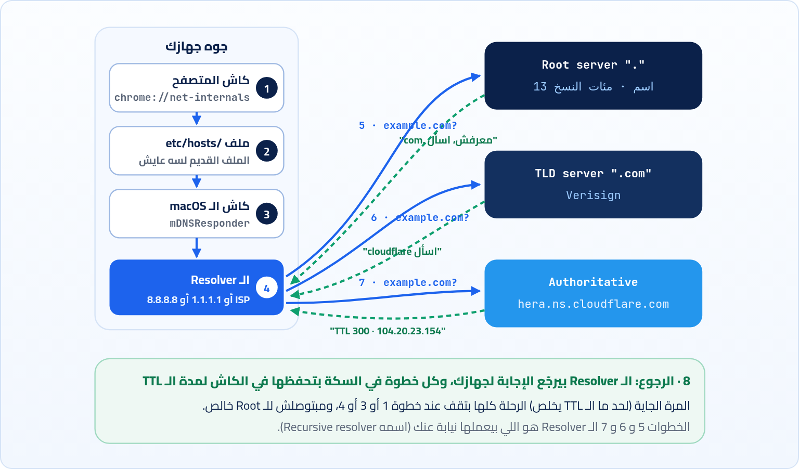

<small>المرحلة 2 · العناوين والتوصيل</small>

عرفنا إن الأجهزة بتكلم بعض بأرقام، والبشر بيحفظوا أسامي. طب مين بيترجم example.com لـ 104.20.23.154؟ وإزاي نظام واحد بيجاوب مليارات الأسئلة في اليوم من غير ما يقع؟ الفصل ده عن DNS: حكايته، والرحلة اللي السؤال بيعملها، وأنواع السجلات، وإزاي تسأله بنفسك من الـ Terminal.

:::note[بعد الفصل ده هتكون عارف]
- ليه اتعمل DNS والمشكلة اللي قبله (ملف HOSTS.TXT)
- تشريح أي دومين: الـ Root والـ TLD والـ Subdomain
- رحلة السؤال خطوة خطوة من كاش المتصفح لحد الـ Authoritative server
- أنواع السجلات A و AAAA و CNAME و MX و TXT و NS، والـ TTL
- تستخدم dig و nslookup و dscacheutil وتقرا ناتجهم
- تعدّل /etc/hosts وتمسح كاش الـ DNS على الـ Mac، وتفهم أخطاء DNS في Chrome
:::

<a id="s5-1"></a>

## 5.1 قبل DNS: ملف واحد للدنيا كلها

في أيام ARPANET، كانت الأجهزة كام مية بس. والحل اللي الناس عملته عشان متحفظش أرقام كان بسيط جداً: ملف نصي واحد اسمه `HOSTS.TXT`، فيه كل اسم وجنبه رقمه، ومحفوظ على جهاز واحد في معهد اسمه SRI في كاليفورنيا. أي حد عاوز يعرف الأسامي، ينزّل الملف ده على جهازه كل فترة. ولو عاوز تضيف جهاز جديد، تبعت إيميل للناس اللي في SRI يضيفوه بإيدهم.

وهنا كانت المشكلة. الشبكة كبرت لآلاف الأجهزة، والملف كبر، والكل بينزّله كل شوية فالجهاز اللي عليه بقى مخنوق. ومفيش حاجة تمنع اتنين يختاروا نفس الاسم. وأي تعديل بياخد أيام لحد ما يوصل للكل. نظام مركزي واحد ببساطة مكانش هيستحمل. فاتطور حل: سنة 1983 مهندس اسمه **Paul Mockapetris** صمم **DNS** (Domain Name System)، وفكرته إن مفيش ملف واحد خالص. الأسامي بقت **شجرة**، وكل فرع في الشجرة مسؤول عنه جهة مختلفة، وكل جهة بتدير الأسامي اللي تحتها بس. وبالمناسبة، الملف القديم ده لسه عايش على جهازك لحد النهارده باسم `/etc/hosts`، وهنلعب بيه في آخر الفصل.

<a id="s5-2"></a>

## 5.2 تشريح الدومين: بيتقرا من اليمين

الدومين بيتقرا من اليمين للشمال، من العام للخاص، زي العنوان البريدي بالعكس: البلد، وبعدين المدينة، وبعدين الشارع.

**تشريح الأمر**

```sh
api.shop.example.com.
```

1. `.`: النقطة الأخيرة اللي محدش بيكتبها: دي **الـ Root**، جذر الشجرة. كل دومين في الدنيا بيخلص بيها في الحقيقة، والأدوات بتضيفها لوحدها.
2. `com`: الـ **TLD** (Top-Level Domain). فيه عامة زي `com` و`org` و`dev`، وفيه بلاد زي `eg` لمصر و`uk`.
3. `example`: الاسم اللي انت بتشتريه (اسمه Second-level domain). `example.com` كله اسمه الـ **Apex** أو الـ Root domain بتاعك.
4. `shop`: Subdomain: انت كصاحب `example.com` تعمل اللي انت عاوزه تحته ببلاش، زي `shop` و`blog` و`www`.
5. `api`: Subdomain جوه Subdomain. وكلمة `www` نفسها مجرد Subdomain عادي، مش حاجة سحرية.

:::note[مين بيبيعلك الدومين؟]
لما تشتري دومين من شركة زي Namecheap أو Cloudflare أو GoDaddy (اسمها **Registrar**)، انت في الحقيقة بتأجر الاسم لمدة (سنة غالباً)، والشركة بتسجّله عند الجهة اللي ماسكة الـ TLD (اسمها **Registry**، زي Verisign لـ `.com`). وبتقولهم "الأسامي اللي تحت دوميني، اسألوا عليها السيرفرات دي"، ودي اسمها **Nameservers**.
:::

<a id="s5-3"></a>

## 5.3 رحلة السؤال: example.com فين؟

خلينا نمشي مع المتصفح وهو بيدوّر على `example.com` لأول مرة خالص. أهم حاجة تلاحظها إن كل خطوة فيها **كاش**: قبل ما حد يسأل اللي بعده، بيبص الأول "هل أنا سألت السؤال ده قريب؟". ولو أيوه، الرحلة بتقف عنده. ومن غير الكاش ده، الـ Root servers كانت هتنهار من أول يوم.



*رحلة السؤال عن example.com: من الكاش اللي جوه جهازك لحد السيرفر اللي عنده الإجابة الأكيدة.*

نحكيها بالكلام. أول حاجة المتصفح بيبص في **الكاش بتاعه** (خطوة 1): Chrome بيحفظ إجابات DNS لوقت قصير. مفيش؟ بيسأل نظام التشغيل، والـ macOS بيبص الأول في <strong>ملف `/etc/hosts`</strong> (خطوة 2)، وبعدين في **الكاش بتاعه** (خطوة 3) اللي ماسكه برنامج في الخلفية اسمه `mDNSResponder`. لسه مفيش؟ هنا جهازك بيبعت السؤال لبرّه، لسيرفر اسمه **Recursive Resolver** (خطوة 4). ده غالباً بتاع شركة الإنترنت، أو واحد عام انت اخترته زي `1.1.1.1` بتاع Cloudflare أو `8.8.8.8` بتاع Google. والـ Resolver ده "الموظف" اللي هيلف المصالح بدالك.

لو الـ Resolver نفسه معندوش الإجابة في الكاش، بيبدأ من فوق خالص. يسأل **Root server** (خطوة 5): "فين `example.com`؟". الـ Root معندوش فكرة عن `example.com`، بس عارف مين مسؤول عن كل TLD، فيرد: "معرفش، بس دول سيرفرات `.com`، اسألهم". يروح يسأل <strong>سيرفر الـ `.com`</strong> (خطوة 6)، وده برضه معندوش الرقم، بس عارف مين مسؤول عن `example.com` تحديداً: "اسأل `hera.ns.cloudflare.com`". وأخيراً يسأل الـ **Authoritative server** (خطوة 7)، وده اللي صاحب الدومين حاطط عنده السجلات، فيرد بالإجابة الأكيدة: "`104.20.23.154`، واحفظها 300 ثانية". والـ Resolver يرجّعها لجهازك (خطوة 8)، وكل واحد في السكة يحفظها.

:::note[لو حابب تتعمق: 13 Root server بس؟]
هتقرا إن فيه "13 Root server" في الدنيا. ده نص الحقيقة: فيه 13 **اسم** (من `a.root-servers.net` لـ `m.root-servers.net`)، بس كل اسم وراه مئات الأجهزة في بلاد كتير بتشارك نفس الـ IP، بتقنية اسمها **Anycast**: الـ Packet بتاعتك بتروح لأقرب نسخة. نفس التقنية اللي `1.1.1.1` والـ CDNs بيستخدموها (الفصل 15). ولو عاوز تشوف الرحلة بنفسك من الـ Root لحد الآخر: `dig +trace example.com`.
:::

<a id="s5-4"></a>

## 5.4 أنواع السجلات: مش أرقام بس

الـ DNS مش بيخزن IP بس. كل دومين ليه **سجلات** (Records) من أنواع مختلفة، كل نوع بيجاوب سؤال مختلف. لو انت عاوز تعرف "أبعت الإيميل لـ `sara@example.com` فين؟"، ده سؤال تاني غير "الموقع على أنهي IP؟". وأهم الأنواع اللي هتقابلها:

**أشهر أنواع سجلات DNS**

| النوع | بيجاوب على | مثال |
|---|---|---|
| `A` | عنوان IPv4 للاسم ده | `example.com → 104.20.23.154` |
| `AAAA` | عنوان IPv6 (أربع A لأنه 4 أضعاف الحجم) | `→ 2606:4700:10::6814:179a` |
| `CNAME` | "الاسم ده اسم تاني لـ…" (Alias) | `www.site.com → site.netlify.app` |
| `MX` | سيرفر الإيميل للدومين | `10 mail.example.com` |
| `TXT` | أي نص، غالباً للتحقق من الملكية وإعدادات الإيميل | `"v=spf1 include:_spf.google.com ~all"` |
| `NS` | مين الـ Authoritative servers للدومين | `hera.ns.cloudflare.com` |

:::note[مثال عملي: هتستخدم ده إمتى؟]
لما تنشر مشروع React على Netlify أو Vercel وتشتري دومين، الموقع هيقولك "اعمل `CNAME` لـ `www` يشاور على `your-site.netlify.app`"، أو "اعمل `A` record للـ Apex يشاور على IP كذا". ولما تربط الدومين بـ Google Workspace عشان الإيميل، هيطلب منك `MX` و`TXT`. يعني الجدول ده هيبقى شغلك فعلاً.
:::

### الـ TTL وخرافة "الـ DNS لسه بيتنشر"

كل سجل معاه رقم اسمه **TTL** بالثواني: "احفظ الإجابة دي في الكاش الوقت ده بس". TTL = 300 يعني 5 دقايق. ولو غيّرت IP موقعك، الناس اللي عندهم الإجابة القديمة في الكاش هيفضلوا يروحوا للقديم لحد ما الـ TTL بتاعهم يخلص. وده اللي الناس بتسميه "DNS propagation" وتقول "استنى 48 ساعة". في الحقيقة مفيش حاجة "بتتنشر"، فيه كاشات بتخلص في أوقات مختلفة. وعشان كده الشركات بتقلل الـ TTL قبل أي نقل بيوم، عشان الكاشات تخلص بسرعة.

:::tip[حاجة مشتركة: TTL ليها معنيين]
خلي بالك إن كلمة **TTL** قابلتنا مرتين بمعنيين مختلفين: في الفصل 4 كانت عدّاد المحطات جوه الـ Packet (اللي traceroute بيستغله)، وهنا مدة الكاش بالثواني لسجل DNS. الاسم واحد (Time To Live: "يعيش قد إيه") والفكرة قريبة، بس السياق مختلف. وهتقابل نفس الفكرة تالت مرة في كاش HTTP بس باسم `max-age` (الفصل 15).
:::

<a id="s5-5"></a>

## 5.5 dig: اسأل الـ DNS بنفسك

الأداة الأشهر لسؤال DNS هي `dig` (Domain Information Groper)، وجاية جاهزة على الـ Mac. أبسط استخدام:

```sh title="Terminal"
$ dig example.com

; <<>> DiG 9.10.6 <<>> example.com
;; global options: +cmd
;; Got answer:
;; ->>HEADER<<- opcode: QUERY, status: NOERROR, id: 41267
;; flags: qr rd ra; QUERY: 1, ANSWER: 2, AUTHORITY: 0, ADDITIONAL: 1

;; QUESTION SECTION:
;example.com.                   IN      A

;; ANSWER SECTION:
example.com.            300     IN      A       104.20.23.154
example.com.            300     IN      A       172.66.147.243

;; Query time: 18 msec
;; SERVER: 192.168.1.1#53(192.168.1.1)
;; WHEN: Thu Oct 22 23:30:12 EEST 2026
;; MSG SIZE  rcvd: 72
```

```sh title="قراية ناتج dig"
status: NOERROR
flags: qr rd ra
;example.com.  IN  A
example.com. 300 IN A 104.20.23.154
Query time: 18 msec
SERVER: 192.168.1.1#53
```

1. `status: NOERROR`: السؤال اتجاوب. لو `NXDOMAIN` = الاسم ده مش موجود أصلاً. لو `SERVFAIL` = الـ Resolver فشل يجيب إجابة.
2. `flags: qr rd ra`: `qr` = ده رد، و`rd` = طلبنا بحث كامل (Recursion desired)، و`ra` = الـ Resolver بيعمل ده (available).
3. `;example.com.  IN  A`: السؤال: سجل `A` لـ `example.com.` (لاحظ نقطة الـ Root في الآخر). و`IN` = Internet.
4. `example.com. 300 IN A 104.20.23.154`: الإجابة: الاسم، والـ TTL المتبقي (300 ثانية)، والنوع، والقيمة. وفيه عنوانين، والمتصفح ممكن يستخدم أي واحد.
5. `Query time: 18 msec`: الوقت اللي الإجابة خدته. جرّب تاني على طول، هتلاقيه قرّب من 0 لأنه بقى في الكاش.
6. `SERVER: 192.168.1.1#53`: مين جاوب: هنا الراوتر بتاعك على Port `53` (الـ `#` بتفصل الـ IP عن الـ Port في ناتج dig). والراوتر بيوصّل السؤال للـ Resolver بتاع شركة الإنترنت.

<small>الـ TTL والأرقام عندك هتختلف. والسطور اللي بتبدأ بـ `;` في ناتج dig مجرد تعليقات وعناوين للأقسام.</small>

الناتج الكامل ده مفيد لما تحقق في مشكلة، بس أغلب الوقت انت عاوز الإجابة وبس. ودي أهم أشكال dig:

**تشريح الأمر**

```sh
dig +short AAAA example.com @1.1.1.1
```

1. `dig`: اسأل الـ DNS.
2. `+short`: في dig، الـ Options بتبدأ بـ `+` مش `-` (استثناء غريب). `+short` = اطبع الإجابة بس من غير كل التفاصيل.
3. `AAAA`: نوع السجل. من غيره dig بيسأل عن `A`. جرّب `MX` و`TXT` و`NS` و`CNAME`.
4. `example.com`: الاسم.
5. `@1.1.1.1`: الـ `@` = "اسأل السيرفر ده بالذات" بدل الـ Resolver الافتراضي. مفيد جداً تقارن: هل الإجابة عند Cloudflare زي اللي عند شركة الإنترنت؟

```sh title="Terminal"
$ dig +short example.com
104.20.23.154
172.66.147.243
$ dig +short NS example.com
hera.ns.cloudflare.com.
elliott.ns.cloudflare.com.
$ dig +short www.github.com
github.com.
140.82.121.4
```

لاحظ آخر مثال: `www.github.com` رجّع سطرين. الأول `github.com.` ده CNAME ("www اسم تاني لـ github.com")، والتاني الـ IP بتاع `github.com`. يعني dig مشي الـ CNAME لوحده لحد ما وصل لرقم.

### nslookup: الأداة الأقدم

هتلاقي في شروحات كتير `nslookup` بدل dig، خصوصاً اللي جاية من Windows لأنها موجودة هناك. بتعمل نفس الشغلانة بناتج أبسط:

```sh title="Terminal"
$ nslookup example.com
Server:         192.168.1.1
Address:        192.168.1.1#53

Non-authoritative answer:
Name:   example.com
Address: 104.20.23.154
Name:   example.com
Address: 172.66.147.243
```

`Non-authoritative answer` معناها "الإجابة دي جاية من كاش الـ Resolver، مش من الـ Authoritative server نفسه". عادي جداً وده اللي بيحصل أغلب الوقت. وتقدر تحدد السيرفر برضه: `nslookup example.com 1.1.1.1` (من غير `@` هنا).

:::caution[خلي بالك: dig و nslookup مش بيبصوا في /etc/hosts]
دي نقطة بتضيّع وقت ناس كتير. `dig` و`nslookup` بيكلموا سيرفر DNS على طول، ومش بيعدّوا على `/etc/hosts` ولا على كاش الـ macOS. أما المتصفح و`curl` و`ping` فبيستخدموا نظام التشغيل اللي بيبص في الكل. فلو ضفت سطر في `/etc/hosts` وdig مش شايفه، ده طبيعي. عشان تسأل زي ما المتصفح بيسأل بالظبط على الـ Mac استخدم: `dscacheutil -q host -a name example.com` (`-q host` = اسأل عن جهاز، و`-a name` = بالاسم ده).
:::

<a id="s5-6"></a>

## 5.6 /etc/hosts: اكذب على جهازك

فاكر ملف `HOSTS.TXT` القديم؟ أهو لسه عايش على كل جهاز Mac و Linux باسم `/etc/hosts`، وجهازك بيبص فيه **قبل** أي DNS. يعني أي سطر تكتبه فيه بيكسب. وده مفيد جداً في التطوير: عاوز تفتح مشروعك على اسم شيك زي `myshop.test` بدل `localhost`؟ أو عاوز تجرب سيرفر جديد قبل ما تغيّر الـ DNS الحقيقي؟

**تشريح الأمر**

```sh
sudo nano /etc/hosts
```

1. `sudo`: الملف ملك النظام، فمحتاج صلاحيات Admin تعدّله. هيطلب باسورد الـ Mac (ومش هتشوف النجوم وانت بتكتب، عادي).
2. `nano`: Editor بسيط في الـ Terminal. للحفظ <kbd>Ctrl</kbd>+<kbd>O</kbd> ثم Enter، وللخروج <kbd>Ctrl</kbd>+<kbd>X</kbd>.
3. `/etc/hosts`: المسار الكامل للملف.

```text
##
# Host Database
##
127.0.0.1       localhost
255.255.255.255 broadcasthost
::1             localhost

# مشاريعي
127.0.0.1       myshop.test api.myshop.test
```

كل سطر: IP وبعده اسم أو أكتر بينهم مسافات. والـ `#` تعليق. بعد السطر الأخير، لو كتبت `http://myshop.test:5173` في المتصفح هيفتح مشروعك اللي على localhost. واستخدم دايماً `.test` للأسامي اللي بتخترعها، لأنه TLD محجوز رسمياً للتجارب ومستحيل يبقى موقع حقيقي (`.local` متستخدمهوش على الـ Mac لأنه محجوز لحاجة تانية اسمها Bonjour).

### امسح كاش الـ DNS على الـ Mac

عدّلت `/etc/hosts` أو غيّرت DNS موقعك والجهاز لسه بيروح للقديم؟ امسح الكاش:

**تشريح الأمر**

```sh
sudo dscacheutil -flushcache; sudo killall -HUP mDNSResponder
```

1. `sudo dscacheutil -flushcache`: أداة كاش خدمات الدليل في macOS: "امسح الكاش".
2. `;`: نفّذ الأمر اللي بعدي بعد ما ده يخلص، سواء نجح أو لأ (غير `&&` اللي بتنفّذ بس لو نجح).
3. `sudo killall -HUP mDNSResponder`: `killall` = ابعت إشارة لكل البرامج اللي بالاسم ده. و`-HUP` إشارة اسمها Hang Up معناها هنا "اعمل Reload وانسى الكاش"، مش "موت". و`mDNSResponder` البرنامج اللي ماسك DNS في macOS.

وChrome كمان ليه كاش لوحده. افتح `chrome://net-internals/#dns` ودوس **Clear host cache**.

<a id="s5-7"></a>

## 5.7 لما الـ DNS يبوظ: إزاي تعرف؟

:::danger[مشكلة: DNS_PROBE_FINISHED_NXDOMAIN أو net::ERR_NAME_NOT_RESOLVED]
Chrome بيقولك "This site can't be reached" و"server IP address could not be found". يعني الـ DNS ملقاش الاسم ده خالص. في الـ Console لو الطلب جاي من `fetch` هتلاقي `net::ERR_NAME_NOT_RESOLVED`.

<strong>الحل:</strong> (1) اتأكد من الإملاء: `gogle.com`؟ (2) جرّب `dig +short الاسم`: لو فاضي أو `NXDOMAIN` يبقى الاسم مش موجود فعلاً. (3) جرّب `dig +short الاسم @1.1.1.1`: لو اشتغل هنا ومش شغال من غيرها، يبقى المشكلة في الـ Resolver بتاع شركة الإنترنت، فغيّر الـ DNS من **System Settings ‹ Network ‹ Wi-Fi ‹ Details ‹ DNS**. (4) لو دومين لسه شاريه، الـ Nameservers ممكن تكون لسه متظبطتش.
:::

:::danger[مشكلة: الموقع شغال عند ناس ومش شغال عندي بعد ما غيّرت الـ DNS]
نقلت موقعك لسيرفر جديد، وصاحبك شايف الجديد وانت لسه شايف القديم.

<strong>الحل:</strong> ده الكاش. قارن `dig +short الاسم` بـ `dig +short الاسم @1.1.1.1`. لو مختلفين استنى الـ TTL يخلص، أو امسح كاش الـ Mac و Chrome زي ما شرحنا. واتأكد إن مفيش سطر قديم في `/etc/hosts`.
:::

:::note[لو حابب تتعمق: DNS over HTTPS]
الـ DNS العادي بيمشي على UDP Port 53 من غير تشفير، يعني شركة الإنترنت (أو أي حد على نفس الواي فاي) يقدر يشوف كل الأسامي اللي بتسأل عنها، حتى لو المواقع نفسها HTTPS. فاتطور حل اسمه **DoH** (DNS over HTTPS): السؤال بيتبعت كطلب HTTPS عادي لـ Resolver زي `1.1.1.1`، فمحدش يقدر يقراه. Chrome بيدعمه من **Settings ‹ Privacy and security ‹ Security ‹ Use secure DNS**. وتقدر تجربه بـ curl: `curl -s -H 'accept: application/dns-json' 'https://cloudflare-dns.com/dns-query?name=example.com&type=A'`، وهيرجعلك الإجابة JSON.
:::

:::tip[ملخص الفصل]
- DNS اتعمل بدل ملف `HOSTS.TXT` المركزي، وفكرته شجرة موزعة كل فرع مسؤول عنه جهة.
- الدومين بيتقرا من اليمين: Root ثم TLD ثم الاسم ثم الـ Subdomains.
- الرحلة: كاش المتصفح، `/etc/hosts`، كاش الـ OS، الـ Resolver، وبعدين Root ثم TLD ثم Authoritative. وكل خطوة بتكاش لمدة الـ TTL.
- السجلات: `A` و`AAAA` للعناوين، و`CNAME` للـ Alias، و`MX` للإيميل، و`TXT` للتحقق، و`NS` للمسؤول.
- `dig +short` و`@server` وأنواع السجلات، ومعاهم `dscacheutil -q host` اللي بيسأل زي المتصفح.
- `/etc/hosts` بيكسب على DNS، واستخدم `.test` لأساميك، وامسح الكاش بعد أي تعديل.
:::

### صح ولا غلط؟

1. الـ Root server عارف الـ IP بتاع كل موقع في الدنيا.
2. `dig` بيقرا ملف `/etc/hosts` قبل ما يسأل.
3. `www` مجرد Subdomain عادي.

### أسئلة مراجعة

1. إيه المشاكل اللي كانت في `HOSTS.TXT`، و DNS حلها إزاي؟
2. اشرح ليه الكاش مهم جداً لـ DNS، وإيه علاقته بالـ TTL؟
3. إمتى تستخدم `CNAME` وإمتى `A`؟
4. عدّلت `/etc/hosts` و`dig` مش شايف التعديل. ليه؟ وتتأكد إزاي؟
5. اشرح كل حتة في `sudo killall -HUP mDNSResponder`.

### تحديات الفصل

<small>جرّبها بإيدك، والحلول في ملحق الإجابات.</small>

1. **[سهل]** اعرف سجلات `A` و`AAAA` و`MX` و`NS` لـ `gmail.com` بـ `dig +short`.
2. **[متوسط]** ضيف `127.0.0.1 hello.test` لـ `/etc/hosts`، وشغّل `python3 -m http.server 8000`، وافتح `http://hello.test:8000`. وبعدين قارن `dig +short hello.test` بـ `dscacheutil -q host -a name hello.test`. (متنساش تشيل السطر بعدها.)
3. **[صعب]** جرّب `dig +trace github.com`، وحدد في الناتج: مين الـ Root اللي رد، ومين سيرفرات `.com`، ومين الـ Authoritative.
