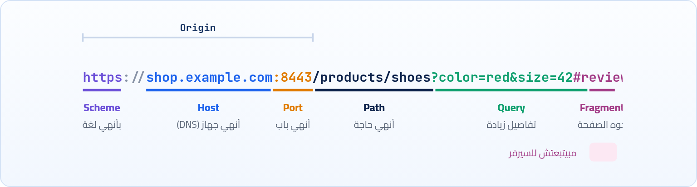

<small>المرحلة 3 · لغة الويب: HTTP</small>

الـ URL هو أول حاجة بتكتبها وأول حاجة المتصفح بيفصّصها. وكل حتة فيه بتستخدم في مرحلة مختلفة: حتة للـ DNS، وحتة للـ Port، وحتة للسيرفر، وحتة مبتطلعش من المتصفح أصلاً. والفصل ده هيوصلك لمفهوم الـ Origin، اللي هو مفتاح فهم الكوكيز والـ CORS بعدين.

:::note[بعد الفصل ده هتكون عارف]
- كل جزء في الـ URL: Scheme و Host و Port و Path و Query و Fragment
- ليه الـ Fragment (#) عمره ما بيوصل للسيرفر
- الـ Query string وإزاي تبعت بيانات فيه
- الـ Percent-encoding: ليه المسافة بتبقى %20، والعربي في الـ URL
- العناوين النسبية والمطلقة (/ و ./ و ../)
- يعني إيه Origin، وإزاي تقارن اتنين
- ليه لازم تحط الـ URL بين Quotes في zsh
:::

<a id="s6-1"></a>

## 6.1 المشكلة: عنوان واحد يقول كل حاجة

قبل الويب، عشان تجيب مستند من جهاز تاني كان لازم تعرف تلات حاجات منفصلة وتعمل بيهم خطوات منفصلة: أنهي جهاز، وأنهي برنامج تكلمه عليه (FTP؟ Gopher؟)، وفين الملف جوه الجهاز. والمعلومات دي كانت بتتقال بالكلام أو بتتكتب في إيميل: "ادخل على الجهاز الفلاني بـ FTP، وروح للفولدر الفلاني، وهات الملف ده". فـ Tim Berners-Lee عمل حاجة بسيطة وعبقرية: **جمع التلاتة في سطر واحد** بقواعد ثابتة، أي برنامج يقدر يقراه ويعرف يعمل إيه. وده الـ **URL** (Uniform Resource Locator)، يعني "عنوان موحّد لأي مورد".

<a id="s6-2"></a>

## 6.2 التشريح الكامل

خلينا ناخد URL فيه كل الحتت مرة واحدة. في الحياة العادية مش هتلاقي كلهم مع بعض، بس كل حتة منهم هتقابلها:



*كل لون حتة ليها شغلانة مختلفة. والتلات حتت الأولى مع بعض اسمهم الـ Origin.*

**تشريح الأمر**

```sh
https://shop.example.com:8443/products/shoes?color=red&size=42#reviews
```

1. `https`: الـ **Scheme**: بأنهي Protocol نتكلم. `https` و`http` للويب، وفيه غيرهم زي `mailto:` و`file:` و`ws:` (WebSocket).
2. `://`: فاصل ثابت بعد الـ Scheme في عناوين الويب. Tim Berners-Lee نفسه قال بعدين إن الـ `//` مكانتش ليها لازمة، بس فضلت.
3. `shop.example.com`: الـ **Host**: اسم الجهاز، وده اللي بيروح للـ DNS (الفصل 5). ممكن يبقى IP على طول زي `127.0.0.1`.
4. `:8443`: الـ **Port** (الفصل 3). لو مكتوبش، المتصفح بيستخدم الافتراضي: 443 لـ https و 80 لـ http. عشان كده `localhost:3000` لازم تكتب فيه الرقم.
5. `/products/shoes`: الـ **Path**: "عاوز أنهي حاجة على السيرفر ده". زمان كان دايماً مسار ملف حقيقي، النهارده السيرفر بيفهمه زي ما هو عاوز (Route).
6. `?color=red&size=42`: الـ **Query string**: بعد علامة `?`، أزواج `key=value` بينهم `&`. بيستخدم للبحث والفلترة والصفحات.
7. `#reviews`: الـ **Fragment**: بعد `#`. ده للمتصفح بس: "انزل لحد العنصر اللي `id` بتاعه `reviews`". **مبيتبعتش للسيرفر أبداً**.

:::note[ليه الـ Fragment مبيروحش للسيرفر؟]
لأنه اتعمل أصلاً عشان يشاور على مكان **جوه** المستند اللي عندك، والسيرفر مش محتاج يعرف انت عاوز تقرا أنهي حتة. وعشان كده لو فتحت DevTools وبصيت على الطلب هتلاقي الـ URL من غير الـ `#`. والمعلومة دي استخدمتها تطبيقات قديمة (زي React Router في وضع `HashRouter`) عشان تغيّر "الصفحة" من غير ما تكلم السيرفر خالص: `site.com/#/about`.
:::

<a id="s6-3"></a>

## 6.3 الـ Query string: بيانات في العنوان

الـ Query string هو أبسط طريقة تبعت بيها بيانات للسيرفر، وهتستخدمه كتير في كورس JavaScript مع APIs زي `?q=egypt`. القواعد بسيطة: يبدأ بـ `?`، وكل معلومة `key=value`، وبينهم `&`، والترتيب مش مهم. وممكن نفس الـ Key يتكرر: `?tag=js&tag=css`، والسيرفر هو اللي يقرر يفهمها إزاي.

وفي JavaScript مش محتاج تقطّع الـ URL بإيدك، فيه أدوات جاهزة. افتح الـ Console في Chrome وجرّب:

```sh title="Console · Chrome DevTools"
> const u = new URL('https://shop.example.com:8443/products?color=red&size=42#reviews')
> u.hostname
'shop.example.com'
> u.port
'8443'
> u.searchParams.get('color')
'red'
> u.origin
'https://shop.example.com:8443'
> u.hash
'#reviews'
```

`new URL()` بياخد الـ URL ويفصّصه زي ما المتصفح بيعمل بالظبط، و`searchParams` بيديك الـ Query جاهز. ولو عاوز تبني Query بأمان: `new URLSearchParams({ q: 'آيفون 15', page: 2 }).toString()` هيرجعلك `q=%D8%A2%D9%8A%D9%81%D9%88%D9%86+15&page=2`. والشكل الغريب ده هو موضوعنا الجاي.

<a id="s6-4"></a>

## 6.4 الـ Percent-encoding: ليه المسافة بقت %20؟

المشكلة: الـ URL اتصمم من الأول إنه يتكتب بحروف إنجليزي وأرقام وكام رمز بس. وفيه رموز ليها معنى خاص جواه: `?` بتبدأ الـ Query، و`&` بتفصل، و`#` بتبدأ الـ Fragment، و`/` بتفصل المسار. طب لو عاوز تبحث عن "`rock & roll`"؟ الـ `&` هتتفهم إنها فاصل، والمسافة مش مسموحة أصلاً. ولو عاوز تبحث بالعربي؟

فاتطور حل اسمه **Percent-encoding**: أي حرف مش مسموح أو ليه معنى خاص، بيتحول لـ `%` وبعدها رقمه بالـ Hex. المسافة رقمها 32 يعني `20` بالـ Hex، فبقت `%20`. والحروف العربي بتتحول لـ Bytes بنظام UTF-8 (كل حرف عربي = 2 Bytes)، وكل Byte يتكتب `%XX`. عشان كده كلمة "مصر" بقت `%D9%85%D8%B5%D8%B1`.

**أشهر الحروف المتشفّرة**

| الحرف | شكله في الـ URL | ملاحظة |
|---|---|---|
| مسافة | `%20` أو `+` | `+` في الـ Query بس (من أيام الفورمز)، و`%20` في أي حتة |
| `&` | `%26` | عشان متتفهمش فاصل |
| `=` | `%3D` |   |
| `?` / `#` / `/` | `%3F` / `%23` / `%2F` | لما يبقوا جزء من القيمة نفسها |
| `%` نفسه | `%25` | عشان يتفهم إنه حرف مش بداية كود |

:::tip[في JavaScript: encodeURIComponent]
لما تبني URL بإيدك من قيمة جاية من المستخدم، متلزقهاش كده: `'?q=' + search`. استخدم `'?q=' + encodeURIComponent(search)`، أو الأحسن `URLSearchParams` اللي بيعملها لوحده. ولو نسيت، أول مستخدم يكتب `&` أو `#` هيكسر الطلب بتاعك بطريقة غريبة جداً ومش هتفهمها.
:::

:::note[لو حابب تتعمق: الدومين بالعربي]
الـ Path والـ Query بيتشفّروا بالـ Percent-encoding، بس الدومين نفسه ليه نظام تاني. فيه دومينات بالعربي فعلاً (زي `مصر.` كـ TLD رسمي لمصر)، والـ DNS نفسه مبيفهمش غير إنجليزي، فالاسم بيتحول لشكل اسمه **Punycode** بيبدأ بـ `xn--`. يعني `مصر` بتبقى `xn--wgbh1c`. المتصفح بيعرضلك العربي، ويبعت الـ Punycode من ورا.
:::

<a id="s6-5"></a>

## 6.5 العناوين النسبية: من غير ما تكتب كل حاجة

جوه ملف HTML، نادراً ما بتكتب الـ URL كامل. بتكتب `` وخلاص، والمتصفح بيكمّل الباقي من عنوان الصفحة اللي انت فيها. ودي قواعد التكميل، لو انت في صفحة `https://site.com/blog/post.html`:

**إزاي المتصفح بيكمّل العنوان النسبي**

| اللي كتبته | بيبقى | القاعدة |
|---|---|---|
| `logo.png` | `https://site.com/blog/logo.png` | نفس فولدر الصفحة |
| `./logo.png` | `https://site.com/blog/logo.png` | `./` = الفولدر الحالي (زي الـ Terminal) |
| `../logo.png` | `https://site.com/logo.png` | `../` = فولدر لفوق |
| `/logo.png` | `https://site.com/logo.png` | يبدأ بـ `/` = من جذر الموقع |
| `//cdn.com/x.js` | `https://cdn.com/x.js` | يبدأ بـ `//` = نفس الـ Scheme بس جهاز تاني |
| `?page=2` | `https://site.com/blog/post.html?page=2` | نفس الصفحة بـ Query جديد |

:::tip[حاجة مشتركة: . و .. و / زي الـ Terminal]
الـ `./` والـ `../` والـ `/` في العناوين النسبية نفس معناهم بالظبط في مسارات الـ Terminal اللي اتعلمناها: الحالي، واللي فوقه، والجذر. والفرق الوحيد إن "الجذر" هنا جذر الموقع مش جذر الجهاز. وأشهر مشكلة هتقابلك: الصور شغالة على `localhost` ومش شغالة بعد النشر على GitHub Pages، لأن الموقع بقى في `user.github.io/project/` فالـ `/logo.png` بقى بيروح لجذر `user.github.io` مش لمشروعك. الحل غالباً: `./logo.png`.
:::

<a id="s6-6"></a>

## 6.6 الـ Origin: أهم مفهوم في أمان الويب

دلوقتي جه وقت أهم فكرة في الفصل. فاكر الخط اللي فوق الرسمة الأولى؟ الـ **Scheme** والـ **Host** والـ **Port** مع بعض اسمهم **Origin**. والـ Origin هو "الهوية" بتاعة أي صفحة في المتصفح. المتصفح بيعامل كل Origin كأنه بيت لوحده، ليه كوكيزه وتخزينه، وصفحة من Origin مش مسموحلها تقرا حاجات Origin تاني إلا لو التاني سمح. ودي قاعدة اسمها **Same-Origin Policy**، وهي أساس فصل الكوكيز والـ CORS كله.

القاعدة: اتنين URL ليهم نفس الـ Origin **بس لو** التلات حتت متطابقين بالظبط. والـ Path والـ Query مش داخلين في الحسبة. خلينا نقارن بـ `https://shop.example.com`:

**نفس الـ Origin ولا لأ؟**

| الـ URL | نفس الـ Origin؟ | ليه |
|---|---|---|
| `https://shop.example.com/cart?id=5` | أيوه | الـ Path والـ Query مش داخلين |
| `http://shop.example.com` | لأ | الـ Scheme اختلف (http) |
| `https://api.example.com` | لأ | الـ Host اختلف، حتى لو نفس الدومين الكبير |
| `https://shop.example.com:8443` | لأ | الـ Port اختلف (الأصلي 443) |
| `http://localhost:5173` مقابل `http://localhost:3000` | لأ | Port مختلف. ودي اللي هتقابلك أول ما React تكلم Node |

:::caution[خلي بالك: Origin مش Site]
هتقابل كلمة تانية قريبة اسمها **Site**. الـ Site أوسع: `shop.example.com` و`api.example.com` نفس الـ **Site** (`example.com`) بس مش نفس الـ **Origin**. الكوكيز (الفصل 13) بتفكر بالـ Site في حاجات كتير زي `SameSite`، والـ CORS (الفصل 14) بيفكر بالـ Origin. افتكر الفرق ده عشان هيرجعلك.
:::

<a id="s6-7"></a>

## 6.7 URLs في الـ Terminal: الـ Quotes إجبارية

آخر حاجة، ودي هتوفرلك وجع دماغ كبير. جرّب تكتب في zsh على الـ Mac:

```sh title="Terminal"
$ curl https://httpbin.org/get?color=red&size=42
zsh: no matches found: https://httpbin.org/get?color=red
```

إيه اللي حصل؟ حاجتين في نفس السطر. الـ `?` في zsh رمز **Globbing** معناه "أي حرف واحد"، فـ zsh حاول يدوّر على ملف اسمه كده، وملقاش، فوقف بالخطأ ده. ولو كانت عدّت، كانت الـ `&` هتعمل مشكلة تانية: في الـ Shell معناها "شغّل اللي قبلي في الخلفية"، فالأمر كان هيتقطع عندها والـ `size=42` كانت هتتفهم أمر لوحده. الحل بسيط: **حط أي URL بين Quotes** دايماً:

**تشريح الأمر**

```sh
curl 'https://httpbin.org/get?color=red&size=42'
```

1. `curl`: اطلب الـ URL ده.
2. `'`: الـ Single quote بتقول للـ zsh "متلمسش أي حرف جوايا"، فالـ `?` والـ `&` بيوصلوا لـ curl زي ما هما. (الـ Double quotes `"` كمان تنفع هنا، بس الـ Single أأمن لأن zsh مبيفسرش `$` جواها.)
3. `?color=red&size=42`: الـ Query. و`httpbin.org/get` موقع للتجارب بيرجعلك الطلب اللي بعته كـ JSON، فتشوف الـ Query وصل إزاي.

:::tip[حاجة مشتركة: نفس القاعدة من كتاب الـ Terminal]
دي نفس قاعدة الـ Quoting اللي اتعلمناها في كتاب الـ Terminal: أي حاجة فيها رموز ليها معنى في الـ Shell (`? * & # $ ! ( )` والمسافات) حطها بين Single quotes. والـ `#` كمان ممكن تتفهم تعليق لو جت بعد مسافة. فخليها عادة: أي URL في الـ Terminal بين `'...'`.
:::

:::tip[ملخص الفصل]
- الـ URL = Scheme + `://` + Host + Port (اختياري) + Path + Query (`?`) + Fragment (`#`).
- الـ Port الافتراضي 443 لـ https و 80 لـ http، والـ Fragment مبيوصلش للسيرفر.
- الـ Query أزواج `key=value` بينهم `&`، وفي JS استخدم `URL` و`URLSearchParams`.
- Percent-encoding: أي حرف خاص أو عربي بيتحول لـ `%XX`، والمسافة `%20` أو `+`.
- الـ Origin = Scheme + Host + Port، ولازم التلاتة يتطابقوا. ده أساس الكوكيز والـ CORS.
- في zsh حط أي URL بين `'...'` عشان `?` و`&`.
:::

### صح ولا غلط؟

1. `https://site.com` و`https://site.com:443` نفس الـ Origin.
2. السيرفر يقدر يعرف انت فاتح `#section2` في الصفحة من الطلب.
3. `http://localhost:3000` و`http://localhost:5173` نفس الـ Origin لأنهم نفس الجهاز.

### أسئلة مراجعة

1. فصّص `http://127.0.0.1:8000/api/users?page=2&limit=10#top` لكل حتته.
2. ليه كلمة "مصر" في الـ URL بقت 6 أكواد `%XX`؟
3. انت في `https://site.com/docs/a/page.html`. `../img/x.png` هيبقى إيه؟
4. ليه `curl https://x.com/?a=1&b=2` من غير Quotes بيبوظ في zsh؟ اذكر السببين.

### تحديات الفصل

<small>جرّبها بإيدك، والحلول في ملحق الإجابات.</small>

1. **[سهل]** في الـ Console: `new URL(location.href)` على أي موقع، واستكشف الخصائص (`protocol` و`host` و`pathname` و`search`).
2. **[متوسط]** جرّب `curl 'https://httpbin.org/get?q=rock%20%26%20roll&lang=ar'` وبص على `args` في الرد: الـ `%26` اتفهمت إزاي؟ وبعدين جرّبها بـ `&` عادية بدل `%26` وقارن.
3. **[صعب]** اكتب في الـ Console Function بتاخد Object وترجع URL كامل بالـ Query متشفّر صح باستخدام `URL` و`searchParams.set`. جربها بقيمة فيها عربي و`&`.
