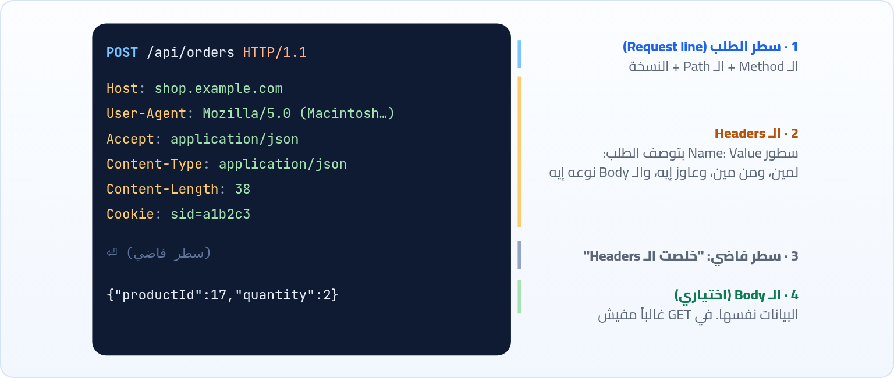
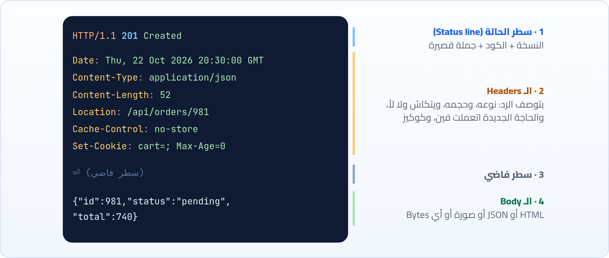

<small>المرحلة 3 · لغة الويب: HTTP</small>

ده قلب الكتاب. HTTP هي اللغة اللي المتصفح و fetch و curl والسيرفر بيتكلموا بيها. هنعرف الحكاية: بدأت بسطر واحد وكبرت ليه. وبعدين نفصّص الطلب والرد سطر سطر، ونفهم الـ Methods (GET و POST وأخواتهم) ويعني إيه Safe و Idempotent، وإزاي البيانات بتتبعت في الـ Body.

:::note[بعد الفصل ده هتكون عارف]
- إزاي HTTP اتطور من سطر واحد سنة 1991 لشكله النهارده
- شكل رسالة الطلب: Request line و Headers وسطر فاضي و Body
- شكل رسالة الرد: Status line و Headers و Body
- الـ Methods: GET و POST و PUT و PATCH و DELETE و HEAD و OPTIONS
- يعني إيه Safe ويعني إيه Idempotent، وليه زرار الدفع مبيتضغطش مرتين
- أنواع الـ Body: JSON و Form و Multipart، والـ Content-Type
- نفس الطلب بـ fetch في JavaScript
- يعني إيه HTTP Stateless
:::

<a id="s7-1"></a>

## 7.1 الحكاية: من سطر واحد لـ لغة كاملة

أول نسخة من HTTP سنة 1991 (اسمها بعدين **HTTP/0.9**) كانت بسيطة لدرجة مضحكة. الطلب كله سطر واحد: `GET /page.html`. والرد: الـ HTML على طول، وبعدين السيرفر يقفل الاتصال. مفيش أي حاجة تانية. وده كان كفاية لفكرة Tim الأولى: مستندات نصية فيها روابط.

وهنا كانت المشكلة. الناس بدأت تحط صور، وملفات، وصفحات بتتعمل من برامج. والمتصفح بيستلم Bytes ومش عارف دي HTML ولا صورة ولا PDF. ولو الصفحة مش موجودة، السيرفر يرجّع إيه؟ صفحة HTML مكتوب فيها "مش موجود"؟ طب المتصفح هيعرف منين إنها خطأ مش صفحة عادية؟ ومفيش طريقة تبعت بيها بيانات للسيرفر غير في الـ URL. فاتطور حل: **HTTP/1.0** سنة 1996 ضاف تلات حاجات غيرت كل حاجة: **رقم النسخة** في الطلب، و**Status code** في أول سطر من الرد (200 تمام، 404 مش موجود)، و**Headers**: سطور بتوصف الرسالة نفسها، زي `Content-Type: image/png`.

وبعدها على طول ظهرت مشكلة تانية. السيرفرات بقت بتشيل مواقع كتير على نفس الـ IP (عشان IPv4 غالي)، والطلب مفيهوش غير المسار، فالسيرفر مش عارف انت عاوز أنهي موقع. وكل ملف بيفتح اتصال TCP جديد، والـ Handshake كل مرة بطيء. فجه **HTTP/1.1** (1997 ثم اتظبط 1999): خلّى Header اسمه `Host` إجباري، وخلّى الاتصال **يفضل مفتوح** لطلبات كتير (Keep-alive). والنسخة دي لسه شغالة لحد النهارده، ونسخ 2 و 3 (الفصل 11) غيروا طريقة النقل بس، لكن **المعاني** نفسها (Methods و Status و Headers) زي ما هي، ومكتوبة النهارده في `RFC 9110`.

<a id="s7-2"></a>

## 7.2 رسالة الطلب: أربع حتت

أي طلب HTTP، من المتصفح أو `fetch` أو `curl`، شكله كده. خلينا ناخد طلب حقيقي: انت بتعمل طلب أوردر جديد في متجر:



*تشريح رسالة طلب HTTP/1.1. كل سطر بيخلص بـ \\r\\n، والسطر الفاضي هو الحد بين الـ Headers والـ Body.*

**تشريح الأمر**

```http
POST /api/orders HTTP/1.1
```

1. `POST`: الـ **Method** (أو الفعل): "عاوز أعمل إيه". هنا: "ابعتلك بيانات تعمل بيها حاجة جديدة". وبيتكتب كابيتال دايماً.
2. `/api/orders`: الـ **Target**: الـ Path والـ Query من الـ URL. لاحظ إن الـ Host مش هنا، بيتكتب في Header لوحده. والـ `#fragment` مش هنا أكيد.
3. `HTTP/1.1`: نسخة الـ Protocol اللي الـ Client بيتكلمها، عشان السيرفر يرد بنفس اللغة.

وبعد سطر الطلب تيجي الـ **Headers**، كل واحد في سطر: اسم، وبعدين `:`، وبعدين القيمة. وأسامي الـ Headers **مش حساسة لحالة الحروف**: `Content-Type` و`content-type` نفس الحاجة (وفي HTTP/2 بقت كلها small). هنفصّص أهم الـ Headers في الفصل 9، بس لاحظ دلوقتي إن الـ Headers دي هي "الظرف" اللي بيوصف الجواب: الجواب رايح لمين (`Host`)، ومين باعته (`User-Agent`)، وعاوز الرد بأنهي شكل (`Accept`)، والبيانات اللي جوه نوعها إيه وحجمها قد إيه (`Content-Type` و`Content-Length`).

<a id="s7-3"></a>

## 7.3 رسالة الرد: نفس الشكل تقريباً

والسيرفر بيرد برسالة شكلها نفس الفكرة، بس أول سطر مختلف:



*تشريح رسالة الرد. أهم حاجة فيها الرقم اللي في أول سطر.*

**تشريح الأمر**

```http
HTTP/1.1 201 Created
```

1. `HTTP/1.1`: النسخة اللي السيرفر بيرد بيها.
2. `201`: الـ **Status code**: 3 أرقام، وأول رقم بيقول الفئة (2 = نجح). البرامج بتقرا الرقم ده بس. الفصل 8 كله عنه.
3. `Created`: الـ Reason phrase: جملة للبني آدمين بس، والبرامج بتتجاهلها. وفي HTTP/2 اتشالت خالص، فهتشوف `HTTP/2 201` من غيرها.

:::note[HTTP مالوش ذاكرة (Stateless)]
معلومة هتفسرلك حاجات كتير: كل طلب HTTP **مستقل تماماً** عن اللي قبله. السيرفر مبيفتكرش إنك لسه عامل Login من ثانيتين. كل طلب لازم يحمل معاه كل اللي السيرفر محتاجه يعرفه عنك. طب إزاي المواقع بتفتكرك؟ ده موضوع الفصل 13 (الكوكيز)، وشايف في الرسمة الأولى Header اسمه `Cookie`؟ هو ده السر.
:::

<a id="s7-4"></a>

## 7.4 الـ Methods: انت عاوز تعمل إيه؟

في الأول كان فيه `GET` بس، لأن الويب كان للقراية بس. ولما الناس احتاجت تبعت فورمز (تسجيل، بحث، تعليق) اتضاف `POST`. ومع الوقت، والـ APIs بقت بتتعامل مع بيانات زي قاعدة بيانات (تقرا وتضيف وتعدل وتمسح)، بقى فيه Method لكل فعل. وفكرة إن الـ URL يمثل "حاجة" (`/api/products/17`) والـ Method يمثل "الفعل" ده أساس طريقة تصميم اسمها **REST** هتقابلها في Node:

**الـ Methods الأساسية**

| الـ Method | معناه | مثال | Body؟ |
|---|---|---|---|
| `GET` | هاتلي (قراية بس) | `GET /api/products/17` | لأ |
| `POST` | خد البيانات دي واعمل بيها حاجة (غالباً حاجة جديدة) | `POST /api/products` | أيوه |
| `PUT` | حط الحاجة دي كاملة مكان القديمة (أو اعملها) | `PUT /api/products/17` | أيوه، كاملة |
| `PATCH` | عدّل جزء بس | `PATCH /api/products/17` بـ `{"price":90}` | أيوه، الجزء بس |
| `DELETE` | امسح | `DELETE /api/products/17` | غالباً لأ |
| `HEAD` | زي GET بالظبط بس من غير Body: الـ Headers بس | `curl -I` | لأ |
| `OPTIONS` | "إيه المسموح هنا؟" المتصفح بيستخدمه في الـ CORS Preflight (الفصل 14) | `OPTIONS /api/orders` | لأ |

### Safe و Idempotent: ليه زرار الدفع مبيتضغطش مرتين

تخيل إنك دوست "ادفع" والنت قطع ثانية، والصفحة مردتش. تدوس تاني؟ لو الطلب الأول كان وصل فعلاً، هتدفع مرتين! المشكلة دي حقيقية، وعشان كده HTTP بيقسم الـ Methods بصفتين مهمين جداً، والمتصفحات والسيرفرات والكاش بيعتمدوا عليهم:

#### Safe: مبيغيرش حاجة

`GET` و`HEAD` و`OPTIONS`. المفروض إنهم قراية بس، فالمتصفح يقدر يعيدهم براحته، ويعملهم مسبقاً (Prefetch)، والكاش يحفظهم. عشان كده عمرك ما تعمل `GET /delete-account`: أي Bot بيمشي على الروابط هيمسح الحسابات!

#### Idempotent: تكراره زي مرة واحدة

الـ Safe كلهم، ومعاهم `PUT` و`DELETE`. لو بعت `DELETE /items/5` عشر مرات، النتيجة نفس مرة واحدة: العنصر ممسوح. أما `POST` مش Idempotent: كل مرة ممكن تعمل أوردر جديد. عشان كده المتصفح بيسألك "Confirm Form Resubmission" لو عملت Refresh بعد POST.

:::tip[في الشغل الحقيقي]
لما تيجي تعمل API في Node: القراية دايماً `GET`، والإنشاء `POST`، والتعديل `PATCH` (أو `PUT` لو بتستبدل كله)، والمسح `DELETE`. ومتحطش أفعال في الـ URL زي `/getProducts` أو `/deleteUser?id=5`، الـ Method هو الفعل والـ URL هو الحاجة. وفي الواجهة، امنع الضغط المتكرر على أزرار الـ POST المهمة (اعمل الزرار `disabled` لحد ما الرد ييجي).
:::

<a id="s7-5"></a>

## 7.5 الـ Body والـ Content-Type: البيانات شكلها إيه؟

لما تبعت بيانات في الـ Body، السيرفر بيستلم Bytes. ومحتاج يعرف يقراها إزاي. هنا شغل Header اسمه `Content-Type`، وهو بيقول "اللي في الـ Body ده نوعه كذا". وفيه تلات أشكال هتقابلهم في كل حتة:

```http title="1 · JSON: الأشهر في الـ APIs"
POST /api/orders HTTP/1.1
Content-Type: application/json

{"productId":17,"quantity":2,"note":"باب العمارة"}
```

```http title="2 · Form عادي: اللي الفورم بيبعته افتراضياً"
POST /login HTTP/1.1
Content-Type: application/x-www-form-urlencoded

email=sara%40example.com&password=s3cret
```

```http title="3 · Multipart: لما فيه ملفات"
POST /upload HTTP/1.1
Content-Type: multipart/form-data; boundary=----X9f2

------X9f2
Content-Disposition: form-data; name="avatar"; filename="me.png"
Content-Type: image/png

(Bytes الصورة)
------X9f2--
```

```http title="الفرق بين التلاتة"
application/json
application/x-www-form-urlencoded
multipart/form-data; boundary=…
```

1. `application/json`: الـ Body نص JSON. في JS بتعمله بـ `JSON.stringify(obj)`. وده اللي هتستخدمه مع أغلب الـ APIs.
2. `application/x-www-form-urlencoded`: نفس شكل الـ Query string بالظبط (`key=value&...`) بس في الـ Body، ومتشفّر Percent-encoding (لاحظ `@` بقت `%40`). ده اللي `<form method="post">` بيبعته.
3. `multipart/form-data; boundary=…`: الـ Body متقسم أجزاء، وكل جزء ليه Headers لوحده. والـ `boundary` = النص اللي بيفصل الأجزاء. ده الوحيد اللي ينفع للملفات. في JS بتعمله بـ `FormData`.

:::caution[خلي بالك: أشهر غلطة مع fetch]
لو بعت JSON من غير ما تقول إنه JSON، السيرفر ممكن ميعرفش يقراه، ويرجعلك `400` أو يلاقي الـ Body فاضي. يعني لازم الاتنين مع بعض: `body: JSON.stringify(data)` **و** `headers: { 'Content-Type': 'application/json' }`. والعكس كمان: لو بعت `FormData` متحطش `Content-Type` بإيدك، سيب المتصفح يحطه عشان يكتب الـ `boundary` صح.
:::

<a id="s7-6"></a>

## 7.6 نفس الكلام في JavaScript

:::note[Promise و async/await في دقيقة (لو لسه موصلتلهمش في الكورس)]
الطلب على الشبكة بياخد وقت، و JavaScript مش هتقف تستنى وتعلّق الصفحة. فـ `fetch` مبيرجعش الرد على طول، بيرجع **Promise**: "وعد" إن الرد هييجي بعدين، زي البيجر اللي بيدّوهولك في المطعم ويرن لما الأكل يجهز. الـ Promise ليها حالتين في الآخر: يا **اتحققت** (Fulfilled) بالنتيجة، يا **اترفضت** (Rejected) بـ Error.

- `await` قبل الـ Promise = "استنى هنا لحد ما البيجر يرن، وهات النتيجة". ومينفعش تستخدمها غير جوه دالة مكتوب قبلها `async` (أو في الـ Console مباشرة).
- `.then(fn)` = نفس الفكرة بالطريقة القديمة: "لما النتيجة تيجي، شغّل fn".
- `try / catch` حوالين الـ `await` بتمسك الـ Rejection.

وكمان **JSON**: نص شكله زي الـ Object في JavaScript (`{"id": 1, "name": "Sara"}`)، والـ Keys لازم بين `"..."`. `JSON.stringify(obj)` بتحوّل الـ Object لنص علشان يتبعت، و `res.json()` بتعمل العكس. الشرح الكامل لـ JSON في كتاب APIs و JSON (فصل 4 و 5)، والـ fetch بالتفصيل هناك في فصل 10.
:::

لما توصل لجزء `fetch` في كورس Jonas، افتكر إن كل سطر في `fetch` بيتحول لحتة من الرسالة اللي فوق. شوف الطلب اللي رسمناه في أول الفصل لو اتكتب بـ JS:

```js
const res = await fetch('https://shop.example.com/api/orders', {
  method: 'POST',                              // سطر الطلب: الـ Method
  headers: { 'Content-Type': 'application/json',
             'Accept': 'application/json' },   // الـ Headers
  body: JSON.stringify({ productId: 17, quantity: 2 }), // الـ Body
});
console.log(res.status);      // 201  ← من سطر الحالة
console.log(res.ok);          // true ← أي كود من 200 لـ 299
console.log(res.headers.get('Location')); // '/api/orders/981'
const data = await res.json(); // اقرا الـ Body كـ JSON
```

```js title="كل حتة في fetch رايحة فين"
method: 'POST'
headers: {...}
body: JSON.stringify(...)
res.status / res.ok
await res.json()
```

1. `method: 'POST'`: أول كلمة في سطر الطلب. لو مكتبتهاش، الافتراضي `GET`.
2. `headers: {...}`: الـ Headers. المتصفح بيضيف لوحده حاجات زي `Host` و`User-Agent` و`Cookie`، ومش هيسيبك تغيرها.
3. `body: JSON.stringify(...)`: الـ Body كنص. ومينفعش تبعت Body مع `GET` في fetch، هيرمي Error.
4. `res.status / res.ok`: رقم الحالة، و`ok` = هل الرقم بين 200 و 299.
5. `await res.json()`: اقرا الـ Body وحوّله Object. ليه `await` تاني؟ لأن الـ Headers بتوصل الأول، والـ Body ممكن لسه بيتحمل.

:::caution[خلي بالك: fetch مبيعملش Error على 404 و 500]
دي هتقابلك في الكورس أكيد. `fetch` بيعتبر أي رد من السيرفر "نجاح"، حتى لو 404 أو 500، لأن الطلب راح ورجع فعلاً. الـ Promise مبتترفضش (Reject) غير لو الطلب **فشل يوصل** أصلاً: نت قاطع، DNS فشل، CORS منع. عشان كده لازم دايماً تشيك بنفسك: ``if (!res.ok) throw new Error(`HTTP ${res.status}`)``.
:::

:::tip[حاجة مشتركة: نفس الرسالة في 4 أدوات]
الرسالة اللي فصّصناها هي هي في كل حتة، والفرق في طريقة الكتابة بس. في `curl`: `-X POST` للـ Method، و`-H` للـ Header، و`-d` للـ Body (الفصل 10). وفي `fetch`: `method` و`headers` و`body`. وفي DevTools: تابة **Headers** وتابة **Payload** (الفصل 19). وفي Node بعدين: `req.method` و`req.headers` و`req.body`. اتعلمها مرة، تقراها في الأربعة.
:::

:::tip[ملخص الفصل]
- HTTP بدأ سطر واحد (0.9)، و 1.0 ضاف النسخة والـ Status والـ Headers، و 1.1 ضاف `Host` الإجباري والاتصال المفتوح.
- الطلب: Request line (Method + Target + Version)، Headers، سطر فاضي، Body.
- الرد: Status line (Version + Code + Reason)، Headers، سطر فاضي، Body.
- الـ Methods: GET قراية، POST إنشاء، PUT استبدال، PATCH تعديل جزئي، DELETE مسح، HEAD الـ Headers بس، OPTIONS سؤال.
- Safe = مبيغيرش (GET و HEAD و OPTIONS)، و Idempotent = تكراره زي مرة (ومعاهم PUT و DELETE). POST لا ده ولا ده.
- `Content-Type` بيقول شكل الـ Body: JSON أو Form أو Multipart.
- HTTP Stateless، و `fetch` مبيرفضش على 404/500، شيك على `res.ok`.
:::

### صح ولا غلط؟

1. أسامي الـ Headers حساسة لحالة الحروف.
2. `DELETE` Idempotent.
3. `fetch` بيرمي Error لو السيرفر رجّع 404.

### أسئلة مراجعة

1. إيه المشكلة اللي Header الـ `Host` حلها في HTTP/1.1؟
2. السيرفر بيعرف إن الـ Headers خلصت والـ Body بدأ إزاي؟
3. إيه الفرق بين `PUT` و`PATCH`؟ اديني مثال لكل واحد على `/api/users/3`.
4. ليه غلط تعمل Route زي `GET /logout` أو `GET /delete?id=5`؟
5. عاوز ترفع صورة بروفايل من فورم. أنهي `Content-Type`؟ وليه مش JSON؟

### تحديات الفصل

<small>جرّبها بإيدك، والحلول في ملحق الإجابات.</small>

1. **[سهل]** في الـ Console على أي صفحة: `const r = await fetch('https://httpbin.org/get'); r.status; await r.json()`. بص على الـ `headers` اللي httpbin رجعهالك: دي الـ Headers اللي المتصفح بعتها.
2. **[متوسط]** ابعت POST بـ JSON لـ `https://httpbin.org/post` من الـ Console، وشوف في الرد قيمة `json` وقيمة `headers['Content-Type']`. وبعدين ابعته من غير Header الـ Content-Type وقارن.
3. **[صعب]** اكتب Function اسمها `getJSON(url)` بترمي Error فيه رقم الـ Status لو `res.ok` بـ false، وجربها على `https://httpbin.org/status/404`.
