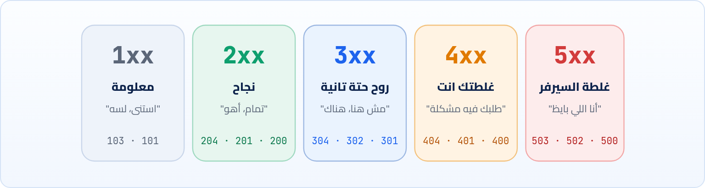
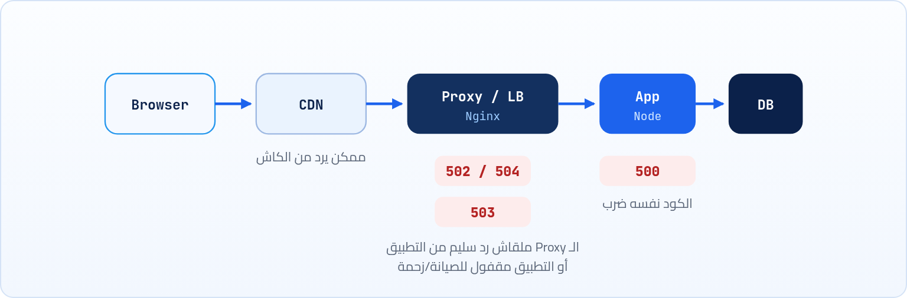

<small>المرحلة 3 · لغة الويب: HTTP</small>

أول حاجة هتبص عليها في أي طلب في DevTools هي الرقم اللي في عمود Status. الرقم ده هو أسرع تشخيص في الدنيا: في ثانية بيقولك المشكلة عندك ولا عند السيرفر، ولا مفيش مشكلة أصلاً. الفصل ده هيخليك تقرا الأرقام دي زي ما الدكتور بيقرا التحاليل.

:::note[بعد الفصل ده هتكون عارف]
- ليه اتعملت الأرقام، ومنطق الفئات الخمسة 1xx لـ 5xx
- أكواد النجاح 200 و 201 و 204 و 206
- التحويلات 301 و 302 و 307 و 308، و 304 اللي مش تحويل
- أخطاء الـ Client: 400 و 401 و 403 و 404 و 405 و 409 و 422 و 429
- أخطاء السيرفر: 500 و 502 و 503 و 504، وإزاي تعرف مين اللي رد
- تجرب أي كود بـ curl و httpbin وتطلّع الكود بس بـ -w
:::

<a id="s8-1"></a>

## 8.1 المشكلة: البرنامج مش بيقرا كلام

في HTTP/0.9، لو طلبت صفحة مش موجودة، السيرفر كان بيرجعلك صفحة HTML مكتوب فيها "Not found" وخلاص. الإنسان يفهمها، بس البرنامج؟ المتصفح مش هيعرف إن دي صفحة خطأ، والكاش هيحفظها كأنها الصفحة الحقيقية، ومحرك البحث هيضيفها لنتائجه. ولو عندك برنامج بيجيب بيانات من سيرفر، هيعرف منين إن العملية فشلت؟ يقرا النص ويدوّر على كلمة "error"؟ وبالإنجليزي ولا بالعربي؟

فاتطور حل بسيط جداً في HTTP/1.0: أول سطر في أي رد فيه **رقم من 3 خانات**، ثابت ومتفق عليه، البرنامج يقراه من غير ما يفهم أي لغة. وأحلى حاجة في التصميم إن **أول رقم لوحده بيقولك الفئة**. يعني حتى لو قابلت كود عمرك ما شفته، زي `425`، هتعرف على طول إنه "غلطة من ناحية الـ Client" لأنه بيبدأ بـ 4.



*أول رقم بيقولك الحكاية كلها: 2 تمام، 3 روح حتة تانية، 4 المشكلة في طلبك، 5 المشكلة عند السيرفر.*

:::tip[أول سؤال في أي Debugging]
لما حاجة متشتغلش، بص على الرقم قبل أي حاجة. **4xx** يبقى ابدأ دوّر عندك: الـ URL، والـ Headers، والـ Body، والـ Login. **5xx** يبقى غالباً الكود بتاعك سليم والمشكلة في السيرفر، فبص على لوجات السيرفر أو كلّم اللي ماسك الـ API. والتقسيمة البسيطة دي لوحدها هتوفرلك ساعات. هنبني عليها خطة كاملة في الفصل 22.
:::

<a id="s8-2"></a>

## 8.2 2xx: نجح، بس بأنهي طريقة؟

ممكن تقول: نجح يعني نجح، ليه أكتر من كود؟ لأن فيه فرق بين "أهو اللي طلبته" و"عملت الحاجة الجديدة" و"عملت اللي قلت عليه ومعنديش حاجة أرجعها". والفرق ده بيفرق مع البرنامج اللي بيقرا الرد:

| الأمر | بيعمل إيه |
|---|---|
| `200 OK` | الافتراضي: الطلب نجح، والـ Body فيه النتيجة. أي `GET` ناجح غالباً 200. |
| `201 Created` | اتعملت حاجة جديدة (بعد `POST` غالباً). وعادة معاه Header اسمه `Location` فيه عنوان الحاجة الجديدة، زي اللي شفناه في الفصل 7. |
| `204 No Content` | نجح، و**مفيش Body خالص**. مشهور بعد `DELETE`. خلي بالك: لو عملت `await res.json()` على 204 هيرمي Error لأن مفيش JSON أصلاً. |
| `206 Partial Content` | رجعتلك حتة من الملف بس، لأنك طلبت كده بـ Header اسمه `Range`. ده اللي بيخلي الفيديو يبدأ من النص لما تقدّم، والتحميلات تكمّل بعد ما النت يقطع. |

<a id="s8-3"></a>

## 8.3 3xx: "مش هنا، روح هناك"

المواقع بتتنقل. الصفحة اللي كانت `/blog/old-post` بقت `/articles/new-post`. الموقع اتنقل من `http` لـ `https`، أو من `site.com` لـ `www.site.com`. والمشكلة: الناس عندها الروابط القديمة، ومحركات البحث كمان. فاتطور حل اسمه **Redirect**: السيرفر بيرد بكود من فئة 3، ومعاه Header اسمه `Location` فيه العنوان الجديد، والمتصفح لوحده بيروح هناك من غير ما تحس.

```sh title="Terminal"
$ curl -I http://github.com
HTTP/1.1 301 Moved Permanently
Content-Length: 0
Location: https://github.com/
```

شفت؟ طلبت `http`، و GitHub قالك "اتنقلت لـ `https` نهائياً". بس فيه أكتر من نوع Redirect، والفرق بينهم حاجتين: <strong>نهائي ولا مؤقت؟</strong> و<strong>المتصفح يحافظ على الـ Method ولا يحولها GET؟</strong>

**أنواع الـ Redirect**

| الكود | نهائي؟ | الـ Method | هتستخدمه إمتى |
|---|---|---|---|
| `301 Moved Permanently` | أيوه | ممكن يتحول GET | الصفحة اتنقلت للأبد. محركات البحث بتنقل ترتيبها للجديدة، والمتصفح بيكاشه |
| `302 Found` | لأ | ممكن يتحول GET | تحويل مؤقت، زي بعد الـ Login روح للـ Dashboard |
| `303 See Other` | لأ | دايماً GET | بعد POST فورم: "تمام، روح شوف النتيجة هنا" (عشان Refresh ميعيدش الـ POST) |
| `307 Temporary Redirect` | لأ | زي ما هو | زي 302 بس بيحافظ على POST وعلى الـ Body |
| `308 Permanent Redirect` | أيوه | زي ما هو | زي 301 بس بيحافظ على الـ Method. مهم للـ APIs |

:::caution[خلي بالك: الـ 301 بيتكاش جامد]
المتصفح بيحفظ الـ `301` في الكاش، وممكن ميسألش السيرفر تاني خالص لفترة طويلة. يعني لو عملت 301 بالغلط وصلّحته، الناس اللي زاروا الموقع هيفضلوا يتحولوا للعنوان الغلط. وانت كمان! عشان كده وانت بتجرب، استخدم `302` أو `307` لحد ما تتأكد، وفي DevTools فعّل **Disable cache** (الفصل 18).
:::

### 304 Not Modified: مش تحويل خالص

كود غريب في الفئة دي: `304`. هو مش "روح هناك"، هو "النسخة اللي عندك لسه زي ما هي، استخدمها". المتصفح بيسأل السيرفر "معايا نسخة من الملف ده من يوم كذا، اتغير؟"، والسيرفر يرد بـ 304 من غير Body، فيوفر تحميل الملف كله تاني. هتشوفه كتير جداً في تابة Network، وده **شيء كويس** مش خطأ. تفاصيله في فصل الكاش (الفصل 15).

<a id="s8-4"></a>

## 8.4 4xx: المشكلة في طلبك

الفئة دي هي اللي هتقابلها أكتر حاجة وانت بتتعلم، لأن أغلبها معناه "انت بعت حاجة غلط"، وده بيحصل كتير لما تبدأ تكلم APIs. وكل كود هنا بيقولك **نوع** الغلطة بالظبط، فافهمهم كويس:

| الأمر | بيعمل إيه |
|---|---|
| `400 Bad Request` | "مش فاهم طلبك". الـ JSON بايظ، أو حقل مطلوب ناقص، أو قيمة شكلها غلط. اقرا الـ Body بتاع الرد، غالباً السيرفر كاتب فيه السبب. |
| `401 Unauthorized` | "<strong>مين انت؟</strong>". مش عامل Login، أو الـ Token غلط أو انتهى. الاسم مضلل: المقصود Unauthenticated. وغالباً معاه Header اسمه `WWW-Authenticate`. |
| `403 Forbidden` | "**عارف انت مين، ومش مسموحلك**". عامل Login بس صلاحياتك متسمحش. Login تاني مش هيحل حاجة. |
| `404 Not Found` | "مفيش حاجة على العنوان ده". غلطة في الـ URL أو الـ Path، أو الحاجة اتمسحت. وأحياناً السيرفر بيرد 404 بدل 403 عشان ميعرفكش إن الحاجة موجودة أصلاً. |
| `405 Method Not Allowed` | العنوان موجود بس مش بيقبل الـ Method ده. بعت `POST` لحاجة بتقبل `GET` بس. الرد فيه Header اسمه `Allow` بالمسموح. |
| `409 Conflict` | الطلب بيتعارض مع الحالة الحالية: الإيميل ده مسجل قبل كده، أو حد عدّل نفس الحاجة قبلك. |
| `413 / 415` | `413 Content Too Large`: الـ Body (غالباً ملف) أكبر من المسموح. `415 Unsupported Media Type`: الـ `Content-Type` مش اللي السيرفر مستنيه (بعت Form والسيرفر عاوز JSON). |
| `422 Unprocessable Content` | "فهمت طلبك، بس البيانات نفسها مش منطقية": الإيميل شكله غلط، أو التاريخ في الماضي. APIs كتير بتستخدمه للـ Validation بدل 400. |
| `429 Too Many Requests` | "اهدى شوية". بعت طلبات كتير في وقت قليل (Rate limit). بص على Header اسمه `Retry-After`: هيقولك تستنى قد إيه. هيقابلك مع APIs المجانية. |

:::note[401 و 403: مثال الفندق]
تخيل فندق. لو جيت تدخل الأسانسير من غير كارت خالص، الأمن هيقولك "انت مين؟ وريني الكارت" = **401**. ولو معاك كارت سليم بس بتحاول تدخل جناح الإدارة، هيقولك "عارف انت مين، بس الكارت ده مش بيفتح هنا" = **403**. فلو جالك 401: اعمل Login أو جدد الـ Token. لو جالك 403: محتاج صلاحية، مش Login.
:::

<a id="s8-5"></a>

## 8.5 5xx: السيرفر هو اللي وقع

هنا المشكلة مش منك. طلبك ممكن يكون سليم 100%، والسيرفر هو اللي معرفش يتعامل. بس عشان تفهم الأكواد دي كويس، لازم تعرف حاجة عن شكل السيرفرات الحقيقية: نادراً ما بيبقى فيه سيرفر واحد. غالباً طلبك بيعدّي على طبقات: CDN، وبعدين **Reverse proxy** أو **Load balancer** (زي Nginx)، وبعدين التطبيق نفسه (Node مثلاً)، اللي ممكن يكلم Database. وكل طبقة ممكن هي اللي ترد بالخطأ:



*مين بيرد بأنهي 5xx: الـ 500 من التطبيق نفسه غالباً، والـ 502 و 504 من اللي واقف قدامه.*

| الأمر | بيعمل إيه |
|---|---|
| `500 Internal Server Error` | "حصل Error في الكود ومعرفتش أعمل إيه". في Node ده غالباً Exception متمسكتش. الرسالة المفيدة في لوج السيرفر، مش في المتصفح. |
| `502 Bad Gateway` | الـ Proxy كلّم التطبيق اللي وراه، ورجعله رد بايظ أو مردش خالص (التطبيق واقع أو بيعيد التشغيل). مشهور جداً وقت الـ Deploy. |
| `503 Service Unavailable` | "مش قادر دلوقتي": صيانة أو ضغط زيادة. ممكن يبقى معاه `Retry-After`. مؤقت بطبيعته. |
| `504 Gateway Timeout` | الـ Proxy استنى التطبيق وزهق. التطبيق بطيء جداً، غالباً Query تقيلة على الـ Database. |

:::note[مثال عملي: مين اللي رد؟]
لو صفحة الخطأ شكلها بسيط ومكتوب فيها `nginx` أو `cloudflare`، يبقى الطبقة اللي قدام هي اللي ردت، والتطبيق نفسه غالباً واقع أو بطيء. بص على Header الـ `Server` في الرد (الفصل 9)، وعلى Headers زي `cf-ray` اللي بتقولك إن Cloudflare في السكة. المعلومة دي بتفرق لما تبلّغ حد بالمشكلة: "الـ API بيرجّع 502 من Nginx" أوضح بكتير من "الموقع مش شغال".
:::

<a id="s8-6"></a>

## 8.6 1xx: الأكواد اللي مش هتشوفها كتير

الفئة دي رسايل مؤقتة قبل الرد الحقيقي، ونادراً ما هتتعامل معاها بنفسك. أشهرهم `101 Switching Protocols`: "تمام، هنقلب من HTTP لـ WebSocket" (الشات والإشعارات اللحظية). و`103 Early Hints`: السيرفر لسه بيجهّز الصفحة، فيقول للمتصفح بدري "ابدأ نزّل ملف الـ CSS ده على ما أخلص"، وهتلاقيه في DevTools في عمود Initiator باسم Early Hints.

:::note[لو حابب تتعمق: 418 I'm a teapot]
فيه كود اسمه `418 I'm a teapot` ("أنا براد شاي")، جه من RFC اتكتب كنكتة يوم 1 أبريل 1998 عن Protocol للتحكم في أباريق القهوة. والكود فضل عايش لحد النهارده، وفيه مواقع بترجعه كهزار، و`https://httpbin.org/status/418` هيرجعهولك برسمة براد. مش هتستخدمه، بس دلوقتي لما تشوفه هتضحك بدل ما تتخض.
:::

<a id="s8-7"></a>

## 8.7 معمل: اطلب أي كود بإيدك

موقع `httpbin.org` اتعمل للتجارب، وعنده عناوين بترجع أي كود تطلبه. وفيه طريقتين مهمين تشوف بيهم الكود من curl. الأولى `-I` اللي شفناها: بتعمل طلب `HEAD` وتطبع الـ Headers بس. والتانية بتطبع الرقم لوحده، ودي اللي هتستخدمها في الـ Scripts:

**تشريح الأمر**

```sh
curl -s -o /dev/null -w '%{http_code}\n' https://httpbin.org/status/404
```

1. `-s`: Silent: متطبعش شريط التقدم والرسايل. curl بيطبع شريط تقدم لما الناتج رايح لملف، و`-s` بتخفيه.
2. `-o /dev/null`: ارمي الـ Body (زي ما شفنا في الفصل 2).
3. `-w`: Write-out: "بعد ما تخلص، اطبع النص ده". وجواه متغيرات بين `%{...}` curl بيملاها.
4. `'%{http_code}\n'`: متغير الـ Status code، وبعده `\n` سطر جديد عشان الـ Prompt ميلزقش في الرقم. والـ Single quotes عشان zsh ميلمسش الـ `%` والـ `{}`.
5. `https://httpbin.org/status/404`: عنوان بيرجّع الكود اللي في آخره.

```sh title="Terminal"
$ curl -s -o /dev/null -w '%{http_code}\n' https://httpbin.org/status/404
404
$ curl -s -o /dev/null -w '%{http_code}\n' https://example.com
200
$ curl -sI https://httpbin.org/redirect/2
HTTP/2 302
date: Thu, 22 Oct 2026 20:41:03 GMT
content-type: text/html; charset=utf-8
content-length: 247
location: /relative-redirect/1
```

وآخر مثال بيورّيك إن curl **مبيتبعش الـ Redirect لوحده** زي المتصفح، بيوقف عند أول رد ويوريهولك. ولو عاوزه يكمّل زي المتصفح، ضيف `-L`:

**تشريح الأمر**

```sh
curl -sIL https://httpbin.org/redirect/2
```

1. `-s`: Silent.
2. `I`: الـ `-I` = اطبع الـ Headers بس (طلب HEAD). وتقدر تلزق الحروف القصيرة ورا بعض: `-sIL` = `-s -I -L`.
3. `L`: الـ `-L` = Location: "لو الرد Redirect، روح على الـ `Location` وكمّل". هتشوف كل رد في السلسلة ورا بعض لحد الـ 200.
4. `https://httpbin.org/redirect/2`: عنوان بيحوّلك مرتين قبل ما يوصّلك.

:::tip[حاجة مشتركة: لزق الـ Flags القصيرة]
زي ما شفنا في كتاب الـ Terminal مع `ls -la` و`tar -xzf`، الـ Flags القصيرة (حرف واحد بشرطة واحدة) بتتلزق ورا بعض: `-sIL`. بس خلي بالك: لو فيه Flag محتاج قيمة (زي `-o file` أو `-w '...'`) خليه آخر واحد في المجموعة أو لوحده، عشان اللي بعده هيتفهم إنه قيمته. والطويلة (`--silent`) مبتتلزقش أبداً.
:::

**ورقة المراجعة: أهم الأكواد في سطر**

| الكود | في كلمة | أول حاجة تعملها |
|---|---|---|
| `200` / `201` / `204` | تمام / اتعمل / تمام من غير Body | ولا حاجة، أو اقرا الـ Body |
| `301` / `308` | اتنقل نهائي | حدّث الرابط عندك |
| `302` / `307` | اتنقل مؤقتاً | عادي، المتصفح هيتبعه |
| `304` | نسختك لسه سليمة | ولا حاجة، ده كاش شغال |
| `400` / `422` | البيانات غلط | اقرا Body الرد وراجع اللي بعته (Payload) |
| `401` | مين انت؟ | Login أو Token في `Authorization` |
| `403` | مش مسموحلك | صلاحيات، أو CSRF، أو الـ API Key مش ليها الحق ده |
| `404` | مش موجود | راجع الـ URL حرف حرف، والـ Method |
| `429` | كتير قوي | استنى `Retry-After`، وقلل الطلبات |
| `500` | الكود ضرب | لوج السيرفر |
| `502` / `503` / `504` | اللي قدام التطبيق مش لاقيه / مشغول / زهق | استنى وجرب تاني، أو بلّغ صاحب السيرفر |

:::tip[ملخص الفصل]
- الـ Status code 3 أرقام، والأول هو الفئة: 1 معلومة، 2 نجاح، 3 تحويل، 4 غلطة الـ Client، 5 غلطة السيرفر.
- 201 بعد إنشاء ومعاه `Location`، و 204 من غير Body (متعملش `.json()`).
- 301/308 نهائي و 302/307 مؤقت، و 307/308 بيحافظوا على الـ Method. و 304 = استخدم الكاش.
- 401 = مين انت (Login)، و 403 = مش مسموحلك (صلاحية)، و 404 = مش موجود، و 429 = بطّأ.
- 500 من التطبيق، و 502/504 من الـ Proxy اللي قدامه، و 503 مؤقت.
- `curl -s -o /dev/null -w '%{http_code}\n'` للرقم بس، و`-I` للـ Headers، و`-L` عشان يتبع التحويلات.
:::

### صح ولا غلط؟

1. الـ 304 معناه إن الصفحة اتنقلت لعنوان تاني.
2. لو جالك 403، أول حل إنك تعمل Login تاني.
3. curl بيتبع الـ Redirects لوحده زي المتصفح.

### أسئلة مراجعة

1. ليه فكرة "أول رقم = الفئة" ذكية؟ إيه فايدتها لما تقابل كود جديد؟
2. بعد فورم تسجيل بـ POST، تحوّل المستخدم بأنهي كود؟ وليه مش 307؟
3. API رجّع 502 وصاحبك قالك "الكود بتاعك بايظ". ترد تقوله إيه؟
4. اشرح كل حتة في `curl -s -o /dev/null -w '%{http_code}\n' URL`.

### تحديات الفصل

<small>جرّبها بإيدك، والحلول في ملحق الإجابات.</small>

1. **[سهل]** اطلع الكود بتاع `https://httpbin.org/status/201` و`/status/429` و`/status/503` بأمر الـ `-w`.
2. **[متوسط]** جرّب `curl -sIL http://github.com` و`curl -sIL http://www.google.com`. كام Redirect في كل واحد، ولأنهي عنوان؟
3. **[صعب]** اكتب Script صغير في zsh بيلف على 3 مواقع ويطبع جنب كل واحد الكود بتاعه: `for u in https://example.com https://github.com https://httpbin.org/status/500; do echo "$u $(curl -s -o /dev/null -w '%{http_code}' "$u")"; done`. واشرح الـ `$()` فيه.
