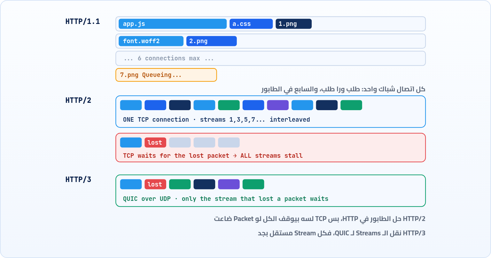

<small>المرحلة 3 · لغة الويب: HTTP</small>

الـ Methods والـ Status codes والـ Headers اللي اتعلمناها ماتغيرتش من التسعينات تقريباً. اللي اتغير هو إزاي الكلام ده بيتنقل على السلك. الصفحات بقت 100 ملف بدل ملف واحد، و HTTP/1.1 بقى بيتخنق. فاتطور HTTP/2 وبعده HTTP/3. هنفهم كل مشكلة والحل بتاعها، ونشوف النسخة في DevTools و curl.

:::note[بعد الفصل ده هتكون عارف]
- ليه HTTP/1.1 اتخنق مع الصفحات الحديثة
- Head-of-line blocking على مستوى HTTP وعلى مستوى TCP
- HTTP/2: اتصال واحد و Streams و Binary frames و HPACK
- HTTP/3: QUIC فوق UDP وإزاي بيحل مشكلة TCP
- Alt-Svc: إزاي المتصفح يعرف إن فيه HTTP/3
- تعرف النسخة من عمود Protocol و curl -w
:::

<a id="s11-1"></a>

## 11.1 المشكلة: صفحة واحدة بقت 100 طلب

سنة 1997 لما HTTP/1.1 اتعمل، صفحة الويب العادية كانت ملف HTML وكام صورة. النهارده، افتح أي موقع أخبار وبص على Network: 100 أو 200 طلب. ملفات JS كتير، و CSS، وخطوط، وصور، وإعلانات. وهنا ظهرت مشكلة HTTP/1.1 الكبيرة: **على الاتصال الواحد، طلب واحد في المرة**. تبعت طلب، تستنى الرد كله، وبعدين تبعت اللي بعده. زي شباك واحد في البنك والطابور طويل.

فالمتصفحات عملت حل مؤقت: **افتح 6 اتصالات** لنفس السيرفر في نفس الوقت. 6 شبابيك بدل شباك. وده هو السبب اللي هتشوف بيه في DevTools حاجة اسمها **Queueing** (الفصل 18): الطلب السابع واقف مستني شباك يفضى. والمطورين عملوا حيل أكتر: يجمعوا كل ملفات JS في ملف واحد كبير (Bundling)، ويحطوا كل الأيقونات في صورة واحدة (Sprites)، ويوزعوا الملفات على كذا Domain (`static1.site.com`، `static2...`) عشان ياخدوا 6 اتصالات من كل واحد. حيل، مش حلول.

### Head-of-line blocking: العربية المعطلة في أول الطابور

المشكلة ليها اسم: **Head-of-line blocking** (الحجز من أول الطابور). لو أول طلب في الطابور ملف كبير أو السيرفر بطيء فيه، كل اللي وراه واقفين، حتى لو صغيرين وجاهزين. زي ما عربية واحدة معطلة في حارة واحدة بتوقف الحارة كلها.



*تلات طرق لنقل نفس الطلبات: 6 طوابير، ثم اتصال واحد متداخل، ثم Streams مستقلة فعلاً*

<a id="s11-2"></a>

## 11.2 HTTP/2: اتصال واحد، طلبات كتير مع بعض

جوجل جربت بروتوكول اسمه **SPDY** سنة 2009، ونجح، فبقى أساس **HTTP/2** (سنة 2015، دلوقتي RFC 9113). الفكرة الأساسية: بدل ما الطلب ينزل على الاتصال كتلة واحدة، **قطّعه حتت صغيرة** اسمها **Frames**، وكل Frame عليه رقم الطلب بتاعه (اسمه **Stream ID**). وكده تقدر تبعت حتة من طلب 1، وحتة من طلب 3، وحتة من 5، على نفس الاتصال في نفس الوقت، والناحية التانية تجمّع كل طلب من الحتت بتاعته. ده اسمه **Multiplexing**. اتصال واحد بيعمل شغل 6 وأكتر، والـ Queueing تقريباً اختفى.

#### Binary بدل نص

HTTP/1.1 كان نص تقدر تكتبه بإيدك في nc (عملناها في الفصل 4). HTTP/2 Binary: أسرع في القراية للأجهزة، بس انت مش هتقدر تكتبه بإيدك. عشان كده curl و DevTools بيترجموه لشكل نصي ليك.

#### HPACK: ضغط الـ Headers

كل طلب بيبعت نفس الـ User-Agent والكوكيز تاني وتاني، يعني مئات البايتات متكررة. HPACK بيعمل جدول بالـ Headers اللي اتبعتت، والمرة الجاية يبعت "رقم 62" بدل السطر كله.

#### Pseudo-headers

السطر الأول اتقسم لـ `:method` و`:path` و`:scheme` و`:authority` (الفصل 9)، وأسماء الـ Headers بقت **small letters** إجباري. عشان كده بتشوف `content-type` مش `Content-Type` في ردود HTTP/2.

#### من غير Reason phrase

سطر الحالة بقى `HTTP/2 200` من غير "OK". الكلمة كانت زينة أصلاً، والبرامج بتقرا الرقم بس.

:::note[الحيل القديمة بقت مضرة أحياناً]
مع HTTP/2، تقسيم الملفات على كذا Domain بقى بيضر، لأن كل Domain = اتصال جديد = DNS و TCP و TLS من الأول، والمتصفح كان ممكن يستخدم اتصال واحد للكل. والـ Bundling لسه مفيد بس بشكل أخف. فلو قريت نصيحة أداء قديمة من 2012، اسأل نفسك: هي لسه صح مع HTTP/2؟
:::

<a id="s11-3"></a>

## 11.3 HTTP/3: المشكلة كانت في TCP نفسه

HTTP/2 حل الطابور على مستوى HTTP. بس فاكر في الفصل 4 إن TCP بيضمن إن البيانات توصل **بالترتيب**؟ هنا بقت مشكلة. TCP ميعرفش حاجة عن Streams. هو شايف شريط بايتات واحد. فلو Packet واحدة ضاعت (وده بيحصل كتير على Wi-Fi و 4G)، TCP بيوقف **كل حاجة بعدها** لحد ما تتبعت تاني، حتى لو اللي بعدها تبع Streams تانية خالص وكاملة. يعني Head-of-line blocking رجع، بس من تحت.

والحل كان جريء: **سيب TCP خالص**. جوجل عملت **QUIC** فوق **UDP** (اللي مبيضمنش حاجة)، وبنت جواه كل اللي محتاجينه: الترتيب والتأكد من الوصول، بس **لكل Stream لوحده**. فلو Packet ضاعت من Stream الصورة، الـ JS والـ CSS بيكملوا عادي. وده بقى **HTTP/3** (سنة 2022، RFC 9114).

#### Streams مستقلة بجد

Packet ضاعت = Stream واحد بيستنى، مش الكل.

#### Handshake أسرع

QUIC بيدمج الاتصال والـ TLS 1.3 في خطوة واحدة: RTT واحد بدل اتنين قبل أول طلب (الفصل 12).

#### الاتصال بيعيش لما الشبكة تتغير

نزلت من الـ Wi-Fi للـ 4G؟ مع TCP الاتصال بيموت لأن الـ IP اتغير. QUIC عنده Connection ID بيفضل زي ما هو.

### المتصفح بيعرف منين إن فيه HTTP/3؟

المتصفح مبيقدرش يجرب HTTP/3 على طول، لأنه UDP على Port 443، وممكن يكون مقفول في شبكة الشركة. فأول مرة بيروح بـ HTTP/2 العادي، والسيرفر بيقوله في الرد: "على فكرة، أنا بعرف HTTP/3":

**تشريح الأمر**

```http
alt-svc: h3=":443"; ma=86400
```

1. `alt-svc`: Alternative Service: "فيه طريقة تانية توصلني بيها".
2. `h3`: البروتوكول: HTTP/3.
3. `=":443"`: على نفس الـ Host، Port 443 (بس UDP المرة دي).
4. `ma=86400`: Max age: افتكر المعلومة دي 86400 ثانية (يوم). فالطلبات الجاية بتروح HTTP/3 على طول.

وعشان كده أول تحميل لموقع ممكن تلاقيه h2 في DevTools، وبعد ما تعمل Reload تلاقيه h3. ده مش عطل، ده التصميم. وفيه طريقة أحدث كمان: السيرفر يحط المعلومة دي في الـ DNS نفسه (Record اسمه `HTTPS`)، فالمتصفح يعرف من الأول.

<a id="s11-4"></a>

## 11.4 تشوف النسخة بعينك

**في DevTools**: في Network، اعمل Right-click على عناوين الأعمدة وفعّل **Protocol**. هتلاقي قيم زي `h2` و`h3` و`http/1.1`، وكمان ممكن `data` للحاجات المدمجة في الصفحة (الفصل 18).

**في curl**:

| الأمر | بيعمل إيه |
|---|---|
| `curl -sI https://example.com \| head -1` | أول سطر في الرد بيقولك النسخة: `HTTP/2 200`. |
| `curl -s -o /dev/null -w '%{http_version}\n' https://example.com` | النسخة بس: `2`. |
| `curl --http1.1 -sI https://example.com \| head -1` | أجبره على 1.1. هتلاقي `HTTP/1.1 200 OK`، والـ Reason phrase رجع. |
| `curl -sI https://example.com \| grep -i alt-svc` | هل السيرفر بيعلن عن HTTP/3؟ |
| `curl -V \| grep -o HTTP3` | هل الـ curl بتاعك بيعرف HTTP/3 أصلاً؟ لو ماطلعش حاجة، يبقى `--http3` مش هيشتغل معاك. |

:::note[على الـ Mac: curl بتاع Apple]
الـ curl اللي جاي مع macOS بتاع Apple نفسها، وغالباً مش متبني بـ HTTP/3. لو عاوز تجرب `--http3`، نزّل نسخة Homebrew: `brew install curl`. وخلي بالك إن Homebrew مش بيحطها مكان بتاعة النظام (عشان متكسرش حاجة)، فهتلاقي المسار بتاعها في رسالة التثبيت، زي `/opt/homebrew/opt/curl/bin/curl`. وفيه طريقة أسهل: افتح الموقع في Chrome وبص على عمود Protocol.
:::

<a id="s11-5"></a>

## 11.5 النهارده: مين بيستخدم إيه؟

حسب تقرير Cloudflare لسنة 2025، توزيع الطلبات اللي عدت عليهم كان تقريباً: **HTTP/2 حوالي 50%**، و**HTTP/1.x حوالي 29%** (أغلبه Bots و APIs وبرامج قديمة)، و**HTTP/3 حوالي 21%**. يعني الـ 3 نسخ عايشين مع بعض، والمتصفح والسيرفر بيتفقوا على أحسن نسخة الاتنين بيعرفوها. وده سبب إن التلاتة لازم تكون عارفهم.

**ملخص: 3 نسخ لنفس اللغة**

| الحاجة | HTTP/1.1 | HTTP/2 | HTTP/3 |
|---|---|---|---|
| السنة | 1997 | 2015 | 2022 |
| فوق إيه | TCP | TCP | QUIC فوق UDP |
| الشكل | نص | Binary frames | Binary frames |
| طلبات متوازية | طلب لكل اتصال، فـ 6 اتصالات | Multiplexing على اتصال واحد | Multiplexing، و Streams مستقلة |
| HOL blocking | على مستوى HTTP | على مستوى TCP بس | محلول |
| ضغط الـ Headers | لأ | HPACK | QPACK |
| التشفير | اختياري | عملياً إجباري في المتصفحات | إجباري (TLS 1.3 جواه) |
| في DevTools | `http/1.1` | `h2` | `h3` |

:::note[لو حابب تتعمق: ليه مش عدلوا TCP وخلاص؟]
سؤال منطقي. المشكلة إن TCP متبني جوه أنظمة التشغيل نفسها (Kernel)، وجوه ملايين الراوترات والـ Firewalls حوالين العالم اللي "فاهمة" شكل TCP وممكن ترمي أي حاجة شكلها غريب. فأي تعديل في TCP محتاج سنين لحد ما يوصل لكل الأجهزة. ده اسمه **Ossification** (التكلّس). لكن UDP بسيط، وكل الأجهزة بتعديه. فـ QUIC اتبنى فوق UDP، ومتشفّر بالكامل حتى في الـ Headers بتاعته، عشان الأجهزة اللي في النص متقدرش تقراه ولا "تتعود" على شكله، فيقدر يتطور بسرعة.
:::

:::tip[ملخص الفصل]
- اللغة (Methods و Status و Headers) واحدة في الـ 3 نسخ. اللي بيتغير طريقة النقل.
- HTTP/1.1: طلب واحد لكل اتصال، فالمتصفح بيفتح 6 اتصالات، والزيادة بتقف في Queueing.
- HTTP/2: Frames و Streams على اتصال واحد (Multiplexing)، و HPACK، وأسماء Headers صغيرة.
- TCP لسه بيوقف كل الـ Streams لو Packet ضاعت. HTTP/3 حل ده بـ QUIC فوق UDP.
- المتصفح بيعرف بـ HTTP/3 من `alt-svc` أو من DNS، فأول زيارة ممكن تبقى h2.
- تشوف النسخة من عمود Protocol في DevTools أو `curl -w '%{http_version}'`.
:::

### صح ولا غلط؟

1. HTTP/2 غيّر أسماء الـ Status codes.
2. HTTP/3 شغال فوق UDP مش TCP.
3. لو أول زيارة طلعت h2 وبعد Reload طلعت h3، يبقى فيه عطل.

### أسئلة مراجعة

1. اشرح Head-of-line blocking بمثال من حياتك، وإزاي HTTP/2 خففه.
2. ليه HTTP/2 لوحده مكفاش على شبكات الموبايل؟
3. إيه معنى `alt-svc: h3=":443"; ma=86400`؟
4. ليه بتشوف أسماء الـ Headers small letters في ردود كتير؟

### تحديات الفصل

<small>جرّبها بإيدك، والحلول في ملحق الإجابات.</small>

1. **[سهل]** افتح 3 مواقع كبيرة في Chrome، وفعّل عمود Protocol. مين بيستخدم h3؟ ومين لسه http/1.1؟
2. **[متوسط]** قارن `curl --http1.1 -sI` بـ `curl -sI` على نفس الموقع. إيه الفروق اللي شايفها في الشكل؟
3. **[صعب]** افتح موقع كبير في Chrome بـ Disable cache، وبص على عمود Waterfall. هل شايف Queueing؟ لو الموقع h2، ليه ممكن تشوف Queueing برضه؟ (تلميح: Domains مختلفة، والأولوية Priority.)
