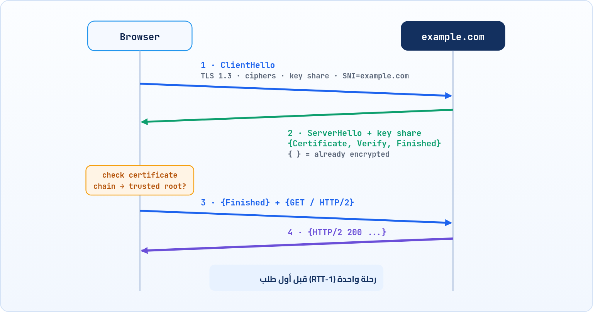

<small>المرحلة 4 · الأمان والحالة</small>

كل اللي بعتناه لحد دلوقتي بيعدي على راوترات ناس منعرفهمش: الكافيه، ومزوّد الإنترنت، ودول كاملة. HTTP العادي نص مكشوف لأي حد في النص. الفصل ده عن الحل: TLS. هنفهم المشكلتين اللي بيحلهم (حد يقرا، وحد ينتحل)، والـ Handshake خطوة بخطوة، والشهادات وسلسلة الثقة، وإزاي تقرا كل ده في curl و openssl و Chrome، وأشهر أخطاء الشهادات.

:::note[بعد الفصل ده هتكون عارف]
- المشكلتين: التصنت والانتحال، وليه التشفير لوحده مش كفاية
- فكرة المفتاحين (Public/Private) والمفتاح المشترك
- TLS 1.3 Handshake خطوة بخطوة، و 0-RTT
- الشهادة وسلسلة الثقة والـ CAs و Let's Encrypt
- عمر الشهادات اللي بيقصر: 200 يوم ثم 100 ثم 47
- HSTS والـ Mixed content
- تقرا TLS في curl -v و openssl s\_client و Chrome
- أخطاء NET::ERR\_CERT\_\* ومعناها
:::

<a id="s12-1"></a>

## 12.1 المشكلة: كلامك ماشي في الشارع مكشوف

افتكر رحلة الطلب: الـ Packets بتعدي على راوتر الكافيه، وبعدين مزوّد الإنترنت، وبعدين 10 أو 15 راوتر تانيين بتوع شركات مختلفة. مع HTTP العادي، كل واحد من دول يقدر يقرا كل حاجة: الباسورد اللي كتبته، والكوكي بتاع الـ Session، والصفحة اللي بتقراها. ومش يقرا وبس، يقدر **يعدّل**: يحقن إعلانات في الصفحة (ومزوّدين إنترنت عملوا كده فعلاً)، أو يغيّر رابط التحميل لبرنامج فيه فيروس.

طب الحل سهل: شفّر الكلام. بس هنا فيه مشكلة أخبث: <strong>انت بتشفّر لمين؟</strong> لو الراوتر اللي في الكافيه قال للمتصفح "أنا `bank.com`، ابعتلي مشفر بالمفتاح بتاعي"، المتصفح هيشفّر كويس جداً… للحرامي. ده اسمه **Man-in-the-middle** (حد في النص). فالحل محتاج حاجتين مش حاجة:

#### 1. التشفير (Confidentiality)

محدش في النص يقدر يقرا.

#### 2. السلامة (Integrity)

محدش يقدر يعدّل حرف من غير ما يتكشف.

#### 3. الهوية (Authentication)

انت متأكد إنك بتكلم `bank.com` الحقيقي، مش حد بيقلده.

البروتوكول اللي بيعمل التلاتة اسمه **TLS** (Transport Layer Security)، واسمه القديم **SSL** (لسه الناس بتقول "شهادة SSL" بالعادة). و**HTTPS** = HTTP عادي بالظبط، بس ماشي جوه نفق TLS. نفس الـ Methods والـ Headers اللي اتعلمناها، بس محدش يشوفهم غير الطرفين.

<a id="s12-2"></a>

## 12.2 فكرة المفتاحين: قفل أي حد يقفله، ومفتاح مع واحد بس

مشكلة التشفير القديمة: لو أنا وانت عاوزين نتكلم مشفر، لازم نتفق على مفتاح سري الأول. بس إزاي نتفق عليه والخط نفسه متراقب؟ لو بعتّه، اتكشف. وهنا جه اختراع من السبعينات غيّر كل حاجة: **التشفير بمفتاحين** (Public-key cryptography).

تخيل إن السيرفر معاه **قفل** بيوزّع منه نسخ على أي حد (ده الـ **Public key**)، ومعاه **المفتاح** الوحيد اللي بيفتحه، ومخبيه عنده (ده الـ **Private key**). أي حد يقدر ياخد نسخة من القفل ويقفل بيها صندوق، بس محدش يفتحه غير السيرفر. والعكس كمان مفيد: السيرفر يقدر "يمضي" على حاجة بالـ Private key، وأي حد يتأكد بالـ Public key إن المضا ده بتاعه هو. وده اللي بيحل مشكلة الهوية.

بس التشفير بالمفتاحين بطيء. فـ TLS بيستخدمه في البداية بس، عشان الطرفين يتفقوا بأمان على **مفتاح مشترك** سريع (Session key)، وبعدين كل الكلام بيتشفر بيه. والطريقة اللي بيتفقوا بيها اسمها **Key exchange**، وأشهرها حالياً **X25519**.

:::note[طريقة الاتفاق اللي عاملة زي السحر]
فيه طريقة اسمها Diffie-Hellman بتخلي اتنين يطلعوا بنفس الرقم السري، وهما بيتكلموا قدام الناس كلها، ومحدش من الناس يقدر يحسبه. التشبيه المشهور: كل واحد عنده لون سري، وبيخلطه مع لون عام ويبعت الخلطة. كل واحد يضيف لونه السري على خلطة التاني، فالاتنين بيطلعوا بنفس اللون النهائي. واللي سامع الكلام شايف الخلطات بس، ومش عارف يفصل الألوان.
:::

<a id="s12-3"></a>

## 12.3 TLS 1.3 Handshake خطوة بخطوة

بعد ما الـ TCP Handshake يخلص (الفصل 4)، المتصفح والسيرفر بيعملوا Handshake تاني بتاع TLS. ونسخة **TLS 1.3** (سنة 2018، RFC 8446) خلته <strong>رحلة واحدة رايح جاي (1-RTT)</strong> بدل اتنين في 1.2:



*TLS 1.3: المتصفح بيبعت مفتاحه من أول رسالة، فالسيرفر يرد بالشهادة متشفرة، والطلب بيمشي في الرحلة التانية*

1. **ClientHello**: المتصفح بيقول "أنا بعرف TLS 1.3، وبعرف طرق التشفير دي، ودي حتة المفتاح بتاعتي (Key share) عشان نتفق". وبيقول كمان اسم الموقع اللي عاوزه في حاجة اسمها **SNI**، لأن السيرفر الواحد ممكن يشيل آلاف المواقع على نفس الـ IP (زي Cloudflare)، ولازم يعرف يطلع الشهادة الصح.
2. **ServerHello**: السيرفر بيختار طريقة، ويبعت حتة المفتاح بتاعته. هنا الاتنين بقى معاهم المفتاح المشترك، فكل اللي بعد كده **متشفّر**: الشهادة، وإمضا بيثبت إن معاه الـ Private key بتاعها (CertificateVerify)، و Finished.
3. **المتصفح بيتحقق** من الشهادة (الجزء الجاي)، ولو تمام يبعت Finished، ومعاه على طول **أول طلب HTTP**.
4. السيرفر يرد. ومن هنا كله HTTP عادي جوه النفق.

:::note[لو حابب تتعمق: 0-RTT والتشفير الجاي بعد الكمبيوتر الكمّي]
**0-RTT**: لو المتصفح كلم السيرفر قبل كده، ممكن يبعت الطلب مع الـ ClientHello نفسه، من غير ما يستنى أي رحلة. أسرع حاجة ممكنة، بس فيها خطر: حد يسجل الرسالة دي ويعيد بعتها (Replay)، فبتستخدم للطلبات الآمنة زي GET بس. **Post-quantum**: لو كمبيوتر كمّي قوي اتعمل في المستقبل، ممكن يكسر X25519، وحد ممكن يسجل كلامك النهارده ويفكه بعد 10 سنين. فالمتصفحات بقت بتستخدم طريقة مختلطة اسمها `X25519MLKEM768`، ودي اللي ظهرت في curl بتاعنا مع example.com. وحسب Cloudflare، أكتر من نص الاتصالات اللي عدت عليهم آخر 2025 كانت بتستخدم النوع ده.
:::

<a id="s12-4"></a>

## 12.4 الشهادة: مين يضمن إن ده bank.com بجد؟

رجعنا للمشكلة: السيرفر بعتلي Public key وقالي "ده بتاع example.com". أصدقه إزاي؟ الحرامي برضه يقدر يعمل مفتاح ويقول نفس الكلام. والحل زي البطاقة الشخصية: انت مش بتصدق إن ده "أحمد" عشان هو قال، بتصدق عشان **الحكومة** (طرف انت واثق فيه) مضت على البطاقة. على الويب، البطاقة اسمها **Certificate**، والحكومة اسمها **CA** (Certificate Authority).

الشهادة ملف فيه: اسم الموقع (أو المواقع)، والـ Public key بتاعه، وتاريخ البداية والنهاية، واسم الـ CA اللي أصدرها، وإمضا الـ CA. ونظام التشغيل والمتصفح جايين معاهم قايمة بحوالي 150 CA موثوقين اسمها **Root store**. على الـ Mac تقدر تشوفها في برنامج **Keychain Access** تحت System Roots.

### سلسلة الثقة (Chain of trust)

الـ Root CAs مفاتيحهم غالية جداً ومحفوظة في خزن، مبيستخدموهاش كل يوم. فبيمضوا على CA وسيط (Intermediate)، والوسيط هو اللي بيمضي على شهادات المواقع. فالمتصفح بيمشي في سلسلة: شهادة الموقع ممضية من الوسيط، والوسيط ممضي من الـ Root، والـ Root موجود في القايمة. لو أي حلقة باظت، الاتصال بيقف. ودي السلسلة الحقيقية بتاعة example.com:

```sh title="Terminal"
$ echo | openssl s_client -connect example.com:443 -servername example.com 2>/dev/null | head -12
CONNECTED(00000003)
---
Certificate chain
 0 s:CN=example.com
   i:C=US, O=SSL Corporation, CN=Cloudflare TLS Issuing ECC CA 3
   v:NotBefore: Sep 26 22:49:11 2026 GMT; NotAfter: Dec 25 22:56:35 2026 GMT
 1 s:C=US, O=SSL Corporation, CN=Cloudflare TLS Issuing ECC CA 3
   i:C=US, O=SSL Corporation, CN=SSL.com TLS Transit ECC CA R2
 2 s:C=US, O=SSL Corporation, CN=SSL.com TLS Transit ECC CA R2
   i:C=US, O=SSL Corporation, CN=SSL.com TLS ECC Root CA 2022
```

**تشريح الأمر**

```sh
echo | openssl s_client -connect example.com:443 -servername example.com 2>/dev/null | head -12
```

1. `echo |`: ابعت سطر فاضي للأمر اللي بعده. ليه؟ `s_client` بيفتح اتصال ويفضل مستنيك تكتب. السطر الفاضي بيخليه يقفل ويخرج على طول.
2. `openssl s_client`: عميل TLS خام: بيعمل Handshake ويطبع كل التفاصيل. زي `nc` بس بالتشفير.
3. `-connect example.com:443`: الـ Host والـ Port.
4. `-servername example.com`: ابعت SNI بالاسم ده. من غيره، سيرفر زي Cloudflare ممكن ميعرفش يطلعلك أنهي شهادة.
5. `2>/dev/null`: ارمي الـ stderr (رسايل التحقق الكتير).
6. `| head -12`: أول 12 سطر بس.

```sh title="تقرا السلسلة إزاي"
0 s:CN=example.com
  i:...Cloudflare TLS Issuing ECC CA 3
  v:NotBefore ... NotAfter
2 ... i:SSL.com TLS ECC Root CA 2022
```

1. `0 s:CN=example.com`: الحلقة 0 = شهادة الموقع نفسه. `s:` = Subject (الشهادة دي بتاعة مين). `CN` = Common Name.
2. `i:...Cloudflare TLS Issuing ECC CA 3`: `i:` = Issuer (مين اللي مضى عليها). ده الوسيط. لاحظ إن الـ i هنا هو نفسه الـ s في الحلقة اللي بعدها: ده معنى "سلسلة".
3. `v:NotBefore ... NotAfter`: فترة الصلاحية: من 26 سبتمبر لـ 25 ديسمبر 2026. يعني الشهادة دي عمرها **90 يوم** بس.
4. `2 ... i:SSL.com TLS ECC Root CA 2022`: آخر Issuer = الـ Root اللي المفروض يكون في الـ Root store عندك.

:::note[على الـ Mac: openssl بتاع Apple]
الـ `openssl` اللي جاي مع macOS هو في الحقيقة **LibreSSL** (نسخة متفرعة منه)، والأمر ده شغال عليه عادي. بس لو قريت أوامر openssl أحدث على النت وفيها Flags مش شغالة، نزّل النسخة الأصلية بـ `brew install openssl`. وعشان تشوف الأسماء اللي الشهادة بتغطيها: `... | openssl x509 -noout -text | grep -A1 'Subject Alternative'`، وهتلاقي `DNS:example.com, DNS:*.example.com`.
:::

### الشهادة بتغطي أنهي أسماء؟

زمان كان الاسم في `CN`. دلوقتي المتصفحات بتبص على حقل اسمه **SAN** (Subject Alternative Name) بس، وفيه قايمة أسماء. و`*.example.com` = **Wildcard**: أي Subdomain مستوى واحد، زي `www.example.com` و`api.example.com`، بس **مش** `a.b.example.com`. ولو فتحت موقع باسم مش في القايمة، هتاخد `NET::ERR_CERT_COMMON_NAME_INVALID`.

<a id="s12-5"></a>

## 12.5 Let's Encrypt والشهادات اللي عمرها بيقصر

قبل 2015، الشهادة كانت بتتشترى بفلوس (أحياناً مئات الدولارات في السنة)، وتطلبها بإيميلات وأوراق، وتركبها بإيدك. فمواقع كتير كانت HTTP وخلاص. وبعدين جت **Let's Encrypt**: CA مجاني وأوتوماتيكي بالكامل. برنامج على السيرفر بيثبت إنك متحكم في الدومين (مثلاً بيحط ملف معين على الموقع، والـ CA يدخل يشوفه)، وياخد شهادة، ويجددها لوحده. النتيجة: HTTPS بقى الطبيعي، وأغلب الصفحات اللي Chrome بيفتحها دلوقتي HTTPS.

والصناعة ماشية في اتجاه **شهادات عمرها أقصر**، لأن الشهادة لو اتسرقت، كل ما عمرها أقصر كل ما الضرر أقل. منظمة اسمها CA/Browser Forum (الـ CAs والمتصفحات مع بعض) قررت إن أقصى عمر للشهادة:

**أقصى عمر لشهادة TLS (قرار CA/B Forum)**

| من تاريخ | أقصى عمر |
|---|---|
| قبل 15 مارس 2026 | 398 يوم |
| 15 مارس 2026 | 200 يوم |
| 15 مارس 2027 | 100 يوم |
| 15 مارس 2029 | 47 يوم |

الرسالة واضحة: محدش هيجدد شهادة بإيده كل 47 يوم. التجديد لازم يبقى أوتوماتيك. ولو انت مستخدم Vercel أو Netlify أو Cloudflare، ده بيحصل من غير ما تحس.

<a id="s12-6"></a>

## 12.6 HSTS: متجيش هنا من غير قفل تاني

فيه ثغرة صغيرة: لما تكتب `bank.com` في العنوان من غير `https://`، المتصفح ممكن يروح HTTP الأول، والسيرفر يرد بـ 301 لـ HTTPS. بس الطلب الأول ده كان مكشوف، وحد في النص يقدر يخطفه ويفضل يكلمك HTTP. فالسيرفر بيبعت Header بيقول: "من هنا ورايح، متكلمنيش غير HTTPS":

**تشريح الأمر**

```http
strict-transport-security: max-age=31536000; includeSubDomains; preload
```

1. `strict-transport-security`: اسم الـ Header، واختصاره **HSTS**.
2. `max-age=31536000`: افتكر القاعدة دي سنة (بالثواني). طول المدة دي المتصفح هيحوّل أي `http://` لـ `https://` بنفسه، من غير ما يبعت أي حاجة.
3. `includeSubDomains`: وكل الـ Subdomains كمان.
4. `preload`: "حطوني في القايمة المدمجة". فيه قايمة جوه Chrome نفسه بالمواقع دي، فحتى أول زيارة بتبقى HTTPS.

وخلي بالك من أثر جانبي: الموقع اللي عنده HSTS، لو شهادته فيها مشكلة، Chrome **مش هيسيبك تعدي** (مفيش زرار "Proceed anyway"). وده مقصود. وعشان كده دومينات زي `.dev` و`.app` كلها HSTS إجباري، ولازم HTTPS.

### Mixed content

صفحة HTTPS بتحمّل سكريبت أو صورة من `http://`؟ ده اسمه **Mixed content**، ومعناه إن جزء من الصفحة ماشي مكشوف، فحد في النص يقدر يبدّل السكريبت بسكريبت بتاعه ويتحكم في الصفحة كلها. فالمتصفح بيمنع السكريبتات والـ `fetch` دي خالص، والصور بيحاول يحولها لـ HTTPS. وهتشوف ده في الـ Console (الفصل 20)، بس الفكرة: **كل حاجة في صفحة HTTPS لازم تبقى HTTPS**.

<a id="s12-7"></a>

## 12.7 تقرا TLS بعينك

**في curl -v**، السطور اللي بتبدأ بـ `*` بعد الاتصال:

```sh title="Terminal"
$ curl -v -o /dev/null https://example.com
* Connected to example.com (104.20.23.154) port 443
* ALPN: curl offers h2,http/1.1
* TLSv1.3 (OUT), TLS handshake, Client hello (1):
* TLSv1.3 (IN), TLS handshake, Server hello (2):
* TLSv1.3 (IN), TLS handshake, Certificate (11):
* TLSv1.3 (IN), TLS handshake, CERT verify (15):
* TLSv1.3 (IN), TLS handshake, Finished (20):
* TLSv1.3 (OUT), TLS handshake, Finished (20):
* SSL connection using TLSv1.3 / TLS_AES_256_GCM_SHA384 / X25519MLKEM768 / id-ecPublicKey
* ALPN: server accepted h2
* Server certificate:
*  subject: CN=example.com
*  expire date: Dec 25 22:56:35 2026 GMT
*  subjectAltName: host "example.com" matched cert's "example.com"
*  issuer: C=US; O=SSL Corporation; CN=Cloudflare TLS Issuing ECC CA 3
*  SSL certificate verify ok.
```

```sh title="السطور دي بتقول إيه"
ALPN: curl offers h2,http/1.1
(OUT) Client hello
(IN) Server hello / Certificate / CERT verify / Finished
TLSv1.3 / TLS_AES_256_GCM_SHA384 / X25519MLKEM768
ALPN: server accepted h2
subjectAltName: host ... matched
SSL certificate verify ok.
```

1. `ALPN: curl offers h2,http/1.1`: **ALPN** = الاتفاق على نسخة HTTP جوه الـ TLS Handshake نفسه. curl بيقول "بعرف h2 و 1.1".
2. `(OUT) Client hello`: الخطوة 1 في الرسمة. OUT = طالع مني، IN = جايلي.
3. `(IN) Server hello / Certificate / CERT verify / Finished`: الخطوة 2: كله جه في رحلة واحدة.
4. `TLSv1.3 / TLS_AES_256_GCM_SHA384 / X25519MLKEM768`: النسخة، وطريقة تشفير الكلام (AES-256)، وطريقة الاتفاق على المفتاح (المختلطة Post-quantum).
5. `ALPN: server accepted h2`: اتفقنا على HTTP/2.
6. `subjectAltName: host ... matched`: الاسم اللي طلبته موجود في الشهادة.
7. `SSL certificate verify ok.`: السلسلة كلها سليمة لحد Root موثوق. ده السطر اللي بتدور عليه.

<small>السطور دي مختصرة (شلنا سطور زي Change cipher spec و CAfile). والـ curl بتاع Apple على الـ Mac بيطبع السطور دي بشكل مختلف شوية، وطريقة الاتفاق عندك ممكن تطلع X25519 بس. الفكرة واحدة.</small>

**في Chrome**: اضغط على الأيقونة اللي جنب العنوان، وبعدين "Connection is secure"، وبعدين "Certificate is valid"، هتشوف الشهادة والسلسلة. وفي DevTools فيه تابة اسمها **Security** (ممكن تلاقيها في قايمة `»`) بتوريك النسخة وطريقة التشفير والشهادة لكل Origin في الصفحة. وفي تابة Timing لأي طلب، مرحلة **SSL** هي وقت الـ Handshake ده.

<a id="s12-8"></a>

## 12.8 أخطاء الشهادات: الصفحة الحمرا

لما التحقق يفشل، Chrome بيوقفك بصفحة "Your connection is not private"، وتحتها كود صغير هو أهم حاجة في الصفحة:

**أشهر أخطاء الشهادات في Chrome**

| الكود | المعنى | السبب الشائع |
|---|---|---|
| `NET::ERR_CERT_DATE_INVALID` | الشهادة منتهية أو لسه مبدأتش | التجديد الأوتوماتيك وقف، أو ساعة جهازك غلط |
| `NET::ERR_CERT_COMMON_NAME_INVALID` | الاسم مش في الشهادة | فتحت `www` والشهادة على الاسم من غيرها، أو العكس |
| `NET::ERR_CERT_AUTHORITY_INVALID` | مش واصل لـ Root موثوق | شهادة Self-signed، أو السيرفر مش باعت الوسيط |
| `NET::ERR_CERT_REVOKED` | الشهادة اتلغت | الـ Private key اتسرق أو اتلغت لسبب تاني |
| `ERR_SSL_PROTOCOL_ERROR` | الـ Handshake نفسه فشل | سيرفر متظبط غلط، أو بتكلم HTTPS على Port بيتكلم HTTP |

:::danger[مشكلة: الموقع شغال في Chrome، بس curl بيقول certificate problem]
`curl: (60) SSL certificate problem: unable to get local issuer certificate`

غالباً السيرفر مش باعت الشهادة الوسيطة. Chrome ساعات بيكمّل السلسلة لوحده (عنده كاش أو بينزلها)، لكن curl والـ Node والبرامج التانية لأ. اتأكد بـ `openssl s_client -showcerts`: لو مفيش غير حلقة 0، يبقى الوسيط ناقص، والحل على السيرفر. <strong>متستخدمش `-k`</strong> كحل: كده انت بتلغي التحقق خالص.
:::

:::caution[خلي بالك: الكتابة thisisunsafe وأخواتها]
هتلاقي نصايح على النت لتجاوز صفحة الخطأ في Chrome. على موقع بتطوره على جهازك بشهادة Self-signed، ماشي. لكن لو ظهرت الصفحة دي على موقع حقيقي، خصوصاً في شبكة عامة، **متعديش**. دي بالظبط اللحظة اللي حد في النص بيحاول فيها، والصفحة دي معمولة عشان توقفه.
:::

:::tip[HTTPS على جهازك وانت بتطور]
أغلب الوقت `http://localhost` كفاية، لأن المتصفحات بتعتبر localhost "Secure context" حتى من غير HTTPS. لو محتاج HTTPS محلي بجد (عشان كوكي `Secure` مثلاً على دومين زي `shop.test`)، فيه أداة اسمها `mkcert` (`brew install mkcert`) بتعمل CA صغير على جهازك ويثق فيه الـ Mac، وتطلع منه شهادات من غير أي تحذيرات.
:::

:::tip[ملخص الفصل]
- HTTP مكشوف لأي حد في النص. TLS بيدي تشفير وسلامة و**هوية**، و HTTPS = HTTP جوه TLS.
- المفتاحين (Public/Private) بيستخدموا في البداية بس، عشان يتفقوا على مفتاح مشترك سريع.
- TLS 1.3: رحلة واحدة. ClientHello بالمفتاح و SNI، والسيرفر يرد بالشهادة متشفرة، وبعدين الطلب.
- الشهادة = اسم + Public key + مدة + إمضا CA. والمتصفح بيمشي في السلسلة لحد Root موثوق.
- الأسماء في SAN، و`*.` بتغطي مستوى واحد. والعمر بيقصر: 200 يوم من مارس 2026 ولحد 47 يوم في 2029.
- HSTS بيمنع أي HTTP بعد كده، و Mixed content بيتمنع في صفحات HTTPS.
- كود الخطأ (`NET::ERR_CERT_*`) هو اللي بيقولك المشكلة فين.
:::

### صح ولا غلط؟

1. التشفير لوحده من غير التحقق من الهوية بيحميك من Man-in-the-middle.
2. شهادة `*.example.com` بتغطي `api.example.com`.
3. `curl -k` حل مناسب لخطأ الشهادة على موقع حقيقي.

### أسئلة مراجعة

1. ليه HTTPS محتاج "هوية" مش تشفير بس؟ احكي سيناريو الكافيه.
2. إيه فايدة الـ SNI؟ وليه Cloudflare بالذات محتاجاه؟
3. في سلسلة example.com، مين مضى على مين؟ ومين المفروض يكون في الـ Root store؟
4. إيه اللي بيحصل لو موقع عنده HSTS وشهادته خلصت؟
5. ليه الصناعة بتقصّر عمر الشهادات؟ وإيه الأثر على أصحاب المواقع؟

### تحديات الفصل

<small>جرّبها بإيدك، والحلول في ملحق الإجابات.</small>

1. **[سهل]** افتح شهادة 3 مواقع في Chrome (من الأيقونة جنب العنوان). مين الـ CA؟ وعمر كل شهادة كام يوم؟
2. **[متوسط]** استخدم `openssl s_client` على `github.com` و`google.com`، واكتب السلسلة كاملة لكل واحد.
3. **[صعب]** جرب المواقع اللي على `badssl.com` (زي `expired.badssl.com` و`wrong.host.badssl.com` و`self-signed.badssl.com`) في Chrome و curl، واكتب كود الخطأ في كل واحد.
