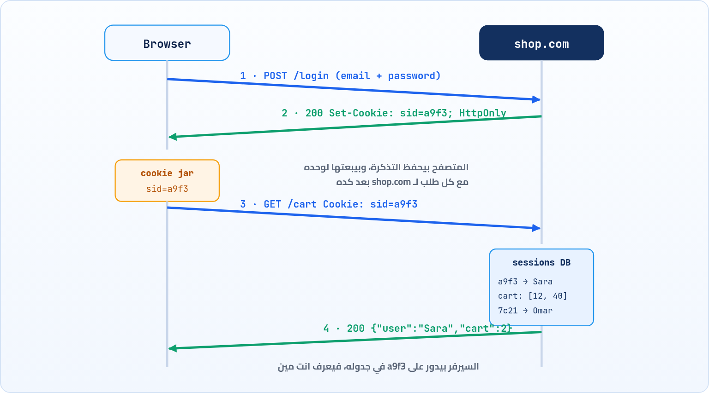

<small>المرحلة 4 · الأمان والحالة</small>

في الفصل 7 قلنا إن HTTP بينسى: كل طلب لوحده، والسيرفر ميعرفش إنك نفس الشخص اللي عمل Login من ثانية. طب إزاي أي موقع بيفتكرك؟ الحل كان تذكرة صغيرة اسمها Cookie. هنحكي القصة، ونفصّص Set-Cookie وكل Attribute فيه، ونفهم الـ Sessions والـ Tokens، والـ Third-party cookies ووضعها النهارده، وأماكن التخزين التانية في المتصفح.

:::note[بعد الفصل ده هتكون عارف]
- المشكلة: HTTP بينسى، وإزاي الكوكي حل ده
- رحلة الكوكي: Set-Cookie ثم Cookie في كل طلب
- كل Attribute: Domain و Path و Expires و Max-Age و Secure و HttpOnly و SameSite و Partitioned
- Session ID على السيرفر مقابل Token زي JWT
- First-party و Third-party ووضعهم في 2026
- localStorage و sessionStorage و IndexedDB والفرق عن الكوكيز
- تتابع الكوكيز في curl و DevTools
:::

<a id="s13-1"></a>

## 13.1 قبل الكوكيز: عربية تسوق بتفضى كل صفحة

سنة 1994، شركة Netscape كانت بتعمل موقع تسوق لعميل، ووقعت في مشكلة: الزبون يضيف منتج للعربية، يروح للصفحة اللي بعدها، والسيرفر **ميعرفوش**. ده طلب جديد من غير أي ذاكرة، فالعربية فاضية. كان فيه حلول وحشة: تحط رقم الزبون في كل لينك في الـ URL (`?user=4821`)، وده بيتسرب لو بعت اللينك لحد، وبيضيع لو فتحت الموقع من جديد.

فمبرمج اسمه Lou Montulli اقترح فكرة بسيطة جداً: السيرفر يدّي المتصفح **تذكرة صغيرة** في الرد، والمتصفح **يحفظها ويرجّعها لوحده مع كل طلب** لنفس الموقع. زي التذكرة اللي بتاخدها في الجراج: انت مش بتفتكر عربيتك فين، الجراج بيفتكر، وانت معاك الرقم بس. الاسم جه من "Magic cookie"، مصطلح قديم عند المبرمجين لحتة بيانات بتتبعت رايح جاي من غير ما تتفهم.



*رحلة الـ Session: السيرفر بيدّي تذكرة (Set-Cookie)، والمتصفح بيرجعها (Cookie)، والسيرفر بيدور عليها في جدوله*

لاحظ إن الكوكي نفسها مفيهاش "Sara" ولا العربية. فيها رقم عشوائي بس (**Session ID**). المعلومات الحقيقية على السيرفر، في جدول. ده اسمه **Session**: حالة متخزنة على السيرفر، والكوكي هي المفتاح بتاعها.

<a id="s13-2"></a>

## 13.2 Set-Cookie: كل كلمة ليها معنى

الرد بيحط الكوكي بـ Header اسمه `Set-Cookie` (واحد لكل كوكي). وده شكل كوكي Session متظبطة صح:

**تشريح الأمر**

```http
Set-Cookie: sid=a9f3c1; Domain=shop.com; Path=/; Max-Age=86400; Secure; HttpOnly; SameSite=Lax
```

1. `Set-Cookie:`: "احفظ الكوكي دي". وكل كوكي ليها سطر `Set-Cookie` لوحدها.
2. `sid=a9f3c1`: الاسم والقيمة. ده الجزء الوحيد اللي هيرجع في الطلبات. كل اللي بعده تعليمات للمتصفح بس.
3. `Domain=shop.com`: ابعتها لـ `shop.com` **وكل الـ Subdomains** (`api.shop.com`). لو مكتبتهاش، بتتبعت للـ Host اللي حطها بالظبط بس، ودي أضيق وأأمن.
4. `Path=/`: ابعتها مع أي مسار. لو `Path=/admin`، تتبعت مع `/admin/...` بس.
5. `Max-Age=86400`: عيشها يوم (بالثواني). وفيه `Expires=` بتاريخ، ولو الاتنين موجودين، `Max-Age` بيكسب. ولو مفيش ولا واحد = **Session cookie**، بتتمسح لما تقفل المتصفح (أو ممكن تعيش لو المتصفح بيرجّع الـ Tabs القديمة).
6. `Secure`: ابعتها على HTTPS بس. على `localhost` مسموح استثناء.
7. `HttpOnly`: **الـ JS ميشوفهاش**. `document.cookie` مش هيرجعها. لو حد قدر يحقن سكريبت في الصفحة (XSS)، مش هيقدر يسرق الـ Session.
8. `SameSite=Lax`: إمتى تتبعت لو الطلب جاي من موقع تاني (الجزء الجاي).

وفي الطلبات اللي بعد كده، المتصفح بيبعت الأسماء والقيم بس، كلهم في Header واحد مفصولين بـ `; `:

```http
GET /cart HTTP/2
Host: shop.com
Cookie: sid=a9f3c1; theme=dark; lang=ar
```

:::tip[حاجة مشتركة: الـ ; في الاتنين بس بمعنيين]
في `Set-Cookie`، الـ `;` بتفصل بين الكوكي والتعليمات بتاعتها (`sid=a9f3; Secure; HttpOnly`)، فده كوكي **واحدة**. لكن في `Cookie`، الـ `;` بتفصل بين كوكيز **مختلفة** (`sid=a9f3; theme=dark`). نفس الرمز، وظيفتين. فلو شفت `Secure` في Header اسمه `Cookie`، يبقى فيه حاجة غلط.
:::

<a id="s13-3"></a>

## 13.3 SameSite: الحماية من الطلبات اللي جاية من بره

هنا فيه مشكلة تاريخية خطيرة. المتصفح بيبعت الكوكي "لوحده مع كل طلب لنفس الموقع"، حتى لو الطلب ده **موقع تاني هو اللي عمله**. يعني لو انت عامل Login في البنك، ودخلت موقع شرير فيه فورم مخفي بيعمل `POST bank.com/transfer`، المتصفح هيبعت كوكي البنك معاه، والبنك هيفتكر إنك انت اللي بتحوّل. الهجوم ده اسمه **CSRF** (Cross-Site Request Forgery).

والحل: الكوكي نفسها تقول "متتبعتش مع طلبات جاية من مواقع تانية". وفاكر الفرق بين Origin و Site في الفصل 6؟ هنا بيفرق. SameSite بيبص على الـ **Site**:

**قيم SameSite**

| القيمة | طلب من نفس الموقع | ضغطت لينك من موقع تاني (Navigation) | fetch أو فورم POST أو صورة من موقع تاني |
|---|---|---|---|
| `Strict` | تتبعت | لأ | لأ |
| `Lax` | تتبعت | تتبعت (GET بس) | لأ |
| `None` | تتبعت | تتبعت | تتبعت، و**لازم** معاها `Secure` |

`Strict` أأمن، بس مزعجة: لو حد بعتلك لينك لـ GitHub ودخلت منه، هتلاقي نفسك مش عامل Login لحد ما تعمل Reload. عشان كده `Lax` هي التوازن المعقول. ومن 2020، Chrome بيعامل أي كوكي **من غير SameSite** على إنها `Lax`. وده كسر مواقع كتير وقتها، وبيفسر رسايل هتشوفها في DevTools عن كوكيز "اتمنعت".

:::note[Prefixes: أسماء ليها قواعد]
لو اسم الكوكي بدأ بـ `__Secure-`، المتصفح مش هيقبلها غير لو معاها `Secure`. ولو بدأ بـ `__Host-`، لازم `Secure` و`Path=/` ومن غير `Domain`، يعني مربوطة بالـ Host ده بس. دي حماية من إن Subdomain تاني يكتب كوكي بنفس الاسم ويخدع السيرفر.
:::

<a id="s13-4"></a>

## 13.4 First-party و Third-party: وإعلان الشوز اللي بيمشي وراك

انت بتقرا مقالة في `news.com`، والصفحة فيها إعلان جاي من `ads.net`. الإعلان ده طلب لـ `ads.net`، فيقدر يحط كوكي لـ `ads.net`. وبكرة لما تفتح `recipes.com` وفيه نفس شركة الإعلانات، المتصفح هيبعت نفس الكوكي. والنتيجة: `ads.net` عارف إنك نفس الشخص اللي كان في الموقعين. كده الإعلان بيمشي وراك. الكوكي اللي بتاعة الموقع اللي انت فيه اسمها **First-party**، واللي بتاعة موقع تاني جوه الصفحة اسمها **Third-party**.

الوضع النهارده (2026) مختلف بين المتصفحات:

#### Safari

بيمنع الـ Third-party cookies من 2020 (ITP). يعني على الـ Mac لو في Safari، حاجات زي "Login بحساب في iframe" ممكن تتصرف بشكل مختلف.

#### Firefox

بيعزل كل موقع في "برطمان" لوحده (Total Cookie Protection). `ads.net` جوه `news.com` غير `ads.net` جوه `recipes.com`.

#### Chrome

كان ناوي يمنعها، وبعد سنين من التأجيل أعلن في 2025 إنه **هيسيبها**، وقفل أغلب مشروع Privacy Sandbox. بس في Incognito بيمنعها.

والحل اللي اتفقوا عليه للحالات المشروعة (زي Chat widget جوه مواقع كتير) اسمه **CHIPS**: الكوكي تتعلم بـ `Partitioned`، فتتحفظ منفصلة لكل موقع أب. كده الـ Widget يفتكرك جوه `news.com`، بس ميقدرش يربطك بـ `recipes.com`. وده العمود اللي اسمه **Partition Key** في DevTools (الفصل 21).

<a id="s13-5"></a>

## 13.5 Session على السيرفر ولا Token معاك؟

الطريقة اللي في الرسمة (رقم عشوائي، والبيانات في جدول على السيرفر) اسمها **Server-side session**. فيه طريقة تانية انتشرت مع الـ APIs و الـ SPAs (زي تطبيقات React): السيرفر يدّيك **Token** فيه البيانات نفسها، وممضي، فالسيرفر يتأكد من الإمضا من غير ما يدور في جدول. أشهر شكل ليه **JWT** (JSON Web Token):

**تشريح الأمر**

```http
eyJhbGciOiJIUzI1NiJ9.eyJzdWIiOiI0MiIsIm5hbWUiOiJTYXJhIiwiZXhwIjoxNzk1MDAwMDAwfQ.k3J8x...
```

1. `eyJhbGciOiJIUzI1NiJ9`: الجزء الأول (Header): Base64 لـ `{"alg":"HS256"}`، يعني طريقة الإمضا.
2. `.`: النقط بتفصل التلات أجزاء.
3. `eyJzdWIiOiI0MiIsIm5hbWUiOiJTYXJhIiwiZXhwIjoxNzk1MDAwMDAwfQ`: الجزء التاني (Payload): Base64 لـ `{"sub":"42","name":"Sara","exp":1795000000}`. `sub` = المستخدم، و`exp` = إمتى ينتهي. **أي حد يقدر يقراه**، فمتحطش فيه أسرار.
4. `k3J8x...`: الجزء التالت (Signature): الإمضا. لو حد غيّر حرف في الـ Payload، الإمضا مش هيطابق، والسيرفر هيرفضه.

والـ Token ده بيتبعت إزاي؟ يا إما في كوكي (زي الـ Session ID بالظبط)، يا إما الـ JS يحفظه ويبعته في `Authorization: Bearer ...` (الفصل 9). والنقاش المشهور: لو حفظته في `localStorage`، أي سكريبت شرير في الصفحة يقدر يقراه. ولو في كوكي `HttpOnly`، الـ JS مش شايفه، بس لازم تهتم بـ SameSite و CSRF. مفيش إجابة واحدة، بس الأهم إنك لما تفتح DevTools تعرف تدوّر في المكانين.

**ملخص: Session مقابل Token**

| الحاجة | Server-side session | Token (زي JWT) |
|---|---|---|
| البيانات فين | على السيرفر، والكوكي فيها رقم بس | جوه الـ Token نفسه |
| السيرفر بيتحقق إزاي | بيدور في جدول | بيتأكد من الإمضا |
| تسجيل خروج فوري | سهل: امسح السطر | صعب: الـ Token صالح لحد `exp` |
| بيتبعت في | `Cookie` | `Cookie` أو `Authorization` |

<a id="s13-6"></a>

## 13.6 أماكن تخزين تانية في المتصفح

الكوكيز صغيرة (حوالي 4 KB للكوكي)، وبتتبعت مع **كل** طلب، فلو حطيت فيها حاجات كبيرة كل طلب هيتقل. عشان كده المتصفح فيه أماكن تخزين **مبتتبعتش** للسيرفر خالص، الـ JS بس هو اللي بيستخدمها:

**أماكن التخزين في المتصفح**

| المكان | بيتبعت للسيرفر؟ | بيعيش قد إيه | الحجم تقريباً | تستخدمه في |
|---|---|---|---|---|
| Cookies | أيوه، مع كل طلب | حسب Max-Age (Chrome أقصاه 400 يوم) | ~4 KB للكوكي | الـ Session والـ Login |
| `localStorage` | لأ | لحد ما يتمسح | ~5 MB للـ Origin | الإعدادات: الثيم واللغة |
| `sessionStorage` | لأ | لحد ما التابة تتقفل | ~5 MB | حاجة مؤقتة في تابة واحدة: فورم بتكتبه |
| IndexedDB | لأ | لحد ما يتمسح | كبير (جزء من مساحة الديسك) | بيانات كتير، شغل Offline |

```sh title="Terminal"
> localStorage.setItem('theme', 'dark')
> localStorage.getItem('theme')
'dark'
> localStorage.setItem('user', {name: 'Sara'})
> localStorage.getItem('user')
'[object Object]'
# بيخزن نصوص بس! لازم JSON.stringify الأول
> localStorage.setItem('user', JSON.stringify({name: 'Sara'}))
> JSON.parse(localStorage.getItem('user')).name
'Sara'
> document.cookie
'theme=dark; lang=ar'
# الـ sid مش ظاهرة، لأنها HttpOnly
```

:::caution[خلي بالك: التخزين مربوط بالـ Origin]
`localStorage` بتاع `http://localhost:3000` غير بتاع `http://localhost:5173`، لأن الـ Port مختلف يعني Origin مختلف (الفصل 6). فلو غيّرت Port السيرفر وانت بتطور، هتلاقي "البيانات اختفت". هي ما اختفتش، انت في Origin تاني.
:::

<a id="s13-7"></a>

## 13.7 تتابع الكوكيز في curl

curl مبيحفظش كوكيز من نفسه. ودي فرصة تشوف الآلية من غير سحر:

```sh title="Terminal"
$ curl -si 'https://httpbin.org/cookies/set?name=sara' | grep -i -e '^HTTP' -e set-cookie -e location
HTTP/2 302
location: /cookies
set-cookie: name=sara; Path=/
$ curl -s -c jar.txt -b jar.txt -L 'https://httpbin.org/cookies/set?name=sara'
{
  "cookies": {
    "name": "sara"
  }
}
```

**تشريح الأمر**

```sh
curl -s -c jar.txt -b jar.txt -L 'https://httpbin.org/cookies/set?name=sara'
```

1. `-s`: اسكت.
2. `-c jar.txt`: أي `Set-Cookie` تجيلك، احفظها في `jar.txt` (الملف بيتكتب في الآخر).
3. `-b jar.txt`: وابعت الكوكيز اللي في الملف ده مع الطلبات. وكمان، أول ما تدّي curl `-b`، بيشغّل "محرك الكوكيز" بتاعه، فيفتكر الكوكي حتى بين الـ Redirects في نفس الأمر.
4. `-L`: اتبع الـ 302 لـ `/cookies`، اللي بيرجعلك الكوكيز اللي وصلت للسيرفر.
5. `'...cookies/set?name=sara'`: بين Quotes عشان الـ `?` (zsh، فاكر؟).

ولو فتحت `jar.txt` هتلاقي سطر فيه الدومين والمسار و Secure ووقت الانتهاء والاسم والقيمة، مفصولين بـ Tabs. ده "برطمان" الكوكيز بتاع curl، نفس فكرة اللي جوه المتصفح بالظبط.

:::tip[ملخص الفصل]
- HTTP بينسى، والكوكي تذكرة: السيرفر يبعتها بـ `Set-Cookie`، والمتصفح يرجعها لوحده في `Cookie`.
- Session = البيانات على السيرفر، والكوكي فيها رقم عشوائي بس.
- `Domain` و`Path` = تتبعت لمين، و`Max-Age`/`Expires` = تعيش قد إيه.
- `Secure` = HTTPS بس، و`HttpOnly` = الـ JS ميشوفهاش، و`SameSite` = ضد CSRF، والافتراضي في Chrome `Lax`.
- Third-party cookies: Safari بيمنع، و Firefox بيعزل، و Chrome لسه بيسمح. و`Partitioned` (CHIPS) حل وسط.
- JWT = بيانات ممضية، ويتقري بسهولة، فمتحطش فيه أسرار.
- `localStorage` و`sessionStorage` و IndexedDB مبيتبعتوش للسيرفر، ومربوطين بالـ Origin.
:::

### صح ولا غلط؟

1. كوكي عليها `HttpOnly` مش هتظهر في `document.cookie`.
2. `localStorage` بيتبعت للسيرفر مع كل طلب زي الكوكيز.
3. محتوى الـ JWT متشفّر ومحدش يقدر يقراه غير السيرفر.

### أسئلة مراجعة

1. ليه الكوكي بتاعة الـ Session فيها رقم عشوائي، مش اسم المستخدم؟
2. اشرح هجوم CSRF، وإزاي `SameSite=Lax` بيمنعه.
3. إيه الفرق بين الـ `;` في `Set-Cookie` والـ `;` في `Cookie`؟
4. ليه ممكن تلاقي بياناتك في `localStorage` "اختفت" لما غيّرت Port السيرفر؟
5. Session على السيرفر مقابل JWT: إيه أسهل في تسجيل الخروج الفوري؟ وليه؟

### تحديات الفصل

<small>جرّبها بإيدك، والحلول في ملحق الإجابات.</small>

1. **[سهل]** اعمل الأمر بتاع httpbin بـ `-c` و`-b`، وافتح `jar.txt` واشرح كل عمود فيه.
2. **[متوسط]** خد JWT من أي موقع تعليمي (أو اعمل واحد على `jwt.io`)، وفك الجزء التاني بـ `atob()` في الـ Console. إيه البيانات اللي جواه؟
3. **[صعب]** افتح أي موقع كبير، ومن Network شوف ردود فيها `Set-Cookie` من دومينات تانية غير الموقع نفسه. دي Third-party؟ وإيه الـ SameSite بتاعها؟
