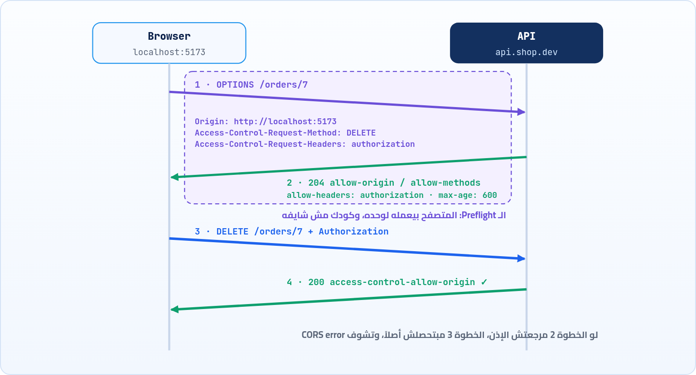

<small>المرحلة 4 · الأمان والحالة</small>

هتكتب fetch بسيط لـ API، وتلاقي في الـ Console سطر أحمر طويل فيه كلمة CORS، والطلب نفسه شغال كويس في curl. ده أكتر خطأ بيلخبط المبتدئين، لأنه بيبان كأنه مشكلة في كودك، وهو في الحقيقة قرار أمان من المتصفح ومكان حله غالباً على السيرفر. هنحكي القصة من الأول: ليه المتصفح بيمنع، والاستثناء اللي اسمه CORS، والـ Preflight، وتقرا الخطأ صح، وتحله صح.

:::note[بعد الفصل ده هتكون عارف]
- Same-origin policy: ليه المتصفح بيمنع قراية ردود مواقع تانية
- CORS: السيرفر هو اللي بيدّي الإذن، مش انت
- Simple requests مقابل Preflight بـ OPTIONS
- كل Header: Allow-Origin و Methods و Headers و Credentials و Max-Age
- تقرا رسالة الخطأ في الـ Console وتلاقي الطلب في Network
- الحلول الصح (والغلط): السيرفر، و Proxy في Vite، و no-cors
- ليه curl مبيتأثرش بـ CORS خالص
:::

<a id="s14-1"></a>

## 14.1 ليه المتصفح بيمنع أصلاً؟

انت عامل Login في بنكك في تابة. وفي تابة تانية فتحت موقع شرير. الموقع ده فيه سطر JS بسيط: `fetch('https://bank.com/api/balance')`. المتصفح هيبعت الطلب، ومعاه كوكي البنك بتاعتك (هو بيعمل كده لوحده، الفصل 13)، والبنك هيرد برصيدك. لو الـ JS الشرير قدر **يقرا** الرد ده، يبقى يقدر يقرا إيميلاتك وكل حاجة انت عامل فيها Login. كارثة.

فالمتصفحات من التسعينات عندها قاعدة اسمها **Same-origin policy** (سياسة نفس الأصل): **الـ JS اللي جاي من Origin معين ميقدرش يقرا ردود Origin تاني**. وفاكر الـ Origin من الفصل 6؟ `scheme + host + port`. يعني `http://localhost:5173` و`http://localhost:3000` Origins مختلفين، حتى لو الاتنين على جهازك.

بس هنا ظهرت مشكلة تانية: الويب اتغير. بقى عندك Frontend على `app.com` ومحتاج يكلم API على `api.app.com`، أو API عام زي الطقس عاوز أي موقع يستخدمه. والقاعدة بتمنع ده كله. فكان لازم طريقة **آمنة** لعمل استثناء. والمهم: مين اللي يقرر الاستثناء؟ مش الـ JS (ده ممكن يكون الشرير)، لكن **السيرفر صاحب البيانات**. الطريقة دي اسمها **CORS** (Cross-Origin Resource Sharing).

:::note[الفكرة في جملة]
CORS مش حماية. CORS **استثناء** من حماية. المتصفح بيمنع، والسيرفر يقدر يقول "أنا موافق إن الـ Origin ده يقرا ردودي" بـ Headers. لو السيرفر مقالش، المتصفح بيفضل مانع. فالخطأ معناه: "السيرفر مدّاش الإذن".
:::

<a id="s14-2"></a>

## 14.2 أبسط حالة: Access-Control-Allow-Origin

الـ Frontend بتاعك على `http://localhost:5173` عمل `fetch('https://api.weather.dev/today')`. المتصفح بيبعت الطلب عادي، ومعاه Header بيقول هو جاي منين:

```http
GET /today HTTP/2
Host: api.weather.dev
Origin: http://localhost:5173
```

ولما الرد يرجع، المتصفح بيدور فيه على Header واحد:

**تشريح الأمر**

```http
access-control-allow-origin: http://localhost:5173
```

1. `access-control-allow-origin`: "مسموح للـ Origin ده يقرا الرد". اختصاره **ACAO**.
2. `http://localhost:5173`: لازم يطابق الـ `Origin` اللي اتبعت **بالظبط** (الـ Scheme والـ Port كمان). أو `*` = "أي حد".

لو الـ Header موجود ومطابق، المتصفح يسلّم الرد للـ JS. لو مش موجود، **الطلب اتبعت والرد وصل فعلاً**، بس المتصفح بيحجزه وبيرمي خطأ. ودي نقطة مهمة جداً: CORS مش بيمنع الطلب من إنه يوصل للسيرفر في الحالة دي، بيمنع الـ JS من إنه يقرا الرد.

<a id="s14-3"></a>

## 14.3 الـ Preflight: "ممكن أبعت؟" قبل ما تبعت

طب لو الطلب مش مجرد قراية؟ لو هو `DELETE` أو `PUT`، أو `POST` بـ JSON، أو فيه `Authorization`؟ هنا الخطر أكبر: لو المتصفح بعت الطلب الأول وبعدين سأل، يبقى الحذف حصل فعلاً حتى لو الرد اتحجز. وكمان فيه سيرفرات قديمة كانت متصممة على إن "مفيش موقع تاني يقدر يبعت DELETE"، لأن الفورمز العادية متقدرش تبعته.

فالمتصفح في الحالات دي **بيسأل الأول** بطلب صغير اسمه **Preflight**، بالـ Method `OPTIONS`، ومفيهوش Body ولا كوكيز. ولو السيرفر وافق، يبعت الطلب الحقيقي:



*الـ Preflight: سؤال بـ OPTIONS قبل الطلب الحقيقي، والطلب الحقيقي مبيتبعتش غير لو السيرفر وافق*

### إمتى يحصل Preflight؟

المتصفح بيعدي من غير Preflight لو الطلب "بسيط"، يعني حاجة كانت الفورمز العادية تقدر تعملها من زمان. أي حاجة غير كده بتاخد Preflight:

**Simple request ولا Preflight؟**

| الحاجة | من غير Preflight (Simple) | بيعمل Preflight |
|---|---|---|
| الـ Method | `GET` و`HEAD` و`POST` | `PUT` و`PATCH` و`DELETE` |
| الـ Content-Type | `text/plain` و`multipart/form-data` و`application/x-www-form-urlencoded` | `application/json` وأي حاجة تانية |
| Headers إضافية | مفيش غير الأساسية (زي `Accept` و`Accept-Language`) | `Authorization` أو أي `X-...` من عندك |

يعني أبسط `fetch` بـ JSON في الدنيا: `fetch(url, {method:'POST', headers:{'Content-Type':'application/json'}, body})` بيعمل Preflight. وده بيفاجئ ناس كتير: "أنا بعت POST، ليه لقيت OPTIONS في Network؟".

### كل Header في الرد

| الأمر | بيعمل إيه |
|---|---|
| `access-control-allow-origin` | مين مسموحله يقرا. Origin واحد بالظبط أو `*`. مينفعش قايمة: لو السيرفر عاوز يسمح لكذا Origin، لازم يقرا الـ `Origin` اللي جاي ويرجعه لو هو في القايمة، ويحط `Vary: Origin` (الفصل 9). |
| `access-control-allow-methods` | في رد الـ Preflight: الـ Methods المسموحة. |
| `access-control-allow-headers` | في رد الـ Preflight: الـ Headers اللي مسموح تبعتها (زي `authorization` و`content-type`). |
| `access-control-allow-credentials: true` | مسموح تبعت كوكيز وتقرا الرد. ولازم الـ JS يطلبها: `fetch(url, {credentials: 'include'})`. ومعاها **مينفعش** `allow-origin: *`. |
| `access-control-max-age: 600` | افتكر رد الـ Preflight 600 ثانية، فمتسألش تاني كل مرة. |
| `access-control-expose-headers` | الـ JS بيشوف Headers قليلة في الرد بشكل افتراضي. لو عاوز يقرا `Location` مثلاً، السيرفر يحطه هنا. (شفناه في رد jsonplaceholder في الفصل 10.) |

<a id="s14-4"></a>

## 14.4 تقرا الخطأ صح

ده شكل الخطأ في الـ Console. طويل ومخيف، بس كل حتة فيه بتقول حاجة:

```sh title="Terminal"
x Access to fetch at 'https://api.shop.dev/orders/7' from origin 'http://localhost:5173' has been blocked by CORS policy: Response to preflight request doesn't pass access control check: No 'Access-Control-Allow-Origin' header is present on the requested resource.
x DELETE https://api.shop.dev/orders/7 net::ERR_FAILED
x Uncaught (in promise) TypeError: Failed to fetch
```

```sh title="فصّص الرسالة"
Access to fetch at '...orders/7'
from origin 'http://localhost:5173'
Response to preflight request ...
No 'Access-Control-Allow-Origin' header
TypeError: Failed to fetch
```

1. `Access to fetch at '...orders/7'`: الطلب اللي اتمنع، وكان بـ `fetch` (ممكن تلاقي XMLHttpRequest لو مكتبة زي axios).
2. `from origin 'http://localhost:5173'`: الـ Origin بتاعك. قارنه بالقيمة اللي السيرفر مسموح بيها.
3. `Response to preflight request ...`: المشكلة في الـ **OPTIONS**، مش في الطلب الحقيقي. ولو الجملة دي مش موجودة، المشكلة في الرد العادي.
4. `No 'Access-Control-Allow-Origin' header`: السبب بالظبط. وفيه أسباب تانية هتلاقيها مكانها، زي: `The 'Access-Control-Allow-Origin' header has a value '...' that is not equal to the supplied origin`، أو إن الـ Header فيه `*` وانت باعت `credentials`، أو `Request header field authorization is not allowed`.
5. `TypeError: Failed to fetch`: ده اللي الكود بتاعك بيشوفه في الـ `catch`. لاحظ إنه مفيهوش أي تفاصيل، عن قصد: عشان الـ JS الشرير ميعرفش أي حاجة عن الموقع التاني. التفاصيل للـ Console بس، يعني ليك انت كمطور.

وفي **Network**، الطلب هيظهر وعليه في عمود Status: `CORS error`. ولو فيه Preflight، هتلاقي سطر تاني لوحده نوعه (Type) `preflight`. اضغط عليه وشوف الـ Response Headers بتاعته: هل فيها `access-control-allow-origin`؟ هل الـ Status 2xx؟ ده أول مكان تبص فيه.

:::caution[خلي بالك: الـ CORS error ساعات بيخبي خطأ تاني]
لو السيرفر وقع ورد بـ `500` أو `404`، صفحة الخطأ دي غالباً مفيهاش Headers الـ CORS (الكود اللي بيحطهم مشتغلش). فالمتصفح يقولك "CORS error"، والمشكلة الحقيقية خطأ في السيرفر. عشان كده بص على الـ Status الحقيقي في Network، أو جرب نفس الطلب في curl.
:::

<a id="s14-5"></a>

## 14.5 ليه curl مبيتأثرش؟

CORS قاعدة **جوه المتصفح**، معمولة عشان تحمي اليوزر من صفحات شريرة شغالة في نفس المتصفح بكوكيزه. curl مش متصفح: مفيش صفحة، ومفيش كوكيز مستخبية، ومفيش Origin. انت بتطلب بنفسك. فمحدش بيمنع. وده بالظبط اللي يخلي curl أداة ممتازة لتشخيص CORS: تقدر تعمل الـ Preflight بإيدك وتشوف السيرفر بيرد بإيه:

**تشريح الأمر**

```sh
curl -si -X OPTIONS https://httpbin.org/post -H 'Origin: http://localhost:5173' -H 'Access-Control-Request-Method: POST' -H 'Access-Control-Request-Headers: content-type'
```

1. `curl -si`: اسكت، واطبع الـ Headers.
2. `-X OPTIONS`: نفس الـ Method بتاع الـ Preflight.
3. `https://httpbin.org/post`: العنوان اللي الـ Frontend عاوز يكلمه.
4. `-H 'Origin: http://localhost:5173'`: نتظاهر إننا المتصفح وجايين من الـ Origin ده.
5. `-H 'Access-Control-Request-Method: POST'`: "عاوز أبعت POST، ينفع؟"
6. `-H 'Access-Control-Request-Headers: content-type'`: "وعاوز أبعت Header اسمه content-type".

```sh title="Terminal"
HTTP/2 200
allow: POST, OPTIONS
access-control-allow-origin: http://localhost:5173
access-control-allow-credentials: true
access-control-allow-methods: GET, POST, PUT, DELETE, PATCH, OPTIONS
access-control-max-age: 3600
access-control-allow-headers: content-type
```

هنا السيرفر وافق على كل حاجة: الـ Origin والـ Method والـ Header. لو جربت نفس الأمر على الـ API بتاعك ومالقيتش السطور دي، يبقى عرفت المشكلة فين قبل ما تكتب سطر JS.

<a id="s14-6"></a>

## 14.6 تحلها إزاي؟

#### 1. على السيرفر (الحل الحقيقي)

لو الـ API بتاعك أو بتاع فريقك: السيرفر يرجّع الـ Headers الصح، ويرد على `OPTIONS`. في Express مثلاً فيه Package اسمها `cors` بتعمل ده في سطر. وحط الـ Origins اللي مسموح بيها بالاسم، مش `*`، لو فيه كوكيز أو بيانات خاصة.

#### 2. Proxy وانت بتطور

خلي الطلب يروح لنفس الـ Origin بتاعك (`/api/...`)، وسيرفر التطوير يوصله للـ API من وراك. كده مفيش Cross-origin أصلاً من وجهة نظر المتصفح. ده موجود في Vite و Next.js وغيرهم.

```js title="vite.config.js"
export default {
  server: {
    proxy: {
      // أي طلب يبدأ بـ /api يروح للـ API الحقيقي
      '/api': {
        target: 'https://api.shop.dev',
        changeOrigin: true,               // غيّر Host للـ API
        rewrite: (p) => p.replace(/^\/api/, ''),
      },
    },
  },
}
```

وفي الكود بتاعك تكتب `fetch('/api/orders/7')` بدل العنوان الكامل. المتصفح شايفه طلب لـ `localhost:5173` نفسه، وسيرفر Vite (اللي شغال على جهازك، ومش متصفح) يبعته للـ API. وخلي بالك إن ده للتطوير بس؛ في الـ Production محتاج حل حقيقي (السيرفر نفسه، أو Proxy في الاستضافة).

:::caution[حلول غلط هتلاقيها على النت]
<strong>`mode: 'no-cors'`</strong>: الخطأ هيختفي، بس الرد هيبقى **Opaque**: Status صفر، ومفيش Body تقدر تقراه. يعني مش حل، انت بس سكّتّ الرسالة. **Extensions بتلغي CORS**: هتشتغل عندك بس، ومش عند اليوزرز، وبتفتح ثغرة في متصفحك لكل المواقع. <strong>تشغيل Chrome بـ `--disable-web-security`</strong>: نفس الكلام وأخطر. <strong>"Proxies" عامة على النت</strong>: كل بياناتك بتعدي على سيرفر حد معرفوش.
:::

:::note[لو حابب تتعمق: Opaque responses وليه الصور شغالة عادي]
ممكن تسأل: طب إزاي `` شغالة من غير CORS؟ لأن الـ JS مبيقراش الصورة، المتصفح بيعرضها بس. وكذلك `<script src>` و`<link rel=stylesheet>`. القاعدة عن **قراية** البيانات بالـ JS. لو حاولت ترسم الصورة دي على `<canvas>` وتقرا البيكسلات، هنا CORS هيدخل، لأنك بتحاول تقرا. وده نفس منطق الـ Opaque response في `no-cors`: "اعرضه أو خزنه، بس متقراهوش".
:::

:::tip[ملخص الفصل]
- Same-origin policy: الـ JS ميقدرش يقرا ردود Origin تاني. CORS استثناء **السيرفر** هو اللي بيدّيه.
- الطلب البسيط بيتبعت، والمتصفح بيحجز الرد لو مفيش `access-control-allow-origin` مطابق.
- الطلبات غير البسيطة (PUT/DELETE، JSON، Authorization) بتاخد Preflight بـ `OPTIONS` الأول.
- `allow-credentials: true` مينفعش معاها `*`، والـ JS لازم يطلب `credentials: 'include'`.
- اقرا رسالة الـ Console كلها: هل المشكلة في الـ Preflight؟ إيه السبب بالظبط؟ وبص على Status الحقيقي في Network.
- curl مبيتأثرش بـ CORS، فاستخدمه تعمل الـ Preflight بإيدك.
- الحل: على السيرفر، أو Proxy وانت بتطور. `no-cors` مش حل.
:::

### صح ولا غلط؟

1. CORS error معناه إن الكود بتاعك فيه Syntax error.
2. `fetch` بـ POST و`Content-Type: application/json` بيعمل Preflight.
3. `mode: 'no-cors'` بيخليك تقرا الرد عادي.

### أسئلة مراجعة

1. احكي سيناريو البنك والتابة الشريرة، وإزاي Same-origin policy بتحمي منه.
2. ليه الإذن في CORS لازم يكون من السيرفر مش من الـ JS؟
3. إيه اللي بيخلي طلب "مش بسيط"؟ اذكر 3 أسباب.
4. ليه ممكن تشوف CORS error والمشكلة الحقيقية 500؟
5. إزاي Proxy التطوير في Vite بيخلي المشكلة تختفي؟

### تحديات الفصل

<small>جرّبها بإيدك، والحلول في ملحق الإجابات.</small>

1. **[سهل]** من Console أي موقع (زي `example.com`)، اعمل `fetch('https://jsonplaceholder.typicode.com/posts/1').then(r=>r.json()).then(console.log)`. اشتغل؟ ليه؟ (بص على الـ Response headers في Network.)
2. **[متوسط]** من Console صفحة `example.com` نفسها، اعمل `fetch('https://www.google.com/')`. اقرا الخطأ كامل وفصّصه: هو في Preflight ولا لأ؟ وليه؟ (لو جربت من موقع تاني ولقيت خطأ فيه `Content Security Policy` بدل CORS، ده نوع منع تاني من الموقع نفسه، هنشوفه في الفصل 20.)
3. **[صعب]** اعمل Preflight بـ curl على `httpbin.org/delete` بـ Method `DELETE` و Header `authorization`، وقارن الرد بالرد اللي في الفصل. وبعدين جرب نفس الطلب بـ `fetch` من Console أي موقع، ولاقي سطر الـ `preflight` في Network.
