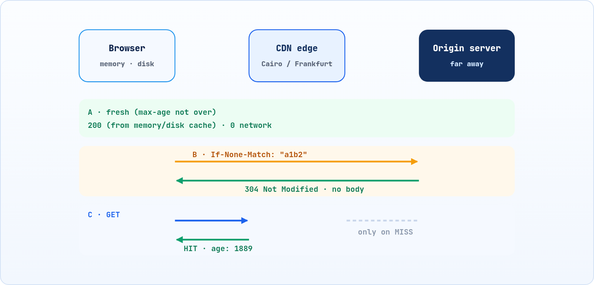

<small>المرحلة 5 · السرعة والعرض</small>

كل طلب فيه DNS و TCP و TLS ورحلة للسيرفر ورجوع. طب لو الملف ماتغيرش من امبارح، ليه نجيبه تاني؟ الكاش هو إن حد في السكة يحتفظ بنسخة. هنفهم مين بيكاش (المتصفح والـ CDN)، وإزاي السيرفر بيقول 'خلي ده عندك قد إيه'، وإزاي المتصفح يسأل 'لسه زي ما هو؟' ويرد عليه 304، وليه أحياناً الكاش هو اللي مبوظ عليك التعديلات.

:::note[بعد الفصل ده هتكون عارف]
- المشكلة: نفس الملف بيتجاب مليون مرة
- Cache-Control وكل Directive فيه: max-age و no-cache و no-store و private و public و immutable
- الـ Validation: ETag و If-None-Match و Last-Modified، و 304
- Fingerprinting: app.3f9a1c.js وليه بيحل كل حاجة
- memory cache و disk cache في DevTools
- Hard reload و Disable cache و Empty cache
- الـ CDN: Edge و Age و cf-cache-status و x-cache
:::

<a id="s15-1"></a>

## 15.1 ليه نجيب نفس الحاجة كل مرة؟

افتح Facebook. اللوجو، وملفات CSS، والخطوط، وملفات JS اللي حجمها ميجات. كل ده ماتغيرش من ساعة ما فتحته امبارح. لو المتصفح جابه تاني كل مرة، هتستنى، وهتصرف باقة، والسيرفر هيتعب من مليار طلب على نفس الملف. والحل القديم جداً في علوم الكمبيوتر: **احتفظ بنسخة قريبة**. ده هو الـ **Cache**.

بس الكاش جواه مشكلة صعبة جداً: <strong>إمتى النسخة اللي عندي تبقى قديمة؟</strong> لو السيرفر غيّر الـ CSS وانت لسه شايف القديم، الصفحة هتبوظ. وفيه نكتة مشهورة بين المبرمجين: "فيه حاجتين صعبين بس في علوم الكمبيوتر: إبطال الكاش (Cache invalidation)، وتسمية الحاجات". فـ HTTP بيدّي السيرفر أدوات يقول بيها للكاش إمتى يثق في النسخة وإمتى يسأل.



*3 سيناريوهات: النسخة طازة في المتصفح فمفيش شبكة أصلاً (A)، أو المتصفح يسأل "اتغيرت؟" ويرجعله 304 (B)، أو الـ CDN القريب يرد بدل السيرفر البعيد (C)*

<a id="s15-2"></a>

## 15.2 Cache-Control: السيرفر بيقول للكاش يعمل إيه

الـ Header الأساسي اسمه `Cache-Control`، والسيرفر بيحطه في الرد. جواه تعليمات (Directives) مفصولة بـ `,`. ده رد حقيقي من MDN:

```sh title="Terminal"
$ curl -sI https://developer.mozilla.org/en-US/ | grep -i -e cache -e '^age' -e etag -e last-mod
cache-control: public, max-age=3600
etag: "adbb7a40fd40be73d624e80eab1af10f"
last-modified: Thu, 22 Oct 2026 01:11:30 GMT
age: 1889
x-cache: MISS, HIT, HIT
```

**تشريح الأمر**

```http
cache-control: public, max-age=3600
```

1. `cache-control:`: تعليمات الكاش.
2. `public`: أي كاش في السكة (المتصفح أو CDN أو Proxy) يقدر يحتفظ بنسخة.
3. `,`: فاصل بين التعليمات.
4. `max-age=3600`: النسخة "طازة" (Fresh) ساعة من وقت ما اتعملت. طول الساعة دي، الكاش يستخدمها من غير ما يسأل حد.

وده كل اللي هتشوفه تقريباً:

**أشهر تعليمات Cache-Control**

| التعليمة | معناها | تستخدمها في |
|---|---|---|
| `max-age=N` | طازة N ثانية | أي حاجة ثابتة شوية |
| `s-maxage=N` | زي اللي فوق بس للكاش المشترك (CDN) بس | عاوز الـ CDN يحتفظ أكتر من المتصفح |
| `public` | أي كاش مسموحله | ملفات عامة |
| `private` | متصفح اليوزر بس، مش CDN | صفحة فيها بيانات اليوزر |
| `no-cache` | احتفظ بيها، بس **اسأل كل مرة** قبل ما تستخدمها | HTML لازم يبقى أحدث حاجة |
| `no-store` | **متحتفظش بأي نسخة** خالص | بيانات حساسة: كشف حساب البنك |
| `immutable` | مش هيتغير أبداً، متسألش حتى في Reload | ملفات باسم فيه Hash (الجزء الجاي) |
| `must-revalidate` | لما تخلص، لازم تسأل، متستخدمش القديمة أبداً | لما الدقة أهم من السرعة |
| `stale-while-revalidate=N` | بعد ما تخلص، استخدم القديمة N ثانية وانت بتجيب الجديدة من ورا | سرعة مع تحديث معقول |

:::caution[خلي بالك: no-cache مش معناها 'متكاشش']
دي أشهر لخبطة في الكاش كله. `no-cache` معناها "خزّن، بس متستخدمش من غير ما تسأل السيرفر". واللي معناها "متخزنش خالص" هي `no-store`. الأسماء وحشة، بس هي كده من التسعينات.
:::

<a id="s15-3"></a>

## 15.3 "لسه زي ما هي؟" : ETag و 304

الـ `max-age` خلص، أو السيرفر قال `no-cache`. المتصفح معاه نسخة، بس مش متأكد هي لسه صح. هل يجيب الملف كله تاني؟ لأ، فيه طريقة أذكى: **يسأل**. ودي اسمها **Revalidation**.

السيرفر لما بعت الملف أول مرة حط عليه "بصمة" اسمها **ETag**، زي `"a1b2c3"`: كود بيتغير لو المحتوى اتغير. المتصفح بيحفظها، ولما يحب يسأل، يبعتها:

```sh title="Terminal"
$ curl -sI https://jsonplaceholder.typicode.com/posts/1 | grep -i etag
etag: W/"124-yiKdLzqO5gfBrJFrcdJ8Yq0LGnU"
$ curl -sI https://jsonplaceholder.typicode.com/posts/1 -H 'If-None-Match: W/"124-yiKdLzqO5gfBrJFrcdJ8Yq0LGnU"' | head -1
HTTP/2 304
```

**تشريح الأمر**

```sh
curl -sI https://jsonplaceholder.typicode.com/posts/1 -H 'If-None-Match: W/"124-yiKdLzqO5gfBrJFrcdJ8Yq0LGnU"'
```

1. `curl -sI`: HEAD، والـ Headers بس.
2. `https://.../posts/1`: نفس الملف.
3. `-H 'If-None-Match: ...'`: "ابعتلي الملف **لو** بصمته مش زي دي". يعني "لو اتغير".
4. `W/`: في قيمة الـ ETag: Weak، يعني "المحتوى نفس المعنى" حتى لو اتضغط بشكل مختلف. من غيرها Strong: كل Byte زي التاني.
5. `"124-yiKd..."`: البصمة نفسها. لازم بالـ Quotes، وعشان كده الـ Header كله بين Single quotes.

السيرفر رد **304 Not Modified** من غير Body. "اللي عندك صح، استخدمه". ووفرنا تحميل الملف كله. وفيه طريقة أقدم بالتاريخ بدل البصمة: السيرفر يبعت `Last-Modified`، والمتصفح يسأل بـ `If-Modified-Since`. نفس الفكرة، بس أقل دقة (بالثانية).

**ملخص: الأسئلة والإجابات**

| السيرفر بعت | المتصفح بيسأل بـ | الإجابة لو ماتغيرش |
|---|---|---|
| `ETag: "a1b2"` | `If-None-Match: "a1b2"` | `304` من غير Body |
| `Last-Modified: تاريخ` | `If-Modified-Since: تاريخ` | `304` من غير Body |

<a id="s15-4"></a>

## 15.4 الحيلة اللي بتحل كل حاجة: اسم الملف فيه بصمته

هنا التعارض: عاوز الكاش طويل (عشان السرعة)، وعاوز التعديلات توصل فوراً (عشان الصح). الاتنين ضد بعض… إلا لو **غيّرت اسم الملف** كل ما يتغير. وده اللي أدوات زي Vite و Webpack بتعمله لوحدها لما تعمل Build:

```html title="dist/index.html"
<link rel="stylesheet" href="/assets/index-3f9a1c.css">
<script type="module" src="/assets/index-b72e0d.js"></script>
```

الـ `3f9a1c` ده Hash من محتوى الملف. لو غيّرت سطر في الـ CSS، الاسم بيبقى `index-8c41e2.css`، ودي بالنسبة للمتصفح حاجة جديدة تماماً، مالهاش نسخة في الكاش. فالاستراتيجية الشائعة:

#### الملفات اللي باسمها Hash

`Cache-Control: public, max-age=31536000, immutable`. سنة، ومتسألش. لأن لو اتغيرت، اسمها هيتغير.

#### الـ HTML نفسه

`Cache-Control: no-cache`. اسأل كل مرة. لأنه هو اللي فيه أسماء الملفات الجديدة، ولو اتكاش، اليوزر هيفضل بيطلب الملفات القديمة.

<a id="s15-5"></a>

## 15.5 الكاش في DevTools

في Network، عمود **Size** هيقولك الحاجة جت منين:

| الأمر | بيعمل إيه |
|---|---|
| `(memory cache)` | من الـ RAM. أسرع حاجة، وغالباً حاجات اتحملت في نفس الصفحة أو التابة. Time تقريباً 0 ms. |
| `(disk cache)` | من الديسك. من زيارة قبل كده. برضه من غير شبكة خالص. |
| `304 + حجم صغير` | سأل السيرفر، والسيرفر قال "زي ما هي". اتبعت طلب، بس من غير Body. |
| `(ServiceWorker)` | جه من Service Worker (كود JS بيعمل كاش بنفسه، الفصل 21). |
| `حجم عادي، زي 14.2 kB` | اتجاب من الشبكة فعلاً. وفي الحالة دي فيه رقمين لو فعّلت Big request rows: المنقول (مضغوط) والحقيقي. |

وفيه 3 طرق تعدّي بيها الكاش، ومهم تعرف الفرق:

**طرق تخطي الكاش في Chrome على الـ Mac**

| الطريقة | بتعمل إيه |
|---|---|
| Reload عادي <kbd>⌘</kbd><kbd>R</kbd> | الصفحة نفسها بتتسأل (Revalidate)، والملفات اللي لسه طازة ممكن تيجي من الكاش |
| Hard reload <kbd>⌘</kbd><kbd>⇧</kbd><kbd>R</kbd> | تجاهل الكاش للصفحة دي وملفاتها في الـ Load ده |
| Empty cache and hard reload | Right-click على زرار Reload **و DevTools مفتوح**: يمسح الكاش ويحمّل. أقوى حاجة |
| Disable cache في Network | طول ما DevTools **مفتوح**، ولا طلب يستخدم الكاش (الفصل 18). أحسن حاجة وانت بتطور |

:::danger[مشكلة: عدّلت الـ CSS والتعديل مش ظاهر]
غيّرت لون الزرار، ورفعت الموقع، وعملت Reload، ولسه اللون القديم.

افتح Network وبص على ملف الـ CSS: لو مكتوب `(disk cache)` أو `(memory cache)`، الكاش هو السبب. جرب <kbd>⌘</kbd><kbd>⇧</kbd><kbd>R</kbd> أو Disable cache. ولو اتحل، يبقى الحل الدائم: أسماء ملفات فيها Hash، أو `max-age` أقصر. ولو لسه مش ظاهر حتى من غير كاش المتصفح، بص على `age` و`cf-cache-status`: ممكن الـ CDN هو اللي لسه ماسك النسخة القديمة (الجزء الجاي).
:::

<a id="s15-6"></a>

## 15.6 الـ CDN: نسخة في كل مدينة

السيرفر بتاعك في فرجينيا في أمريكا. اليوزر في القاهرة. كل طلب بيعدي المحيط رايح جاي، يعني 150 أو 200 ms RTT على الأقل، ودي فيزيا مش حاجة تتحل بسيرفر أسرع. والحل: **CDN** (Content Delivery Network). شركات زي Cloudflare و Akamai و Fastly عندها سيرفرات في مئات المدن اسمها **Edge**. الـ DNS (أو Anycast، فاكر الفصل 5؟) بيوديك لأقرب واحد، وهو يرد من الكاش بتاعه. لو معندوش نسخة، يجيبها مرة من السيرفر الأصلي (**Origin**) ويحتفظ بيها للي بعدك.

وعشان كده الـ CDN بيستخدم نفس `Cache-Control` بتاعنا (خصوصاً `public` و`s-maxage`)، وبيضيف Headers تقولك حصل إيه:

```http title="Headers الـ CDN في رد example.com و MDN"
cf-cache-status: HIT
age: 1889
x-cache: MISS, HIT, HIT
x-served-by: cache-bfi-..., cache-iad-...
```

1. `cf-cache-status: HIT`: Cloudflare: النسخة جت من الكاش بتاع الـ Edge. وفيه `MISS` (راح للـ Origin)، و`EXPIRED`، و`DYNAMIC` (مش بيتكاش أصلاً)، و`BYPASS`.
2. `age: 1889`: النسخة دي بقالها 1889 ثانية (نص ساعة تقريباً) في الكاش. مع `max-age=3600`، فاضلها 1711 ثانية وتبقى قديمة.
3. `x-cache: MISS, HIT, HIT`: في CDNs زي Fastly: فيه أكتر من طبقة كاش، وكل واحدة بتقول حصلها إيه. هنا الطبقة الأولى ماكانش عندها، والتانية كان عندها.
4. `x-served-by: cache-bfi-..., cache-iad-...`: أسماء الـ Edge servers. الحروف غالباً كود المطار في المدينة: `IAD` = واشنطن.

:::tip[حاجة مشتركة: نفس الفكرة في 4 أماكن]
شفنا الكاش في الـ DNS (الـ TTL في الفصل 5)، وفي المتصفح، وفي الـ CDN. وكلهم نفس الفكرة بالظبط: نسخة قريبة، ورقم بيقول تعيش قد إيه، ومشكلة "إمتى أعرف إنها قديمة". لو فهمت واحد، فهمت الكل. وكمان Docker بيعمل كاش لطبقات الـ Image بنفس المنطق: لو الطبقة ماتغيرتش، استخدم القديمة.
:::

:::note[لو حابب تتعمق: Vary ومفتاح الكاش]
الكاش بيحفظ النسخة تحت "مفتاح"، وأساسه الـ URL. بس لو نفس الـ URL بيرجع عربي لواحد وإنجليزي لواحد (حسب `Accept-Language`)، أو مضغوط Brotli لواحد و Gzip لواحد، المفتاح لازم يشمل الـ Header ده، وإلا اليوزر العربي ياخد الإنجليزي. وده بالظبط شغل `Vary: Accept-Language, Accept-Encoding` اللي اتكلمنا عنه في الفصل 9. وكمان `Vary: Origin` مع CORS، عشان الكاش ميرجعش رد عليه إذن لـ Origin لحد تاني.
:::

:::tip[ملخص الفصل]
- الكاش = نسخة قريبة. والمشكلة الصعبة: إمتى تبقى قديمة.
- `Cache-Control: max-age` = طازة قد إيه، و`public`/`private` = مين يكاش.
- `no-cache` = اسأل كل مرة، و`no-store` = متخزنش. مش نفس الحاجة.
- الـ Revalidation: `ETag` + `If-None-Match`، أو `Last-Modified` + `If-Modified-Since`، والرد `304` من غير Body.
- اسم الملف فيه Hash + `immutable` سنة للملفات، و`no-cache` للـ HTML.
- في DevTools: `(memory cache)` و`(disk cache)` و 304، و Disable cache وانت بتطور.
- الـ CDN = كاش في Edge قريب. و`age` و`cf-cache-status` و`x-cache` بيقولوا حصل إيه.
:::

### صح ولا غلط؟

1. `Cache-Control: no-cache` معناها إن المتصفح ميخزنش أي نسخة.
2. رد الـ `304` فيه الملف كامل.
3. ملف اسمه `app-3f9a1c.js` آمن نديله كاش سنة.

### أسئلة مراجعة

1. إيه الفرق بين Fresh و Stale؟ وإيه اللي بيحصل لما النسخة تبقى Stale؟
2. اشرح رحلة `ETag` من أول تحميل لحد الـ `304`.
3. ليه الـ HTML بالذات ميتكاشش طويل، والـ JS يتكاش سنة؟
4. في رد فيه `max-age=3600` و`age: 3500`، النسخة هتفضل طازة قد إيه؟
5. إيه الفرق بين `(disk cache)` و`304` في عمود Size؟

### تحديات الفصل

<small>جرّبها بإيدك، والحلول في ملحق الإجابات.</small>

1. **[سهل]** افتح موقع كبير مرتين، والمرة التانية بص على عمود Size: كام ملف جه من `memory cache` وكام من `disk cache`؟
2. **[متوسط]** اعمل تجربة الـ ETag بـ curl على 3 ملفات مختلفة (صورة و JS و API)، ولاقي مين بيرجع 304.
3. **[صعب]** اعمل `curl -sI` على `example.com` 3 مرات ورا بعض، وراقب `age` و`cf-cache-status`. وبعدين ضيف `?v=123` في الآخر. إيه اللي اتغير؟ وليه؟
