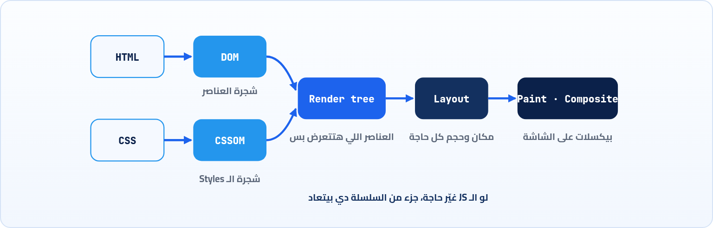
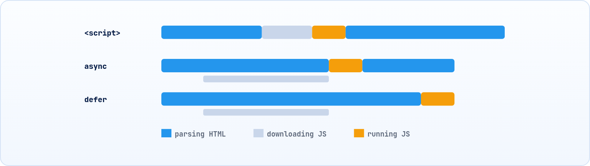

<small>المرحلة 5 · السرعة والعرض</small>

وصل الرد، وجواه HTML. لسه الصفحة مش ظاهرة. المتصفح محتاج يقرا النص ده، ويكتشف منه طلبات تانية (CSS و JS وصور)، ويبني منه شجرة، ويحسب مكان كل حاجة، ويرسمها. الفصل ده قصير وعملي: هنفهم الخطوات عشان تفهم الخطين الأزرق والأحمر في Network، وليه سكريبت واحد ممكن يوقف الصفحة كلها، وإيه فايدة defer و async.

:::note[بعد الفصل ده هتكون عارف]
- الخطوات: Parse و DOM و CSSOM و Render tree و Layout و Paint
- ليه المتصفح بيبعت طلبات جديدة وهو بيقرا الـ HTML
- Render-blocking: الـ CSS والـ script العادي بيوقفوا إيه
- defer و async و type=module والفرق بينهم
- DOMContentLoaded و load: الخطين في Waterfall
- يعني إيه Initiator: Parser و Script
:::

## 16.1 الرحلة من النص للشاشة

الـ HTML اللي جالك ده نص، زي اللي شفناه في curl. المتصفح محتاج يعمل منه صورة. وبيعدي على خطوات ثابتة اسمها **Critical rendering path**:

*المتصفح بيبني شجرتين (DOM و CSSOM)، يدمجهم، يحسب الأماكن، وبعدين يرسم*

1. **Parse الـ HTML → DOM**: المتصفح بيقرا الـ HTML من فوق لتحت، وبيحوّل كل Tag لعنصر في شجرة اسمها **DOM**. ودي نفس الشجرة اللي بتكلمها في JS بـ `document.querySelector`، واللي بتشوفها في تابة Elements.
2. **بيكتشف طلبات**: وهو بيقرا، كل ما يلاقي `<link rel=stylesheet>` أو `<script src>` أو ``، بيبعت طلب جديد. وعشان كده في Network، عمود **Initiator** للحاجات دي بيقول `Parser`: الـ Parser هو اللي لقاها. ولو طلب اتعمل من كود JS (زي `fetch`)، الـ Initiator بيبقى `Script` واسم الملف ورقم السطر.
3. **CSS → CSSOM**: نفس الفكرة للـ CSS: شجرة فيها كل Style ينطبق على إيه.
4. **Render tree**: الشجرتين مع بعض، بس العناصر اللي هتظهر. `display:none` مش هنا، و`<head>` مش هنا.
5. **Layout** (أو Reflow): يحسب كل عنصر فين وحجمه قد إيه، حسب عرض الشاشة.
6. **Paint و Composite**: يرسم الألوان والنصوص والصور في طبقات، ويركبهم على بعض.

## 16.2 مين بيوقف مين؟

هنا فيه مشكلتين ليهم أثر مباشر على سرعة أي موقع:

#### الـ CSS بيوقف الرسم

المتصفح **مش بيرسم** لحد ما الـ CSS اللي في `<head>` يوصل ويتقرا. ليه؟ لو رسم الصفحة من غير Styles وبعدين جه الـ CSS، هتشوف الصفحة "بتنط" (اسمه FOUC). فالـ CSS اسمه **Render-blocking**.

#### الـ script العادي بيوقف القراية

`<script src="app.js">` من غير أي حاجة: المتصفح **بيقف يقرا الـ HTML**، يجيب الملف، ويشغله، وبعدين يكمل. ليه؟ لأن السكريبت ممكن يعمل `document.write` أو يغيّر الـ DOM، فلازم يتنفذ في مكانه بالظبط.

وعشان كده النصيحة القديمة كانت: "حط الـ scripts في آخر الـ `<body>`". والحل الأحدث: خلي السكريبت يقول للمتصفح إنه مش محتاج يوقف حاجة:

*العادي بيوقف القراية وهو بيحمّل وبيشغّل. async بيحمّل جنب القراية ويشغّل أول ما يوصل. defer بيحمّل جنب القراية ويشغّل بعد ما الـ HTML يخلص، وبالترتيب*

**ملخص: طرق تحميل السكريبت**

| الشكل | بيوقف قراية الـ HTML؟ | بيتنفذ إمتى | بالترتيب؟ |
|---|---|---|---|
| `<script src>` | أيوه | فوراً في مكانه | أيوه |
| `<script async src>` | لأ (بس بيوقف وهو بيتنفذ) | أول ما يوصل | لأ، اللي يوصل الأول |
| `<script defer src>` | لأ | بعد ما الـ HTML يخلص، قبل DOMContentLoaded | أيوه |
| `<script type="module" src>` | لأ | زي defer بالظبط | أيوه |

:::tip[القاعدة العملية]
سكريبت التطبيق بتاعك: `defer` أو `type="module"` (وده اللي Vite بيعمله لوحده). سكريبت مستقل مالوش علاقة بحاجة، زي Analytics: `async`. وكورس Jonas هيشرح الفرق ده بالتفصيل في جزء الـ DOM، فلو شفته هناك، افتكر الرسمة دي.
:::

## 16.3 الخطين الأزرق والأحمر

في Waterfall بتاع Network (الفصل 18)، هتلاقي خطين رأسيين، وتحت في الـ Status bar رقمين بنفس اللون:

| الأمر | بيعمل إيه |
|---|---|
| `DOMContentLoaded (أزرق)` | الـ HTML اتقرا كله، والـ DOM جاهز، والسكريبتات العادية و defer اتنفذت. الصور ممكن لسه بتتحمل. ده الحدث اللي بتستناه لما تكتب `document.addEventListener('DOMContentLoaded', ...)`. |
| `Load (أحمر)` | كل حاجة اتحملت: الصور والـ CSS والـ iframes. ده `window.onload`. |

لو الخط الأزرق متأخر قوي، دور على سكريبت عادي تقيل في الـ `<head>`. ولو الأحمر متأخر، دور على صور تقيلة. بس خلي بالك: المواقع الحديثة بتحمّل حاجات كتير بعد Load (بـ `fetch`)، فالـ Load مش معناه إن الصفحة "خلصت" من وجهة نظر اليوزر. وعشان كده فيه مقاييس أحدث زي **LCP** (إمتى أكبر حاجة ظهرت)، تقدر تشوفها في تابة **Performance** و Lighthouse.

:::note[لو حابب تتعمق: الـ Preload scanner و preload]
المتصفح عنده Parser تاني خفيف بيجري قدام الـ Parser الأساسي وهو واقف مستني سكريبت، ويبعت طلبات للحاجات اللي هيلاقيها بعد كده. عشان كده هتلاقي طلبات كتير بتبدأ مع بعض في الـ Waterfall حتى لو فيه سكريبت عادي. ولو حاجة مهمة جداً مش ظاهرة في الـ HTML (زي خط جوه CSS)، تقدر تقول للمتصفح يجيبها بدري: `<link rel="preload" href="/font.woff2" as="font" crossorigin>`. والسيرفر ممكن يقول ده قبل ما الـ HTML نفسه يجهز بـ Status `103 Early Hints` (الفصل 8)، وده واحد من قيم الـ Initiator.
:::

:::tip[ملخص الفصل]
- HTML → DOM، و CSS → CSSOM، والاتنين → Render tree → Layout → Paint.
- الـ Parser بيكتشف الطلبات وهو بيقرا، فالـ Initiator بتاعها `Parser`. وطلبات `fetch` بتاعها `Script`.
- الـ CSS بيوقف الرسم، والـ script العادي بيوقف قراية الـ HTML.
- `defer` و`type="module"`: بعد الـ HTML وبالترتيب. و`async`: أول ما يوصل.
- الأزرق = DOMContentLoaded، والأحمر = Load.
:::

### صح ولا غلط؟

1. السكريبتات اللي عليها `async` بتتنفذ بنفس ترتيبها في الـ HTML دايماً.
2. `<script type="module">` بيتصرف زي `defer`.
3. Load بيحصل قبل DOMContentLoaded.

### أسئلة مراجعة

1. رتّب الخطوات من الـ HTML لحد البيكسلات، وقول كل خطوة بتعمل إيه.
2. ليه المتصفح بيستنى الـ CSS قبل ما يرسم؟
3. إيه الفرق بين `Parser` و`Script` في عمود Initiator؟
4. سكريبت Analytics وسكريبت التطبيق: كل واحد تحطه بـ async ولا defer؟ وليه؟

### تحديات الفصل

<small>جرّبها بإيدك، والحلول في ملحق الإجابات.</small>

1. **[سهل]** افتح أي موقع، وفي Network بص على الرقمين DOMContentLoaded و Load تحت. وبعدين اعمل نفس الحاجة مع Slow 4G (الفصل 18).
2. **[متوسط]** اعمل صفحة فيها `<script src="a.js">` و`<script src="b.js">`، كل واحد بيعمل `console.log`. جرب الترتيب مع العادي و async و defer.
3. **[صعب]** في صفحة كبيرة، دوس <kbd>⇧</kbd> وحط الماوس على طلب JS في Network: هتشوف مين طلبه (أخضر) ومين هو طلبه (أحمر). ارسم السلسلة.
