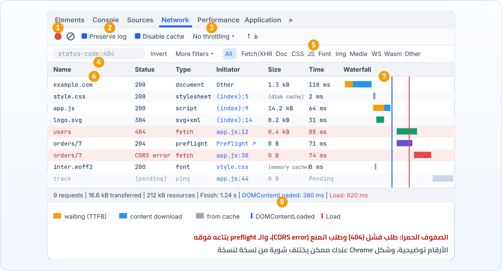
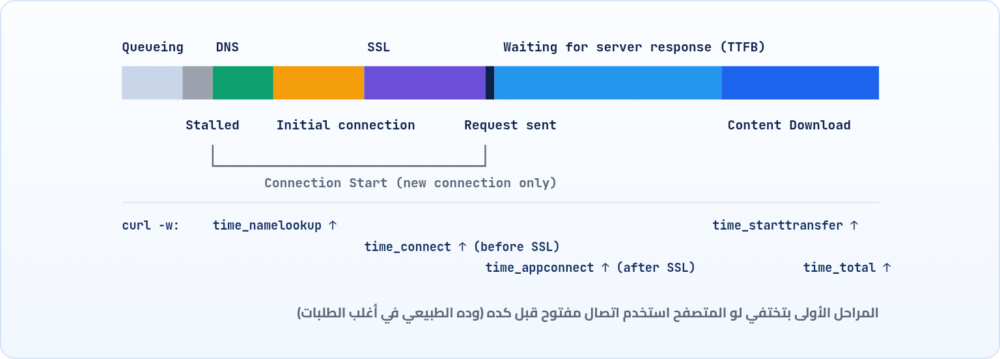

<small>المرحلة 6 · DevTools والـ Debugging</small>

ده الفصل اللي كل اللي فات كان بيمهدله. Network Panel بيوريك كل طلب الصفحة عملته، بنفس الكلام اللي اتعلمناه: Methods و Status codes و Headers وكاش و CORS وتوقيت. هنفصّص الشاشة حتة حتة: شريط الأدوات، والفلاتر، وكل عمود، والـ Waterfall، وتابة Timing مرحلة مرحلة، وإزاي تقلّد نت بطيء على جهازك.

:::note[بعد الفصل ده هتكون عارف]
- ليه لازم تفتح Network قبل ما الصفحة تحمّل
- شريط الأدوات: Record و Clear و Preserve log و Disable cache و Throttling
- الفلاتر: الأنواع و Property filters زي status-code: و method: و domain:
- كل عمود: Name و Status و Type و Initiator و Size و Time، وتضيف Protocol وغيره
- قيم Status الخاصة: (pending) و (canceled) و (failed) و CORS error و (blocked)
- الـ Waterfall و Timing: Queueing و Stalled و DNS و SSL و Waiting (TTFB) و Download
- Throttling: تقلّد Slow 4G و Offline
- Status bar: requests و transferred و resources و Finish
:::

<a id="s18-1"></a>

## 18.1 أول قاعدة: افتحه الأول، وبعدين حمّل

Network Panel بيسجل الطلبات **من ساعة ما يتفتح**. لو فتحته بعد ما الصفحة خلصت تحميل، هتلاقيه فاضي أو فيه طلبات قليلة، وتقول "فين الطلبات؟". فالطريقة دايماً: افتح DevTools، روح Network، وبعدين اعمل Reload (<kbd>⌘</kbd><kbd>R</kbd>). وهو حتى بيقولك كده لما يبقى فاضي: "Recording network activity… Perform a request or hit ⌘ R to record the reload".

<a id="s18-2"></a>

## 18.2 الشاشة حتة حتة



*نسخة مرسومة من Network Panel، فيها أغلب الحالات اللي هتقابلها: Document وكاش و 304 و 404 و Preflight و CORS error وطلب لسه شغال*

#### الأرقام 1 و 2 و 3: شريط الأدوات

**1** زرار التسجيل (أحمر = شغال) وجنبه المسح. **2** Preserve log و Disable cache. **3** قايمة Throttling، وبعدها Import/Export.

#### الرقمين 4 و 5: الفلاتر

**4** خانة الفلتر بالكتابة (هنا `status-code:404`) ومعاها Invert و More filters. **5** أزرار الأنواع: All و Fetch/XHR و JS وغيرهم.

#### رقم 6: الأعمدة

Name و Status و Type و Initiator و Size و Time. اعمل Right-click على العناوين تضيف أعمدة تانية.

#### الرقمين 7 و 8: الوقت والملخص

**7** الـ Waterfall والخطين الأزرق (DOMContentLoaded) والأحمر (Load). **8** شريط الملخص تحت: العدد والحجم والوقت.

<a id="s18-3"></a>

## 18.3 شريط الأدوات

| الأمر | بيعمل إيه |
|---|---|
| `● (أحمر)` | **Record**: شغال أو واقف. لو رمادي، مش بيسجل حاجة. <kbd>⌘</kbd><kbd>E</kbd> يبدّل. |
| `⊘` | **Clear**: امسح القايمة. مفيد قبل ما تدوس زرار في الصفحة عشان تشوف طلباته هو بس. |
| `Preserve log` | متمسحش القايمة لما الصفحة تتغير. من غيره، أي Navigation أو Redirect بيمسح كل حاجة، فلو فورم Login بيعمل POST وبعدين Redirect، هتشوف الصفحة الجديدة بس وتضيع الـ POST اللي انت عاوزه. |
| `Disable cache` | متستخدمش الكاش طول ما DevTools مفتوح (الفصل 15). كده بتشوف اللي هيحصل لزائر جديد. |
| `No throttling ▾` | قلّد شبكة أبطأ (آخر الفصل). |
| `⤒ ⤓` | Import و Export لملف HAR (الفصل 19). |
| `⚙ (يمين الشريط)` | إعدادات الـ Panel: **Big request rows** (كل صف سطرين، فيه الرقمين بتوع الحجم والوقت)، و**Show overview** (شريط الوقت فوق)، و Group by frame. |

<a id="s18-4"></a>

## 18.4 الفلاتر: تلاقي الإبرة في 200 طلب

### فلاتر الأنواع

الأزرار `All` و`Fetch/XHR` و`Doc` و`CSS` و`JS` و`Font` و`Img` و`Media` و`Manifest` و`WS` (WebSocket) و`Wasm` و`Other`. وأهمهم ليك: **Fetch/XHR**، لأنه بيوريك طلبات الـ API اللي كودك بيعملها بس، من غير الصور والخطوط. وتقدر تختار أكتر من نوع بـ <kbd>⌘</kbd>+Click.

### الفلتر بالكتابة

اكتب أي كلمة وهيوريك الطلبات اللي الـ URL بتاعها فيه الكلمة دي. بس القوة الحقيقية في الـ **Property filters**: `خاصية:قيمة`:

**أشهر Property filters**

| الفلتر | بيوريك |
|---|---|
| `status-code:404` | الطلبات اللي رجعت 404 بالظبط |
| `method:POST` | طلبات POST بس |
| `domain:api.shop.dev` | طلبات الدومين ده. وبيقبل `*`: `domain:*.google.com` |
| `-domain:localhost` | الـ `-` في الأول = **عكس** الفلتر: كل حاجة ما عدا localhost |
| `larger-than:100k` | الملفات اللي أكبر من 100 KB. لقيت ليه الصفحة تقيلة |
| `mime-type:application/json` | الردود اللي نوعها JSON |
| `has-response-header:set-cookie` | الردود اللي بتحط كوكيز |
| `scheme:http` | اللي ماشي من غير HTTPS (شاكك في Mixed content؟) |
| `is:running` | الطلبات اللي لسه شغالة |
| `/api\/v\d/` | بين `/ /` = Regex |

وتقدر تكتب أكتر من فلتر بمسافة بينهم، ومعناهم "و": `method:POST status-code:500` = طلبات POST اللي رجعت 500. وجنب خانة الفلتر فيه **Invert** (اعكس النتيجة كلها)، و**More filters** وفيها: Hide data URLs، و Hide extension URLs (اخفي طلبات الـ Extensions، مفيد جداً)، و Blocked response cookies، و Blocked requests، و 3rd-party requests.

:::note[مثال عملي: فين الـ API اللي بيفشل؟]
صفحة فيها 150 طلب، وفيه حاجة مش ظاهرة. دوس **Fetch/XHR**، واكتب `-status-code:200`. فاضل قدامك الطلبات اللي كودك عملها ورجعت أي حاجة غير 200. كده في 3 ثواني.
:::

<a id="s18-5"></a>

## 18.5 الأعمدة: كل واحد بيقولك إيه

```sh title="الأعمدة الافتراضية"
Name
Status
Type
Initiator
Size
Time
Waterfall
```

1. `Name`: آخر جزء من الـ URL. حط الماوس عليه تشوف الـ URL كامل. ودوس عليه تفتح التفاصيل (الفصل 19).
2. `Status`: الـ Status code من الفصل 8، أو حالة خاصة (الجزء الجاي). وفي Big request rows بيظهر تحته الـ Reason phrase زي `Not Found`.
3. `Type`: نوع الحاجة: `document` (الصفحة) و`stylesheet` و`script` و`fetch` و`xhr` و`font` و`png` و`preflight` و`ping` و`websocket`.
4. `Initiator`: مين اللي طلب الحاجة دي (الفصل 16): `Parser` (الـ HTML)، أو `Script` بسطر معين (`app.js:12`، دوس عليه يوديك للسطر في Sources)، أو `Redirect`، أو `Preflight`، أو `Other` (زي إنك كتبت العنوان بنفسك).
5. `Size`: الحجم **المنقول على الشبكة** (مضغوط ومعاه الـ Headers). ولو جه من الكاش هتلاقي `(disk cache)` أو `(memory cache)`. وفي Big request rows الرقم التاني = الحجم الحقيقي بعد فك الضغط.
6. `Time`: من بداية الطلب لآخر Byte. والرقم التاني في Big request rows = الـ Latency (لحد أول Byte).
7. `Waterfall`: كل طلب كخط على محور الوقت: بدأ إمتى وخلص إمتى. حط الماوس على أي خط يطلعلك تفصيل المراحل.

وفيه أعمدة مستخبية مفيدة جداً. اعمل **Right-click على عناوين الأعمدة** وفعّل:

| الأمر | بيعمل إيه |
|---|---|
| `Method` | GET ولا POST ولا OPTIONS. أول عمود أنصحك تفعّله. |
| `Domain` | الطلب ده رايح لمين. مفيد تشوف كام Third-party في الصفحة. |
| `Protocol` | `h2` و`h3` و`http/1.1` (الفصل 11). |
| `Remote address` | الـ IP والـ Port اللي اتكلمنا معاه فعلاً، زي `104.20.23.154:443`. يأكدلك إن الـ DNS ودّاك المكان الصح، أو إن `/etc/hosts` اشتغل. |
| `Priority` | أولوية الطلب عند المتصفح (Highest لحد Lowest). |
| `Cookies / Set cookies` | عدد الكوكيز اللي اتبعتت، واللي السيرفر حطها. |
| `Response Headers ←` | تضيف أي Header كعمود، زي `cache-control` أو `cf-cache-status`. وتقدر تعمل **Manage Header Columns** وتضيف أي اسم. |

وأي عمود تدوس على عنوانه يرتّب القايمة بيه: رتّب بـ Size تلاقي أتقل ملف، وبـ Time تلاقي أبطأ طلب.

<a id="s18-6"></a>

## 18.6 قيم Status الخاصة

مش كل الطلبات بترجع رقم. لو الطلب ماوصلش لرد HTTP أصلاً، هتلاقي حاجة بين أقواس، ودي مهمة جداً في الـ Debugging لأنها بتقولك إن المشكلة **قبل** السيرفر:

**قيم في عمود Status مش أرقام**

| القيمة | معناها | تعمل إيه |
|---|---|---|
| `(pending)` | الطلب لسه شغال، مستني رد | لو فضل كده كتير: السيرفر مش بيرد، أو Long polling |
| `(canceled)` | المتصفح لغاه | غالباً طبيعي: الصفحة اتغيرت، أو الكود عمل `abort()`، أو نفس الصورة اتطلبت تاني |
| `(failed)` | مفيش رد خالص | دوس عليه وشوف `net::ERR_...`: الـ DNS، أو السيرفر مقفول، أو الشبكة (الفصل 20) |
| `CORS error` | الرد اتحجز بسبب CORS | شوف سطر الـ `preflight` والـ Console (الفصل 14) |
| `(blocked:mixed-content)` | طلب `http://` من صفحة HTTPS | حوّله HTTPS (الفصل 12) |
| `(blocked:devtools)` | انت اللي منعته من DevTools | شيل الـ Block من Request conditions (الفصل 19) |
| `(blocked:other)` | اتمنع من حاجة في المتصفح | غالباً Ad blocker أو Extension، وفي الـ Console هتلاقي `net::ERR_BLOCKED_BY_CLIENT`. جرب Incognito |
| `(blocked:csp)` | الـ Content Security Policy بتاعة الصفحة منعته | الموقع نفسه مش سامح بالدومين ده (الفصل 20) |

<a id="s18-7"></a>

## 18.7 الـ Waterfall و Timing: الرحلة بالملي ثانية

فاكر رحلة الطلب في الفصل 2، والأرقام اللي طلّعناها من curl بـ `-w` في الفصل 10؟ دي نفسها. دوس على أي طلب ← تابة **Timing**، أو حط الماوس على خطه في الـ Waterfall:



*مراحل الطلب في تابة Timing بالترتيب، وتحتها أرقام curl اللي بتقابلها (curl بيقيس تراكمي من البداية)*

**كل مرحلة في Timing وإمتى تقلق منها**

| المرحلة | اللي بيحصل | لو طويلة يبقى |
|---|---|---|
| Queueing | الطلب واقف قبل ما يبدأ | فيه طلبات أولويتها أعلى، أو 6 اتصالات مشغولين على HTTP/1.1 (الفصل 11) |
| Stalled | اتأخر لأي سبب تاني قبل ما يتبعت | نفس أسباب Queueing، أو مستني اتصال يفضى |
| DNS Lookup | ترجمة الاسم لـ IP (الفصل 5) | DNS بطيء، أو Third-party دومينات كتير |
| Initial connection | TCP Handshake (الفصل 4) | السيرفر بعيد (RTT عالي) |
| SSL | TLS Handshake (الفصل 12) | بعيد، أو سيرفر متظبط وحش |
| Request sent | بعت الطلب نفسه | نادراً طويلة، إلا لو بترفع ملف كبير |
| Waiting for server response | **TTFB**: السيرفر بيفكر + رحلة | **السيرفر بطيء**: Database، أو كود تقيل. ده أشهر سبب |
| Content Download | تحميل الـ Body | الملف كبير أو النت بطيء |

:::tip[حاجة مشتركة: نفس الرحلة في 3 أماكن]
رسمة الفصل 2، وأرقام `curl -w`، وتابة Timing: نفس المحطات بالظبط. الفرق إن curl بيقيس **تراكمي** (كل رقم من البداية)، و DevTools بيوريك **كل مرحلة لوحدها**. فلو قالك DevTools إن Waiting = 1.8 s، يبقى المشكلة في السيرفر، ولو جربت بـ curl هتلاقي `time_starttransfer - time_appconnect` قريب من نفس الرقم. ولو الاتنين متفقين، اتأكدت.
:::

<a id="s18-8"></a>

## 18.8 Throttling: جرّب نت وحش من غير ما تنزل الشارع

الموقع شغال طيارة على الـ Wi-Fi بتاعك. بس اليوزر في المترو على 4G ضعيف. عشان تشوف اللي هو شايفه، من قايمة **No throttling** اختار:

| الأمر | بيعمل إيه |
|---|---|
| `Fast 4G` | نت موبايل كويس. |
| `Slow 4G` | نت موبايل متوسط. هنا هتبدأ تشوف المشاكل. |
| `3G` | بطيء. كل حاجة تقيلة هتبان. |
| `Offline` | مفيش نت خالص. جرب الكود بتاعك بيعمل إيه لو `fetch` فشل: بيوري رسالة كويسة، ولا بيقع؟ |
| `Add… / Custom` | اعمل Profile بسرعة وتأخير من عندك. |

ولما تشغّل الـ Throttling، هتلاقي علامة تحذير صفرا جنب اسم Network، عشان متنساش إنه شغال وتقعد تقول "ليه النت بطيء النهارده؟".

:::caution[خلي بالك: الـ Throttling تقليد، مش حقيقة]
هو بيأخر الطلبات ويحدد السرعة داخل المتصفح، بس مش بيقلّد كل حاجة في شبكة موبايل حقيقية (زي Packets بتضيع). كفاية جداً عشان تحس بالمشكلة وتشوف الـ Loading states بتاعتك، بس القياس الدقيق بيبقى على أجهزة حقيقية.
:::

<a id="s18-9"></a>

## 18.9 شريط الملخص تحت

```sh title="9 requests | 16.6 kB transferred | 212 kB resources | Finish: 1.24 s | DOMContentLoaded: 380 ms | Load: 820 ms"
9 requests
16.6 kB transferred
212 kB resources
Finish: 1.24 s
DOMContentLoaded / Load
```

1. `9 requests`: عدد الطلبات (لو فيه فلتر: `3 / 9 requests`).
2. `16.6 kB transferred`: اللي اتنقل فعلاً على الشبكة. صغير لأن فيه كاش وضغط.
3. `212 kB resources`: الحجم الحقيقي لكل الحاجات بعد فك الضغط. الفرق بينه وبين اللي فوق = توفير الكاش والضغط.
4. `Finish: 1.24 s`: آخر طلب خلص إمتى. ممكن يفضل يزيد لو الصفحة بتعمل طلبات طول الوقت (Analytics مثلاً).
5. `DOMContentLoaded / Load`: الخطين الأزرق والأحمر (الفصل 16).

:::tip[ملخص الفصل]
- افتح Network **قبل** التحميل، أو اعمل <kbd>⌘</kbd><kbd>R</kbd> وهو مفتوح.
- Preserve log عشان الـ Redirects والـ Login، و Disable cache عشان تشوف زي الزائر الجديد.
- Fetch/XHR يوريك طلبات كودك. والـ Property filters (`status-code:` و`method:` و`domain:` و`-` للعكس) بتلاقي أي حاجة.
- فعّل أعمدة Method و Protocol و Remote address، ورتّب بـ Size و Time.
- Status بين أقواس = مفيش رد HTTP: `(failed)` و`(canceled)` و`(blocked:...)`، و`CORS error`.
- Timing: Queueing و DNS و Initial connection و SSL و Waiting (TTFB) و Download. والـ Waiting الطويل = السيرفر.
- Throttling يقلّد Slow 4G و 3G و Offline، والملخص تحت بيقولك العدد والحجم والوقت.
:::

### صح ولا غلط؟

1. الفلتر `-domain:google.com` بيوريك طلبات google.com بس.
2. Status `(failed)` معناه إن السيرفر رد بـ 500.
3. لو مرحلة Waiting for server response هي الأطول، يبقى المشكلة غالباً في السيرفر.

### أسئلة مراجعة

1. ليه فورم Login ممكن "يختفي" الطلب بتاعه من Network؟ وإيه الحل؟
2. اكتب فلتر يوريك طلبات POST اللي رجعت أي حاجة غير 201.
3. إيه الفرق بين `transferred` و`resources` في الشريط تحت؟
4. طلب الـ DNS Lookup و Initial connection بتوعه صفر. ليه؟
5. إيه فايدة عمود Remote address لو عدّلت `/etc/hosts`؟

### تحديات الفصل

<small>جرّبها بإيدك، والحلول في ملحق الإجابات.</small>

1. **[سهل]** افتح موقع أخبار، وفعّل أعمدة Method و Domain و Protocol، ورتّب بـ Size. إيه أتقل 3 ملفات؟ وكام Domain مختلف؟
2. **[متوسط]** نفس الموقع بـ Disable cache، مرة No throttling ومرة Slow 4G. قارن Finish و Load.
3. **[صعب]** اختار طلب واحد (الـ document)، واكتب كل مراحل Timing بتاعته، وبعدين قيسه بـ `curl -w @timing.txt`، وقارن كل مرحلة بالتانية.
