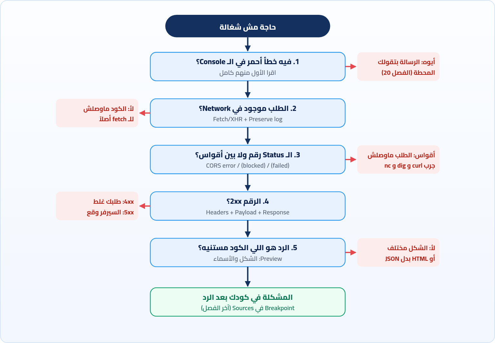

<small>المرحلة 6 · DevTools والـ Debugging</small>

عندك دلوقتي كل الأدوات: curl و dig و nc، و Network و Console و Application. بس الأدوات من غير طريقة بتخليك تفتح كل حاجة وتدوّر عشوائي. الفصل ده هو الطريقة: خريطة أسئلة بالترتيب توصّلك للمشكلة، وحالات مشهورة بالحل بتاعها، وفي الآخر أساسيات الـ Breakpoints عشان لما المشكلة تطلع في كودك فعلاً.

:::note[بعد الفصل ده هتكون عارف]
- الطريقة العلمية في الـ Debugging: لاحظ، وخمّن، وجرب، واستبعد
- خريطة: الطلب اتبعت؟ وصل؟ رد بإيه؟ الكود فهم الرد؟
- 7 حالات مشهورة بالأعراض والحل
- Breakpoints: سطر، و debugger، و Conditional، و Logpoints
- Step over و Step into و Scope و Watch
- fetch/XHR breakpoints و Pause on exceptions
- إزاي تكتب سؤال أو Bug report كويس
:::

<a id="s22-1"></a>

## 22.1 الطريقة قبل الأدوات

الـ Debugging مش موهبة. هو طريقة، وشبه شغل المحقق: عندك **عَرَض** ("الصفحة فاضية")، وانت عاوز توصل للـ**سبب**. والغلطة اللي كلنا بنعملها في الأول: نخمّن السبب على طول ونعدّل الكود، ولما ميتحلش نعدّل حاجة تانية، ونفضل كده ساعة. الطريقة الصح:

1. **لاحظ**: إيه اللي حصل بالظبط، وإيه اللي كنت متوقعه؟ اقرا الرسالة كلها، مش أول كلمتين.
2. **نصّ المشكلة**: الرحلة ليها محطات (الفصل 2). المشكلة في أنهي محطة؟ كل سؤال في الخريطة اللي جاية بيشيل نص الاحتمالات.
3. **جرب حاجة واحدة** في المرة. لو غيّرت 3 حاجات ونجحت، مش هتعرف مين اللي حلها.
4. **اتأكد**: المشكلة اتحلت فعلاً ولا بقت مستخبية؟ (Disable cache، Hard reload، Incognito.)

<a id="s22-2"></a>

## 22.2 الخريطة: 5 أسئلة بالترتيب



*كل سؤال بيشيل نص الاحتمالات. ابدأ من فوق، ومتنطش لكودك غير لما الأربع أسئلة الأولانيين يعدّوا*

والسؤال الكبير اللي في عنوان الفصل، "كودي ولا السيرفر؟"، ليه اختبار واحد حاسم: **Copy as cURL** (الفصل 19). لو الطلب نفسه فاشل في curl، المشكلة في الطلب أو السيرفر. لو شغال في curl وفاشل في المتصفح، المشكلة في حاجة المتصفح بيضيفها (CORS أو كوكيز أو كاش أو Extension). ولو شغال في الاتنين والصفحة لسه بايظة، المشكلة في كودك بعد ما الرد وصل.

<a id="s22-3"></a>

## 22.3 7 حالات هتقابلها

:::danger[مشكلة: 1. الصفحة فاضية، ومفيش ولا خطأ]
مفيش حاجة حمرا في الـ Console، و Network فيه طلبات 200.

اتأكد إن مستوى **Errors** مش مقفول في Default levels، وإن الفلتر فاضي. ولو كله تمام، شوف الـ Response بتاع الـ API: ممكن يكون `[]` فاضي، والكود بيرسم لستة فاضية صح جداً. المشكلة هنا في البيانات مش في الكود.
:::

:::danger[مشكلة: 2. TypeError: Failed to fetch]
الـ `catch` مسك خطأ من غير أي تفاصيل.

دي رسالة `fetch` لأي فشل شبكة، وهي متعمدة من غير تفاصيل. التفاصيل في سطر تاني في الـ Console (CORS أو `net::ERR_*`) وفي عمود Status في Network. ابدأ من هناك، مش من الـ catch.
:::

:::danger[مشكلة: 3. شغال على جهازي، مش شغال بعد الرفع]
على `localhost` تمام. على الموقع الحقيقي، الطلبات فاشلة.

بص على الـ **Request URL** في Headers: لسه بيكلم `http://localhost:3000`؟ (اليوزر مفيش عنده سيرفر على جهازه!) أو بيكلم `http://` من صفحة `https://` (Mixed content)؟ أو كنت مستخدم Proxy في Vite (الفصل 14) ومش موجود في الـ Production فرجع CORS؟
:::

:::danger[مشكلة: 4. عامل Login، والـ API بيقول 401]
الـ Login نجح ورجّع 200، والطلب اللي بعده 401.

افتح الطلب الفاشل ← **Cookies** و فعّل show filtered out request cookies: الكوكي اتمنعت؟ السبب مكتوب (SameSite أو Secure أو Domain). أو لو بتستخدم Token: Request Headers فيها `authorization`؟ وفي fetch لـ Origin تاني، محتاج `credentials: 'include'` عشان الكوكيز تتبعت أصلاً.
:::

:::danger[مشكلة: 5. التعديل مش ظاهر]
غيّرت الكود ورفعته ولسه شايف القديم.

Network ← Size: `(disk cache)`؟ جرب Disable cache. لسه؟ `age` و`cf-cache-status: HIT`: الـ CDN ماسك القديم. لسه؟ Application ← Service workers. ولسه؟ اتأكد إنك رفعت فعلاً: `curl -s URL | grep` على الحاجة اللي غيّرتها.
:::

:::danger[مشكلة: 6. بيشتغل مرة ويفشل مرة]
نفس الزرار، أحياناً يشتغل وأحياناً لأ.

غالباً ترتيب: طلبين بيخلصوا بترتيب مختلف كل مرة، والكود معتمد إن واحد يخلص الأول. جرب Slow 4G في Throttling عشان تكبّر الفرق في الوقت وتخلي المشكلة تحصل كل مرة. أو حد ثاني ماسك نفس الـ Port، أو الـ Token بيخلص بعد وقت.
:::

:::danger[مشكلة: 7. فيه طلب OPTIONS أنا ماعملتوش]
عملت POST، لقيت قبله OPTIONS، وساعات بيفشل.

ده Preflight (الفصل 14)، طبيعي مع JSON أو Authorization. لو فشل، المشكلة إن السيرفر مش بيرد على `OPTIONS` صح. جربه بإيدك بـ `curl -X OPTIONS` مع `Origin` و`Access-Control-Request-Method`.
:::

<a id="s22-4"></a>

## 22.4 لما المشكلة في كودك: Breakpoints

`console.log` كويس، بس ليه حدود: لازم تعرف مقدماً عاوز تطبع إيه، وكل مرة تعدّل وتعمل Reload. الـ **Breakpoint** أقوى: بيوقف الكود عند سطر معين، **وانت تبص على كل المتغيرات** في اللحظة دي، وتمشي سطر سطر.

### توقفه إزاي

| الأمر | بيعمل إيه |
|---|---|
| `Sources ← اضغط على رقم السطر` | **Line breakpoint**: علامة زرقا على السطر. أول ما الكود يوصله، يقف. (افتح الملف بـ <kbd>⌘</kbd><kbd>P</kbd>.) |
| `debugger;` | اكتبها في كودك نفسه. لو DevTools مفتوح، الكود هيقف هنا. ومتنساش تشيلها. |
| `Right-click على السطر ← Add conditional breakpoint` | يقف **بس لو** الشرط صح، زي `user.id === 7`. مفيد جوه Loop بيلف 1000 مرة. |
| `Right-click ← Add logpoint` | مبيوقفش، بيطبع رسالة في الـ Console. يعني `console.log` من غير ما تلمس الكود. |
| `XHR/fetch Breakpoints (في الجنب)` | يقف أول ما أي `fetch` لـ URL فيه كلمة معينة يتبعت. تلاقي الكود اللي عمل الطلب من غير ما تعرف هو فين. |
| `Pause on exceptions ⏸` | يقف عند أي خطأ، قبل ما الـ Stack trace يطلع، والمتغيرات لسه موجودة. فعّل "Pause on caught exceptions" لو عاوز كمان اللي جوه `try`. |

### لما يقف

الصفحة هتتجمد وفوقها شريط "Paused in debugger"، والسطر متلون. وعلى الجنب:

| الأمر | بيعمل إيه |
|---|---|
| `▶ Resume (F8)` | كمّل لحد الـ Breakpoint الجاي. |
| `⤼ Step over (F10)` | نفّذ السطر ده وروح للي بعده. لو فيه دالة، نفّذها كلها مرة واحدة. |
| `⤓ Step into (F11)` | لو السطر فيه دالة، ادخل جواها. |
| `⤒ Step out (⇧F11)` | كمّل الدالة دي واطلع للي ناداها. |
| `Scope` | كل المتغيرات اللي موجودة دلوقتي وقيمها: Local (جوه الدالة) و Closure و Global. وتقدر تعدّل قيمة بـ Double-click. |
| `Watch` | اكتب أي Expression (زي `data.users.length`) وهيتحدث مع كل خطوة. |
| `Call Stack` | نفس الـ Stack trace بتاع الفصل 20، بس حي: دوس على أي سطر فيه تشوف المتغيرات في اللحظة دي. |

وكمان وانت واقف، الـ Console بيشتغل **في الـ Scope ده**: اكتب اسم أي متغير محلي وهيطبعه. ودي أسرع طريقة تجاوب على سؤال "الـ user ده كان undefined ليه؟": حط Breakpoint على السطر اللي قبل الخطأ، وبص على `data` اللي رجعت من الـ API.

:::note[الكورس هيوصل للجزء ده]
كورس Jonas فيه جزء عن الـ Debugging وبيستخدم نفس الأدوات دي. الفصل ده مقدمة عشان لما توصله تبقى عارف المكان. والفكرة الأساسية: **Breakpoint = console.log لكل المتغيرات مرة واحدة، من غير ما تعدّل الكود**.
:::

<a id="s22-5"></a>

## 22.5 تسأل حد إزاي

ساعات هتحتاج تسأل: زميل، أو Stack Overflow، أو Discord الكورس، أو الـ AI. والسؤال الكويس نصه إجابة. ولو مشيت على الخريطة، معاك كل اللي محتاجه:

```md title="قالب سؤال كويس"
## اللي بحاول أعمله
بجيب لستة الـ users من API وبعرضها في جدول.

## اللي حصل
الجدول فاضي، وفي الـ Console:
TypeError: Cannot read properties of undefined (reading 'map') at render (app.js:22:18)

## اللي جربته
- Network: GET /api/users بيرجع 200، والـ Response: {"data": {"users": [...]}}
- نفس الطلب بـ curl -i: نفس الرد
- الكود بيعمل data.users.map  ← (هنا شكيت إن المسار غلط)

## البيئة
Chrome على macOS، Vite dev server على localhost:5173
```

لاحظ إن وانت بتكتب السؤال ده، غالباً هتلاقي الإجابة لوحدك: الرد فيه `data.data.users` مش `data.users`. ودي ظاهرة مشهورة اسمها **Rubber duck debugging**: لما تشرح المشكلة بالتفصيل (حتى لبطة بلاستيك)، بتشوفها.

:::caution[قبل ما تلزق حاجة]
شيل الـ Tokens والكوكيز والإيميلات وأي بيانات حقيقية من اللي هتلزقه، سواء لإنسان أو لـ AI. نفس الكلام بتاع Copy as cURL و HAR (الفصل 19).
:::

:::tip[ملخص الفصل]
- الطريقة: لاحظ، نصّ المشكلة، جرب حاجة واحدة، اتأكد.
- الخريطة: Console ← الطلب موجود؟ ← رقم ولا أقواس؟ ← 2xx؟ ← الشكل صح؟ ← كودك.
- "كودي ولا السيرفر؟": Copy as cURL. فشل = الطلب/السيرفر، نجح = المتصفح أو كودك.
- `Failed to fetch` مفيهوش تفاصيل عن قصد، والتفاصيل في Console و Network.
- Breakpoints: سطر، و`debugger`، و Conditional، و Logpoint، و fetch breakpoints، و Pause on exceptions.
- وانت واقف: Step over/into/out، و Scope، و Watch، و Call Stack، والـ Console في نفس الـ Scope.
- السؤال الكويس: اللي عاوزه، واللي حصل، واللي جربته، والبيئة. ومن غير أسرار.
:::

### صح ولا غلط؟

1. لو الطلب شغال بـ curl وفاشل في المتصفح، يبقى المشكلة أكيد في السيرفر.
2. الـ Logpoint بيوقف الكود زي الـ Breakpoint.
3. Step over بينفّذ الدالة اللي في السطر كلها من غير ما يدخل جواها.

### أسئلة مراجعة

1. رتّب الـ 5 أسئلة بتاعة الخريطة، وقول ليه الترتيب ده.
2. Status `(failed)` و`500`: إيه الفرق في المكان اللي هتدور فيه؟
3. الموقع شغال على localhost وبايظ بعد الرفع. اذكر 3 أسباب في الشبكة.
4. إمتى تستخدم Conditional breakpoint بدل Breakpoint عادي؟
5. إيه اللي يخلي السؤال اللي بتسأله "كويس"؟

### تحديات الفصل

<small>جرّبها بإيدك، والحلول في ملحق الإجابات.</small>

1. **[سهل]** حط Breakpoint في أي ملف JS على موقع كبير، واعمل Reload، وبص على Scope و Call Stack.
2. **[متوسط]** اعمل fetch breakpoint بكلمة `api` على موقع بيعمل طلبات API، ولاقي الدالة اللي عملت الطلب.
3. **[صعب]** اختار Bug قابلك قبل كده في الكورس، واكتب له سؤال بالقالب اللي فوق. هل لقيت الإجابة وانت بتكتب؟
