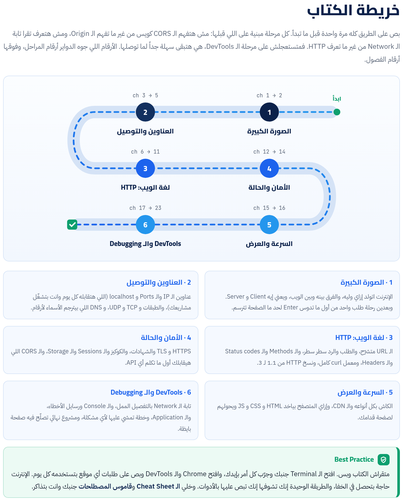

الكتاب ده ماشي معاك على 6 مراحل. هنبدأ بالحكاية: الإنترنت اتعمل ليه، والصفحة بتوصلك إزاي. وبعدين نفهم العناوين والتوصيل، ولغة الويب HTTP، والأمان والكوكيز والـ CORS، والسرعة والكاش. وفي الآخر هنفتح DevTools ونتعلم نمسك بيها أي مشكلة. كل حاجة هنجربها بإيدنا من الـ Terminal على الـ Mac ومن المتصفح.

:::tip[تحميل]
- [الكتاب كامل PDF](/biginner-journey/downloads/03-web-book.pdf)
- [الـ Cheat Sheet PDF](/biginner-journey/downloads/03-web-cheatsheet.pdf)
:::

## خريطة الكتاب

- **1 · الصورة الكبيرة**: الإنترنت اتولد إزاي وليه، والفرق بينه وبين الويب، ويعني إيه Client و Server. وبعدين رحلة طلب واحد من أول ما تدوس Enter لحد ما الصفحة تترسم.
- **2 · العناوين والتوصيل**: عناوين الـ IP والـ Ports و localhost (اللي هتقابله كل يوم وانت بتشغّل مشاريعك)، والطبقات و TCP و UDP، و DNS اللي بيترجم الأسماء لأرقام.
- **3 · لغة الويب: HTTP**: الـ URL متشرّح، والطلب والرد سطر سطر، والـ Methods والـ Status codes والـ Headers، ومعمل curl كامل، ونسخ HTTP من 1.1 لـ 3.
- **4 · الأمان والحالة**: HTTPS و TLS والشهادات، والكوكيز والـ Sessions والـ Storage، والـ CORS اللي هيقابلك أول ما تكلم أي API.
- **5 · السرعة والعرض**: الكاش بكل أنواعه والـ CDN، وإزاي المتصفح بياخد HTML و CSS و JS ويحولهم لصفحة قدامك.
- **6 · DevTools والـ Debugging**: تابة الـ Network بالتفصيل الممل، والـ Console ورسايل الأخطاء، والـ Application، وخطة تمشي عليها لأي مشكلة، ومشروع نهائي تصلّح فيه صفحة بايظة.

## الفصول

**المرحلة 1 · الصورة الكبيرة**

- [الفصل 1: الحكاية من الأول: الإنترنت اتولد ليه؟](./ch01/)
- [الفصل 2: رحلة طلب واحد: من Enter لحد ما الصفحة تظهر](./ch02/)

**المرحلة 2 · العناوين والتوصيل**

- [الفصل 3: العناوين: IP والـ Ports و localhost](./ch03/)
- [الفصل 4: الطبقات و TCP و UDP: إزاي الكلام يوصل سليم](./ch04/)
- [الفصل 5: DNS: دليل التليفونات بتاع الإنترنت](./ch05/)

**المرحلة 3 · لغة الويب: HTTP**

- [الفصل 6: الـ URL متشرّح: كل حرف في العنوان ليه شغلانة](./ch06/)
- [الفصل 7: HTTP: الطلب والرد سطر سطر](./ch07/)
- [الفصل 8: الـ Status Codes: السيرفر بيقولك إيه بالأرقام](./ch08/)
- [الفصل 9: الـ Headers: الكلام اللي على الظرف](./ch09/)
- [الفصل 10: معمل curl: متصفح في سطر واحد](./ch10/)
- [الفصل 11: HTTP/1.1 و 2 و 3: نفس اللغة، طرق أسرع](./ch11/)

**المرحلة 4 · الأمان والحالة**

- [الفصل 12: HTTPS و TLS: القفل اللي جنب العنوان](./ch12/)
- [الفصل 13: الكوكيز والـ Sessions: إزاي السيرفر بيفتكرك](./ch13/)
- [الفصل 14: CORS: أشهر خطأ أحمر في الـ Console](./ch14/)

**المرحلة 5 · السرعة والعرض**

- [الفصل 15: الكاش والـ CDN: أسرع طلب هو اللي مبيتبعتش](./ch15/)
- [الفصل 16: من HTML لبيكسلات: المتصفح بيرسم إزاي](./ch16/)

**المرحلة 6 · DevTools والـ Debugging**

- [الفصل 17: DevTools: الشبابيك اللي جوه المتصفح](./ch17/)
- [الفصل 18: Network Panel (1): تقرا قايمة الطلبات](./ch18/)
- [الفصل 19: Network Panel (2): جوه الطلب الواحد](./ch19/)
- [الفصل 20: الـ Console: تقرا الأخطاء وتكلم الصفحة](./ch20/)
- [الفصل 21: Application Panel و Safari: الكوكيز والتخزين بإيدك](./ch21/)
- [الفصل 22: الـ Debugging بطريقة: كودي ولا السيرفر؟](./ch22/)
- [الفصل 23: المشروع النهائي: صفحة بايظة وانت المحقق](./ch23/)

**الملاحق**

- [ملحق أ: Cheat Sheet وجدول الـ Flags وجدول الرموز](./appendix-1/)
- [ملحق ب: قاموس المصطلحات](./appendix-2/)
- [ملحق ج: مصادر للاستزادة](./appendix-3/)
- [ملحق د: الإجابات والحلول](./appendix-4/)
