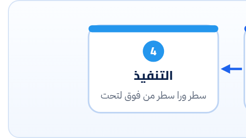

<small>المرحلة 1 · التشغيل والقراية</small>

قبل ما نقرا ولا سطر، لازم نفهم احنا بنتعامل مع إيه. ليه Python بالذات هي لغة الـ AI؟ يعني إيه ملف .py؟ ومين اللي بيقراه وينفّذه، وبأي ترتيب؟ الفصل ده الأساس اللي كل حاجة بعده هتتبني عليه.

:::note[بعد الفصل ده هتكون عارف]
- الحكاية: Python جت منين وليه بقت لغة الـ AI
- يعني إيه Script ويعني إيه Interpreter
- الاسكريبت بيتنفّذ بأي ترتيب: من فوق لتحت
- الـ Indentation (المسافات) في Python جزء من اللغة
- الـ Comments والـ REPL وإزاي تجرّب سطر لوحده
- الفرق بين Python و JavaScript في التشغيل
:::

<a id="s1-1"></a>

## 1.1 الحكاية: من "مهام مملة" لـ "لغة الـ AI"

خلينا نرجع لآخر الثمانينات. وقتها لو عايز تكتب برنامج صغير يعمل حاجة مملة بدالك، زي إنه يغيّر أسامي 500 ملف، أو يقرا ملف بيانات ويطلّع منه أرقام، كان قدامك اختيارين وحشين. الأول لغة زي C: قوية جداً، بس تكتب 50 سطر علشان تفتح ملف، وأي غلطة صغيرة تطيّر البرنامج كله. والتاني سكريبتات الـ Shell: سريعة في الكتابة، بس شكلها رموز ملخبطة، ولما تكبر شوية محدش يقدر يقراها، ولا حتى اللي كتبها.

<strong>وهنا كانت المشكلة:</strong> مفيش لغة في النص. لغة سهلة تقراها زي الإنجليزي، وفي نفس الوقت قوية كفاية تعمل حاجات حقيقية.

في أجازة الكريسماس سنة 1989 بدأ مبرمج هولندي اسمه **Guido van Rossum** يكتب لغة جديدة كمشروع جانبي، ونزّل أول نسخة منها سنة 1991. وسمّاها Python مش على اسم التعبان، لكن على اسم برنامج كوميدي إنجليزي كان بيحبه (Monty Python). والفكرة كانت بسيطة: <strong>الكود بيتقري أكتر بكتير ما بيتكتب، فخلّي القراية سهلة.</strong> عشان كده Python من غير أقواس معقّدة ولا فاصلة منقوطة في آخر كل سطر، والكلمات فيها شبه الإنجليزي: `for` و`in` و`if` و`not` و`with`.

مع الوقت بقى ليها ميزة تانية مهمة: "**Batteries included**"، يعني اللغة نازلة معاها مكتبة ضخمة جاهزة. عايز تقرا CSV؟ في `csv`. JSON؟ في `json`. فولدرات؟ في `pathlib`. وفوق ده بنى الناس آلاف المكتبات الإضافية.

طب إزاي بقت لغة الـ AI؟ في الألفينات العلماء والباحثين حبّوها عشان سهلة، فاتعملت لها مكتبات حسابات سريعة زي **NumPy** (جواها كود C سريع، وانت بتكلّمه بـ Python سهلة). وعلى الأساس ده اتبنت مكتبات تعلّم الآلة كلها. فلما جت شركات زي OpenAI و Google تعمل APIs للموديلات بتاعتها، أول **SDK** رسمي عملوه كان لـ Python، عشان ده المكان اللي الناس كلها فيه. ودي بالظبط النقطة اللي انت داخل منها: اسكريبتات صغيرة بتقرا ملفاتك، وتبعتها لموديل AI، وتكتب النتيجة في ملف.

:::note[Python 2 و Python 3: حكاية لازم تعرفها]
سنة 2008 نزلت Python 3، وكانت مش متوافقة مع Python 2. يعني كود قديم كتير مكانش بيشتغل عليها. الناس فضلت على الاتنين سنين طويلة، لحد ما Python 2 اتقفلت رسمياً أول يناير 2020. ولو لقيت في النت كود فيه `print "hello"` من غير أقواس، يبقى ده Python 2 قديم. احنا هنا Python 3 بس، وعشان كده الأمر على الـ Mac اسمه `python3` مش `python`.
:::

**المصادر الرسمية:** [docs.python.org · The Python Tutorial](https://docs.python.org/3/tutorial/index.html) · [General Python FAQ](https://docs.python.org/3/faq/general.html)

<a id="s1-2"></a>

## 1.2 يعني إيه "اسكريبت"؟

الاسكريبت مجرد **ملف نص عادي** امتداده `.py`. تقدر تفتحه في TextEdit أو VS Code وتقراه. مفيش فيه أي سحر. اللي بيحوّله لأفعال برنامج اسمه **Python Interpreter**، وده اللي بتشغّله لما تكتب `python3` في الـ Terminal.

**تشريح الأمر**

```sh
python3 hello.py
```

1. `python3`: اسم برنامج الـ Interpreter نفسه، يعني "المترجم الفوري". هو اللي هيقرا الملف وينفّذه.
2. `hello.py`: الملف اللي عايزه يقراه. المسار ده بيتحسب من الفولدر اللي انت واقف فيه في الـ Terminal. لو الملف في حتة تانية، اكتب مساره كامل.

طب الـ Interpreter بيعمل إيه بالظبط؟ بص على الرسمة:



*رحلة الاسكريبت من ملف نص لأفعال: الـ Interpreter بيقرا الملف كله الأول، ولو فيه SyntaxError بيقف قبل ما ينفّذ أي حاجة. بعدين بيترجمه لـ Bytecode وينفّذه من فوق لتحت.*

1. <strong>بيقرا الملف كله ويفحص الكتابة.</strong> لو في قوس ناقص أو مسافات غلط، بيطلّع `SyntaxError` وميشغّلش ولا سطر.
2. <strong>بيترجمه لـ Bytecode.</strong> دي لغة وسيطة سهلة على الكمبيوتر. لو لقيت فولدر اسمه `__pycache__` فيه ملفات `.pyc` جنب ملفاتك، ده هو. متخافش منه، ومتعدّلش فيه، وتقدر تمسحه عادي وهيتعمل تاني.
3. <strong>بينفّذ من فوق لتحت، سطر ورا سطر.</strong> ودي أهم جملة في الفصل. الاسكريبت مش بيقفز لوحده. لو السطر 10 بينادي على حاجة لسه متعرّفتش غير في السطر 20، هيطلع خطأ.

:::note[Interpreter ولا Compiler؟]
في لغات زي C و Go، فيه خطوة منفصلة اسمها Compile بتطلّع ملف برنامج جاهز (Binary) تشغّله بعدين. في Python مفيش الخطوة دي قدامك: انت بتدي الـ Interpreter ملف النص على طول، وهو بيترجم وينفّذ في نفس اللحظة. وعشان كده لازم Python تكون متسطّبة على أي جهاز هيشغّل الاسكريبت.
:::

<a id="s1-3"></a>

## 1.3 أول اسكريبت… متشرّح حرف حرف

خلينا نكتب اسكريبت صغير جداً بس فيه أهم الحاجات اللي هتشوفها في أي اسكريبت:

```python title="hello.py"
# first script: greet and count files
from pathlib import Path

name = "Content Engineer"
files = list(Path(".").glob("*.txt"))

print(f"Hello, {name}")
if len(files) == 0:
    print("No .txt files here")
else:
    print(f"Found {len(files)} files")
```

```python title="hello.py سطر سطر"
# first script: greet and count files
from pathlib import Path
name = "Content Engineer"
files = list(Path(".").glob("*.txt"))
print(f"Hello, {name}")
if len(files) == 0:
    print("No .txt files here")
else:
```

1. `# first script: greet and count files`: <strong>Comment.</strong> أي حاجة بعد `#` لحد آخر السطر Python بتتجاهلها خالص. دي ملاحظات للبني آدم اللي بيقرا. (في JS بتبقى `//`.)
2. `from pathlib import Path`: **import**: "هات لي أداة جاهزة". من المكتبة `pathlib` (جاية مع Python) هات حاجة اسمها `Path` بتتعامل مع مسارات الملفات. ليها فصل كامل لوحدها.
3. `name = "Content Engineer"`: **Variable** اسمه `name`، و`=` معناها "حط في": حط النص ده في الصندوق ده. والنص بين علامتين `" "` اسمه String.
4. `files = list(Path(".").glob("*.txt"))`: `Path(".")` = الفولدر الحالي (النقطة يعني "هنا"). و`.glob("*.txt")` = دوّر على كل ملف آخره `.txt`. و`list(...)` = حط النتايج في List. كل ده هنفصّصه بعدين.
5. `print(f"Hello, {name}")`: `print` = اطبع على الشاشة. والـ `f` قبل العلامة = **f-string**: أي حاجة بين `{ }` بتتبدّل بقيمتها، فهيطبع `Hello, Content Engineer`. (ونصوص الكود في الكتاب هنكتبها إنجليزي، عشان العربي جوه الكود بيظهر ملخبط في المحررات بسبب اتجاه الكتابة.)
6. `if len(files) == 0:`: `if` = لو. و`len()` = عدد العناصر. و`==` = "بيساوي؟" (سؤال، مش "حط في"). والـ `:` في الآخر معناها "اللي جاي تحت ده تابع ليّا".
7. `print("No .txt files here")`: لاحظ الـ **4 مسافات** في الأول. هي دي اللي بتقول لـ Python إن السطر ده جوه الـ `if`.
8. `else:`: وإلا (لو الشرط طلع غلط) اعمل اللي تحت.

<a id="s1-4"></a>

## 1.4 المسافات في Python مش زينة

دي أكبر حاجة هتلاحظها لو جاي من JavaScript. في JS الكود اللي جوه `if` بيتحط بين أقواس `{ }`، والمسافات مجرد تنسيق. في Python مفيش أقواس: <strong>المسافات (Indentation) هي اللي بتحدد مين جوه مين.</strong>

:::tip[حاجة مشتركة: نفس الـ if في JS]
نفس المنطق بالظبط، بس الـ Block محدود بأقواس:

```js title="JavaScript"
if (files.length === 0) {
  console.log("No .txt files here");
} else {
  console.log(`Found ${files.length} files`);
}
```

الـ `{` في JS = الـ `:` + المسافات في Python. والـ template string `` `${x}` `` = الـ f-string `f"{x}"`.
:::

:::danger[مشكلة: IndentationError: unexpected indent]
شغّلت اسكريبت والخطأ ده طلع. معناه إن في سطر عليه مسافات زيادة أو ناقصة مش متوقعة، أو خلطت بين Tab ومسافات في نفس الملف.

<strong>الحل:</strong> روح للسطر اللي الخطأ بيقول عليه وظبّط المسافات زي السطر اللي فوقه. والقاعدة الرسمية في Python (PEP 8): استخدم **4 مسافات** لكل مستوى، ومتستخدمش Tab. و VS Code بيعمل ده لوحده لملفات `.py`.
:::

**المصادر الرسمية:** [PEP 8 · Style Guide for Python Code](https://peps.python.org/pep-0008/) · [Lexical analysis · Indentation](https://docs.python.org/3/reference/lexical_analysis.html#indentation)

<a id="s1-5"></a>

## 1.5 الـ REPL: ملعب تجرّب فيه سطر لوحده

أوقات هتقابل سطر مش فاهمه، زي `"a,b,c".split(",")`. أسرع حل: جرّبه. اكتب `python3` لوحده في الـ Terminal من غير اسم ملف، هتدخل حاجة اسمها **REPL** (Read, Eval, Print, Loop): بيقرا السطر، ينفّذه، يطبع النتيجة، ويستناك تكتب اللي بعده.

```python
$ python3
Python 3.14.9 (main, Oct 21 2026) [Clang] on darwin
Type "help", "copyright", "credits" or "license" for more information.
>>> "a,b,c".split(",")
['a', 'b', 'c']
>>> len("مرحبا")
5
>>> exit()
```

| الأمر | بيعمل إيه |
|---|---|
| `>>>` | ده الـ Prompt بتاع Python، يعني "اكتب سطر". متنسخهوش مع الكود لو لقيته في مثال. |
| `...` | بيطلع لو كتبت سطر بيفتح Block (زي `if x:`). كمّل السطور واضغط Enter على سطر فاضي علشان يتنفّذ. |
| `exit()` | تخرج من الـ REPL. أو Ctrl+D. |

:::tip[حاجة مشتركة: الـ Console في المتصفح]
الـ REPL ده نفس فكرة الـ Console في Chrome DevTools، أو إنك تكتب `node` لوحده في الـ Terminal. نفس الـ Loop: سطر، نتيجة، سطر.
:::

<a id="s1-6"></a>

## 1.6 Python و JavaScript: نفس الأفكار، لهجة تانية

**مقارنة سريعة: الحاجات اللي هتقابلها الأول**

| الفكرة | Python | JavaScript |
|---|---|---|
| تشغيل ملف | `python3 app.py` | `node app.js` |
| Comment | `# ...` | `// ...` |
| Block | `:` + 4 مسافات | `{ ... }` |
| طباعة | `print(x)` | `console.log(x)` |
| متغير | `x = 5` | `let x = 5` |
| نص فيه متغير | `f"Hi {name}"` | `` `Hi ${name}` `` |
| استيراد | `from x import y` | `import { y } from "x"` |
| مدير الحزم | `pip` | `npm` |
| ملف الاعتماديات | `requirements.txt` | `package.json` |

:::tip[ملخص الفصل]
- Python اتعملت علشان الكود يبقى سهل في القراية، وبقت لغة الـ AI عشان العلماء والمكتبات كانوا فيها، فكل شركات الـ AI نزّلت SDK ليها الأول.
- الاسكريبت = ملف نص `.py`، والـ Interpreter (`python3`) بيقراه وينفّذه.
- الترتيب: فحص الكتابة كلها الأول (SyntaxError بيوقف كل حاجة)، وبعدين تنفيذ من فوق لتحت.
- المسافات (4 لكل مستوى) هي اللي بتحدد الـ Blocks، والـ `:` بتفتح Block.
- الـ REPL (`python3` لوحده) مكان تجرّب فيه أي سطر مش فاهمه.
:::

### صح ولا غلط؟

1. لو في SyntaxError في السطر الأخير، Python هتنفّذ كل السطور اللي قبله الأول.
2. تقدر تمسح فولدر `__pycache__` من غير ما تبوّظ حاجة.
3. في Python، المسافات في أول السطر مجرد تنسيق زي JavaScript.

### أسئلة مراجعة

1. إيه المشكلة اللي Python جت تحلّها في الأول؟ وليه بقت لغة الـ AI بالذات؟
2. إيه الفرق بين `=` و `==`؟
3. لو لقيت `print "done"` في كود من النت، تستنتج إيه؟
4. اشرح وظيفة الـ `f` في `f"Found {n} files"`.

### تحديات الفصل

<small>جرّبها بإيدك، والحلول في ملحق الإجابات.</small>

1. **[سهل]** اكتب `hello.py` زي اللي في الفصل وشغّله مرة في فولدر فيه ملفات `.txt` ومرة في فولدر فاضي.
2. **[متوسط]** شيل الـ 4 مسافات من قدام `print` اللي جوه الـ `if` وشغّل. اقرا رسالة الخطأ: بتقول إيه وفي أنهي سطر؟
3. **[صعب]** افتح الـ REPL وجرّب: `"Hello".upper()` و `"a-b-c".split("-")` و `len([1,2,3])`. اكتب جنب كل واحد بكلامك هو عمل إيه.
