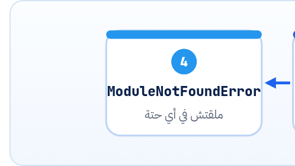

<small>المرحلة 2 · لغة Python</small>

from google import genai. و from google.genai import types. و import pandas as pd. و from .config import MODEL. أول 10 سطور في أي اسكريبت AI كلها import، ولو مفهمتهاش مش هتعرف أي اسم في الاسكريبت جاي منين. الفصل ده بيشرح كل شكل import، و Python بتدوّر على الحاجة فين، وليه اسم الـ pip مش دايماً اسم الـ import.

:::note[بعد الفصل ده هتكون عارف]
- الأشكال الخمسة: import x، و import x as y، و from x import y، و from x.y import z، و from . import
- الفرق بين Module و Package والـ \_\_init\_\_.py
- Python بتدوّر فين: sys.path و site-packages
- ليه pip install python-dotenv بس import dotenv
- ترتيب الـ imports: Standard library، بعدين Third-party، بعدين Local
- الفخ: إنك تسمّي ملفك openai.py
:::

<a id="s7-1"></a>

## 7.1 قبل كده: كل الكود في ملف واحد

اسكريبت بيكبر لـ 2000 سطر في ملف واحد بيبقى كابوس: متعرفش تلاقي حاجة، ومينفعش تستخدم نفس الفانكشن في اسكريبت تاني غير لو نسختها. <strong>فاتطور الحل:</strong> تقسّم الكود لملفات، وكل ملف اسمه **Module**، وتجيب منه اللي محتاجه بـ `import`. والفكرة دي هي اللي خلّت مكتبات زي `openai` ممكنة أصلاً: حد كتب آلاف السطور في ملفات، وانت بتجيب منهم اللي محتاجه في سطر.

<a id="s7-2"></a>

## 7.2 الأشكال الخمسة

```python title="كل أشكال الـ import"
import json
import pandas as pd
from pathlib import Path
from google.genai import types
from .config import MODEL
from openai import OpenAI, RateLimitError
```

1. `import json`: هات الـ Module كلها باسمها. وتستخدم اللي جواها بنقطة: `json.loads(...)`. ميزته إنك وانت بتقرا عارف `loads` جاية منين.
2. `import pandas as pd`: نفس الكلام، بس اديها اسم مستعار أقصر: `pd.read_csv(...)`. و`pd` و`np` (numpy) أسامي متعارف عليها في الدنيا كلها.
3. `from pathlib import Path`: هات حاجة واحدة بعينها من الـ Module، وتستخدمها على طول من غير نقطة: `Path("notes")`.
4. `from google.genai import types`: النقطة في اسم الـ Module = فولدر جوه فولدر: Package `google`، جواها `genai`، جواها Module `types`. وبعدين تكتب `types.GenerateContentConfig(...)`.
5. `from .config import MODEL`: النقطة في الأول = **Relative import**: "من ملف `config.py` اللي جنبي في نفس الـ Package". بتلاقيها في المشاريع اللي من كذا ملف (فصل 31).
6. `from openai import OpenAI, RateLimitError`: أكتر من حاجة في سطر بفاصلة. ولو طويلة بتتحط بين أقواس على كذا سطر.

:::caution[from x import * : متعملهاش]
النجمة معناها "هات كل حاجة". المشكلة إنك وانت بتقرا مش هتعرف أي اسم جاي منين، وممكن اسم يغطّي على اسم تاني من غير ما تحس. لو لقيتها في اسكريبت الـ AI كتبه، اطلب منه يكتب الأسامي صريحة.
:::

:::tip[حاجة مشتركة: ES Modules]
`from pathlib import Path` = `import { Path } from "pathlib"`. و`import pandas as pd` = `import * as pd from "pandas"`. و`from .config import MODEL` = `import { MODEL } from "./config.js"`. الفرق إن Python مبتكتبش امتداد الملف، وبتفصل الفولدرات بنقطة مش `/`.
:::

<a id="s7-3"></a>

## 7.3 Module و Package

#### Module

ملف `.py` واحد. `config.py` هو Module اسمها `config`.

#### Package

فولدر فيه Modules. وغالباً فيه ملف اسمه `__init__.py`، ودا اللي بيتنفّذ لما تعمل `import` للفولدر نفسه. وفي حالة `from openai import OpenAI`، الـ `OpenAI` متعرّفة جوه Package `openai`، وجاية للـ `__init__.py` بتاعها.

```text title="شكل Package على الهارد (مختصر)"
.venv/lib/python3.14/site-packages/
├── openai/
│   ├── __init__.py          ← from openai import OpenAI
│   ├── _client.py
│   └── resources/responses/...
├── google/
│   └── genai/
│       ├── __init__.py      ← from google import genai
│       ├── types.py         ← from google.genai import types
│       └── errors.py        ← from google.genai import errors
└── dotenv/                  ← import dotenv (pip: python-dotenv)
```

<a id="s7-4"></a>

## 7.4 Python بتدوّر فين؟

لما تكتب `import openai`، Python بتدوّر بالترتيب في قايمة فولدرات اسمها `sys.path`، وأول ما تلاقي حاجة بالاسم ده بتقف:



*ترتيب البحث عن الـ import. فولدر الاسكريبت الأول: علشان كده لو عندك ملف اسمه openai.py جنب الاسكريبت، Python هتستورده هو بدل المكتبة الحقيقية.*

```python
>>> import sys
>>> for p in sys.path: print(p)
/Users/you/ai-scripts
/opt/homebrew/Cellar/python@3.14/3.14.9/Frameworks/.../lib/python3.14
/Users/you/ai-scripts/.venv/lib/python3.14/site-packages
>>> import openai; print(openai.__file__)
/Users/you/ai-scripts/.venv/lib/python3.14/site-packages/openai/__init__.py
```

:::danger[مشكلة: ImportError: cannot import name 'OpenAI' from 'openai' (/Users/you/ai-scripts/openai.py)]
لاحظ المسار اللي في آخر الرسالة: مش جوه `site-packages`، ده ملف عندك! عملت ملف تجارب وسمّيته `openai.py` (أو `json.py` أو `csv.py`). Python لقت ملفك الأول في فولدر الاسكريبت، واستوردته هو بدل المكتبة، وطبعاً ملفك مفيهوش `OpenAI`.

<strong>الحل:</strong> غيّر اسم ملفك لحاجة زي `test_openai.py`، وامسح `__pycache__` اللي جنبه. والقاعدة: متسمّيش ملفاتك بأسامي مكتبات.
:::

<a id="s7-5"></a>

## 7.5 اسم الـ pip مش دايماً اسم الـ import

**أسامي هتقابلها في اسكريبتات الـ AI**

| pip install | import | بتعمل إيه |
|---|---|---|
| `openai` | `from openai import OpenAI` | SDK بتاع OpenAI (وبيستخدم لـ OpenRouter كمان) |
| `google-genai` | `from google import genai` | SDK بتاع Gemini |
| `anthropic` | `import anthropic` | SDK بتاع Claude |
| `python-dotenv` | `from dotenv import load_dotenv` | يقرا ملف `.env` |
| `pandas[excel]` | `import pandas as pd` | جداول و Excel |
| `openpyxl` | `import openpyxl` | Excel بالتفصيل |
| `Pillow` | `from PIL import Image` | صور |
| `beautifulsoup4` | `from bs4 import BeautifulSoup` | قراية HTML |
| `PyYAML` | `import yaml` | ملفات YAML |
| `pydantic` | `from pydantic import BaseModel` | شكل البيانات (Structured output) |
| `tqdm` | `from tqdm import tqdm` | شريط التقدم |

:::caution[google-generativeai القديمة]
لو لقيت في كود قديم `import google.generativeai as genai` و`genai.configure(api_key=...)`، دي المكتبة القديمة `google-generativeai`. Google بتقول دلوقتي إن الـ SDK الرسمي هو `google-genai` (`from google import genai`)، وإن المكتبات القديمة بقت Deprecated من 30 نوفمبر 2025 ومبتوصلش للمميزات الجديدة. و`google-genai` هو اللي الكتاب كله ماشي عليه.
:::

**المصادر الرسمية:** [docs.python.org · Modules](https://docs.python.org/3/tutorial/modules.html) · [The import system](https://docs.python.org/3/reference/import.html) · [sys.path](https://docs.python.org/3/library/sys.html#sys.path) · [ai.google.dev · Gemini API libraries](https://ai.google.dev/gemini-api/docs/libraries)

<a id="s7-6"></a>

## 7.6 ترتيب الـ imports: اقراه كخريطة

```python
import json                      # 1) Standard library: جاية مع Python
import time
from pathlib import Path

import pandas as pd              # 2) Third-party: اتسطّبت بـ pip
from openai import OpenAI
from tqdm import tqdm

from .prompts import SUMMARY     # 3) Local: ملفات المشروع نفسه
from .files import list_inputs
```

ده العرف الرسمي (PEP 8)، وبيخليك من أول نظرة تعرف: الاسكريبت بيعتمد على أنهي مكتبات خارجية (الحتة 2، ودي اللي لازم تبقى في requirements.txt)، وإيه ملفات المشروع اللي لازم تفتحها (الحتة 3).

:::tip[ملخص الفصل]
- `import x` و `x.thing`، أو `from x import thing` و `thing` على طول، و`as` لاسم مستعار.
- النقطة في الاسم = فولدر جوه فولدر. والنقطة في الأول = ملف جنبي.
- Python بتدوّر: فولدر الاسكريبت، بعدين Standard library، بعدين site-packages.
- متسمّيش ملفاتك بأسامي مكتبات زي `openai.py`.
- اسم الـ pip ممكن يختلف عن الـ import: `python-dotenv` و `dotenv`، و`google-genai` و `google.genai`.
:::

### صح ولا غلط؟

1. `pip install google-genai` وبعدين `import google_genai` هيشتغل.
2. بعد `from pathlib import Path` تقدر تكتب `Path("x")` على طول.
3. ملف اسمه `json.py` في نفس فولدر الاسكريبت ممكن يبوّظ `import json`.

### أسئلة مراجعة

1. اشرح الفرق بين `import json` و `from json import loads` من ناحية القراية.
2. إيه معنى كل نقطة في `from google.genai import types`؟
3. عندك ModuleNotFoundError: No module named 'dotenv'. إيه الاحتمالات، وهتسطّب إيه؟

### تحديات الفصل

<small>جرّبها بإيدك، والحلول في ملحق الإجابات.</small>

1. **[سهل]** اطبع `openai.__file__` و`genai.__file__` من الـ venv بتاعك.
2. **[متوسط]** اعمل `helpers.py` فيه فانكشن، واعمل لها import من `main.py` بالشكلين.
3. **[صعب]** اعمل الفخ بإيدك: ملف `openai.py` فاضي وجنبه اسكريبت فيه `from openai import OpenAI`. اقرا الخطأ، وبعدين صلّحه.
