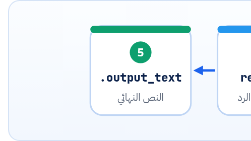

<small>المرحلة 2 · لغة Python</small>

client = OpenAI(). و response.output\_text. و class Summary(BaseModel). الـ SDKs كلها مبنية على Objects، ومن غير ما تفهم النقطة دي بتعمل إيه، سطر زي client.models.generate\_content هيفضل تعويذة. احنا مش هنتعلم نكتب Classes معقدة، هنتعلم نقراها.

:::note[بعد الفصل ده هتكون عارف]
- يعني إيه Class ويعني إيه Object (Instance)
- \_\_init\_\_ و self والـ Attributes والـ Methods
- تقرا سلسلة النقط: client.responses.create(...)
- تتفرج على أي Object رجع من SDK: print و type و model\_dump\_json
- الـ dataclass والـ Pydantic BaseModel، وليه مهمين للـ AI
- الـ with و Context managers
:::

<a id="s8-1"></a>

## 8.1 الفكرة: بيانات + أفعال في حاجة واحدة

قبل الـ Objects كنت هتلاقي كود فيه API key في متغير، و URL في متغير، و Timeout في متغير، وكل فانكشن بتاخد التلاتة دول كل مرة: `call_api(key, url, timeout, model, text)`. لو عندك 20 فانكشن، كلهم بيشيلوا نفس الشنطة. <strong>فاتطور الحل:</strong> حط البيانات والدوال اللي بتستخدمها في حاجة واحدة اسمها **Object**. والـ **Class** هي "الفورمة" أو "الرسم الهندسي" اللي بنعمل منه Objects.

```python title="Class صغيرة نقراها"
class Pricing:
    def __init__(self, input_per_mtok, output_per_mtok):
        self.input_per_mtok = input_per_mtok
        self.output_per_mtok = output_per_mtok

    def cost(self, input_tokens, output_tokens):
        return (input_tokens * self.input_per_mtok
                + output_tokens * self.output_per_mtok) / 1_000_000

luna = Pricing(0.10, 0.50)
print(luna.cost(2_000, 300))    # 0.00035
```

```python title="سطر سطر"
class Pricing:
def __init__(self, input_per_mtok, ...):
self.input_per_mtok = input_per_mtok
def cost(self, input_tokens, output_tokens):
luna = Pricing(0.10, 0.50)
luna.cost(2_000, 300)
```

1. `class Pricing:`: "عرّف Class اسمها Pricing". العرف إن أسامي الـ Classes بتبدأ بحرف كبير (CamelCase)، فلما تشوف `OpenAI` أو `Path` أو `BaseModel` عارف إنها Classes.
2. `def __init__(self, input_per_mtok, ...):`: الـ **Constructor**: بيتنفّذ لوحده أول ما تعمل Object جديد. و`self` = "الـ Object اللي لسه بيتعمل".
3. `self.input_per_mtok = input_per_mtok`: بيخزّن القيمة "جوه" الـ Object كـ **Attribute**. على الشمال `self.x` (جوه الـ Object)، وعلى اليمين `x` (اللي اتبعت).
4. `def cost(self, input_tokens, output_tokens):`: **Method**: فانكشن جوه Class. وبتاخد `self` علشان تقدر توصل لبيانات الـ Object.
5. `luna = Pricing(0.10, 0.50)`: نداء الـ Class كأنها فانكشن = اعمل **Object** (أو Instance) جديد. Python بتنادي `__init__` وتبعت `self` لوحدها.
6. `luna.cost(2_000, 300)`: نادي الـ Method. انت باعت 2 Arguments بس، و`self` = `luna` بيتبعت لوحده.

:::tip[حاجة مشتركة: class في JS]
نفس الشكل تقريباً: `class Pricing { constructor(i, o) { this.i = i } cost() {...} }` و`new Pricing(0.1, 0.5)`. الفروق: `__init__` = `constructor`، و`self` = `this` بس مكتوب صريح كأول Parameter، ومفيش `new` في Python.
:::

<a id="s8-2"></a>

## 8.2 سلسلة النقط: client.responses.create

دلوقتي نقدر نفك أشهر سطر في الكتاب. <strong>بص، النقطة معناها "اللي جوه"</strong>، واقراها من الشمال لليمين:

**تشريح الأمر**

```python
response = client.responses.create(model="gpt-6-luna", input="Hi")
```

1. `client`: Object من Class `OpenAI` اتعمل بـ `client = OpenAI()`. شايل جواه الـ API key والـ Base URL والـ Timeout والـ Retries.
2. `.responses`: Attribute جوه الـ client، وهو كمان Object (من Class اسمها `Responses`) فيه كل الحاجات الخاصة بالـ Responses API. وجنبه `client.files` و`client.embeddings` و`client.batches` و`client.chat`.
3. `.create`: Method جوه `responses`: "اعمل Response جديد"، يعني ابعت Request للموديل.
4. `(…)`: الأقواس = نفّذ دلوقتي، والـ Keyword arguments جواها.
5. `response`: اللي رجع: Object تاني (من Class `Response`) فيه الرد. وتوصل لحاجاته بنقط برضه: `response.output_text` و`response.usage.input_tokens`.



*سلسلة النقط في سطر واحد. نفس الفكرة بالظبط في Gemini: client.models.generate\_content(...) ثم response.text.*

<a id="s8-3"></a>

## 8.3 اتفرج على أي Object رجع لك

أهم مهارة في الفصل ده: لما SDK يرجّع لك حاجة ومش عارف جواها إيه، **متخمّنش، اتفرج**:

| الأمر | بيعمل إيه |
|---|---|
| `print(type(response))` | النوع. مثلاً `<class 'openai.types.responses.response.Response'>`. |
| `print(response.model_dump_json(indent=2))` | كل حاجة جوه الـ Object كـ JSON متنسق. ده شغّال في `openai` وفي `google-genai` لأن الاتنين مبنيين على Pydantic. |
| `response.model_dump()` | نفس الكلام بس كـ dict تقدر تحفظه أو تكتبه JSON. |
| `dir(response)` | قايمة بكل الـ Attributes والـ Methods. تجاهل اللي بيبدأ بـ `_`. |
| `vars(obj)` | الـ Attributes بقيمها، لـ Objects العادية. |

:::tip[Best Practice]
الـ SDK Objects بتتقري بالنقطة (`response.usage.input_tokens`) مش بالأقواس (`response["usage"]`). ولو عملت `model_dump()` بقت dict، وساعتها بالأقواس. لو جربت النقطة على dict أو الأقواس على Object، هيطلع `AttributeError` أو `TypeError: ... is not subscriptable`.
:::

<a id="s8-4"></a>

## 8.4 dataclass و Pydantic: Classes لشكل البيانات

في اسكريبتات الـ AI هتشوف Classes كتير مبتعملش حاجة غير إنها بتوصف شكل البيانات. ودي أهمهم:

```python title="Pydantic: شكل الرد اللي عايزه من الموديل"
from pydantic import BaseModel, Field

class ArticleInfo(BaseModel):
    title: str
    language: str = Field(description="ISO code like en or ar")
    keywords: list[str]
    word_count: int
```

```python title="قراية الـ BaseModel"
class ArticleInfo(BaseModel):
title: str
Field(description=...)
keywords: list[str]
```

1. `class ArticleInfo(BaseModel):`: الأقواس بعد اسم الـ Class = **Inheritance**: "ArticleInfo ورثت كل قدرات BaseModel". يعني من غير ما تكتب ولا Method، بقت تعرف تتأكد من البيانات وتتحوّل لـ JSON.
2. `title: str`: هنا الـ Type hints **بتفرق**: Pydantic بتقراها وبتتأكد فعلاً إن `title` نص. ولو جالها رقم بدل نص بترمي `ValidationError`.
3. `Field(description=...)`: وصف بيتحط في الـ JSON Schema. والموديل بيقراه لما تطلب Structured output، فهو "تعليمات" للموديل كمان.
4. `keywords: list[str]`: List نصوص.

وليه ده مهم؟ لأن الـ SDKs بتقبل الـ Class دي على طول. في OpenAI: `client.responses.parse(..., text_format=ArticleInfo)`، وفي Gemini: `response_json_schema=ArticleInfo.model_json_schema()`. وده فصل 21 كله.

| الأمر | بيعمل إيه |
|---|---|
| `ArticleInfo.model_json_schema()` | يطلّع JSON Schema (وصف الشكل) من الـ Class. |
| `ArticleInfo.model_validate_json(text)` | ياخد نص JSON (زي رد الموديل)، ويتأكد إنه مطابق، ويرجّع Object. |
| `info.model_dump()` | الـ Object لـ dict (علشان تكتبه في CSV مثلاً). |
| `@dataclass` | من `dataclasses` (Standard library): نفس الفكرة من غير Validation. الـ `@` اسمها **Decorator**: "زوّد على الـ Class دي قدرات" (هنا: `__init__` بيتكتب لوحده). |

<a id="s8-5"></a>

## 8.5 with: افتح واقفل لوحدك

```python
with open("out.csv", "w", encoding="utf-8") as f:
    f.write("file,summary\n")
# هنا الملف اتقفل لوحده، حتى لو حصل خطأ جوه
```

`with X as name:` بتشغّل حاجة اسمها **Context manager**: في الأول بتفتح (ملف، أو Connection، أو Client)، وتديك الـ Object في `name`، وفي الآخر بتقفل لوحدها مهما حصل. وهتشوفها مع الملفات طول الوقت، ومع `with OpenAI() as client:` كمان.

**المصادر الرسمية:** [docs.python.org · Classes](https://docs.python.org/3/tutorial/classes.html) · [dataclasses](https://docs.python.org/3/library/dataclasses.html) · [Pydantic · Models](https://docs.pydantic.dev/latest/concepts/models/) · [The with statement](https://docs.python.org/3/reference/compound_stmts.html#the-with-statement)

:::tip[ملخص الفصل]
- الـ Class فورمة، والـ Object حاجة اتعملت منها: `client = OpenAI()`.
- `__init__` بيتنفّذ وقت الإنشاء، و`self` = الـ Object نفسه.
- النقطة = "اللي جوه": `client.responses.create(...)` يعني Object، جواه Object، جواه Method.
- متخمّنش جوه الرد إيه: `print(response.model_dump_json(indent=2))`.
- الـ Pydantic BaseModel بيوصف شكل البيانات وبيتأكد منه، وده أساس الـ Structured output.
- `with` بتفتح وتقفل لوحدها.
:::

### صح ولا غلط؟

1. لما تنادي `luna.cost(100, 50)` لازم تبعت `self` بإيدك.
2. `response.output_text` و`response["output_text"]` نفس الحاجة في الـ SDK.
3. في Pydantic الـ Type hints بتتفحص فعلاً.

### أسئلة مراجعة

1. اشرح كل نقطة في `client.models.generate_content(...)`.
2. إيه فايدة `model_dump_json(indent=2)` لما تستلم رد مش فاهمه؟
3. يعني إيه `class ArticleInfo(BaseModel)`؟ إيه اللي ArticleInfo خدته من BaseModel؟

### تحديات الفصل

<small>جرّبها بإيدك، والحلول في ملحق الإجابات.</small>

1. **[سهل]** اكتب Class `Pricing` اللي في الفصل واحسب تكلفة 10,000 توكن داخل و 2,000 خارج.
2. **[متوسط]** اعمل BaseModel فيه `title` و `tags`، وجرّب `model_validate_json('{"title": "x", "tags": ["a"]}')`، وبعدين جرّب تبعت `tags` كنص بدل List. شوف الخطأ.
3. **[صعب]** اطبع `ArticleInfo.model_json_schema()` واقرا الـ Schema اللي طلع: لاقي الـ `description` فين؟
