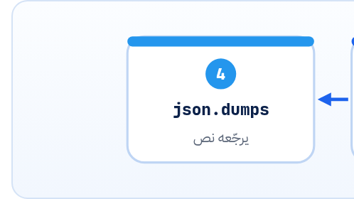

<small>المرحلة 3 · الاسكريبت والدنيا</small>

الموديل بيرجّع JSON، وانت عايز النتايج في CSV أو Excel، والـ Input نفسه غالباً شيت Excel فيه عمود نصوص. الفصل ده بيشرح الـ json و csv بتوع Python، و JSONL، و pandas و openpyxl، وكل Parameter بتشوفه في السطور دي.

:::note[بعد الفصل ده هتكون عارف]
- json.loads و json.dumps والفرق بينهم وبين load و dump
- ensure\_ascii=False و indent وليه العربي بيطلع \\u0645
- JSONL: سطر JSON لكل Record، وليه بتاع الـ Batch والـ Resume
- csv.DictReader و DictWriter
- pandas: read\_excel و to\_excel و iterrows والأعمدة
- openpyxl لما تحتاج تعدّل الشيت نفسه
:::

<a id="s10-1"></a>

## 10.1 JSON: النص اللي شكله dict

JSON مجرد **نص** مكتوب بشكل معين. والـ dict حاجة جوه ذاكرة Python. والـ Module `json` بتحوّل بين الاتنين:



*loads و dumps بيشتغلوا على نصوص (الـ s في الآخر = string). و load و dump من غير s بيشتغلوا على ملف مفتوح على طول.*

| الأمر | بيعمل إيه |
|---|---|
| `json.loads(text)` | نص → dict/list. ده اللي بتعمله على رد الموديل لما تطلب JSON. |
| `json.dumps(obj)` | dict → نص. |
| `json.load(f)` | من ملف مفتوح → dict. |
| `json.dump(obj, f)` | dict → يتكتب في ملف مفتوح. |

**تشريح الأمر**

```python
json.dump(data, f, ensure_ascii=False, indent=2)
```

1. `data`: اللي هيتكتب (dict أو list).
2. `f`: ملف مفتوح بـ `open(..., "w", encoding="utf-8")`.
3. `ensure_ascii=False`: من غيرها العربي بيتكتب كأكواد: `"\u0645\u0631\u062d\u0628\u0627"` بدل `"مرحبا"`. كلاهما JSON صحيح، بس الأول مش مقروء. مع العربي حطها دايماً.
4. `indent=2`: نسّقه بمسافتين علشان يتقري. من غيرها كله في سطر واحد.

:::danger[مشكلة: json.decoder.JSONDecodeError: Expecting value: line 1 column 1 (char 0)]
بتعمل `json.loads` على رد الموديل والخطأ ده طلع. معناه إن أول حرف في النص مش JSON. أشهر سبب: الموديل لفّ الـ JSON في Markdown كده ```` ```json … ``` ````، أو كتب جملة قبله "Here is the JSON:"، أو الرد اتقطع في النص لأن `max_output_tokens` خلص.

<strong>الحل الصح:</strong> متطلبش JSON بالكلام وخلاص. استخدم **Structured outputs** من الـ SDK (فصل 21)، علشان الرد يبقى JSON مضمون مطابق لـ Schema. والحل المؤقت: اطبع `repr(text[:200])` وشوف أوله فيه إيه.
:::

<a id="s10-2"></a>

## 10.2 JSONL: سطر لكل Record

JSON Lines (`.jsonl`): كل سطر في الملف JSON كامل لوحده. ليه ده مهم؟ لأنك تقدر **تزوّد سطر سطر** بـ `"a"` من غير ما تقرا الملف كله وتكتبه تاني. علشان كده هو الشكل اللي OpenAI و Gemini بيطلبوه في الـ Batch API، والشكل المثالي لحفظ النتايج أول بأول علشان تكمّل لو الاسكريبت وقع.

```python title="كتابة وقراية JSONL"
with open("results.jsonl", "a", encoding="utf-8") as f:
    f.write(json.dumps(record, ensure_ascii=False) + "\n")

done = set()
with open("results.jsonl", encoding="utf-8") as f:
    for line in f:                       # الملف بيتقري سطر سطر
        done.add(json.loads(line)["file"])
```

**المصادر الرسمية:** [docs.python.org · json](https://docs.python.org/3/library/json.html) · [jsonlines.org](https://jsonlines.org/)

<a id="s10-3"></a>

## 10.3 CSV بمكتبة csv

```python
import csv
with open("in.csv", encoding="utf-8-sig", newline="") as f:
    for row in csv.DictReader(f):
        print(row["title"])

with open("out.csv", "w", encoding="utf-8", newline="") as f:
    writer = csv.DictWriter(f, fieldnames=["file", "summary"])
    writer.writeheader()
    writer.writerow({"file": "a.md", "summary": "..."})
```

| الأمر | بيعمل إيه |
|---|---|
| `csv.DictReader(f)` | بيقرا أول سطر كأسامي أعمدة، وكل سطر بعده بيرجع dict: `row["title"]`. |
| `utf-8-sig` | لو الـ CSV اتعمل من Excel غالباً في أوله علامة خفية (BOM). من غير `-sig` أول عمود اسمه هيبقى `"\ufefftitle"`، و`row["title"]` هيدّي KeyError. |
| `DictWriter(f, fieldnames=[...])` | كاتب بيكتب dicts، و`fieldnames` = الأعمدة وترتيبها. |
| `writeheader()` | اكتب سطر أسامي الأعمدة (مرة واحدة بس في الأول). |
| `writerow / writerows` | صف واحد / List صفوف. |

:::note[على الـ Mac: CSV عربي في Excel]
لو فتحت CSV فيه عربي في Excel على الـ Mac ولقيت حروف ملخبطة، اكتبه بـ `encoding="utf-8-sig"`. الـ BOM بيقول لـ Excel "ده UTF-8". أو الأسهل: اكتب `.xlsx` على طول بـ pandas.
:::

<a id="s10-4"></a>

## 10.4 pandas: Excel وجداول في سطر

`pandas` بتشيل الجدول كله في Object اسمه **DataFrame** (اختصاره `df`): صفوف وأعمدة زي الشيت بالظبط.

```python title="نمط Excel → AI → Excel"
import pandas as pd

df = pd.read_excel("articles.xlsx", sheet_name="Sheet1")
df["summary"] = ""                          # عمود جديد فاضي
for i, row in df.iterrows():
    df.at[i, "summary"] = summarize(row["body"])
df.to_excel("articles_out.xlsx", index=False)
```

```python title="سطر سطر"
pd.read_excel("articles.xlsx", sheet_name="Sheet1")
df["summary"] = ""
for i, row in df.iterrows():
df.at[i, "summary"] = ...
df.to_excel("articles_out.xlsx", index=False)
```

1. `pd.read_excel("articles.xlsx", sheet_name="Sheet1")`: يقرا الشيت لـ DataFrame. محتاج `openpyxl` متسطّبة (`pip install "pandas[excel]"`). و`sheet_name` اسم الشيت أو رقمه (0 = الأول).
2. `df["summary"] = ""`: الأعمدة بتتقري وتتعمل بالأقواس زي الـ dict.
3. `for i, row in df.iterrows():`: يلف على الصفوف: `i` رقم الصف (Index)، و`row` الصف نفسه، وتقرا منه `row["body"]`.
4. `df.at[i, "summary"] = ...`: اكتب في خانة واحدة: الصف `i`، العمود `"summary"`. خد بالك: <strong>التعديل على `row` نفسه مش بيتحفظ في `df`</strong>، لازم `df.at` أو `df.loc`.
5. `df.to_excel("articles_out.xlsx", index=False)`: اكتب ملف Excel جديد. و`index=False` = متكتبش عمود أرقام الصفوف. (وده بيمسح الملف لو موجود، زي `"w"`.)

| الأمر | بيعمل إيه |
|---|---|
| `df.head()` | أول 5 صفوف. أول حاجة تعملها بعد read علشان تشوف شكل الداتا. |
| `df.columns` | أسامي الأعمدة. لو `KeyError: 'body'` طلع، اطبعها وشوف الاسم الحقيقي (ممكن فيه مسافة). |
| `df[df["status"] != "done"]` | فلتر: الصفوف اللي status بتاعها مش done. |
| `df["body"].fillna("")` | الخانات الفاضية في Excel بتيجي `NaN` (مش نص فاضي). وده بيعمل مشاكل لو بعتها للموديل، فـ `fillna("")` تحوّلها لنص فاضي. |
| `df.to_csv("o.csv", index=False)` | نفس to\_excel بس CSV. |

<a id="s10-5"></a>

## 10.5 openpyxl: لما تعدّل الشيت نفسه

pandas بتقرا البيانات وبس، ولما تكتب بتعمل ملف جديد من غير تنسيق: الألوان والعروض والمعادلات بتضيع. لو عايز تكتب في عمود جوه شيت متنسّق وتحافظ على شكله، استخدم `openpyxl`:

```python
from openpyxl import load_workbook
wb = load_workbook("articles.xlsx")
ws = wb["Sheet1"]
for row in ws.iter_rows(min_row=2):          # من الصف 2: سيب العناوين
    body = row[1].value                       # العمود B (العدّ من 0)
    row[2].value = summarize(body or "")      # اكتب في العمود C
wb.save("articles_out.xlsx")
```

:::caution[خلي بالك]
`ws["B2"]` في openpyxl العدّ فيها من **1** زي Excel، لكن `row[1]` جوه الـ Tuple العدّ فيه من **0**. ده أكتر مكان بيلخبط. ولو قريت بـ `iter_rows(values_only=True)` بترجع قيم بس ومينفعش تكتب فيها.
:::

:::tip[حاجة مشتركة: JSON في JS]
`json.loads` = `JSON.parse`، و`json.dumps(x, indent=2)` = `JSON.stringify(x, null, 2)`. وفي JS العربي بيطلع مقروء على طول، ولكن في Python محتاج `ensure_ascii=False`.
:::

**المصادر الرسمية:** [docs.python.org · csv](https://docs.python.org/3/library/csv.html) · [pandas.read_excel](https://pandas.pydata.org/docs/reference/api/pandas.read_excel.html) · [DataFrame.to_excel](https://pandas.pydata.org/docs/reference/api/pandas.DataFrame.to_excel.html) · [openpyxl tutorial](https://openpyxl.readthedocs.io/en/stable/tutorial.html)

:::tip[ملخص الفصل]
- `loads/dumps` للنصوص، و`load/dump` للملفات. و`ensure_ascii=False, indent=2` مع العربي.
- JSONL = سطر لكل Record: للـ Batch والحفظ أول بأول.
- `csv.DictReader/DictWriter` مع `newline=""`، و`utf-8-sig` لملفات Excel.
- pandas: `read_excel` و`iterrows` و`df.at[i, col]` و`to_excel(index=False)`، و`fillna("")`.
- openpyxl لما تحافظ على تنسيق الشيت.
:::

### صح ولا غلط؟

1. `json.loads` بتاخد مسار ملف.
2. تعديل `row["x"]` جوه `iterrows` بيتحفظ في الـ DataFrame.
3. `"\u0645\u0631"` في ملف JSON معناه إن الملف بايظ.

### أسئلة مراجعة

1. ليه JSONL أحسن من JSON عادي لحفظ نتايج 1000 Request؟
2. اشرح `df.to_excel("o.xlsx", index=False)` وإيه اللي هيحصل لو o.xlsx موجود.
3. الـ CSV بتاعك أول عمود فيه بيطلع اسمه `\ufeffid`. ليه وإيه الحل؟

### تحديات الفصل

<small>جرّبها بإيدك، والحلول في ملحق الإجابات.</small>

1. **[سهل]** اكتب dict فيه عربي لملف JSON مرة بـ `ensure_ascii=False` ومرة من غيرها، وافتح الاتنين.
2. **[متوسط]** اقرا Excel بـ pandas، وزوّد عمود `length` فيه طول نص عمود تاني، واكتبه في ملف جديد.
3. **[صعب]** اكتب 5 Records في JSONL واحد واحد بـ `"a"`، وبعدين اقرا الملف وطلّع Set بالأسامي اللي خلصت.
