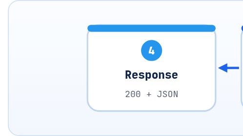

<small>المرحلة 3 · الاسكريبت والدنيا</small>

قبل ما نستخدم الـ SDKs، لازم نشوف هي بتعمل إيه من تحت: Request HTTP فيه URL و Headers و JSON. الفصل ده بيكلم OpenAI و Gemini بـ requests على طول، وبعدين بيشرح أهم موضوع أمان في الكتاب: الـ API key بيتحط فين، وإزاي متسرّبوش.

:::note[بعد الفصل ده هتكون عارف]
- Request HTTP: الـ Method والـ URL والـ Headers والـ Body
- requests.post بكل الـ Parameters: headers و json و timeout
- status\_code و raise\_for\_status و r.json()
- متغيرات البيئة: os.environ و os.getenv و export
- ملف .env و python-dotenv و .gitignore
- قواعد أمان الـ Keys الرسمية من OpenAI و Google
:::

:::note[الكلام ده كله اتشرح في كتاب الإنترنت]
الـ Method والـ Headers والـ Body والـ Status codes والـ JSON اللي هتشوفهم في الفصل ده هما نفسهم اللي شرحناهم في **كتاب الإنترنت والويب و DevTools** (فصول 7 لـ 10، ومعمل curl في فصل 10). الفرق الوحيد إنك هنا بتبعت الطلب من Python بدل المتصفح أو curl. لو حاجة وقفتك، ارجع هناك.
:::

<a id="s11-1"></a>

## 11.1 الـ SDK بيعمل إيه من تحت؟

كل سطر `client.responses.create(...)` في الآخر بيتحوّل لـ **HTTP Request**: نفس اللي المتصفح بيعمله لما يفتح موقع. فيه 4 حاجات: **Method** (غالباً POST)، و**URL**، و**Headers** (فيها الـ Key)، و**Body** (JSON فيه الموديل والنص). وبيرجع Response فيه **Status code** و Body JSON.



*أي نداء لموديل AI هو Request HTTP عادي. الـ SDK مجرد طبقة مريحة فوقه: بيبني الـ Request ويقرا الـ JSON ويحوّله Objects ويعيد المحاولة لو فشل.*

<a id="s11-2"></a>

## 11.2 OpenAI بـ requests على طول

```python title="raw_openai.py"
import os
import requests

resp = requests.post(
    "https://api.openai.com/v1/responses",
    headers={"Authorization": f"Bearer {os.environ['OPENAI_API_KEY']}"},
    json={"model": "gpt-6-luna", "input": "Say hi in 3 words."},
    timeout=60,
)
resp.raise_for_status()
data = resp.json()
print(data["output"])
```

```python title="سطر سطر"
requests.post(
"https://api.openai.com/v1/responses",
headers={"Authorization": f"Bearer {...}"},
json={"model": ..., "input": ...},
timeout=60,
resp.raise_for_status()
data = resp.json()
```

1. `requests.post(`: ابعت Request بـ Method اسمها POST ("ابعت بيانات"). وفي كمان `requests.get` للقراية.
2. `"https://api.openai.com/v1/responses",`: الـ **Endpoint**: الـ `v1` رقم نسخة الـ API، و`/responses` الـ Responses API.
3. `headers={"Authorization": f"Bearer {...}"},`: الـ **Header** اللي بيثبت إنك انت. و`Bearer` = "حامل التذكرة دي": أي حد معاه الـ Key ده يقدر يصرف من حسابك. و`os.environ['OPENAI_API_KEY']` بيجيب الـ Key من متغيرات البيئة (تحت). وخد بالك من العلامات: الـ f-string بـ `"` وجواها `'`.
4. `json={"model": ..., "input": ...},`: الـ **Body**. و`json=` بيحوّل الـ dict لـ JSON ويحط `Content-Type: application/json` لوحده.
5. `timeout=60,`: استنى 60 ثانية بالكتير. **من غيرها requests ممكن تستنى للأبد** لو السيرفر مردّش.
6. `resp.raise_for_status()`: لو الـ Status code خطأ (4xx أو 5xx) ارمي Exception، بدل ما تكمّل بداتا غلط.
7. `data = resp.json()`: حوّل الـ Body من JSON لـ dict. ومن هنا انت لوحدك: لازم تعرف شكل الـ JSON وتقراه بالأقواس.

### ونفس الفكرة مع Gemini

```python
url = "https://generativelanguage.googleapis.com/v1beta/models/gemini-3.8-flash:generateContent"
resp = requests.post(
    url,
    headers={"x-goog-api-key": os.environ["GEMINI_API_KEY"]},
    json={"contents": [{"parts": [{"text": "Say hi in 3 words."}]}]},
    timeout=60,
)
text = resp.json()["candidates"][0]["content"]["parts"][0]["text"]
```

لاحظ الفروق: الـ Key في Header اسمه `x-goog-api-key` مش `Authorization`، والموديل جوه الـ URL نفسه، والـ Body شكله تاني خالص، والنص مدفون جوه 5 مستويات. **وهنا كانت المشكلة** اللي الـ SDKs حلّتها: كل شركة ليها شكل، والقراية بالأقواس سهل تغلط فيها، ومفيش Retries. علشان كده في الكتاب كله هنستخدم الـ SDKs، بس دلوقتي انت عارف هي بتعمل إيه من تحت.

**أكواد الـ Status اللي هتقابلها مع APIs الـ AI**

| الكود | معناه | تعمل إيه |
|---|---|---|
| `200` | تمام | اقرا النتيجة |
| `400` | الـ Request غلط (Parameter مش موجود، JSON بايظ) | صلّح الكود، متعيدش |
| `401` | الـ Key غلط أو مش موجود | اتأكد من الـ Key |
| `403` | مش مسموح (بلد، أو صلاحيات، أو موديل مش متاح) | راجع الحساب |
| `404` | الموديل أو الـ Endpoint مش موجود | راجع اسم الموديل |
| `429` | Rate limit أو الرصيد خلص | استنى وعيد (فصل 25) |
| `500` / `503` | مشكلة عندهم | استنى وعيد |

**المصادر الرسمية:** [requests · Quickstart](https://requests.readthedocs.io/en/latest/user/quickstart/) · [OpenAI · Text generation](https://developers.openai.com/api/docs/guides/text) · [Gemini · Text generation (generateContent)](https://ai.google.dev/gemini-api/docs/generate-content/text-generation)

<a id="s11-3"></a>

## 11.3 متغيرات البيئة: الـ Key ميتكتبش في الكود

**قبل كده** الناس كانت بتكتب `api_key = "sk-proj-abc123..."` جوه الاسكريبت، وبعدين ترفعه على GitHub أو تبعته لزميل… وبعد ساعات يلاقوا فاتورة بآلاف الدولارات، لأن في Bots بتلف على GitHub طول اليوم تدوّر على Keys. <strong>فاتطور الحل:</strong> الـ Key يتحط في **متغير بيئة** (Environment variable): قيمة شايلها الـ Terminal نفسه، والكود بيقراها بالاسم.

```sh title="Terminal"
$ export OPENAI_API_KEY="sk-proj-..."
$ python3 run.py
```

| الأمر | بيعمل إيه |
|---|---|
| `export NAME="value"` | اعمل متغير بيئة للـ Terminal ده، ولأي برنامج يتشغّل منه. وبيروح لما تقفل التابة. ولو حطيته في `~/.zshrc` هيتعمل في كل Terminal (zsh هو الـ Shell الافتراضي على الـ Mac). |
| `os.environ["NAME"]` | اقراه في Python. ولو مش موجود: `KeyError`. |
| `os.getenv("NAME")` | نفس الكلام، بس بيرجّع `None` لو مش موجود. ومعاه قيمة افتراضية: `os.getenv("MODEL", "gpt-6-luna")`. |
| `echo $OPENAI_API_KEY` | تتأكد من الـ Terminal إنه موجود. (بس متعملهاش وانت بتشارك الشاشة!) |

والـ SDKs بتقرا المتغيرات دي لوحدها: `OpenAI()` بيدوّر على `OPENAI_API_KEY`، و`genai.Client()` بيدوّر على `GEMINI_API_KEY` أو `GOOGLE_API_KEY` (ولو الاتنين موجودين، `GOOGLE_API_KEY` هي اللي بتكسب). علشان كده هتشوف `client = OpenAI()` فاضية من غير Key.

<a id="s11-4"></a>

## 11.4 ملف .env و python-dotenv

`export` في كل تابة متعب. فالحل الشائع: ملف اسمه `.env` جنب الاسكريبت، ومكتبة `python-dotenv` تقراه:

```ini title=".env"
OPENAI_API_KEY=sk-proj-xxxxxxxxxxxxxxxx
GEMINI_API_KEY=AIzaxxxxxxxxxxxxxxxx
OPENROUTER_API_KEY=sk-or-v1-xxxxxxxxxxxx
MODEL=gpt-6-luna
```

```python
from dotenv import load_dotenv
load_dotenv()                 # اقرا .env وحط اللي فيه في os.environ
client = OpenAI()             # دلوقتي هيلاقي OPENAI_API_KEY
```

**تشريح الأمر**

```python
load_dotenv(override=False)
```

1. `load_dotenv`: بيدوّر على ملف `.env` (بيبدأ من فولدر الاسكريبت ويطلع لفوق) ويحط كل سطر `NAME=value` في متغيرات البيئة.
2. `override=False`: الافتراضي: لو المتغير موجود أصلاً في الـ Terminal، **متغيّروش**. فلو عملت `export` لـ Key قديم، هو اللي هيكسب على الـ `.env`. ودي من أشهر أسباب "غيّرت الـ Key ولسه 401".

```gitignore title=".gitignore"
.env
.venv/
__pycache__/
```

:::caution[قواعد الأمان (من الدوكيومنتيشن الرسمية)]
الـ Key = فلوس. والقواعد دي جاية من صفحات OpenAI و Google الرسمية:

- <strong>متحطوش في الكود ولا في Git أبداً.</strong> `.env` لازم يبقى في `.gitignore` قبل أول Commit.
- **متحطوش في كود بيتشغّل عند المستخدم** (صفحة ويب أو App)، لأن أي حد يقدر يطلّعه. الطلبات تعدّي على سيرفر بتاعك.
- **Key لكل مشروع** علشان لو اتسرّب تقفل واحد بس. وفي OpenAI حط **Hard spend limit** للـ Project (لما يتخطّى، الطلبات بترجع 429)، و OpenAI بتنصح كمان تحط **تاريخ انتهاء** للـ Key وتغيّره كل فترة.
- **لو اتسرّب، اقفله فوراً** من الـ Dashboard واعمل واحد جديد. مسحه من الكود مش كفاية: الـ Git History لسه فيه.
- في Gemini: من 28 مايو 2026 الـ Keys الجديدة في AI Studio بقت **Auth keys**، وبقى الـ API بيرفض الـ Standard keys اللي ملهاش Restrictions.
:::

:::tip[خد بالك وانت بتطلب كود من AI]
متلزقش الـ Key في الشات مع الموديل وانت بتطلب منه يصلّح اسكريبت. واطلب دايماً: "read the key from the environment variable OPENAI\_API\_KEY". وفي فصل 28 هنعمل Checklist تراجع بيه أي اسكريبت.
:::

:::tip[حاجة مشتركة: process.env]
`os.environ["X"]` = `process.env.X` في Node. و`python-dotenv` = حزمة `dotenv` في npm (`require("dotenv").config()`). وفي Node 20.6 وأحدث في `node --env-file=.env`.
:::

**المصادر الرسمية:** [OpenAI · Quickstart (API key)](https://developers.openai.com/api/docs/quickstart) · [OpenAI · Production best practices](https://developers.openai.com/api/docs/guides/production-best-practices) · [OpenAI · Spend limits](https://developers.openai.com/api/docs/guides/spend-limits) · [Gemini · Using API keys](https://ai.google.dev/gemini-api/docs/api-key) · [python-dotenv](https://pypi.org/project/python-dotenv/) · [os.environ](https://docs.python.org/3/library/os.html#os.environ)

:::tip[ملخص الفصل]
- كل نداء AI = POST + URL + Headers فيها الـ Key + Body JSON، ويرجع Status + JSON.
- `requests.post(url, headers=, json=, timeout=)`، و`raise_for_status()` و`.json()`.
- OpenAI بـ `Authorization: Bearer`، و Gemini بـ `x-goog-api-key`، والـ SDKs بتخبّي الفرق ده.
- الـ Key في متغير بيئة أو `.env` (و`.env` في `.gitignore`)، والـ SDK بيقراه لوحده.
- الـ Key المتسرّب يتقفل فوراً، مش يتمسح من الكود بس.
:::

### صح ولا غلط؟

1. `requests` من غير `timeout` ممكن تستنى للأبد.
2. لو مسحت الـ Key من الكود وعملت Commit جديد، يبقى انت في أمان.
3. `load_dotenv()` بيكتب فوق متغير موجود في الـ Terminal بنفس الاسم.

### أسئلة مراجعة

1. إيه الحاجات الأربعة في أي HTTP Request؟ طلّعهم من `raw_openai.py`.
2. إيه الفرق بين 400 و 429 من ناحية "أعيد المحاولة ولا لأ"؟
3. ليه `client = OpenAI()` شغّالة من غير ما تبعت `api_key`؟

### تحديات الفصل

<small>جرّبها بإيدك، والحلول في ملحق الإجابات.</small>

1. **[سهل]** اعمل `.env` فيه `MODEL=gpt-6-luna`، واقراه بـ `load_dotenv()` و`os.getenv("MODEL")`.
2. **[متوسط]** جرّب `requests.get("https://httpbin.org/status/429", timeout=10)` واطبع `status_code`، وبعدين جرّب `raise_for_status()` واقرا الخطأ.
3. **[صعب]** اعمل `export MODEL=old` في الـ Terminal، وحط `MODEL=new` في `.env`. شغّل وشوف مين كسب، وبعدين جرّب `load_dotenv(override=True)`.
