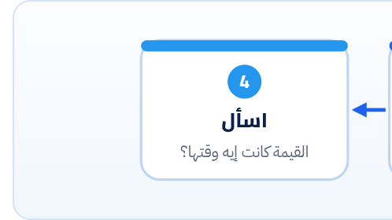

<small>المرحلة 3 · الاسكريبت والدنيا</small>

الاسكريبت وقع وطبع 30 سطر أحمر. الناس بتعمل حاجة من اتنين: يا تتخض، يا تلزق كله للـ AI. الفصل ده بيعلّمك تقرا الـ Traceback في 10 ثواني (من تحت لفوق)، وتعرف أشهر الأخطاء، وتمسك الخطأ صح بـ try/except من غير ما تخبّي مشاكل.

:::note[بعد الفصل ده هتكون عارف]
- تقرا الـ Traceback: آخر سطر الأول، وبعدين ملفك انت
- أشهر 8 أخطاء ومعناها
- try و except و else و finally
- تمسك خطأ معيّن مش كل حاجة، و except Exception as e
- raise وإزاي ترمي خطأ بنفسك
- الخطأ المتسلسل: During handling of the above exception
:::

<a id="s12-1"></a>

## 12.1 الـ Traceback: اقراه من تحت لفوق

ده Traceback حقيقي طلع من اسكريبت بيقرا ردود موديل وبياخد منها `summary`. واحد من الردود رجع JSON مفيهوش المفتاح ده:

```text
Traceback (most recent call last):
  File "/Users/you/ai-scripts/summarize.py", line 18, in <module>
    print(process(rows))
          ~~~~~~~^^^^^^
  File "/Users/you/ai-scripts/summarize.py", line 12, in process
    out.append(parse_reply(row["reply"]))
               ~~~~~~~~~~~^^^^^^^^^^^^^^
  File "/Users/you/ai-scripts/summarize.py", line 6, in parse_reply
    return data["summary"]
           ~~~~^^^^^^^^^^^
KeyError: 'summary'
```

```text title="القراية الصح"
KeyError: 'summary'
File "...summarize.py", line 6, in parse_reply
    return data["summary"]
           ~~~~^^^^^^^^^^^
File "...", line 12, in process
File "...", line 18, in <module>
Traceback (most recent call last):
```

1. `KeyError: 'summary'`: <strong>ابدأ من هنا: آخر سطر.</strong> نوع الخطأ (`KeyError`) ورسالته (`'summary'`): "دوّرت على مفتاح اسمه summary في dict وملقتهوش".
2. `File "...summarize.py", line 6, in parse_reply`: فوقه على طول = **المكان اللي الخطأ حصل فيه فعلاً**: الملف، ورقم السطر، وجوه أنهي فانكشن.
3. `return data["summary"]`: السطر نفسه. والعلامات `~` و `^` (Python 3.11 وأحدث) بتشاور على الحتة بالظبط اللي فشلت.
4. `File "...", line 12, in process`: مين نادى `parse_reply`؟ `process` في السطر 12.
5. `File "...", line 18, in <module>`: ومين نادى `process`؟ الكود الرئيسي (`<module>` = برّه أي فانكشن). ده أول الطريق.
6. `Traceback (most recent call last):`: "آخر نداء في الآخر". يعني الترتيب من أقدم نداء فوق لأحدث نداء تحت.



*خطة قراية أي Traceback. ولو الـ Traceback طويل ومليان ملفات من site-packages (جوه المكتبة)، سيبها وطلّع أول سطر من ملفاتك انت: غالباً ده المكان اللي بعت فيه حاجة غلط للمكتبة.*

:::tip[قبل ما تلزقه للـ AI]
اقرا آخر سطر وقول بكلامك المشكلة إيه. ولو هتطلب مساعدة، ابعت الـ Traceback كله + السطور حوالين السطر اللي وقع + "كنت متوقع إيه". ومتنساش تشيل أي API key أو بيانات حساسة ممكن تكون ظاهرة في الرسالة.
:::

<a id="s12-2"></a>

## 12.2 أشهر الأخطاء ومعناها بالعربي

**هتقابل دول كل أسبوع**

| الخطأ | معناه | مثال من اسكريبتات AI |
|---|---|---|
| `KeyError: 'x'` | مفتاح مش موجود في dict | رد JSON ناقص حقل |
| `IndexError: list index out of range` | رقم أكبر من الـ List | `choices[0]` والـ List فاضية |
| `AttributeError: 'NoneType' object has no attribute 'strip'` | عملت `.حاجة` على None | `response.text` طلع None ورحت تعمل strip |
| `TypeError: 'X' object is not subscriptable` | استخدمت `[ ]` على حاجة مبتتقراش كده | `response["output"]` على Object من الـ SDK |
| `TypeError: ... got an unexpected keyword argument` | Parameter اسمه غلط | `max_tokens=` في Responses API بدل `max_output_tokens=` |
| `ValueError` | النوع صح بس القيمة مش منطقية | `int("12a")` |
| `FileNotFoundError` | الملف مش موجود في المسار ده | مسار نسبي من فولدر غلط |
| `NameError: name 'x' is not defined` | اسم مش متعرّف (أو مكتوب غلط) | نسيت `import` |

<a id="s12-3"></a>

## 12.3 try و except: امسك الخطأ

من غير try، أول خطأ بيوقّف الاسكريبت كله. ولو كنت في الملف 900 من 1000، كله وقف. الـ `try` بتقول: "جرّب الحتة دي، ولو حصل خطأ معيّن اعمل كذا وكمّل".

```python
for path in paths:
    try:
        reply = summarize(client, path.read_text(encoding="utf-8"))
    except FileNotFoundError:
        print(f"missing: {path}")
        continue
    except Exception as e:
        print(f"failed: {path.name}: {type(e).__name__}: {e}")
        failed.append(path.name)
        continue
    else:
        save(path, reply)
    finally:
        done_count += 1
```

```python title="كل جزء بيعمل إيه"
try:
except FileNotFoundError:
except Exception as e:
else:
finally:
```

1. `try:`: "جرّب". الكود اللي ممكن يفشل. وخليه صغير على قد اللي ممكن يفشل بس.
2. `except FileNotFoundError:`: لو حصل الخطأ **ده بالذات**، اعمل اللي تحت. وPython بتجرّب الـ except بالترتيب، وأول واحد يطابق بيتنفّذ.
3. `except Exception as e:`: أي خطأ تاني تقريباً. و`as e` = حط الخطأ نفسه في متغير اسمه `e` علشان تطبعه. و`type(e).__name__` = اسم النوع، و`str(e)` = الرسالة.
4. `else:`: بيتنفّذ **لو مفيش خطأ** حصل في الـ try. مكان كويس للحفظ.
5. `finally:`: بيتنفّذ **دايماً**: سواء حصل خطأ أو لأ، حتى لو في `continue` أو `return`. للتنضيف والعدّادات.

:::caution[except: لوحدها = تخبية مشاكل]
`except:` من غير نوع، أو `except Exception: pass`، معناها "أي حاجة تحصل اسكت". كده الاسكريبت هيكمّل ويطلّع نتايج ناقصة، ومش هتعرف ليه. وكمان `except:` لوحدها بتمسك Ctrl+C فمبتعرفش توقف الاسكريبت! القاعدة: امسك الأخطاء اللي متوقعها بأساميها، وأي حاجة عامة **اطبعها أو سجّلها**، ومتسكتش عليها.
:::

<a id="s12-4"></a>

## 12.4 raise: ارمي خطأ بنفسك

```python
if not os.getenv("OPENAI_API_KEY"):
    raise SystemExit("Set OPENAI_API_KEY first (see .env.example)")

if response.status == "incomplete":
    raise RuntimeError(f"cut off: {response.incomplete_details.reason}")
```

| الأمر | بيعمل إيه |
|---|---|
| `raise ValueError("...")` | ارمي خطأ من نوع معيّن برسالة. أحسن من إنك تكمّل بداتا غلط. |
| `raise SystemExit("...")` | اقفل الاسكريبت برسالة واضحة من غير Traceback طويل. ممتاز للتأكد من الإعدادات في الأول. |
| `raise` | لوحدها جوه except: "ارمي نفس الخطأ تاني لفوق" بعد ما تسجّله. |
| `raise X from e` | ارمي خطأ جديد واربطه بالأصلي. وهنا بيظهر في الـ Traceback: "The above exception was the direct cause". |

:::note[During handling of the above exception, another exception occurred]
لو شفت الجملة دي في نص الـ Traceback، معناها إن في خطأ حصل، وجوه الـ except اللي بتتعامل معاه حصل خطأ **تاني**. اقرا الاتنين: الأول هو السبب الأصلي، والتاني غالباً غلطة في كود التعامل مع الخطأ نفسه.
:::

<a id="s12-5"></a>

## 12.5 أخطاء الـ SDKs: Classes ليها شجرة

الأخطاء نفسها Classes، وبينهم وراثة. فلما تمسك الأب، بتمسك كل ولاده. والـ SDKs معمولة كده:

```text title="شجرة أخطاء openai (مختصرة)"
openai.APIError
├── APIConnectionError        ← النت أو السيرفر مش بيرد
│   └── APITimeoutError
└── APIStatusError            ← رجع Status خطأ (.status_code)
    ├── BadRequestError        400
    ├── AuthenticationError    401
    ├── PermissionDeniedError  403
    ├── NotFoundError          404
    ├── RateLimitError         429
    └── InternalServerError    ≥500
```

وفي Gemini: `from google.genai import errors`، والأب اسمه `errors.APIError` وفيه `.code` (رقم الـ Status) و`.message`، وتحته `errors.ClientError` (4xx) و`errors.ServerError` (5xx). وده كله هنستخدمه في فصل 25.

```text title="شكل الخطأ اللي هتشوفه (Key غلط)"
openai.AuthenticationError: Error code: 401 - {'error': {'message': 'Incorrect API key provided: sk-bad...', 'type': 'invalid_request_error', 'param': None, 'code': 'invalid_api_key'}}
```

:::tip[حاجة مشتركة: try/catch]
`try/except` = `try/catch` في JS، و`finally` هي هي، و`raise` = `throw`. الفرق إن Python بتقدر تمسك **نوع** معيّن في كل except، وفي JS بتمسك كله وبعدين تعمل `if (e instanceof X)`. و`else` مش موجودة في JS.
:::

**المصادر الرسمية:** [docs.python.org · Errors and Exceptions](https://docs.python.org/3/tutorial/errors.html) · [Built-in Exceptions](https://docs.python.org/3/library/exceptions.html) · [openai-python · Handling errors](https://github.com/openai/openai-python#handling-errors) · [google-genai SDK docs](https://googleapis.github.io/python-genai/)

:::tip[ملخص الفصل]
- الـ Traceback: آخر سطر (النوع والرسالة)، بعدين أول سطر من ملفاتك من تحت، بعدين اطلع لفوق.
- KeyError و IndexError و AttributeError على None و "not subscriptable": أشهر أخطاء قراية الردود.
- `try/except` بأنواع محددة، و`else` لو نجح، و`finally` دايماً.
- متسكتش على الأخطاء: `except: pass` ممنوعة.
- `raise SystemExit("...")` لرسالة واضحة، وأخطاء الـ SDK شجرة: امسك `RateLimitError` لوحدها، و`APIError` للباقي.
:::

### صح ولا غلط؟

1. أهم سطر في الـ Traceback هو أول سطر.
2. الـ `finally` بتتنفّذ حتى لو حصل `continue` جوه الـ except.
3. `except openai.APIError` بتمسك `RateLimitError` كمان.

### أسئلة مراجعة

1. في الـ Traceback اللي في أول الفصل، الخطأ حصل في أنهي فانكشن وأنهي سطر؟ ومين نادى عليها؟
2. ليه `except Exception: pass` خطر في اسكريبت بيعالج 1000 ملف؟
3. إيه الفرق بين `else` و `finally`؟

### تحديات الفصل

<small>جرّبها بإيدك، والحلول في ملحق الإجابات.</small>

1. **[سهل]** اعمل الأخطاء دي بإيدك في الـ REPL واقرا رسايلها: `{}["a"]` و`[][0]` و`None.strip()` و`int("x")`.
2. **[متوسط]** اكتب Loop على 3 مسارات، منهم واحد مش موجود. امسك `FileNotFoundError` واطبع رسالة وكمّل.
3. **[صعب]** خلّي `OPENAI_API_KEY` قيمته غلط، وشغّل نداء صغير، وامسك `openai.AuthenticationError` واطبع `e.status_code`.
