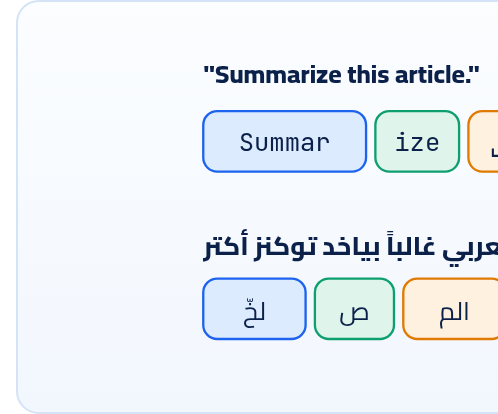

<small>المرحلة 4 · أساسيات الـ AI</small>

قبل أي SDK، لازم تفهم المفاهيم اللي كل الـ SDKs مبنية عليها: الموديل بيقرا ويكتب Tokens مش كلمات، وليه حد أقصى (Context window)، ومين الـ system ومين الـ user، وإن الـ API مبيفتكرش حاجة بين Request والتاني، وإيه هي temperature و max tokens والـ Reasoning. كل اللي في الفصل ده هتلاقيه في أي اسكريبت AI.

:::note[بعد الفصل ده هتكون عارف]
- يعني إيه Token وليه العربي بياخد توكنز أكتر
- الـ Context window والـ Input والـ Output tokens
- الـ Roles: system/developer و user و assistant
- الـ API مبيفتكرش: لازم تبعت المحادثة، أو تستخدم previous\_response\_id
- temperature و top\_p ودلوقتي بقوا إيه مع الموديلات الجديدة
- max output tokens والـ Reasoning/Thinking وليه بيتحسبوا Output
:::

<a id="s14-1"></a>

## 14.1 الحكاية في سطرين

الـ **LLM** (Large Language Model) برنامج اتدرّب على كمية نصوص مهولة لحد ما بقى شاطر جداً في حاجة واحدة: **يتوقع الحتة الجاية من النص**. انت بتديله نص، وهو بيكتب بعده حتة حتة، ولما يقرر إنه خلّص بيقف. كل اللي بتشوفه من "ذكاء" (تلخيص، ترجمة، كود، JSON) هو نتيجة الحكاية دي. والـ **API** هو الباب اللي بتبعت منه النص وتستلم الرد.

<a id="s14-2"></a>

## 14.2 الـ Token: العملة اللي بتدفع بيها

الموديل مبيقراش حروف ولا كلمات. بيقرا **Tokens**: حتت نص. ممكن تبقى كلمة كاملة (`the`)، أو حتة من كلمة (`summar` + `ize`)، أو علامة، أو مسافة + كلمة.



*الـ Tokens حتت نص، والتقطيع ده مثال توضيحي بس. كل موديل ليه "Tokenizer" خاص بيه، فنفس النص ممكن يتحسب بأرقام مختلفة في OpenAI و Gemini. والأرقام الحقيقية بتعرفها من الـ API نفسه (فصل 27).*

:::note[قواعد تقريبية من الدوكيومنتيشن]
Google بتقول في صفحة الـ Tokens: في Gemini الـ Token تقريباً **4 حروف**، و**100 توكن ≈ 60 لـ 80 كلمة إنجليزي**. ودي أرقام للإنجليزي. العربي والكود والأرقام بيتقطعوا بشكل تاني. فمتعتمدش على التقريب للفلوس: اعد التوكنز بالـ API (فصل 27)، واقرا `usage` في كل رد.
:::

وليه التوكنز مهمة؟ لأن تلات حاجات بتتحسب بيها:

#### الفلوس

السعر مكتوب "لكل مليون توكن" (per 1M tokens)، و**سعر الـ Output أغلى من الـ Input** بكتير (مثلاً gpt-6-luna: ‎$0.10 داخل و ‎$0.50 خارج).

#### الحد الأقصى

كل موديل ليه **Context window**: أقصى عدد توكنز (اللي داخل + اللي خارج) في الـ Request الواحد. مثلاً gpt-6-luna حوالي 1,050,000، و gemini-3.8-flash يقبل 1,048,576 داخل.

#### السرعة

الموديل بيكتب الـ Output توكن ورا توكن، فرد طويل = وقت أطول.

#### الـ Rate limits

في حد للتوكنز في الدقيقة (TPM) غير حد الـ Requests (RPM). فصل 25.

**المصادر الرسمية:** [Gemini · Understand and count tokens](https://ai.google.dev/gemini-api/docs/tokens) · [OpenAI · Token counting](https://developers.openai.com/api/docs/guides/token-counting)

<a id="s14-3"></a>

## 14.3 الـ Roles: مين بيتكلم؟

الـ Request مش نص واحد. هو "محادثة" فيها رسايل، وكل رسالة ليها **Role**:

**الأدوار ومكانها في كل SDK**

| الدور | معناه | OpenAI (Responses) | Gemini (generate\_content) |
|---|---|---|---|
| **system / developer** | تعليماتك انت كصاحب الاسكريبت: الشخصية، والقواعد، وشكل الرد | `instructions=` (أو رسالة role `"developer"`) | `system_instruction=` جوه الـ config |
| **user** | الطلب نفسه أو البيانات (النص اللي هيتلخّص) | `input=` | `contents=` |
| **assistant / model** | ردود الموديل السابقة في المحادثة | role `"assistant"` | role `"model"` |

وفي OpenAI الـ `instructions` ليها أولوية أعلى من الـ `input`. علشان كده الطريقة الصح في اسكريبت تلخيص: <strong>القواعد في instructions، والنص اللي هيتلخّص في input.</strong> ومتخلطش الاتنين في نص واحد.

```python title="نفس الفكرة في الاتنين"
#   OpenAI
response = client.responses.create(
    model="gpt-6-luna",
    instructions="You are an editor. Reply in 2 sentences.",   # system/developer
    input=article_text,                                       # user
)
#   Gemini
response = client.models.generate_content(
    model="gemini-3.8-flash",
    contents=article_text,                                    # user
    config=types.GenerateContentConfig(
        system_instruction="You are an editor. Reply in 2 sentences.",
    ),
)
```

<a id="s14-4"></a>

## 14.4 الـ API مبيفتكرش حاجة

دي أكتر حاجة بتلخبط الناس اللي جايين من ChatGPT. في الشات الموديل "فاكر" اللي قلته. لكن في الـ API كل Request **منفصل تماماً**: الموديل مبيعرفش أي حاجة غير اللي في الـ Request ده. فلو عايز محادثة، عندك طريقتين:

#### 1) ابعت المحادثة كلها كل مرة

تحتفظ بـ List فيها كل الرسايل (user و assistant)، وتبعتها كلها في الـ Request الجاي. وده بيكلّف توكنز Input أكتر مع كل دور.

#### 2) خلّي السيرفر يفتكر

في OpenAI: `previous_response_id=response.id` في الـ Request الجاي. وفي Gemini Interactions API: `previous_interaction_id=`. وفي `chats` في google-genai بتمسك المحادثة بدالك. (ولسه بتدفع على توكنز المحادثة كلها كـ Input.)

:::tip[في اسكريبتات الملفات: ده خبر حلو]
لما بتلخّص 500 ملف، انت مش عايز الموديل يفتكر الملف اللي فات! كل ملف Request لوحده، نضيف. وده اللي بيخلّي المعالجة بالتوازي ممكنة (فصل 26).
:::

**المصادر الرسمية:** [OpenAI · Conversation state](https://developers.openai.com/api/docs/guides/conversation-state) · [Gemini · Interactions API](https://ai.google.dev/gemini-api/docs/interactions)

<a id="s14-5"></a>

## 14.5 الإعدادات: temperature و max tokens و Reasoning

### temperature و top\_p: كانوا أهم زرار… ودلوقتي اتغيروا

الموديل في كل خطوة بيحسب احتمال لكل Token ممكن ييجي بعد كده. **temperature** بتتحكم هو هيختار إزاي: قيمة واطية (زي 0.2) = يختار الأكتر احتمالاً تقريباً دايماً، فالرد ثابت ومتوقع. وقيمة عالية (زي 1.2) = يجرّب اختيارات أقل احتمالاً، فالرد متنوع أكتر. و**top\_p** طريقة تانية لنفس الفكرة: "اختار بس من التوكنز اللي مجموع احتمالاتها p". و OpenAI بتقول: غيّر واحد فيهم بس، مش الاتنين.

:::caution[مهم جداً مع موديلات 2026 (من الدوكيومنتيشن)]
<strong>Gemini:</strong> صفحة Text generation بتقول إن موديلات Gemini 4 و Gemini 3.6 وأحدث **بتتجاهل** أي قيمة لـ `temperature` و`top_p` و`top_k`، وبترجّع تحذير Deprecation، و**هترجّع خطأ 400 في إصدار جاي**. فشيلهم من الـ config.<br><strong>OpenAI:</strong> دليل GPT-6 بيقول: لما الـ `reasoning.effort` مش `"none"`، شيل `temperature` و`top_p`. يعني يتقبلوا بس مع `effort="none"` على الموديلات اللي بتدعمها (زي gpt-6-luna).<br>ولو لقيت `temperature=0.7` في اسكريبت قديم كتبه AI، دي أول حاجة تراجعها.
:::

### max output tokens: سقف الرد

| الأمر | بيعمل إيه |
|---|---|
| `max_output_tokens=500` | OpenAI Responses API. (في Chat Completions القديم اسمها `max_completion_tokens`، وقبلها `max_tokens`.) |
| `max_output_tokens=500` | Gemini، جوه `GenerateContentConfig`. |
| `max_tokens=500` | Anthropic (إجباري هناك) و OpenRouter (Chat Completions). |

لو الموديل وصل للسقف قبل ما يخلّص، الرد **بيتقطع في النص**. في OpenAI هتلاقي `response.status == "incomplete"` و`response.incomplete_details.reason == "max_output_tokens"`. وفي Gemini `finish_reason` هيبقى `MAX_TOKENS`. ولو كنت طالب JSON، هيبقى JSON بايظ. فالسقف حماية للفلوس، بس لازم يبقى كفاية.

### الـ Reasoning (OpenAI) والـ Thinking (Gemini)

الموديلات الحديثة "بتفكر" قبل ما ترد: بتكتب توكنز داخلية مش بتظهر لك، وبعدين تكتب الرد. وده بيحسّن المسائل الصعبة جداً، بس **التوكنز دي بتتحسب عليك كـ Output** (الاتنين بيقولوا كده صراحة في الدوكيومنتيشن)، وبتاكل من الـ max output tokens.

**زرار التفكير في كل SDK**

|   | OpenAI | Gemini |
|---|---|---|
| الـ Parameter | `reasoning={"effort": "low"}` | `thinking_config=types.ThinkingConfig(thinking_level="low")` |
| القيم | `none` / `low` / `medium` / `high` / `xhigh` / `max` (حسب الموديل) | `low` / `medium` / `high` (Gemini 3.8 Flash و 4 Argon) |
| تشوف استهلاكه | `usage.output_tokens_details.reasoning_tokens` | `usage_metadata.thoughts_token_count` |

:::tip[لاسكريبتات المحتوى]
تلخيص، وتصنيف، واستخراج بيانات، وإعادة صياغة: دي مهام بسيطة. ابدأ بأقل Reasoning (`"none"` أو `"low"` في OpenAI، و`"low"` في Gemini) وموديل رخيص، وجرّب على 10 ملفات، وارفع بس لو الجودة مش كفاية. هتوفّر كتير (فصل 27).
:::

**المصادر الرسمية:** [OpenAI · Reasoning](https://developers.openai.com/api/docs/guides/reasoning) · [OpenAI · Using GPT-6](https://developers.openai.com/api/docs/guides/latest-model) · [Gemini · Text generation](https://ai.google.dev/gemini-api/docs/generate-content/text-generation) · [Gemini · Thinking](https://ai.google.dev/gemini-api/docs/thinking)

:::tip[حاجة مشتركة: نفس الـ API من JS]
كل المفاهيم دي هي هي في JS. الـ SDK الرسمي `openai` في npm: `await client.responses.create({ model, instructions, input })`. و`@google/genai`: `await ai.models.generateContent({ model, contents, config })`. أسامي الـ Parameters بس بتبقى camelCase في JS (`maxOutputTokens`) و snake\_case في Python (`max_output_tokens`).
:::

:::tip[ملخص الفصل]
- الموديل بيقرا ويكتب Tokens. والسعر والحد الأقصى والسرعة كلهم بالتوكنز، والـ Output أغلى.
- القواعد في system (`instructions` / `system_instruction`)، والبيانات في user (`input` / `contents`).
- الـ API مبيفتكرش: كل Request لوحده، إلا لو بعت المحادثة أو `previous_response_id`.
- temperature/top\_p: بيتجاهلوا في Gemini 4 و 3.6+، وفي GPT-6 مسموحين بس مع `effort="none"`.
- الـ max output tokens سقف، ولو اتخطى الرد بيتقطع. وتوكنز التفكير بتتحسب Output.
:::

### صح ولا غلط؟

1. الموديل في الـ API فاكر الملف اللي بعته في الـ Request اللي فات.
2. توكنز الـ Reasoning مجانية لأنها مش بتظهر لك.
3. في gemini-3.8-flash، `temperature=0` بتخلي الرد ثابت.

### أسئلة مراجعة

1. ليه سعر 1000 توكن Output أغلى من 1000 توكن Input؟ وده يأثر إزاي على اسكريبت بيترجم مقالات؟
2. إيه اللي يتحط في `instructions` وإيه اللي يتحط في `input` في اسكريبت تصنيف تعليقات؟
3. رد اتقطع في النص. إيه السبب المحتمل؟ وتعرف منين في OpenAI وفي Gemini؟

### تحديات الفصل

<small>جرّبها بإيدك، والحلول في ملحق الإجابات.</small>

1. **[سهل]** افتح صفحة الـ Pricing الرسمية لـ OpenAI و Gemini، واكتب سعر الـ Input والـ Output لموديلين رخاص.
2. **[متوسط]** دوّر في اسكريبت قديم عندك على `temperature` و`max_tokens`، وقرّر بناءً على الفصل تعمل فيهم إيه.
3. **[صعب]** لو عندك Key: ابعت نفس الطلب مرتين بـ `reasoning={"effort": "none"}` و`"high"`، وقارن `usage` في الاتنين.
