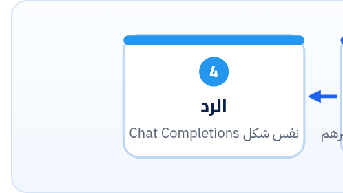

<small>المرحلة 4 · أساسيات الـ AI</small>

لو عايز تجرّب موديل من OpenAI، وواحد من Google، وواحد من Anthropic، وموديل مفتوح، محتاج 4 حسابات و 4 Keys و 4 SDKs. OpenRouter بيحل ده: Key واحد، و Endpoint واحد متوافق مع OpenAI، وتغيّر الموديل بتغيير نص. الفصل ده بيشرح إزاي تستخدمه من Python بنفس مكتبة openai، وأسامي الموديلات، والـ Fallbacks والـ Routing، والفلوس، وإمتى تستخدمه وإمتى تروح للشركة على طول.

:::note[بعد الفصل ده هتكون عارف]
- OpenRouter إيه وبيحل مشكلة إيه
- تكلمه بمكتبة openai: base\_url و api\_key و extra\_headers
- أسامي الموديلات: provider/model، و ~ للـ latest، و :free و :nitro و :floor
- الـ Fallbacks بـ models، والـ Provider routing بـ provider، و openrouter/auto
- الفلوس: Credits، ومفيش Markup على الموديل، والـ Fees، و usage.cost
- إمتى OpenRouter وإمتى الـ SDK المباشر
:::

:::caution[البيانات من الدوكيومنتيشن الرسمية]
كل اللي هنا من `openrouter.ai/docs` ومن قايمة الموديلات العامة `openrouter.ai/api/v1/models` يوم 23 أكتوبر 2026. والكود متجرّب بمكتبة `openai` 3.37 على سيرفر تجريبي محلي بنفس شكل الـ API (مش على OpenRouter الحقيقي، لأن مفيش Key).
:::

<a id="s19-1"></a>

## 19.1 المشكلة اللي اتحلّت

كل شركة AI ليها API بشكل مختلف، وحساب منفصل، وفاتورة منفصلة، و Rate limits منفصلة. ولو الشركة دي وقعت ساعة، اسكريبتك يقع معاها. **فاتطور حل**: "راوتر" في النص. انت بتكلمه هو بشكل واحد، وهو بيبعت الطلب لأي موديل عند أي شركة. OpenRouter بيقول في أول الدوكيومنتيشن: <strong>"مئات الموديلات من خلال Endpoint واحد"</strong>، وبيعمل Fallbacks لوحده، وبيختار أوفر مزوّد للطلب.



*OpenRouter في النص بين اسكريبتك والشركات. والـ API بتاعه متوافق مع OpenAI، فاسكريبتك بيستخدم نفس المكتبة اللي في فصل 16.*

<a id="s19-2"></a>

## 19.2 من Python: نفس مكتبة openai

```python title="openrouter_hello.py"
import os
from openai import OpenAI

client = OpenAI(
    base_url="https://openrouter.ai/api/v1",
    api_key=os.environ["OPENROUTER_API_KEY"],
)

completion = client.chat.completions.create(
    model="openai/gpt-6-luna",
    messages=[
        {"role": "system", "content": "You are an editor."},
        {"role": "user", "content": "Give 3 titles about tea in Egypt."},
    ],
    max_tokens=300,
    extra_headers={
        "HTTP-Referer": "https://example.com",      # اختياري
        "X-OpenRouter-Title": "Content scripts",     # اختياري
    },
)
print(completion.choices[0].message.content)
print(completion.model, completion.usage.total_tokens)
```

```python title="سطر سطر"
base_url="https://openrouter.ai/api/v1",
api_key=os.environ["OPENROUTER_API_KEY"],
client.chat.completions.create(
model="openai/gpt-6-luna",
max_tokens=300,
extra_headers={...}
completion.model
```

1. `base_url="https://openrouter.ai/api/v1",`: ده السطر السحري. بدل سيرفر OpenAI، المكتبة هتبعت لـ OpenRouter. وكل حاجة تانية في المكتبة زي ما هي.
2. `api_key=os.environ["OPENROUTER_API_KEY"],`: Key الـ OpenRouter (بيبدأ بـ `sk-or-`). **لازم تكتبه صريح**: لو سبته فاضي، المكتبة هتدوّر على `OPENAI_API_KEY` وتبعته لـ OpenRouter، وده غلط.
3. `client.chat.completions.create(`: OpenRouter متوافق أساساً مع **Chat Completions** (`/chat/completions`)، وده الشكل اللي في الدوكيومنتيشن بتاعتهم. (فيه كمان Responses API متوافق، بس احنا ماشيين على الأشهر.)
4. `model="openai/gpt-6-luna",`: اسم الموديل بشكل `الشركة/الموديل`. تحت.
5. `max_tokens=300,`: في Chat Completions عند OpenRouter بيتكتب `max_tokens`.
6. `extra_headers={...}`: Headers إضافية **اختيارية**: اسم وموقع الأداة بتاعتك، علشان تظهر في ترتيب التطبيقات على OpenRouter. مش لازمين علشان الكود يشتغل.
7. `completion.model`: الموديل اللي **اشتغل فعلاً**. مهم لو عامل Fallbacks: ممكن يكون غير اللي طلبته.

:::note[وفي SDK رسمي كمان]
OpenRouter عنده مكتبة Python رسمية (`pip install openrouter`) بشكل `client.chat.send(model=..., messages=...)`. بس الأشهر في الاسكريبتات، واللي الـ AI هيكتبهولك غالباً، هو مكتبة `openai` مع `base_url`: نفس الكود اللي اتعلمته، ومفيش مكتبة جديدة.
:::

**المصادر الرسمية:** [OpenRouter · Quickstart](https://openrouter.ai/docs/quickstart) · [API Reference · Overview](https://openrouter.ai/docs/api-reference/overview)

<a id="s19-3"></a>

## 19.3 أسامي الموديلات

**أمثلة من قايمة OpenRouter (أكتوبر 2026)**

| الاسم (slug) | معناه |
|---|---|
| `openai/gpt-6-luna` | موديل معيّن من شركة معيّنة. ده الشكل الأساسي. |
| `google/gemini-3.8-flash` | Gemini من خلال OpenRouter، بنفس كود OpenAI. |
| `anthropic/claude-sonnet-5.5` | Claude. لاحظ إن الاسم في OpenRouter فيه **نقطة** (`5.5`)، وعند Anthropic نفسها **شَرطة** (`claude-sonnet-5-5`). خد الاسم من صفحة OpenRouter دايماً. |
| `~openai/gpt-luna-latest` | الـ `~` = **Alias** بيشاور على أحدث موديل من العيلة دي، وبيتغيّر لوحده. |
| `…:free` | نسخة ببلاش (لو متاحة) بحدود ضيقة: 20 Request في الدقيقة، و 50 في اليوم (أو 1000 لو اشتريت 10 Credits على الأقل). |
| `…:nitro` | اختصار: رتّب المزوّدين على السرعة (Throughput). |
| `…:floor` | اختصار: رتّب المزوّدين على أرخص سعر. |
| `openrouter/auto` | **Auto Router**: OpenRouter يختار الموديل حسب الـ Prompt. |

:::tip[اعرف الأسامي من الـ API نفسه]
القايمة كلها متاحة من غير Key: `https://openrouter.ai/api/v1/models`. فيها الـ `id` والـ `context_length` والأسعار. و**خد بالك** إن الأسعار هناك **لكل توكن واحد** مش لكل مليون: `"prompt": "0.0000001"` = ‎$0.10 لكل مليون توكن.

```python
import requests
models = requests.get("https://openrouter.ai/api/v1/models", timeout=30).json()["data"]
for m in models:
    if m["id"].startswith("openai/gpt-6"):
        per_m = float(m["pricing"]["prompt"]) * 1_000_000
        print(f'{m["id"]:<28} {m["context_length"]:>9,}  ${per_m:.2f}/M in')
```
:::

<a id="s19-4"></a>

## 19.4 الـ Fallbacks: لو الموديل وقع، جرّب التاني

```python
completion = client.chat.completions.create(
    model="openai/gpt-6-luna",
    messages=messages,
    extra_body={
        "models": ["google/gemini-3.8-flash", "anthropic/claude-haiku-5.5"],
    },
)
print("served by:", completion.model)
```

**تشريح الأمر**

```python
extra_body={"models": [...]}
```

1. `extra_body`: مكتبة openai مش عارفة حاجة اسمها `models` (دي خاصة بـ OpenRouter). فبنبعتها في `extra_body`: "حط الحقول دي في الـ JSON زي ما هي". واتأكدنا إنها بتتحط في الـ Body فعلاً.
2. `"models"`: List موديلات احتياطي بالترتيب. لو الأول رجّع خطأ (وقع، أو Rate limit، أو Context طويل عليه، أو رفض بسبب الـ Moderation)، OpenRouter يجرّب اللي بعده لوحده.

:::caution[خلي بالك]
بتدفع **بسعر الموديل اللي اشتغل فعلاً**. ولو حطيت موديل `:free` وبعده موديل مدفوع، والـ free فشل، هتدفع. وكمان الموديلات المختلفة بتكتب بأساليب مختلفة، فلو بتولّد محتوى لازم يبقى بنفس الأسلوب، فكّر قبل ما تحط Fallback لموديل من عيلة تانية.
:::

<a id="s19-5"></a>

## 19.5 الـ Provider routing: مين يشغّل الموديل؟

نفس الموديل ممكن يبقى متاح عند كذا "مزوّد" (Provider). الافتراضي في OpenRouter: يوزّع الطلبات على المزوّدين المستقرين، وبيفضّل الأرخص (الترجيح بـ **مقلوب مربع السعر**). وتقدر تتحكم بـ `provider`:

```python
extra_body={
    "provider": {
        "sort": "price",               # أو "throughput" أو "latency"
        "allow_fallbacks": True,       # لو المزوّد الأول وقع، جرّب غيره
        "data_collection": "deny",     # متبعتش لمزوّدين ممكن يخزّنوا البيانات
    }
}
```

| الأمر | بيعمل إيه |
|---|---|
| `order: ["openai", "azure"]` | جرّب المزوّدين دول بالترتيب. |
| `allow_fallbacks: False` | لو المزوّد اللي اخترته مش متاح، افشل ومتروحش لغيره. |
| `sort` | رتّب على السعر أو السرعة أو الـ Latency. ولو حطيت `sort` أو `order`، التوزيع التلقائي بيتقفل. |
| `data_collection: "deny"` | مهم للبيانات الحساسة. وفي كمان `zdr: True`: مزوّدين Zero Data Retention بس. |
| `max_price` | أقصى سعر تقبل تدفعه للطلب. |

**المصادر الرسمية:** [OpenRouter · Model fallbacks](https://openrouter.ai/docs/guides/routing/model-fallbacks) · [Provider selection](https://openrouter.ai/docs/guides/routing/provider-selection) · [Auto Router](https://openrouter.ai/docs/features/model-routing)

<a id="s19-6"></a>

## 19.6 الفلوس: Credits و Fees

#### Credits

بتشحن رصيد (Credits) مقدّماً، وكل طلب بيتخصم منه. ولو الرصيد خلص أو بقى بالسالب، هتاخد `402` (حتى على الموديلات المجانية).

#### مفيش Markup على الموديل

الـ FAQ بيقول: "بنمرر أسعار المزوّدين من غير Markup على الـ Inference"، بس فيه **Fee على شراء الـ Credits** نفسها (النسبة في صفحة الـ FAQ، شوفها هناك قبل ما تشحن).

#### BYOK

"Bring Your Own Key": تحط Key الشركة نفسها في OpenRouter. ليه Allowance مجانية حسب الخطة، وبعدها Fee ‏5% من السعر العادي.

#### الـ Credits ممكن تنتهي

الـ FAQ: من حقهم يلغوا الـ Credits اللي متستخدمتش بعد سنة من الشراء. فمتشحنش أكتر من احتياجك.

وأحلى حاجة: الرد نفسه فيه **التكلفة** في `usage`. مكتبة openai مش عارفة الحقل ده، بس بيتقري:

```python
cost = getattr(completion.usage, "cost", None)     # بالـ Credits (دولار)
print(f"cost: ${cost:.6f}" if cost is not None else "no cost field")
```

`getattr(obj, "name", default)` = "هات الـ Attribute ده لو موجود، ولو مش موجود رجّع الـ default". ده الأمان لما تقرا حقل ممكن ميكونش موجود.

**المصادر الرسمية:** [OpenRouter · FAQ (pricing, credits)](https://openrouter.ai/docs/faq) · [API Reference · Limits](https://openrouter.ai/docs/api-reference/limits)

<a id="s19-7"></a>

## 19.7 إمتى OpenRouter وإمتى المباشر؟

**اختيار الطريق**

| OpenRouter أحسن لما… | الـ SDK المباشر أحسن لما… |
|---|---|
| عايز تقارن موديلات كتير من شركات مختلفة بنفس الكود | هتستخدم شركة واحدة بس على المدى الطويل |
| عايز Fallback لشركة تانية لو واحدة وقعت | محتاج مميزات خاصة بالشركة (Batch API، و Files، و Explicit caching، و Interactions…) |
| عايز فاتورة ورصيد واحد | عندك اتفاق بيانات أو شروط مع الشركة نفسها (Enterprise، Data residency) |
| عايز تجرّب موديلات مفتوحة من غير ما تسطّبها | عايز أقل عدد "وسطاء" بين بياناتك والموديل |

:::caution[البيانات بتعدّي على طرف تالت]
مع OpenRouter بياناتك بتعدّي على OpenRouter وبعدين على المزوّد. اقرا سياسة البيانات، واستخدم `data_collection: "deny"` أو `zdr` لو المحتوى حساس، أو روح للشركة مباشرة.
:::

:::tip[حاجة مشتركة: نفس الحركة في JS]
`new OpenAI({ baseURL: "https://openrouter.ai/api/v1", apiKey: process.env.OPENROUTER_API_KEY })`. نفس الفكرة بالظبط: غيّر `baseURL` والـ Key، والباقي زي ما هو.
:::

:::tip[ملخص الفصل]
- OpenRouter = Key واحد و Endpoint واحد (`https://openrouter.ai/api/v1`) متوافق مع OpenAI لمئات الموديلات.
- من Python: `OpenAI(base_url=..., api_key=OPENROUTER_API_KEY)` و`chat.completions.create`.
- الأسامي `provider/model`، و`~` = latest alias، و`:free` و`:nitro` و`:floor`، و`openrouter/auto`.
- Fallbacks: `extra_body={"models": [...]}`. Routing: `extra_body={"provider": {...}}`.
- مفيش Markup على الموديل، بس فيه Fee على شراء الـ Credits، والتكلفة في `usage.cost`.
:::

### صح ولا غلط؟

1. لو مكتبتش `api_key` لـ OpenRouter، المكتبة هتلاقي `OPENROUTER_API_KEY` لوحدها.
2. الـ `"prompt": "0.0000003"` في قايمة الموديلات = ‎$0.30 لكل مليون توكن.
3. مع Fallbacks، بتدفع بسعر أول موديل في الطلب دايماً.

### أسئلة مراجعة

1. اشرح ليه `extra_body` لازمة علشان تبعت `models`.
2. اكتب اسم Claude Sonnet 5.5 مرة في OpenRouter ومرة عند Anthropic. إيه الفرق؟
3. اذكر سببين يخلّوك تروح للـ SDK المباشر بدل OpenRouter.

### تحديات الفصل

<small>جرّبها بإيدك، والحلول في ملحق الإجابات.</small>

1. **[سهل]** شغّل كود قايمة الموديلات واطبع أرخص 5 موديلات `openai/` و`google/`.
2. **[متوسط]** لو عندك Key: ابعت نفس السؤال لـ 3 موديلات من 3 شركات بنفس الكود، واطبع `usage.cost` لكل واحد.
3. **[صعب]** زوّد provider `"openrouter"` في `ask()` بتاعة الفصل اللي فات.
