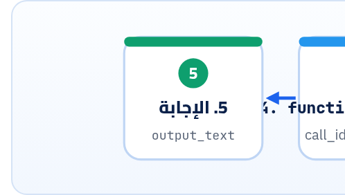

<small>المرحلة 5 · قدرات متقدمة</small>

الموديل مبيعرفش الـ Glossary بتاع شركتك ولا يقدر يفتح ملف على جهازك. الـ Function calling (أو Tool calling) بيخليه يقول: "نادي الفانكشن دي بالـ Arguments دي"، وانت اللي بتنفّذ وترجّعله النتيجة. الفصل ده بيمشي معاك في الـ Loop كاملة في OpenAI وفي Gemini، سطر سطر.

:::note[بعد الفصل ده هتكون عارف]
- يعني إيه Tool، ومين اللي بينفّذ فعلاً
- تعريف Tool في OpenAI: type و name و description و parameters و strict
- الـ Loop: function\_call ثم function\_call\_output بنفس الـ call\_id
- Gemini: FunctionDeclaration و response.function\_calls و Part.from\_function\_response
- الـ Automatic function calling في Gemini Python SDK
- الأمان: الموديل مبينفّذش حاجة، انت اللي بتنفّذ، فاحمي نفسك
:::

<a id="s22-1"></a>

## 22.1 المشكلة: الموديل محبوس جوه الكلام

الموديل بيرجّع نص وبس. مبيقدرش يقرا ملف، ولا يدور في Database، ولا يعرف سعر النهارده. فاتطور حل بسيط جداً: انت بتوصف للموديل "أدوات" (اسم + وصف + Parameters)، والموديل لما يحتاج أداة **مبينفّذهاش**، بيرجّعلك طلب: "عايز `lookup_term` بـ `{"term": "churn"}`". الاسكريبت بتاعك هو اللي بينفّذ الفانكشن، ويرجّع النتيجة للموديل في طلب جديد، والموديل يكمّل الإجابة.



*الـ Loop: الموديل بيطلب والكود بتاعك بينفّذ*

:::caution[أهم جملة في الفصل]
الموديل **عمره ما بينفّذ** حاجة على جهازك. هو بيقترح اسم فانكشن و Arguments، والكود بتاعك هو اللي بيقرر ينفّذ ولا لأ. يعني لو اديته أداة `delete_file(path)`، انت اللي فتحت الباب.
:::

<a id="s22-2"></a>

## 22.2 تعريف الأداة في OpenAI

```python
TOOLS = [
    {
        "type": "function",
        "name": "lookup_term",
        "description": "Look up a business term in the company glossary.",
        "parameters": {
            "type": "object",
            "properties": {
                "term": {"type": "string", "description": "One term, e.g. churn"},
            },
            "required": ["term"],
            "additionalProperties": False,
        },
        "strict": True,
    }
]
```

| الأمر | بيعمل إيه |
|---|---|
| `"type": "function"` | نوع الأداة: فانكشن بتاعتك. (في أنواع تانية built-in زي web search، مش موضوعنا هنا.) |
| `"name"` | الاسم اللي الموديل هيرجّعه. وخليه نفس اسم الفانكشن في Python علشان الـ Mapping يبقى سهل. |
| `"description"` | الموديل بيقرر يستخدم الأداة ولا لأ **من الوصف ده**. الدوكيومنتيشن بتقول: اوصف الغرض وكل Parameter وشكله بوضوح، وطبّق "اختبار المتدرب": لو حد جديد قرا الوصف ده بس، هيعرف يستخدمها صح؟ |
| `"parameters"` | JSON Schema للـ Arguments، نفس اللي اتعلمناه في الفصل اللي فات. |
| `"strict": True` | الـ Arguments هتيجي مطابقة للـ Schema. وبنفس القواعد: كله required، و`additionalProperties: false`. |

<a id="s22-3"></a>

## 22.3 الـ Loop كاملة (OpenAI Responses)

```python title="tool_loop.py"
import json
from openai import OpenAI

client = OpenAI()
MODEL = "gpt-6-luna"
GLOSSARY = {"churn": "Customers who stop paying.", "mrr": "Monthly recurring revenue."}

def lookup_term(term: str) -> str:
    return GLOSSARY.get(term.lower(), "NOT_FOUND")

FUNCTIONS = {"lookup_term": lookup_term}

def run(question: str, max_rounds: int = 5) -> str:
    input_list = [{"role": "user", "content": question}]
    for _ in range(max_rounds):
        response = client.responses.create(model=MODEL, tools=TOOLS, input=input_list)
        input_list += response.output
        calls = [item for item in response.output if item.type == "function_call"]
        if not calls:
            return response.output_text
        for call in calls:
            args = json.loads(call.arguments)
            func = FUNCTIONS.get(call.name)
            result = func(**args) if func else f"ERROR: unknown tool {call.name}"
            input_list.append({
                "type": "function_call_output",
                "call_id": call.call_id,
                "output": result,
            })
    raise RuntimeError("too many tool rounds")
```

بص هنمشي فيها سطر سطر، لأن كل سطر فيها له سبب:

```python title="الـ Loop مشرّحة"
FUNCTIONS = {"lookup_term": lookup_term}
for _ in range(max_rounds):
input_list += response.output
[item for item in response.output if item.type == "function_call"]
if not calls: return response.output_text
json.loads(call.arguments)
func(**args)
"call_id": call.call_id
"output": result
```

1. `FUNCTIONS = {"lookup_term": lookup_term}`: dict من **اسم** لـ **فانكشن** (من غير أقواس، يعني الفانكشن نفسها مش نتيجتها). كده بنترجم الاسم اللي جاي من الموديل لكود، ومفيش أي اسم تاني هيتنفّذ. وده أمان: الموديل مبيقدرش ينادي حاجة مش في القايمة.
2. `for _ in range(max_rounds):`: سقف للّفات. `_` يعني "مش محتاج رقم اللفة". ومن غير سقف، موديل لخبط ممكن يفضل يطلب أدوات للأبد وانت بتدفع.
3. `input_list += response.output`: ضيف رد الموديل (بما فيه الـ `function_call`) للتاريخ. ده إجباري، لأن الـ API Stateless (فصل 14): الطلب الجاي لازم يشوف إن الموديل طلب الأداة.
4. `[item for item in response.output if item.type == "function_call"]`: List comprehension بتفلتر الطلبات. والدوكيومنتيشن بتقول: افترض دايماً إنه ممكن يبقى في **صفر أو واحد أو أكتر** من طلب في نفس الرد.
5. `if not calls: return response.output_text`: مفيش طلبات، يعني الموديل خلص وده الرد النهائي.
6. `json.loads(call.arguments)`: الـ Arguments جاية **نص JSON** مش dict، فلازم تحوّلها.
7. `func(**args)`: `**` بتفك الـ dict لـ Keyword arguments: `{"term": "churn"}` بتبقى `lookup_term(term="churn")` (فصل 6).
8. `"call_id": call.call_id`: بيربط النتيجة بالطلب بتاعها. ولو في 3 طلبات، كل نتيجة بالـ call\_id بتاعها.
9. `"output": result`: النتيجة **نص** (الدوكيومنتيشن بتقول عادة String، والشكل بتاعك: JSON أو نص أو كود خطأ). ولو عندك dict، ابعته `json.dumps(...)`.

:::note[جربناها]
شغّلنا `tool_loop.py` ده على سيرفر تجريبي محلي بيقلّد شكل ردود الـ API (مش الـ API الحقيقي). الطلب الأول اتبعت فيه رسالة واحدة. والتاني اتبعت فيه 3 عناصر (السؤال + `function_call` + `function_call_output` بـ `call_id` نفسه)، والنتيجة النهائية اتطبعت. فالـ Loop شغالة صح من ناحية الشكل.
:::

:::note[tool_choice]
الافتراضي `"auto"`: الموديل يقرر (صفر أو أكتر). و`"required"`: لازم أداة واحدة على الأقل. و`{"type": "function", "name": "lookup_term"}`: الأداة دي بالذات. وفي Chat Completions مع GPT-6 Luna/Sol، الـ Function calling شغال بس مع `reasoning_effort="none"` (فصل 16)، فلو عايز Tools مع Reasoning، استخدم Responses.
:::

**المصادر الرسمية:** [OpenAI · Function calling](https://developers.openai.com/api/docs/guides/function-calling)

<a id="s22-4"></a>

## 22.4 نفس الـ Loop في Gemini

```python title="gemini_tools.py"
from google import genai
from google.genai import types

client = genai.Client()
lookup_decl = {
    "name": "lookup_term",
    "description": "Look up a business term in the company glossary.",
    "parameters": {
        "type": "object",
        "properties": {"term": {"type": "string", "description": "One term, e.g. churn"}},
        "required": ["term"],
    },
}
config = types.GenerateContentConfig(
    tools=[types.Tool(function_declarations=[lookup_decl])],
)
contents = [types.Content(role="user", parts=[types.Part(text="What does churn mean?")])]

for _ in range(5):
    response = client.models.generate_content(
        model="gemini-3.8-flash", contents=contents, config=config,
    )
    if not response.function_calls:
        print(response.text)
        break
    contents.append(response.candidates[0].content)
    parts = []
    for fc in response.function_calls:
        result = FUNCTIONS[fc.name](**fc.args)
        parts.append(types.Part(function_response=types.FunctionResponse(
            name=fc.name, response={"result": result}, id=fc.id,
        )))
    contents.append(types.Content(role="user", parts=parts))
```

**OpenAI قصاد Gemini في الـ Tools**

|   | OpenAI Responses | Gemini generate\_content |
|---|---|---|
| تعريف | `{"type": "function", "name", "parameters"}` في `tools=` | `types.Tool(function_declarations=[...])` في `config.tools` |
| الطلبات | عناصر `type == "function_call"` في `output` | `response.function_calls` |
| الـ Arguments | `json.loads(call.arguments)` (نص) | `fc.args` (dict جاهز) |
| الربط | `call_id` | `id` |
| إرجاع النتيجة | `{"type": "function_call_output", ...}` | `Part(function_response=FunctionResponse(...))` في Content بـ role user |
| النص لما يطلب أداة | `output_text` فاضي | `response.text` بـ `None` |

:::caution[Thought signatures في Gemini 3]
الدوكيومنتيشن بتقول: في Gemini 3، أجزاء الرد ممكن يبقى فيها `thought_signature`، **وإرجاعها إجباري في الـ Function calling**. والحل الأسهل: ضيف `response.candidates[0].content` **زي ما هو** (زي الكود فوق)، والـ SDK هيتصرف. ولو بنيت التاريخ بإيدك، متدمجش ولا تعدّل الـ Parts اللي فيها Signature، وابعت الـ `id` بالظبط.
:::

:::danger[مشكلة: ]
##### TypeError: Part.from\_function\_response() got an unexpected keyword argument 'id'

أمثلة الدوكيومنتيشن (أكتوبر 2026) بتكتب `types.Part.from_function_response(name=..., response=..., id=...)`. بس في `google-genai 2.33.0` اللي جربنا عليه، الـ Helper ده بياخد `name` و`response` و`parts` بس، فالسطر ده بيدّي الخطأ اللي فوق (جربناه).

علشان كده الكود فوق بيبني الـ Part بالشكل الطويل: `types.Part(function_response=types.FunctionResponse(name=..., response=..., id=...))`. ده شغال، و`FunctionResponse` فيه حقل `id` فعلاً. والدرس الأكبر: لو مثال رسمي وقع، اقرا الـ Signature الحقيقي بـ `help(types.Part.from_function_response)`.
:::

### الطريق المختصر: Automatic function calling (Python بس)

```python
def lookup_term(term: str) -> str:
    """Look up a business term in the company glossary.

    Args:
        term: One term, e.g. churn.
    """
    return GLOSSARY.get(term.lower(), "NOT_FOUND")

response = client.models.generate_content(
    model="gemini-3.8-flash",
    contents="What does churn mean?",
    config=types.GenerateContentConfig(tools=[lookup_term]),
)
print(response.text)
```

هنا ادينا **الفانكشن نفسها** في `tools=`. والـ SDK بيقرا الاسم والـ Type hints والـ Docstring، ويعمل منهم الـ Declaration، ويلفّ الـ Loop لوحده. وعلشان كده الـ Docstring والـ Type hints هنا مش تجميل، دول الوصف اللي الموديل بيشوفه. وجربنا `types.FunctionDeclaration.from_callable` (نفس التحويل): الـ Docstring كله بقى `description`، و`term: str` بقى `{"type": "STRING"}` في `required`. والسقف الافتراضي 10 نداءات (`AutomaticFunctionCallingConfig.maximum_remote_calls`)، وتقفله بـ `AutomaticFunctionCallingConfig(disable=True)`.

**المصادر الرسمية:** [Gemini · Function calling](https://ai.google.dev/gemini-api/docs/function-calling) · [Gemini · Thought signatures](https://ai.google.dev/gemini-api/docs/thought-signatures)

<a id="s22-5"></a>

## 22.5 الأمان: انت اللي ماسك الزرار

1. **ابدأ بأدوات قراية بس** (lookup، read، search). وأي أداة بتكتب أو بتمسح أو بتبعت، خلي فيها تأكيد أو `--dry-run`.
2. **اتأكد من الـ Arguments** حتى مع strict: مثلاً `path` لازم يبقى جوه فولدر معين (`Path(p).resolve().is_relative_to(BASE)`).
3. <strong>متاخدش اسم الفانكشن وتنفّذه بـ `eval` أو `getattr`</strong> على Module كامل. استخدم dict صريح زي `FUNCTIONS`.
4. **رجّع الأخطاء كنص** بدل ما الاسكريبت يقع: `"ERROR: file not found"`، والموديل هيتصرف.
5. **Prompt injection**: لو الأداة بترجّع محتوى من برّه (صفحة ويب، ملف)، المحتوى ده ممكن يكون فيه "أوامر". ومتخليش أداة خطيرة متاحة في نفس الـ Loop.

:::tip[حاجة مشتركة: JS]
في JS نفس الشكل بالظبط: `tools: [{ type: "function", name, parameters, strict: true }]`، و`JSON.parse(item.arguments)`، و`{ type: "function_call_output", call_id: item.call_id, output }`. والـ `FUNCTIONS` dict بتبقى Object: `const FUNCTIONS = { lookup_term: lookupTerm }`.
:::

:::tip[ملخص الفصل]
- الموديل بيطلب، والكود بتاعك بينفّذ ويرجّع النتيجة.
- OpenAI: `function_call` ثم `function_call_output` بنفس `call_id`، و`arguments` نص JSON.
- Gemini: `response.function_calls`، و`fc.args` dict، و`FunctionResponse(..., id=fc.id)`، وضيف رد الموديل زي ما هو.
- Automatic function calling في Gemini Python: ادي الفانكشن نفسها، والـ Docstring هو الوصف.
- سقف لفّات، وdict أدوات صريح، وأدوات قراية الأول.
:::

### صح ولا غلط؟

1. OpenAI بينفّذ فانكشن `lookup_term` على سيرفراته.
2. في OpenAI، `call.arguments` بييجي dict جاهز.
3. في Gemini، لو الرد فيه طلب أداة بس، `response.text` بيبقى `None`.

### أسئلة مراجعة

1. ليه بنعمل `input_list += response.output` قبل ما نضيف النتايج؟
2. إيه فايدة `max_rounds`؟ وإيه اللي ممكن يحصل من غيرها؟
3. اكتب Tool Definition لفانكشن `count_words(path)`، وقول هتحمي الـ `path` إزاي.

### تحديات الفصل

<small>جرّبها بإيدك، والحلول في ملحق الإجابات.</small>

1. **[سهل]** ضيف أداة تانية `list_terms()` من غير Parameters (`"properties": {}`).
2. **[متوسط]** حوّل نفس الأداة لـ Automatic function calling في Gemini، وقارن طول الكود.
3. **[صعب]** اعمل أداة `read_file(name)` بتقرا من فولدر `notes/` بس، وجرّب تديها `"../.env"` وتأكد إنها بترفض.
