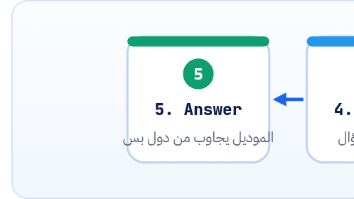

<small>المرحلة 5 · قدرات متقدمة</small>

عندك 300 ملف Notes، وعايز تسأل "سياسة الاسترجاع كام يوم؟" والإجابة تيجي من ملفاتك انت، مش من دماغ الموديل. الفصل ده بيشرح الـ Embeddings من الصفر (يعني إيه نص يبقى أرقام، ويعني إيه "قريب")، وبعدين نبني RAG كامل في 70 سطر بـ numpy، من غير Database ولا Framework.

:::note[بعد الفصل ده هتكون عارف]
- يعني إيه Embedding و Vector و Cosine similarity
- OpenAI: embeddings.create بـ List و dimensions
- Gemini: embed\_content و gemini-embedding-2 (Embedding واحد لكل Request) و Task prefixes
- التقطيع Chunking: ليه وإزاي
- البحث: Matrix @ vector و argsort و Top-k
- الإجابة من الـ Context بس مع ذكر المصدر
:::

<a id="s24-1"></a>

## 24.1 المشكلة: الموديل مبيعرفش ملفاتك

أول حل بيجي في بالك: "ابعت كل الملفات في الـ Prompt". ودي بتشتغل لو الملفات قليلة، بس 300 ملف = Tokens كتير وفلوس كتير مع كل سؤال، وممكن تعدّي الـ Context. وتاني حل: "دوّر بالكلمة"، يعني `if "refund" in text`. بس السؤال لو كان "أرجّع فلوسي إزاي؟"، كلمة refund مش موجودة في السؤال أصلاً.

فاتطور حل اسمه **RAG** (Retrieval-Augmented Generation): **دوّر الأول** على أقرب 3 أجزاء للسؤال **بالمعنى** مش بالكلمة، **وابعت دول بس** للموديل وقوله "جاوب من دول". والبحث بالمعنى ده هو اللي بيعمله الـ **Embeddings**.



*RAG في 5 خطوات: الخطوات 1–3 مرة واحدة، و4–5 مع كل سؤال*

<a id="s24-2"></a>

## 24.2 Embedding: نص بيبقى List أرقام

الـ Embedding Model بياخد نص ويرجّع **Vector**: List أرقام طولها ثابت (مثلاً 1536). الأرقام دي في حد ذاتها ملهاش معنى تقراه، بس **النصوص اللي معناها قريب، الـ Vectors بتاعتها بتبقى قريبة**. و"قريبة" بنقيسها بـ **Cosine similarity**: قد إيه السهمين بيشاوروا لنفس الاتجاه، من 1 (نفس الاتجاه) لـ 0 (ملهمش علاقة).

```python
>>> import numpy as np
>>> a = np.array([0.6, 0.8])
>>> b = np.array([0.8, 0.6])
>>> c = np.array([-0.8, 0.6])
>>> np.linalg.norm(a)
np.float64(1.0)
>>> a @ b
np.float64(0.96)
>>> a @ c
np.float64(2.6645352591003756e-17)
```

| الأمر | بيعمل إيه |
|---|---|
| `np.array([...])` | Array من numpy: زي List بس بتعمل عمليات رياضة على كله مرة واحدة وبسرعة. |
| `np.linalg.norm(a)` | طول السهم. ولو الطول 1، الـ Vector اسمه **normalized**. |
| `a @ b` | `@` = Dot product: اضرب كل رقم في المقابل له واجمع (`0.6×0.8 + 0.8×0.6 = 0.96`). <strong>ولو الاتنين normalized، الـ Dot product هو الـ Cosine similarity بالظبط.</strong> وعلشان كده هنعمل normalize مرة واحدة ونستخدم `@` وخلاص. |

آخر رقم ده `0.000…027`، يعني صفر عملياً: `-0.48 + 0.48` بالـ float مبتطلعش صفر بالظبط (نفس حكاية `0.1 + 0.2` في JS). وفي numpy 2، الرقم الفردي بيتطبع `np.float64(0.96)`، وده نفس `0.96`، و`float(...)` بتحوّله لرقم Python عادي.

<a id="s24-3"></a>

## 24.3 الـ APIs: OpenAI و Gemini

```python
# OpenAI: List نصوص = List Vectors، بنفس الترتيب
response = client.embeddings.create(
    model="text-embedding-3-small",
    input=["first chunk", "second chunk"],
)
vectors = [item.embedding for item in response.data]   # 2 × 1536
```

```python
# Gemini: gemini-embedding-2، Request لكل نص
from google.genai import types

def gemini_embed(text: str, *, query: bool, title: str = "none") -> list[float]:
    content = (f"task: search result | query: {text}" if query
               else f"title: {title} | text: {text}")
    result = client.models.embed_content(
        model="gemini-embedding-2",
        contents=content,
        config=types.EmbedContentConfig(output_dimensionality=768),
    )
    return result.embeddings[0].values
```

**Embeddings في الاتنين (الدوكيومنتيشن، أكتوبر 2026)**

|   | OpenAI `text-embedding-3-small` | Gemini `gemini-embedding-2` |
|---|---|---|
| الطول الافتراضي | 1536 (و`-large` ‏3072) | 3072 |
| تصغير الطول | `dimensions=512` | `output_dimensionality` (المقترح 768 أو 1536 أو 3072) |
| أقصى Input | 8192 Token | 8192 Token (والزيادة **بتتقص بصمت**) |
| List نصوص في Request | Vector لكل نص | **Embedding واحد مجمّع** لكل الـ List. فاعمل Request لكل Chunk، أو استخدم Batch API |
| نوع المهمة | - | Prefix في النص: `task: search result \| query: …` للسؤال، و`title: … \| text: …` للمستند |
| Normalized؟ | - | أيوه، حتى مع الأطوال المصغّرة (Embedding 2) |
| السعر | ‎$0.02 لكل مليون Token (و`-large` ‏$0.13) | ‎$0.20 لكل مليون Token نص |

:::caution[غلطتين بيقعوا فيهم الناس]
(1) **متخلطش موديلات**: Vectors عملتها بـ OpenAI متتقارنش بـ Vector سؤال من Gemini، ولا حتى بنفس الموديل بطول مختلف. فاحفظ اسم الموديل والطول مع الـ Index. (2) في `gemini-embedding-2`، لو بعت List فيها 50 Chunk، هترجعلك **Vector واحد** مش 50. والكود مش هيقع، بس النتايج هتبقى غلط من غير ما تاخد بالك. وعلشان كده مكتوب في الدوكيومنتيشن صراحة. و`gemini-embedding-001` القديم كان بيرجّع Vector لكل نص.
:::

**المصادر الرسمية:** [OpenAI · Embeddings](https://developers.openai.com/api/docs/guides/embeddings) · [Gemini · Embeddings](https://ai.google.dev/gemini-api/docs/embeddings) · [numpy · matmul (@)](https://numpy.org/doc/stable/reference/generated/numpy.matmul.html)

<a id="s24-4"></a>

## 24.4 ليه بنقطّع؟

ملف كامل في Vector واحد = المعنى "متوسط" ومش واضح، والإجابة بتبقى مدفونة. وجزء صغير أوي (سطر) = من غير Context. فالحل الوسط: **فقرات لحد ~1200 حرف** (حوالي 300 Token بقاعدة الـ 4 حروف للـ Token). ومفيش رقم سحري، جرّب على ملفاتك.

<a id="s24-5"></a>

## 24.5 rag.py كامل

```python title="rag.py"
import json
import sys
from pathlib import Path

import numpy as np
from openai import OpenAI

client = OpenAI()
EMBED_MODEL = "text-embedding-3-small"
CHAT_MODEL = "gpt-6-luna"
NOTES = Path("notes")
INDEX = Path("index.json")

def chunk_text(text: str, max_chars: int = 1200) -> list[str]:
    chunks, current = [], ""
    for para in text.split("\n\n"):
        para = para.strip()
        if not para:
            continue
        if current and len(current) + len(para) > max_chars:
            chunks.append(current)
            current = ""
        current = f"{current}\n\n{para}" if current else para
    if current:
        chunks.append(current)
    return chunks

def embed(texts: list[str]) -> np.ndarray:
    response = client.embeddings.create(model=EMBED_MODEL, input=texts)
    vectors = np.array([item.embedding for item in response.data], dtype=np.float32)
    return vectors / np.linalg.norm(vectors, axis=1, keepdims=True)

def build_index() -> None:
    records = []
    for path in sorted(NOTES.glob("*.md")):
        for i, chunk in enumerate(chunk_text(path.read_text(encoding="utf-8"))):
            records.append({"source": f"{path.name}#{i}", "text": chunk})
    vectors = embed([r["text"] for r in records])
    for record, vector in zip(records, vectors):
        record["vector"] = vector.tolist()
    INDEX.write_text(json.dumps(records), encoding="utf-8")
    print(f"indexed {len(records)} chunks")

def search(question: str, k: int = 3) -> list[dict]:
    records = json.loads(INDEX.read_text(encoding="utf-8"))
    matrix = np.array([r["vector"] for r in records], dtype=np.float32)
    query = embed([question])[0]
    scores = matrix @ query
    top = np.argsort(scores)[::-1][:k]
    return [{**records[i], "score": float(scores[i])} for i in top]

def answer(question: str) -> str:
    hits = search(question)
    context = "\n\n".join(f"<doc source=\"{h['source']}\">\n{h['text']}\n</doc>" for h in hits)
    response = client.responses.create(
        model=CHAT_MODEL,
        instructions=(
            "Answer only from the documents. If the answer is not there, say you don't know. "
            "Cite sources like [refunds.md#0]."
        ),
        input=f"{context}\n\nQuestion: {question}",
    )
    return response.output_text

if __name__ == "__main__":
    if sys.argv[1:] == ["index"]:
        build_index()
    else:
        print(answer(" ".join(sys.argv[1:])))
```

بص بقى هندخل جوه السطور المهمة واحدة واحدة:

```python title="rag.py مشرّح"
for para in text.split("\n\n"):
current = f"{current}\n\n{para}" if current else para
np.array([...], dtype=np.float32)
vectors / np.linalg.norm(vectors, axis=1, keepdims=True)
f"{path.name}#{i}"
zip(records, vectors)
vector.tolist()
scores = matrix @ query
np.argsort(scores)[::-1][:k]
{**records[i], "score": float(scores[i])}
<doc source="...">
if sys.argv[1:] == ["index"]:
```

1. `for para in text.split("\n\n"):`: قطّع على السطر الفاضي، يعني فقرات Markdown. ونجمع فقرات لحد ما نقرّب من `max_chars`، ونبدأ Chunk جديد.
2. `current = f"{current}\n\n{para}" if current else para`: Conditional expression (فصل 5): لو في حاجة قبل كده ضيف بفاصل، ولو لأ ابدأ بالفقرة.
3. `np.array([...], dtype=np.float32)`: كل الـ Vectors في Matrix واحدة: صف لكل Chunk. و`float32` نص حجم الافتراضي، ومكفّي.
4. `vectors / np.linalg.norm(vectors, axis=1, keepdims=True)`: Normalize كل صف لطول 1. و`axis=1` = احسب الطول لكل صف لوحده. و`keepdims=True` = خلّي الشكل `(n, 1)` علشان القسمة تتعمل على كل صف (Broadcasting).
5. `f"{path.name}#{i}"`: اسم المصدر: الملف + رقم الجزء. وده اللي الموديل هيذكره في الإجابة، وانت تقدر ترجعله.
6. `zip(records, vectors)`: امشي على الاتنين مع بعض، أول record مع أول vector وهكذا.
7. `vector.tolist()`: numpy array مش بيتحوّل JSON مباشرة، فبنحوّله List عادية الأول.
8. `scores = matrix @ query`: Matrix `(n, d)` @ vector `(d,)` = `n` رقم، Similarity السؤال مع **كل** Chunk في سطر واحد.
9. `np.argsort(scores)[::-1][:k]`: `argsort` بيرجّع **الأماكن** مترتبة من الأصغر للأكبر، و`[::-1]` بيقلبها، و`[:k]` بياخد أول k. والنتيجة: أرقام أحسن k Chunks.
10. `{**records[i], "score": float(scores[i])}`: dict جديد = كل حقول الـ record (`**` بتفرد الـ dict) + حقل `score`. وزي `{...obj, score}` في JS بالظبط.
11. `<doc source="...">`: Delimiters (فصل 20): الموديل يعرف فين كل مستند ومصدره. والتعليمات: "جاوب من المستندات بس، ولو مش موجود قول مش عارف، واذكر المصدر".
12. `if sys.argv[1:] == ["index"]:`: `python rag.py index` تبني الـ Index، و`python rag.py how long is a refund?` تسأل. و`" ".join(sys.argv[1:])` بتجمع الكلام كله سؤال واحد.

:::note[جربناه إزاي]
شغّلنا `build_index` و`search` على فولدر فيه ملفين (refunds و shipping) بـ `embed()` **مزيفة** بتعد الكلمات (علشان مفيش API key). والسؤال "how many days for a refund" جاب `refunds.md#0` الأول بـ score ‏0.617، وبعده `shipping.md#0` بـ 0.365. يعني الـ Pipeline (تقطيع، و normalize، و `@`، و argsort) شغال. أما جودة البحث بالمعنى الحقيقي، فدي من الـ Embedding model الحقيقي.
:::

:::note[إمتى تكبر عن الحل ده؟]
Index في JSON و numpy كويس لحد آلاف الـ Chunks. ولو وصلت لمئات الآلاف، أو محتاج تحديث مستمر وفلترة، ساعتها تبص على Vector database. وOpenAI عندها كمان أداة **File Search** جاهزة بتعمل الـ RAG على ملفاتك من غير ما تكتبه. بس كتابته بإيدك مرة هي اللي بتخليك تفهم أي حل جاهز.
:::

:::tip[حاجة مشتركة: JS]
الـ Dot product في JS: `a.reduce((s, x, i) => s + x * b[i], 0)`. ومفيش numpy، فبتلف بإيدك أو تستخدم مكتبة. والـ `{**d, "score": s}` هي `{...d, score: s}`.
:::

:::tip[ملخص الفصل]
- Embedding = نص بقى Vector، والمعنى القريب = Vectors قريبة، وبنقيس بـ Cosine (= `@` لو normalized).
- OpenAI: `embeddings.create(input=[...])` بيرجّع Vector لكل نص. وGemini Embedding 2: Vector واحد لكل Request، و Prefixes للمهمة.
- قطّع لفقرات، و normalize، واحفظ في JSON مع المصدر واسم الموديل.
- ابحث بـ `matrix @ query` و`argsort`، وابعت أحسن k بس، والتعليمات "من المستندات بس + المصدر".
:::

### صح ولا غلط؟

1. لو الـ Vectors normalized، الـ Dot product = Cosine similarity.
2. `gemini-embedding-2` بيرجّع Vector لكل نص لو بعتلته List.
3. ينفع تقارن Vector من موديل OpenAI بـ Vector من موديل Gemini.

### أسئلة مراجعة

1. اشرح بكلامك ليه البحث بالكلمة مش كفاية.
2. `np.argsort(scores)[::-1][:3]`: إيه اللي بيرجع من كل خطوة؟
3. ليه بنحفظ `source` مع كل Chunk؟

### تحديات الفصل

<small>جرّبها بإيدك، والحلول في ملحق الإجابات.</small>

1. **[سهل]** احسب بإيدك `[1, 0] @ [0.6, 0.8]`، وبعدين اتأكد بـ numpy.
2. **[متوسط]** ضيف في `index.json` حقل `model` و`dims`، وخلي `search` ترفض لو الموديل اتغيّر.
3. **[صعب]** حوّل `embed()` لـ Gemini بـ `gemini_embed` (Request لكل Chunk، و Prefixes مختلفة للسؤال والمستند).
