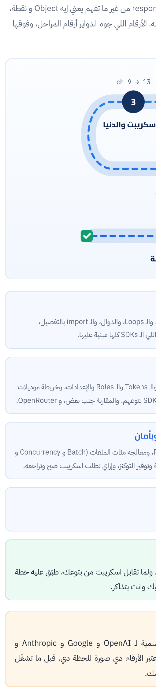

الكتاب ده ماشي معاك على 7 مراحل. الأول هتعرف تشغّل اسكريبت Python على الـ Mac وتدخل جواه وتعرف تقراه. بعدين لغة Python نفسها على قد اللي محتاجه علشان تقرا، والملفات والـ APIs والأخطاء. وبعد كده الجزء الكبير: الـ AI. هنشوف الموديلات، والـ SDKs بتوع OpenAI و Gemini و OpenRouter، وكل المفاهيم اللي هتقابلها في أي اسكريبت. وفي الآخر اسكريبتات كاملة متشرّحة، ومشروع نهائي بتقرا فيه أداة من كذا ملف وتعدّل عليها.

:::tip[تحميل]
- [الكتاب كامل PDF](/biginner-journey/downloads/04-python-book.pdf)
- [الـ Cheat Sheet PDF](/biginner-journey/downloads/04-python-cheatsheet.pdf)
:::

## خريطة الكتاب

- **1 · التشغيل والقراية**: Python إيه وبيشتغل إزاي، وتشغيل أي اسكريبت على الـ Mac بـ venv و pip، وخطة تدخل بيها أي اسكريبت غريب وتعرف رجليه من راسه.
- **2 · لغة Python**: المتغيرات والأنواع، والشروط والـ Loops، والدوال، والـ import بالتفصيل، والـ Classes والـ Objects اللي الـ SDKs كلها مبنية عليها.
- **3 · الاسكريبت والدنيا**: الملفات والفولدرات، و JSON و CSV و Excel، والكلام مع أي API، والـ API keys والـ .env، وقراية الـ Traceback، و logging و argparse.
- **4 · أساسيات الـ AI**: الـ LLM API بيشتغل إزاي، والـ Tokens والـ Roles والإعدادات، وخريطة موديلات OpenAI و Gemini، والـ SDKs بتوعهم، والمقارنة جنب بعض، و OpenRouter.
- **5 · قدرات متقدمة**: الـ Prompts جوه الكود، والـ Structured output، والـ Function calling، والصور والملفات، والـ Embeddings و RAG بسيط بيدوّر في ملفاتك.
- **6 · على نطاق واسع وبأمان**: الـ Rate limits والـ Retries، ومعالجة مئات الملفات (Batch و Concurrency و Resume)، وحساب التكلفة وتوفير التوكنز، وإزاي تطلب اسكريبت صح وتراجعه.
- **7 · اسكريبتات كاملة**: اسكريبتين كاملين متشرّحين سطر سطر بالرسومات، ومشروع نهائي: أداة من كذا ملف تقراها وتعدّل عليها.

## الفصول

**المرحلة 1 · التشغيل والقراية**

- [الفصل 1: حكاية Python: يعني إيه اسكريبت وبيشتغل إزاي](./ch01/)
- [الفصل 2: تشغيل أي اسكريبت على الـ Mac: python3 و venv و pip](./ch02/)
- [الفصل 3: خطة قراية أي اسكريبت: تدخل منين وتمشي إزاي](./ch03/)

**المرحلة 2 · لغة Python**

- [الفصل 4: المتغيرات والأنواع: الصناديق اللي البيانات بتتحط فيها](./ch04/)
- [الفصل 5: الشروط والـ Loops: الاسكريبت بيقرر ويكرر](./ch05/)
- [الفصل 6: الدوال: def و return و الـ Arguments والـ Type hints](./ch06/)
- [الفصل 7: import بالتفصيل: الحاجات دي جاية منين؟](./ch07/)
- [الفصل 8: الـ Classes والـ Objects: يعني إيه client.responses.create](./ch08/)

**المرحلة 3 · الاسكريبت والدنيا**

- [الفصل 9: الملفات والفولدرات: pathlib و open و glob](./ch09/)
- [الفصل 10: JSON و CSV و Excel: لغة البيانات اللي داخلة وخارجة](./ch10/)
- [الفصل 11: الكلام مع أي API: requests والـ API keys وملف .env](./ch11/)
- [الفصل 12: الأخطاء: تقرا الـ Traceback وتمسك الخطأ بـ try/except](./ch12/)
- [الفصل 13: print و logging و argparse: الاسكريبت بيتكلم وبياخد أوامر](./ch13/)

**المرحلة 4 · أساسيات الـ AI**

- [الفصل 14: الـ LLM API بيشتغل إزاي: Tokens و Roles والإعدادات](./ch14/)
- [الفصل 15: خريطة الموديلات: OpenAI و Gemini و Claude (أكتوبر 2026)](./ch15/)
- [الفصل 16: الـ OpenAI Python SDK بالتفصيل: Responses API و Chat Completions](./ch16/)
- [الفصل 17: الـ Google Gen AI SDK بالتفصيل: generate\_content و Interactions](./ch17/)
- [الفصل 18: OpenAI و Gemini جنب بعض: نفس المهمة بلهجتين](./ch18/)
- [الفصل 19: OpenRouter: API واحد لمئات الموديلات](./ch19/)

**المرحلة 5 · قدرات متقدمة**

- [الفصل 20: الـ Prompt engineering جوه الكود: Templates و Few-shot و Versions](./ch20/)
- [الفصل 21: الـ Structured output: JSON مضمون بـ Schema](./ch21/)
- [الفصل 22: Function calling: الموديل يطلب، والاسكريبت ينفّذ](./ch22/)
- [الفصل 23: صور وملفات و PDF: تبعت للموديل حاجة غير النص](./ch23/)
- [الفصل 24: Embeddings و RAG بسيط: الموديل يجاوب من ملفاتك](./ch24/)

**المرحلة 6 · على نطاق واسع وبأمان**

- [الفصل 25: Retries و Rate limits و Timeouts: الاسكريبت ميقعش في النص](./ch25/)
- [الفصل 26: معالجة ملفات كتير: Batch و Threads و asyncio و Resume](./ch26/)
- [الفصل 27: التكلفة وتوفير الـ Tokens: احسب قبل ما تدفع](./ch27/)
- [الفصل 28: تطلب من الـ AI اسكريبت صح، وتراجعه قبل ما تشغّله](./ch28/)

**المرحلة 7 · اسكريبتات كاملة**

- [الفصل 29: اسكريبت كامل: فولدر ملفات ← AI ← CSV و Excel](./ch29/)
- [الفصل 30: اسكريبت كامل: ترجمة أو إعادة صياغة عمود في Excel](./ch30/)
- [الفصل 31: المشروع النهائي: أداة من كذا ملف](./ch31/)

**الملاحق**

- [ملحق أ: Cheat Sheet وجدول الـ Flags وجدول الرموز](./appendix-1/)
- [ملحق ب: قاموس المصطلحات](./appendix-2/)
- [ملحق ج: ملحق الدوكيومنتيشن الرسمية](./appendix-3/)
- [ملحق د: المصادر ومنهجية التحقق](./appendix-4/)
- [ملحق ه: الإجابات والحلول](./appendix-5/)
