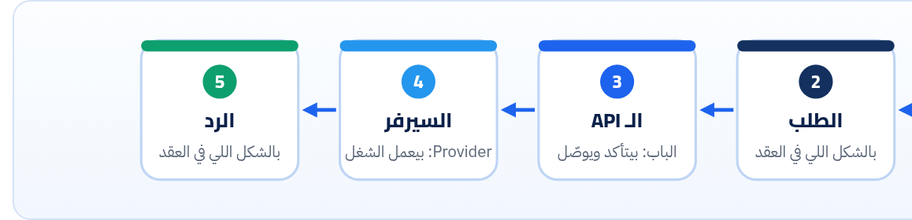

<small>المرحلة 1 · الفكرة</small>

قبل ما نتكلم عن REST و JSON و Tokens، لازم نفهم المشكلة اللي الـ API جه يحلّها. هنبدأ بحكاية فريق محتوى بينسخ ويلزق أرقام كل يوم، وبعدين برنامج بيعمل Scraping لصفحة ويتكسر، وبعدين الحل: باب معمول مخصوص للبرامج، وعليه عقد مكتوب.

:::note[بعد الفصل ده هتكون عارف]
- المشكلة اللي قبل الـ APIs: النسخ واللزق والـ Scraping
- يعني إيه API بجد: عقد بين برنامجين
- الـ API موجود في كل حتة: Library و DOM و Web
- ليه كلمة Web APIs في MDN معناها حاجة تانية
- تبعت أول طلب API بإيدك وتفهم كل حتة فيه
- الفرق بين الـ Consumer والـ Provider، وليه الكتاب بيبدأ بالأول
:::

<a id="s1-1"></a>

## 1.1 قبل الـ APIs: النسخ واللزق

تخيل إنك في فريق محتوى بيكتب مقالات عن الأسعار، وكل مقالة لازم يبقى فيها سعر الدولار النهارده. فكل يوم الصبح، حد في الفريق بيفتح موقع البنك، ويدوّر على الرقم، وينسخه، ويلزقه في الـ CMS. ولو نسي يوم، المقالة بتطلع بسعر قديم. ولو بقوا 50 مقالة بـ 10 عملات، الموضوع بقى شغلانة لوحده.

فواحد من الفريق قال: "أنا هكتب اسكريبت يعمل ده لوحده". والاسكريبت بيعمل اللي الإنسان كان بيعمله بالظبط: يفتح الصفحة، وياخد الـ HTML، ويدوّر جواه على الرقم. والطريقة دي اسمها **Scraping**.

```html title="الصفحة اللي الاسكريبت بيدوّر فيها"
<div class="rates-box">
  <span class="label">USD</span>
  <span class="value big-green">54.87</span>
</div>
```

والاسكريبت بيقول: "هات أول `span` عليه `class="value"` جوه `rates-box`". واشتغل أسبوعين. وبعدين **وهنا كانت المشكلة**: الموقع عمل تصميم جديد، والـ class بقى اسمه `rate-amount`، فالاسكريبت رجّع فاضي، والمقالات كلها طلعت من غير سعر. ومحدش في البنك غلطان: الصفحة دي معمولة **للبني آدمين**، وهم حرّين يغيّروا شكلها في أي وقت. محدش وعدك إن الـ HTML هيفضل زي ما هو.

#### مشاكل الـ Scraping

- بيتكسر مع أي تغيير في التصميم.
- بتنزّل صفحة كاملة (صور و CSS و JS) علشان رقم واحد.
- الرقم جاي كنص `"54.87"` وسط كلام، ومحتاج تنضّفه.
- كتير من المواقع بتمنعه في شروط الاستخدام، أو بتعمل Block للـ IP.

#### اللي كنا محتاجينه

- باب **معمول للبرامج** مش للعين.
- بيرجّع الرقم بس، في شكل ثابت وسهل.
- صاحبه **واعد** إن الشكل ده مش هيتغير فجأة.
- ومكتوب له دوكيومنتيشن: تبعت إيه وترجعلك إيه.

<a id="s1-2"></a>

## 1.2 فاتطور حل: عقد بين برنامجين

الحل إن صاحب البيانات يفتح **باب تاني** مخصوص للبرامج: عنوان تبعتله سؤال بشكل متفق عليه، ويرجّعلك الإجابة بشكل متفق عليه. والباب ده اسمه **API**: اختصار **Application Programming Interface**، يعني "واجهة برمجة التطبيقات". وخلينا نفصّص الاسم:

| الأمر | بيعمل إيه |
|---|---|
| `Application` | أي برنامج: اسكريبتك، أو موقع، أو تطبيق موبايل، أو سيرفر تاني. |
| `Programming` | بيستخدمه **كود**، مش إنسان بيدوس بالماوس. |
| `Interface` | "واجهة": نقطة التلاقي بين حاجتين. زي فيشة الكهربا: انت مش محتاج تعرف المحطة شغالة إزاي، محتاج بس تعرف شكل الفيشة. |



*الـ API هو الباب اللي في النص. انت مش شايف السيرفر من جوه (بيكلم Database ولا ملف ولا موديل AI)، وده بالظبط المقصود: صاحبه يقدر يغيّر كل اللي جوه من غير ما يكسرك، طالما الباب نفسه ثابت.*

والكلمة المهمة هنا هي **العقد** (Contract). الـ API الكويس بيقولك بوضوح:

1. **تبعت فين**: العنوان، زي `/v2/rates`.
2. **تبعت إيه**: الـ Parameters، زي `base=USD`، وأنهي منها إجباري.
3. **هيرجعلك إيه**: شكل الرد بالظبط، وكل Field نوعه إيه.
4. **لو حصل غلط**: هيرجّع إيه، وإزاي تعرف السبب.
5. **الحدود**: تبعت كام طلب في الدقيقة، ومحتاج تسجّل ولا لأ.
6. **الوعد**: إمتى ممكن يتغير، وإزاي هيبلّغك (الـ Versioning، فصل 19).

:::note[تشبيه المطعم (بس متعلقش فيه)]
انت قاعد في مطعم: المنيو هو **الدوكيومنتيشن**، والجرسون هو **الـ API**، والمطبخ هو **السيرفر**. انت مبتدخلش المطبخ، وبتطلب من الحاجات اللي في المنيو بس، بالطريقة اللي الجرسون فاهمها. والمطبخ ممكن يغيّر الطباخ أو الفرن من غير ما تحس. التشبيه حلو للبداية، بس الـ API الحقيقي أدق بكتير: كل كلمة في "الطلب" ليها شكل محدد، والرد بيرجع بـ Status code بيقولك نجح ولا لأ.
:::

<a id="s1-3"></a>

## 1.3 الـ API موجود في كل حتة

الكلمة مش خاصة بالإنترنت. أي حتة فيها **كود بيكلم كود تاني من خلال واجهة متفق عليها** فيها API. وانت بتستخدم APIs من أول يوم في كورس Jonas من غير ما تاخد بالك:

**APIs انت بتستخدمها أصلاً**

| النوع | مثال | العقد فيه إيه |
|---|---|---|
| Library API (اللغة) | `[3, 1, 2].map(n => n * 2)` | `map` بتاخد Function وترجّع Array جديدة بنفس الطول. |
| Browser API | `document.querySelector(".btn")` | بتاخد CSS selector وترجّع أول Element أو `null`. |
| Node API | `fs.readFile(path, "utf8")` | المسار والـ Encoding، وبترجّع النص أو Error. |
| Python library API | `Path("a.md").read_text()` | من كتاب Python for AI. |
| **Web API** | `GET https://api.github.com/users/octocat` | عبر HTTP: عنوان و Method و Headers، والرد JSON. <strong>ده موضوع الكتاب.</strong> |

الفرق الوحيد إن الـ Library API بيشتغل جوه نفس البرنامج (Function call)، أما الـ **Web API** فبيعدّي على الشبكة: طلبك بيخرج من جهازك كـ HTTP request، ويوصل لسيرفر في حتة تانية في الدنيا، والرد بيرجع. وعلشان كده كل اللي اتعلمته في كتاب الإنترنت (الـ DNS و TLS والـ Headers والـ Status codes) هيبان هنا تاني.

:::caution[خلي بالك: كلمة "Web APIs" في MDN]
لما تفتح MDN وتلاقي قسم اسمه **Web APIs**، ده **مش** معناه APIs على سيرفرات. MDN بيقصد الـ APIs اللي **المتصفح** بيدّيهالك في JavaScript: `fetch` و DOM و `localStorage` و Geolocation… أما اللي احنا بنتكلم عنه (سيرفر بيرد بـ JSON) فالناس بتسميه "Web API" أو "HTTP API" أو "REST API". نفس الكلمة، معنيين، فخد بالك من السياق.
:::

**المصادر الرسمية:** [MDN · Web APIs (بتوع المتصفح)](https://developer.mozilla.org/en-US/docs/Web/API) · [MDN Glossary · API](https://developer.mozilla.org/en-US/docs/Glossary/API)

<a id="s1-4"></a>

## 1.4 أول طلب API بإيدك

كفاية كلام. خلينا نعمل نفس اللي الاسكريبت بتاع الفريق كان عايزه، بس من الباب الصح. في API مجاني اسمه **Frankfurter** بيدّي أسعار العملات، من غير تسجيل ولا Key. افتح الـ Terminal واكتب:

```sh title="Terminal"
$ curl -s "https://api.frankfurter.dev/v2/rates?base=USD&quotes=EGP,EUR"
[{"date":"2026-10-23","base":"USD","quote":"EGP","rate":54.868},{"date":"2026-10-23","base":"USD","quote":"EUR","rate":0.89062}]
```

ده خرج حقيقي يوم كتابة الكتاب. بص على الفرق: مفيش HTML، ومفيش تصميم، ومفيش صور. الرقم نفسه `54.868` جاي كـ **رقم** مش نص، وجنبه التاريخ والعملة. وده شكل اسمه **JSON**، وهنقعد معاه 4 فصول. وخلينا نفصّص الأمر:

**تشريح الأمر**

```sh
curl -s "https://api.frankfurter.dev/v2/rates?base=USD&quotes=EGP,EUR"
```

1. `curl`: برنامج بيبعت HTTP requests من الـ Terminal. جاي مع الماك جاهز، واتشرح بالتفصيل في كتاب الإنترنت (فصل 10)، وهنزوّد عليه حاجات الـ APIs في فصل 8.
2. `-s`: "Silent": متطبعش شريط التقدم والرسايل. عايزين الرد بس.
3. `"…"`: علامات التنصيص حوالين الـ URL مهمة جداً: من غيرها الـ Shell هيفهم `&` إنها "شغّل الأمر في الخلفية" ويقطع الـ URL.
4. `https://api.frankfurter.dev`: الـ Host. وكتير من الشركات بتحط الـ API على Subdomain اسمه `api.` علشان تفصله عن الموقع العادي.
5. `/v2`: رقم النسخة (Version) من الـ API. يعني في `v1` قديمة لسه شغالة. ودي أول مرة تشوف الـ Versioning، ولينا فيه فصل 19.
6. `/rates`: الـ **Resource**: الحاجة اللي بتسأل عليها. هنا "الأسعار".
7. `?base=USD`: أول **Query parameter**: العملة الأساسية. والـ `?` بتفصل المسار عن الـ Parameters.
8. `&quotes=EGP,EUR`: تاني Parameter، والـ `&` بتفصل بين الـ Parameters. والقيمة فيها كذا عملة مفصولين بـ `,`: ودي طريقة اختارها صاحب الـ API ومكتوبة في الدوكيومنتيشن بتاعته، مش قاعدة عامة.

:::note[مثال عملي: نفس الطلب في المتصفح]
الصق نفس الـ URL في Chrome. هتلاقي نفس الـ JSON ظاهر كنص. وده لأن أي `GET` request ممكن يتعمل من شريط العنوان. وجرّب تغيّر `quotes=EGP` لـ `quotes=SAR`، أو تشيل `base` خالص وتشوف هو بيفترض إيه. انت دلوقتي بتستكشف API، وده بالظبط اللي هنعمله في المشروع.
:::

**المصادر الرسمية:** [Frankfurter · Docs](https://frankfurter.dev/) · [curl · man page](https://curl.se/docs/manpage.html)

<a id="s1-5"></a>

## 1.5 الـ Consumer والـ Provider: طاقيتين

في أي API في طرفين: **الـ Consumer** (أو Client): اللي بيستخدم الـ API (اسكريبتك أو موقعك). و**الـ Provider**: اللي بانيه وشغّال على السيرفر بتاعه. وكورس Maximilian الجاي هيخليك **Provider**: هتكتب سيرفر Node بيرد على طلبات. بس الكتاب ده بيبدأ بيك **Consumer** عن قصد:

#### النص الأول: انت Consumer

- تبعت طلبات لـ APIs حقيقية (GitHub و PokeAPI و Open-Meteo…).
- تقرا الرد Header بـ Header و Field بـ Field.
- تقرا الدوكيومنتيشن وتعرف تـ Authenticate.
- وتحس بنفسك إيه اللي بيخلي API مريح وإيه اللي بيخليه مزعج.

#### النص التاني: انت Provider

- تختار أسماء الـ URLs والـ Methods.
- تقرر الـ Status code لكل حالة، وشكل الأخطاء.
- تصمم الـ Pagination والـ Versioning والـ Rate limits.
- وتكتب العقد بـ OpenAPI قبل ما تكتب سطر Express.

:::tip[ليه الترتيب ده؟]
أحسن مصممين APIs هم اللي اتعذبوا كتير كـ Consumers: API بيرجّع 200 وجواه `"error"`، أو Pagination مش واضحة، أو رسالة غلط بتقول "Something went wrong" وبس. ولما تحس بالمعاناة دي بنفسك، هتصمم API محدش يتعذب معاه.
:::

<a id="s1-6"></a>

## 1.6 لو حابب تتعمق: حكاية الكلمات اللي هتسمعها

:::note[REST و JSON جم منين؟]
**REST**: اسم اخترعه **Roy Fielding** في رسالة الدكتوراه بتاعته سنة **2000**. وهو نفسه من اللي كتبوا مواصفات HTTP/1.1. والرسالة كانت بتوصف "إيه اللي خلّى الويب ينجح ويكبر"، وطلّعت منه مجموعة قواعد سماها <em>Representational State Transfer</em>. وهنفصّصها في فصل 14.<br>**JSON**: **Douglas Crockford** اشتهر بإنه "اكتشفه" أوائل الألفينات: هو قال إنه مخترعهوش، اكتشفه، لأنه أصلاً جزء من JavaScript. وبقى Standard رسمي في **RFC 8259** و **ECMA-404**. وهنقرا الاتنين في فصل 4.<br>وقبل ده كان في APIs بـ **XML** و **SOAP**، وكانت تقيلة ومعقدة، وده جزء من سبب إن REST + JSON كسبوا. وهنقارن في الفصل الجاي.
:::

**المصادر الرسمية:** [Fielding (2000) · Architectural Styles… (REST)](https://ics.uci.edu/~fielding/pubs/dissertation/top.htm) · [json.org](https://www.json.org/json-en.html) · [RFC 8259 · JSON](https://www.rfc-editor.org/rfc/rfc8259)

:::tip[ملخص الفصل]
- قبل الـ APIs: نسخ ولزق يدوي، أو Scraping بيتكسر مع أي تغيير، لأن الـ HTML معمول للعين.
- الـ API = باب مخصوص للبرامج، وعليه **عقد**: تبعت فين وإيه، وهيرجع إيه، والأخطاء والحدود والوعد بالثبات.
- الـ APIs في كل حتة: `map` و DOM و `fs`، والـ **Web API** هو اللي بيعدّي على HTTP.
- "Web APIs" في MDN = APIs المتصفح، مش APIs السيرفرات.
- في أي URL لـ API: Host و Version و Resource و Query parameters (`?` و `&`).
- الكتاب: الأول Consumer، وبعدين Provider.
:::

### صح ولا غلط؟

1. الـ Scraping أضمن من الـ API لأنه بياخد نفس اللي المستخدم شايفه.
2. `document.querySelector` تعتبر API.
3. قسم Web APIs في MDN بيشرح إزاي تبني REST API على السيرفر.

### أسئلة مراجعة

1. اكتب 4 حاجات لازم تكون موجودة في "عقد" أي API.
2. ليه علامات التنصيص حوالين الـ URL في `curl` ضرورية لما يكون فيه `&`؟
3. إيه الفرق بين Library API و Web API؟ وإدّي مثال على كل واحد.
4. إيه اللي يخلّي الـ Provider يقدر يغيّر السيرفر كله من غير ما يكسر الـ Consumers؟

### تحديات الفصل

<small>جرّبها بإيدك، والحلول في ملحق الإجابات.</small>

1. **[سهل]** ابعت نفس طلب Frankfurter بس بـ `base=EUR` و`quotes=EGP,USD,SAR`، وقارن الأرقام.
2. **[متوسط]** افتح `https://api.github.com/users/octocat` في المتصفح، واكتب 5 Fields في الرد وخمّن كل واحد معناه إيه.
3. **[صعب]** شيل `/v2` من URL الـ Frankfurter وجرّب `/v1/latest?base=USD`. الشكل اختلف إزاي؟ ودوّر في صفحة الـ Docs على اللي مكتوب عن v1.
