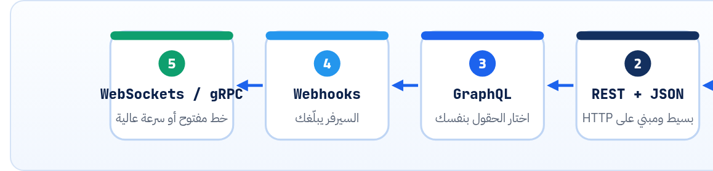
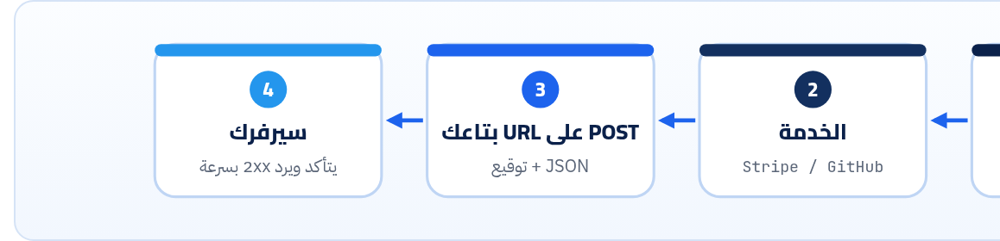

<small>المرحلة 1 · الفكرة</small>

مش كل الـ Web APIs شكلها واحد. في اللي بتسأله على حاجة بعنوانها (REST)، وفي اللي بتكتبله سؤال بالظبط على الحقول اللي عايزها (GraphQL)، وفي اللي هو بيكلمك لما حاجة تحصل (Webhooks)، وفي اللي الخط بيفضل مفتوح بينكم (WebSockets). كل واحد اتعمل علشان يحل مشكلة معينة، وده اللي هنحكيه.

:::note[بعد الفصل ده هتكون عارف]
- الفرق بين Library API و Web API تاني بس بالتفصيل
- SOAP و XML: ليه الناس هربت منهم
- REST: الـ Resources بالعنوان والـ Methods بتاعة HTTP
- GraphQL: Endpoint واحد وانت تختار الحقول، وتجربة على API حقيقي
- Webhooks: السيرفر هو اللي بيكلّمك
- لمحة عن gRPC و WebSockets و SSE وإمتى كل واحد
- جدول يختار لك النوع المناسب
:::

<a id="s2-1"></a>

## 2.1 ليه في أكتر من نوع؟

كل نوع من دول طلع لأن النوع اللي قبله كان بيوجع في حتة معينة. فبدل ما تحفظهم كقايمة، خلينا نمشي ورا الوجع: إيه المشكلة، وإيه اللي اتعمل علشانها.



*مش خط زمني صارم ولا كل واحد بيلغي اللي قبله: النهارده هتلاقي الخمسة شغالين جنب بعض، وأغلب الـ APIs العامة REST + JSON، ومعاها Webhooks.*

<a id="s2-2"></a>

## 2.2 قبل REST: SOAP و XML

في أوائل الألفينات، الشركات الكبيرة كانت بتكلم بعض بـ **SOAP**. كل طلب عبارة عن "ظرف" XML كبير، وكل حاجة ليها تعريف صارم في ملف اسمه WSDL. والميزة إن العقد كان واضح جداً، والعيب إن طلب بسيط زي "هات سعر الدولار" كان بيبقى كده:

```html title="SOAP request (للفرجة بس)"
<soap:Envelope xmlns:soap="http://www.w3.org/2003/05/soap-envelope">
  <soap:Body>
    <GetRate xmlns="http://example.com/rates">
      <Base>USD</Base>
      <Quote>EGP</Quote>
    </GetRate>
  </soap:Body>
</soap:Envelope>
```

كل الطلبات بتروح لنفس الـ URL بـ `POST`، واسم العملية جوه الـ XML. يعني HTTP كان مجرد "عربية نقل"، ومش مستفيدين من أي حاجة فيه (لا الـ Methods ولا الـ Status codes ولا الـ Cache). وهتقابل SOAP النهارده في أنظمة بنوك وحكومات قديمة، بس مش هتبني بيه حاجة جديدة.

<a id="s2-3"></a>

## 2.3 REST: كل حاجة ليها عنوان

REST قال: "HTTP نفسه فيه كل اللي محتاجينه، استخدموه صح". فبدل عملية اسمها `GetRate` جوه XML، كل **حاجة** (Resource) ليها **عنوان** (URL)، والـ **Method** بتقول عايز تعمل فيها إيه:

```http
GET    /articles          ← هات كل المقالات
GET    /articles/42       ← هات المقالة 42
POST   /articles          ← اعمل مقالة جديدة
PATCH  /articles/42       ← عدّل جزء من المقالة 42
DELETE /articles/42       ← امسح المقالة 42
```

والرد بيرجع بـ **Status code** حقيقي (200 و 201 و 404…)، فأي أداة (المتصفح، و curl، والـ Cache، والـ Proxy) فاهمة اللي حصل من غير ما تقرا الـ Body. وده سر انتشاره: **مفيش حاجة جديدة تتعلمها فوق HTTP**. ومن فصل 14 لـ 19 كلهم عن تصميم REST صح.

:::caution[خلي بالك: مش كل اللي اسمه REST API هو REST]
الناس بتقول "REST API" على أي API بيرجّع JSON على HTTP. بس REST الأصلي عند Fielding فيه قواعد أكتر بكتير (زي إن الرد نفسه يحتوي لينكات للخطوة الجاية، فصل 14). فلما تشوف API عنده `POST /getUserById`، ده "HTTP API بـ JSON" مش REST. والكتاب ده هيستخدم الكلمة زي ما الصناعة بتستخدمها، وهيقولك فين الفرق لما يهم.
:::

<a id="s2-4"></a>

## 2.4 GraphQL: اسأل على اللي عايزه بالظبط

**القصة**: فيسبوك سنة 2012 كان عنده تطبيق موبايل بيعرض Feed. وعلشان يرسم بوست واحد، كان محتاج البوست، وصاحبه، وصورته، وعدد اللايكات، وأول كومنتين. وبـ REST ده معناه طلبات كتير (`/posts/1` وبعدين `/users/7` وبعدين `/posts/1/comments`…)، وكل واحد بيرجّع Fields كتير مش محتاجها. والموبايل بنت ساعتها كان بطيء. والمشكلتين دول ليهم أسماء:

| الأمر | بيعمل إيه |
|---|---|
| `Over-fetching` | بتاخد Fields أكتر من اللي محتاجه. زي ما شفنا في PokeAPI: `/pokemon/pikachu` بيرجّع **309 KB** و 21 Field في أول مستوى، وانت يمكن عايز الاسم والنوع بس. |
| `Under-fetching` | طلب واحد مش كفاية، فبتعمل طلبات ورا بعض (ودي اسمها مشكلة N+1 لو عملت طلب لكل عنصر في قايمة). |

فاتطور حل: **GraphQL**. Endpoint **واحد** (غالباً `POST /graphql`)، وانت بتبعتله **Query** مكتوب فيها شكل الرد اللي عايزه بالظبط. والسيرفر عنده **Schema** بيوصف كل الأنواع والحقول المتاحة. جرّبها حالاً على API عام للدول:

```sh title="Terminal"
$ curl -s https://countries.trevorblades.com/graphql \
    -H 'Content-Type: application/json' \
    -d '{"query":"{ country(code: \"EG\") { name capital currency languages { name } } }"}'
{"data":{"country":{"capital":"Cairo","currency":"EGP","languages":[{"name":"Arabic"}],"name":"Egypt"}}}
```

| الأمر | بيعمل إيه |
|---|---|
| `-H 'Content-Type: application/json'` | بنقول للسيرفر إن الـ Body اللي جاي JSON. والـ `-H` = Header (كتاب الإنترنت فصل 9). |
| `-d '{...}'` | الـ Body. ووجود `-d` بيخلي curl يبعت `POST` لوحده. وحطيناه بين `'` علشان الـ Shell ميلعبش في الـ `"` اللي جوه. |
| `"query": "{ … }"` | نص الـ GraphQL query كـ String جوه JSON. وعلشان جواه `"EG"`، اضطرينا نكتب `\"EG\"` (فصل 4 هيشرح الـ Escaping). |
| `country(code: "EG")` | Field بياخد Argument، زي استدعاء فانكشن. |
| `{ name capital … }` | الـ **Selection set**: الحقول اللي عايزها. والرد رجع بيهم هم بس، بنفس الشكل. |
| `languages { name }` | علاقة: لغات الدولة، ومن كل لغة عايز الاسم بس. ده اللي كان هياخد طلب تاني في REST. |

ولو سألت على Field مش موجود في الـ Schema، السيرفر بيرفض قبل ما ينفّذ. وبص على حاجة مهمة في الرد ده:

```sh title="Terminal"
$ curl -s https://countries.trevorblades.com/graphql -H 'Content-Type: application/json' \
    -d '{"query":"{ country(code: \"EG\") { name population } }"}' -w ' %{http_code}'
{"errors":[{"message":"Cannot query field \"population\" on type \"Country\".","locations":[{"line":4,"column":5}],"extensions":{"code":"GRAPHQL_VALIDATION_FAILED"}}]} 200
```

الـ Status code **200** مع إن الطلب فشل! والغلط جوه `"errors"`. وده من أشهر الفروق بين GraphQL و REST: كتير من سيرفرات GraphQL بترجّع 200 دايماً وتحط الأخطاء في الـ Body، فلازم تقرا الـ Body دايماً. (ومواصفة GraphQL-over-HTTP الأحدث بتسمح بـ 4xx في حالات زي دي، بس متعتمدش عليه.)

```json title="Variables بدل ما تلزق القيم في النص"
{
  "query": "query($c: ID!) { country(code: $c) { name currency } }",
  "variables": { "c": "JP" }
}
```

| الأمر | بيعمل إيه |
|---|---|
| `query($c: ID!)` | بنعرّف Variable اسمه `$c` نوعه `ID`، والـ `!` = "إجباري، مينفعش null". |
| `"variables": {…}` | القيم نفسها في JSON منفصل. أأمن وأنضف من إنك تركّب نص الـ Query بإيدك (زي SQL injection بالظبط). |

#### GraphQL كويس في

- شاشات محتاجة بيانات من حاجات كتير مرتبطة.
- Clients كتير مختلفين (ويب وموبايل) كل واحد عايز Fields مختلفة.
- Schema بنوع واضح لكل حاجة، وأدوات بتكمّلك وانت بتكتب.

#### وبيوجع في

- الـ HTTP cache: كله `POST` لنفس الـ URL، فالـ CDN مش فاهم حاجة.
- الـ Rate limiting: Query واحدة ممكن تبقى تقيلة جداً.
- الأخطاء جوه الـ Body مع 200.
- أصعب في البداية من REST لـ API صغير.

**المصادر الرسمية:** [graphql.org · Learn](https://graphql.org/learn/) · [GraphQL Specification](https://spec.graphql.org/) · [graphql.org · Serving over HTTP](https://graphql.org/learn/serving-over-http/) · [GitHub GraphQL API](https://docs.github.com/en/graphql)

<a id="s2-5"></a>

## 2.5 Webhooks: السيرفر هو اللي بيكلّمك

في كل اللي فات، **انت** اللي بتسأل. طب لو عايز تعرف "أول ما حد يدفع"، أو "أول ما حد يفتح Issue على GitHub"؟ الحل الساذج إنك تسأل كل دقيقة: "حد دفع؟ حد دفع؟". ودي اسمها **Polling**، وأغلب الإجابات بتبقى "لأ"، يعني طلبات على الفاضي.

فاتطور حل: انت تدّي الخدمة **URL عندك**، وهي لما الحدث يحصل تبعتلك `POST` عليه فيه التفاصيل. يعني الأدوار اتقلبت: الخدمة بقت Client، وانت بقيت Server. ودي الـ **Webhooks**، وليها فصل كامل (20) لأن فيها مشاكل أمان وتكرار مهمة.



*Webhook: الحدث بيحصل عند الخدمة، والخدمة بتبعت HTTP request لسيرفرك انت. ومن غير سيرفر شغّال على الإنترنت مش هتستقبل حاجة.*

<a id="s2-6"></a>

## 2.6 لمحة: WebSockets و SSE و gRPC

دول مش موضوع الكتاب، بس هتسمعهم كتير، فلازم تعرف كل واحد بيحل إيه:

**التلاتة باختصار**

| الاسم | بيحل إيه | إزاي | هتقابله فين |
|---|---|---|---|
| WebSockets | محادثة في الاتجاهين بسرعة، من غير طلب جديد كل مرة | بيبدأ كـ HTTP request فيه `Upgrade: websocket`، والسيرفر يرد `101 Switching Protocols`، وبعدين الخط يفضل مفتوح والاتنين يبعتوا رسايل في أي وقت (`wss://`) | شات، ألعاب، Google Docs، الأسعار اللحظية |
| SSE (Server-Sent Events) | السيرفر يبعت تحديثات ورا بعض في اتجاه واحد | HTTP عادي بـ `Content-Type: text/event-stream`، والرد مبيخلصش، وكل حدث سطر `data: …` | الـ Streaming في APIs الـ AI (كتاب Python for AI)، والإشعارات |
| gRPC | سيرفرات بتكلم بعض بسرعة جداً وبعقد صارم | العقد في ملف `.proto`، والبيانات Binary (Protocol Buffers) مش JSON، وفوق HTTP/2 | جوه الشركات الكبيرة بين الـ Microservices، ونادراً لـ API عام |

```text title="rates.proto (شكل عقد gRPC)"
syntax = "proto3";

service Rates {
  rpc GetRate (RateRequest) returns (RateReply);
}

message RateRequest { string base = 1; string quote = 2; }
message RateReply   { double rate = 1; string date = 2; }
```

بص الفكرة: `rpc GetRate` = "استدعي فانكشن على سيرفر تاني" (Remote Procedure Call)، و`= 1` و`= 2` مش قيم، دي **أرقام الحقول** في الـ Binary. قريب من SOAP في الفكرة (عملية باسمها) بس أخف وأسرع بكتير.

**المصادر الرسمية:** [MDN · WebSockets API](https://developer.mozilla.org/en-US/docs/Web/API/WebSockets_API) · [MDN · Using server-sent events](https://developer.mozilla.org/en-US/docs/Web/API/Server-sent_events/Using_server-sent_events) · [gRPC · Introduction](https://grpc.io/docs/what-is-grpc/introduction/) · [RFC 6455 · WebSocket](https://www.rfc-editor.org/rfc/rfc6455)

<a id="s2-7"></a>

## 2.7 تختار إيه؟

**جدول الاختيار السريع**

| لو عايز… | استخدم |
|---|---|
| API عام بسيط، أو Backend لموقع، أو أول API في Node | **REST + JSON** (الكتاب ده) |
| شاشات معقدة بتجمع بيانات مرتبطة كتير، وفريق Frontend كبير | GraphQL |
| تعرف لما حاجة تحصل عند خدمة تانية | Webhooks (أو تعمل Polling لو مفيش) |
| تحديثات لحظية من السيرفر بس | SSE |
| محادثة لحظية في الاتجاهين | WebSockets |
| سيرفرات داخلية بتكلم بعض بسرعة | gRPC |

:::tip[حاجة مشتركة: كله فوق HTTP تقريباً]
REST و GraphQL و Webhooks و SSE كلهم HTTP requests عادية: نفس الـ Headers ونفس الـ TLS ونفس تابة Network في DevTools. و WebSockets بيبدأ HTTP ويتحوّل، و gRPC فوق HTTP/2. فكل اللي في كتاب الإنترنت شغال هنا. ولما تفتح تابة Network هتلاقي فلتر اسمه **Fetch/XHR** للأولانيين، وفلتر **WS** للـ WebSockets.
:::

:::tip[ملخص الفصل]
- SOAP: ظرف XML تقيل، كله `POST` لنفس الـ URL، و HTTP مجرد ناقل.
- REST: كل Resource ليه URL، والـ Method بتقول الفعل، والـ Status code بيقول النتيجة.
- GraphQL: Endpoint واحد، والـ Query بتحدد الحقول، وبيحل Over/Under-fetching، والأخطاء ممكن ترجع مع 200.
- Webhooks: الخدمة بتبعتلك `POST` لما حدث يحصل، بدل الـ Polling.
- WebSockets للاتجاهين، و SSE من السيرفر بس، و gRPC بين السيرفرات بـ Protobuf.
:::

### صح ولا غلط؟

1. في GraphQL كل Resource ليه URL مختلف.
2. رد GraphQL بـ 200 معناه إن الـ Query نجحت أكيد.
3. في الـ Webhook، الخدمة التانية هي اللي بتبعت الـ HTTP request لسيرفرك.

### أسئلة مراجعة

1. اشرح Over-fetching و Under-fetching بمثال من عندك.
2. ليه الـ HTTP cache بيشتغل مع REST أحسن من GraphQL؟
3. إيه الفرق بين Polling و Webhook؟ وإمتى تضطر تعمل Polling؟
4. لو عايز تعرض ردّ موديل AI كلمة بكلمة، تختار WebSockets ولا SSE؟ وليه؟

### تحديات الفصل

<small>جرّبها بإيدك، والحلول في ملحق الإجابات.</small>

1. **[سهل]** عدّل الـ GraphQL query بتاعة مصر وخليها ترجّع `name` و`continent { name }`.
2. **[متوسط]** استخدم `variables` واسأل عن 3 دول مختلفة بنفس الـ Query.
3. **[صعب]** اكتب نفس السؤال ("اسم الدولة وعاصمتها ولغاتها") بشكل REST: إيه الـ URLs اللي كنت هتعملها؟ وكام طلب محتاج؟
