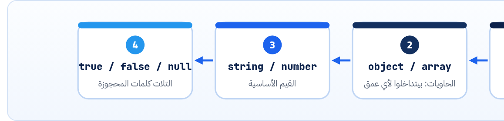

<small>المرحلة 2 · JSON بالتفصيل</small>

JSON شكله سهل لدرجة إن ناس كتير بتكتبه غلط وهي مش واخدة بالها. في الفصل ده هنقرا القواعد من المصدر: RFC 8259. الست أنواع، وكل حرف مسموح بيه، والـ Escaping، والأرقام وحدودها، والمسافات، والـ UTF-8، والحاجات اللي المواصفة سايباها مفتوحة وبتعمل مشاكل.

:::note[بعد الفصل ده هتكون عارف]
- JSON جه منين وليه كسب XML
- RFC 8259 و ECMA-404: المواصفتين وعلاقتهم ببعض
- الست أنواع وشكل كل واحد بالظبط
- الـ Strings: علامات التنصيص والـ Escapes و \\u
- الأرقام: المسموح والممنوع وحد الـ 2^53
- المسافات والـ UTF-8 والـ Keys المتكررة
- JSON Lines والتواريخ: حاجات مش في المواصفة بس في كل حتة
:::

<a id="s4-1"></a>

## 4.1 الحكاية: من XML لـ JSON

سنة 2004 Gmail طلع وعمل حاجة غريبة ساعتها: الصفحة بتجيب الإيميلات الجديدة **من غير ما تعمل Reload**. والتكنيك ده اتسمى **AJAX**: Asynchronous JavaScript **and XML**. يعني البيانات كانت بتيجي XML. والمشكلة إن الـ JS لازم يفصّص الـ XML ده: يدوّر على Tags، ويطلّع النص منها، ويحوّل `"42"` لرقم بنفسه. كتير وبطيء.

وهنا **Douglas Crockford** لاحظ حاجة بسيطة: JavaScript عندها أصلاً طريقة تكتب بيها بيانات: الـ Object literal `{ name: "Omar", age: 30 }`. طب ما نبعت البيانات بالشكل ده؟ والـ JS هيفهمها على طول. فأخد جزء صغير من صيغة JS، وشال منه أي حاجة فيها كود أو غموض، وسماه **JSON**: JavaScript Object Notation. وعمل له موقع من صفحة واحدة: json.org. والمواصفة كلها بتتكتب على كارت.

#### نفس البيانات بـ XML

```html title="XML"
<user>
  <name>Omar</name>
  <age>30</age>
  <admin>false</admin>
  <tags><tag>api</tag><tag>json</tag></tags>
</user>
```

كل حاجة نص. `30` نص، و`false` نص، والـ List محتاجة Tag لكل عنصر.

#### وبـ JSON

```json
{
  "name": "Omar",
  "age": 30,
  "admin": false,
  "tags": ["api", "json"]
}
```

الأنواع جوه الصيغة نفسها: رقم ورقم، و Boolean و Boolean، و List و List.

والنتيجة إن JSON بقى لغة البيانات بتاعة الويب. و**مش خاص بـ JavaScript**: Python و Go و Java وأي لغة عندها Parser ليه. وانت شفته في كتاب Python for AI بـ `json.loads` و`json.dumps`.

<a id="s4-2"></a>

## 4.2 المواصفتين: RFC 8259 و ECMA-404

**مين بيعرّف JSON**

| المواصفة | مين | فيها إيه |
|---|---|---|
| **RFC 8259** (ديسمبر 2017) | IETF | الصيغة + قواعد التبادل على الشبكة: UTF-8 إجباري، والـ MIME type `application/json`، ونصايح عن الأرقام والـ Keys المتكررة. وهي **Internet Standard** (STD 90)، أعلى درجة في الـ RFCs. |
| **ECMA-404** | Ecma International (نفس اللي بتعمل JavaScript) | الصيغة بس (Grammar). و RFC 8259 بيقول صراحة إن الاتنين متفقين على نفس الصيغة. |
| json.org | Crockford | نفس الصيغة برسومات. أسهل حاجة تبص عليها. |

**المصادر الرسمية:** [RFC 8259 · The JSON Data Interchange Format](https://www.rfc-editor.org/rfc/rfc8259) · [ECMA-404](https://ecma-international.org/publications-and-standards/standards/ecma-404/) · [json.org](https://www.json.org/json-en.html)

<a id="s4-3"></a>

## 4.3 الست أنواع، ومفيش غيرهم

أي قيمة في JSON لازم تكون واحدة من دول. ومفيش تاريخ، ولا `undefined`، ولا Function، ولا تعليقات:

**أنواع القيم في JSON**

| النوع | شكله | مثال | ملاحظة |
|---|---|---|---|
| object | `{ "key": value, … }` | `{"id": 7}` | الـ Key لازم **String** بـ `"`. |
| array | `[ value, … ]` | `[1, "a", null]` | مرتّب، ومسموح أنواع مختلفة جوه. |
| string | `"…"` | `"APIs و JSON"` | `"` بس، مش `'`. |
| number | عشري | `-12.5e3` | مفيش NaN ولا Infinity. |
| boolean | `true` / `false` | `true` | حروف صغيرة بس. |
| null | `null` | `null` | "مفيش قيمة" عن قصد. |



*الـ JSON text كله قيمة واحدة. ومن RFC 7159 (2014) القيمة دي ممكن تبقى أي نوع، حتى رقم لوحده أو String لوحده. قبلها كان لازم Object أو Array، وهتلاقي أدوات قديمة لسه فاكرة كده.*

والـ **Structural characters** ستة بس: `[` و `]` و `{` و `}` و `:` و `,`. والمسافات حواليهم مسموحة، بس **أربع أنواع مسافات بس**: Space، و Tab، و سطر جديد (LF)، و Carriage return (CR). يعني الـ Non-breaking space اللي بيتنسخ ساعات من Word أو من صفحة ويب بيبوّظ الـ JSON.

<a id="s4-4"></a>

## 4.4 الـ Strings: علامة التنصيص والـ Escapes

الـ String بيبدأ وبيخلص بـ `"`. طب لو عايز `"` جواه؟ أو سطر جديد؟ هنا بييجي الـ **Escape**: الـ `\` بيقول "الحرف اللي بعدي ليه معنى خاص":

| الأمر | بيعمل إيه |
|---|---|
| `\"` | علامة تنصيص جوه النص: `"he said \"hi\""`. |
| `\\` | الـ Backslash نفسه. ومشهورة في مسارات Windows: `"C:\\Users"`. |
| `\/` | Slash. **مسموح بس مش إجباري**: `"/"` و `"\/"` نفس القيمة. وبعض الـ APIs القديمة (PHP) بتطلّعها كده. |
| `\n  \r  \t` | سطر جديد، و Carriage return، و Tab. |
| `\b  \f` | Backspace و Form feed (نادراً). |
| `\u0639` | أي حرف برقمه في Unicode (4 أرقام Hex). `"\u0639\u0645\u0631"` = `"عمر"` (جربناها في Node). والإيموجي أكبر من 4 أرقام، فبيتكتب كـ "Surrogate pair": `"\uD83D\uDE00"`. |

:::caution[خلي بالك: السطر الجديد الحقيقي ممنوع جوه String]
الـ Control characters (من U+0000 لـ U+001F، ومنهم الـ Enter والـ Tab الحقيقيين) **لازم** يتكتبوا Escaped. فلو لزقت نص فيه Enter جوه `"…"`، الـ Parser هيقع. وفي Node بيطلع: `SyntaxError: Bad control character in string literal in JSON at position 12`. وده بيحصل كتير لما حد يركّب JSON بإيده من نص منسوخ.
:::

<a id="s4-5"></a>

## 4.5 الأرقام: المسموح والممنوع

الصيغة: سالب اختياري، وبعدين جزء صحيح، وبعدين كسر اختياري، وبعدين أُس اختياري:

```text title="number (من RFC 8259، مبسّط)"
number = [ "-" ] int [ "." 1*DIGIT ] [ ("e" / "E") [ "+" / "-" ] 1*DIGIT ]
int    = "0" / ( digit1-9 *DIGIT )
```

| الأمر | بيعمل إيه |
|---|---|
| `[ "-" ]` | الأقواس المربعة في الـ Grammar = اختياري. فالسالب مسموح، بس **الموجب بـ `+` ممنوع**: `+1` غلط. |
| `"0" / ( digit1-9 *DIGIT )` | يا صفر لوحده، يا رقم بيبدأ من 1 لـ 9 وبعده أي أرقام. يعني `012` **ممنوع** (Leading zero). |
| `"." 1*DIGIT` | النقطة لازم يبقى بعدها رقم واحد على الأقل (`1*` = واحد أو أكتر). و**قبلها لازم رقم**: `.5` غلط، اكتب `0.5`. و`5.` غلط برضه. |
| `e / E` | الأُس العلمي: `1.5e3` = 1500. |

وممنوع كمان: `NaN` و `Infinity` و Hex زي `0x1F`. ومفيش فرق في JSON بين Integer و Float: كله "number".

:::note[حد الـ 2^53: ليه IDs بتيجي كـ String]
المواصفة نفسها مش حاطة حد للأرقام، بس بتقول إن أغلب البرامج بتخزّنها كـ IEEE 754 double، وإن الأرقام الصحيحة الآمنة هي من `-(253-1)` لـ `253-1`، يعني `9007199254740991` (ده `Number.MAX_SAFE_INTEGER` في JS). جربنا في Node: `JSON.parse('{"big": 12345678901234567890}').big` رجّع <strong>`12345678901234567000`</strong>: آخر أرقام اتغيرت من غير أي Error! وعلشان كده Twitter زمان كان بيبعت كل ID مرتين: `id` رقم، و`id_str` نص. والقاعدة: **IDs كبيرة؟ ابعتها String**.
:::

<a id="s4-6"></a>

## 4.6 الـ Objects: حاجات المواصفة سايباها مفتوحة

- **الـ Keys المتكررة**: المواصفة بتقول الـ Keys "SHOULD be unique"، يعني "ينبغي" مش "لازم". ولو اتكررت، السلوك مش مضمون. `JSON.parse('{"a":1,"a":2}')` في Node رجّع `{"a":2}` (الأخير بيكسب)، ولغات تانية ممكن تاخد الأول أو ترمي Error. فمتعتمدش عليه أبداً.
- **الترتيب**: ترتيب الـ Keys "مش مهم" في المواصفة. يعني `{"a":1,"b":2}` و`{"b":2,"a":1}` نفس البيانات، ومتكتبش كود بيعتمد على الترتيب.
- **Array فاضية و Object فاضي**: `[]` و `{}` مسموحين.

<a id="s4-7"></a>

## 4.7 الـ Encoding والـ MIME type

- RFC 8259: الـ JSON اللي بيتبادل بين أنظمة مختلفة **MUST** يبقى **UTF-8**. وممنوع تحط BOM في أوله. فالعربي يتكتب عادي: `"عمر"`، ومش محتاج `\u`.
- الـ MIME type الرسمي: `application/json`. والـ `charset=utf-8` اللي بتشوفه في Headers كتير (زي GitHub) ملوش معنى رسمياً لـ JSON (لأنه UTF-8 دايماً)، بس مبيضرش.
- أنواع تانية مبنية على JSON بـ `+json` في الآخر: `application/problem+json` (فصل 17)، و`application/vnd.github+json` (فصل 3)، و`application/merge-patch+json` (فصل 15).

:::note[I-JSON: نسخة أصرم للـ APIs]
في RFC اسمه <strong>RFC 7493 (I-JSON)</strong> بيقول: لو بتصمم API، التزم بالقيود دي: UTF-8، ومفيش Keys متكررة، والأرقام في حدود الـ double، والتواريخ بصيغة RFC 3339. وده بالظبط اللي هنعمله في نص الكتاب التاني.
:::

**المصادر الرسمية:** [RFC 8259 · §6 Numbers](https://www.rfc-editor.org/rfc/rfc8259#section-6) · [RFC 8259 · §8.1 Character Encoding](https://www.rfc-editor.org/rfc/rfc8259#section-8.1) · [RFC 7493 · I-JSON](https://www.rfc-editor.org/rfc/rfc7493)

<a id="s4-8"></a>

## 4.8 حاجات مش في المواصفة بس هتقابلها

#### التواريخ

مفيش نوع تاريخ. العرف: String بصيغة **RFC 3339** زي `"2026-10-23T11:00:00Z"` (الـ `Z` = UTC) أو `"2026-10-23T14:00:00+03:00"`. وأحياناً رقم Unix time (زي `x-ratelimit-reset`). والمهم: **نوع واحد في الـ API كله**، ومع Timezone دايماً.

#### JSON Lines (NDJSON)

ملف كل سطر فيه JSON كامل لوحده. مش JSON واحد صحيح كملف، بس سهل تضيف عليه سطر وتقراه سطر سطر. وانت استخدمته في كتاب Python for AI للـ Resume والـ Batch API. وبيتسمى `.jsonl`.

```text title="results.jsonl"
{"file": "a.md", "ok": true}
{"file": "b.md", "ok": false, "error": "timeout"}
```

**المصادر الرسمية:** [jsonlines.org](https://jsonlines.org/) · [RFC 3339 · §5.6 Internet Date/Time Format](https://www.rfc-editor.org/rfc/rfc3339#section-5.6)

:::tip[ملخص الفصل]
- JSON = جزء صغير من صيغة JS بيانات بس، وبقى Standard في RFC 8259 و ECMA-404.
- ست أنواع: object و array و string و number و boolean و null. والـ Keys Strings بـ `"`.
- الـ Escapes: `\" \\ \/ \n \r \t \b \f \uXXXX`، والـ Control characters لازم Escaped.
- الأرقام: مفيش `+` ولا Leading zero ولا `.5` ولا NaN. وأكبر من `2^53-1` ممكن يتغير بهدوء.
- الـ Keys المتكررة مش مضمونة، والترتيب مش مهم.
- UTF-8 إجباري، و `application/json`، والتواريخ RFC 3339 كـ String.
:::

### صح ولا غلط؟

1. `"42"` لوحده JSON text صحيح.
2. `{"price": .99}` JSON صحيح.
3. الـ JSON لازم يتكتب فيه العربي بـ `\u`.

### أسئلة مراجعة

1. اكتب 5 أرقام ممنوعة في JSON، وصلّح كل واحد.
2. ليه API بيبعت ID كبير كـ String؟
3. إيه اللي بيحصل في Node لو JSON فيه نفس الـ Key مرتين؟ وليه متعتمدش على ده؟
4. إيه الفرق بين ملف `.json` وملف `.jsonl`؟

### تحديات الفصل

<small>جرّبها بإيدك، والحلول في ملحق الإجابات.</small>

1. **[سهل]** اكتب JSON بيوصف كتاب: العنوان، والسنة، والمؤلفين (List)، ومتاح ولا لأ، والسعر، والـ ISBN (ليه String؟).
2. **[متوسط]** اكتب String فيه: علامة تنصيص، وسطر جديد، و Backslash، وحرف عربي بـ `\u`. وتأكد منه بـ `JSON.parse` في الـ Console.
3. **[صعب]** افتح RFC 8259 §9 (Parsers) واقرا إيه اللي مسموح للـ Parser يرفضه. واكتب جملتين بالعامية عن اللي فهمته.
