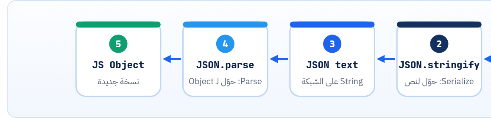

<small>المرحلة 2 · JSON بالتفصيل</small>

في كورس Jonas بتكتب Objects كل يوم، فطبيعي تفتكر إن JSON هو نفس الحاجة. هو قريب جداً، بس الفروق الصغيرة دي هي اللي بتعمل 80% من أخطاء الـ JSON. هنحطهم جنب بعض، وبعدين نشوف JSON.parse و JSON.stringify بالـ Parameters بتاعتهم، وبعدين جدول بكل غلطة ورسالتها الحقيقية في Node 24.

:::note[بعد الفصل ده هتكون عارف]
- الفرق بين JSON text و JS Object في الذاكرة
- 7 فروق في الصيغة جدول واحد
- JSON.parse و reviver، و JSON.stringify و replacer و space
- إيه اللي بيضيع في stringify: undefined و Functions و Date و NaN و BigInt
- رسايل الأخطاء الحقيقية في Node 24 وتفهم كل واحدة
- غلطة Unexpected token '\<' من res.json() وسببها
:::

<a id="s5-1"></a>

## 5.1 أول فرق: JSON نص، والـ Object في الذاكرة

ده أهم سطر في الفصل: **JSON دايماً String**. نص بيتبعت على الشبكة أو بيتحفظ في ملف. أما الـ Object في JS فحاجة عايشة في الذاكرة، ليها Methods و Prototype، وممكن يبقى فيها Functions. والمترجم بينهم اتنين:



*الرحلة الكاملة لأي بيانات في API: الـ Client بيعمل stringify ويبعت، والسيرفر بيعمل parse ويشتغل، وبعدين stringify للرد، والـ Client يعمل parse. وفي Express الكلام ده بيحصل لوحده في express.json() و res.json() (فصل 22).*

```sh title="Terminal"
> const user = { name: "Omar", age: 30 }
> typeof user
'object'
> const text = JSON.stringify(user)
> text
'{"name":"Omar","age":30}'
> typeof text
'string'
> JSON.parse(text).name
'Omar'
```

<a id="s5-2"></a>

## 5.2 الفروق في الصيغة جنب بعض

**JS Object literal ضد JSON**

| الحاجة | JS Object | JSON |
|---|---|---|
| الـ Keys | `{ name: "x" }` من غير تنصيص عادي | **لازم** `{ "name": "x" }` |
| علامة التنصيص | `'` أو `"` أو `` ` `` | `"` بس |
| الفاصلة في الآخر | `[1, 2, 3,]` مسموحة | ممنوعة |
| التعليقات | `// …` و `/* … */` | مفيش تعليقات خالص |
| القيم | `undefined` و Functions و `NaN` و Date و `Map`… | الست أنواع بس |
| الأرقام | `.5` و `0x1F` و `1_000` و `10n` | عشري بالصيغة الصارمة بس |
| Keys محسوبة / مختصرة | `{ [k]: 1, name }` | لأ: النص مكتوب حرفياً |

:::note[ليه JSON صارم كده؟]
علشان أي لغة تقدر تكتب له Parser صغير وسريع ومن غير غموض. كل فاصلة زيادة أو تعليق بيفتح سؤال "طب ده معناه إيه؟". وعلشان كده ملفات زي `package.json` مينفعش فيها تعليقات. (في صيغ تانية زي JSONC اللي VS Code بيستخدمه في `settings.json`، و JSON5، بيسمحوا بتعليقات، بس دول مش JSON، ومينفعش تبعتهم لـ API.)
:::

<a id="s5-3"></a>

## 5.3 JSON.stringify(value, replacer, space)

```sh title="Terminal"
> JSON.stringify({ name: "عمر", tags: ["a", "b"] }, null, 2)
{
  "name": "عمر",
  "tags": [
    "a",
    "b"
  ]
}
> JSON.stringify({ id: 1, password: "x", name: "a" }, ["id", "name"])
'{"id":1,"name":"a"}'
> JSON.stringify({ a: 1, b: "x" }, (key, value) => typeof value === "number" ? value * 10 : value)
'{"a":10,"b":"x"}'
```

| الأمر | بيعمل إيه |
|---|---|
| `value` | الحاجة اللي هتتحوّل. |
| `replacer = null` | مش عايز أغيّر حاجة. و`null` هنا بس علشان نوصل للـ Parameter التالت. |
| `replacer = ["id", "name"]` | Array = "**الـ Keys دي بس**". طريقة سريعة تشيل حاجة حساسة زي `password` قبل ما تطبع أو تبعت. (بس في سيرفر حقيقي، الأحسن تبني الرد من الأول بالحقول اللي عايزها.) |
| `replacer = (key, value) => …` | Function بتتنادى على كل Key، واللي ترجّعه هو اللي يتكتب. ولو رجّعت `undefined` الـ Key بيختفي. |
| `space = 2` | Pretty print بمسافتين. من غيره الناتج سطر واحد (وده اللي بيتبعت على الشبكة عادة، أصغر). وممكن تحط `"\t"`. والعربي بيطلع عادي من غير `\u`. |

### اللي بيضيع أو بيتغير

```sh title="Terminal"
> JSON.stringify({ a: undefined, b: () => 1, c: Symbol("x"), d: NaN, e: Infinity, f: new Date(Date.UTC(2026, 9, 23, 11)), g: [undefined, () => 1], h: null, i: -0 })
'{"d":null,"e":null,"f":"2026-10-23T11:00:00.000Z","g":[null,null],"h":null,"i":0}'
> JSON.stringify({ n: 10n })
x Uncaught TypeError: Do not know how to serialize a BigInt
> const o = {}; o.self = o; JSON.stringify(o)
x Uncaught TypeError: Converting circular structure to JSON
> JSON.stringify(new Map([["a", 1]]))
'{}'
```

**stringify بيعمل إيه في كل حاجة مش JSON**

<table class="cmp keep">
<tr><th>القيمة</th><th>جوه Object</th><th>جوه Array</th></tr>
<tr><td><code>undefined</code> و Function و Symbol</td><td>الـ Key <b>بيختفي</b></td><td>بيبقى <code>null</code></td></tr>
<tr><td><code>NaN</code> و <code>Infinity</code></td><td><code>null</code></td><td><code>null</code></td></tr>
<tr><td><code>Date</code></td><td colspan="2">String بصيغة ISO (لأن Date عنده <code>toJSON()</code>)، وبيرجع من parse <b>String</b> مش Date</td></tr>
<tr><td><code>Map</code> و <code>Set</code></td><td colspan="2"><code>{}</code> فاضي! حوّلهم بنفسك: <code>Object.fromEntries(map)</code> و <code>[...set]</code></td></tr>
<tr><td><code>BigInt</code></td><td colspan="2">TypeError</td></tr>
<tr><td>Object بيشاور على نفسه</td><td colspan="2">TypeError: circular structure</td></tr>
</table>

:::caution[خلي بالك: undefined مش null]
لو عندك `{ title: "x", summary: undefined }` وعملت stringify، الـ `summary` **بتختفي** من الـ JSON. فالسيرفر مش هيعرف إنك "مسحت" الـ Summary، هيفتكر إنك مبعتهاش. ولو عايز تقول "فاضية عن قصد"، ابعت `null`. وده هيفرق جداً في `PATCH` (فصل 15).
:::

<a id="s5-4"></a>

## 5.4 JSON.parse(text, reviver)

```sh title="Terminal"
> const r = JSON.parse('{"d":"2026-10-23T11:00:00Z"}', (key, value) => key === "d" ? new Date(value) : value)
> r.d instanceof Date
true
> JSON.parse('{"big": 12345678901234567890}', (key, value, ctx) => key === "big" ? BigInt(ctx.source) : value).big
12345678901234567890n
```

| الأمر | بيعمل إيه |
|---|---|
| `reviver (key, value)` | نفس فكرة الـ replacer بالعكس: بتتنادى على كل قيمة بعد ما تتقري، واللي ترجّعه بيتحط مكانها. هنا حوّلنا الـ String لـ `Date`. |
| `ctx.source` | Parameter تالت جديد (<em>JSON.parse source text access</em>)، شغال في Node 24: بيدّيك **النص الأصلي** للرقم قبل ما يتحوّل لـ double. فقدرنا نعمل `BigInt` بالرقم الصح من غير ما آخره يضيع. ولسه مش موجود في كل المتصفحات، فاتأكد قبل ما تستخدمه في Frontend. |

:::note[لو حابب تتعمق: __proto__ في JSON]
جربنا `JSON.parse('{"__proto__": {"admin": true}}').admin` ورجّع `undefined`: الـ parse بيعمل `__proto__` كـ Key عادي، مش بيغيّر الـ Prototype. بس لو خدت الناتج ده وعملت له Merge بكود ساذج (`target[key] = source[key]` بشكل Recursive)، ممكن تلوّث `Object.prototype` كله. ودي ثغرة مشهورة اسمها **Prototype pollution**، وعلشان كده متعملش Merge لـ JSON جاي من برّه من غير مكتبة موثوقة.
:::

**المصادر الرسمية:** [MDN · JSON.stringify()](https://developer.mozilla.org/en-US/docs/Web/JavaScript/Reference/Global_Objects/JSON/stringify) · [MDN · JSON.parse()](https://developer.mozilla.org/en-US/docs/Web/JavaScript/Reference/Global_Objects/JSON/parse) · [MDN · JSON](https://developer.mozilla.org/en-US/docs/Web/JavaScript/Reference/Global_Objects/JSON)

<a id="s5-5"></a>

## 5.5 الأخطاء الشائعة ورسايلها الحقيقية

كل الرسايل دي طالعة فعلاً من `JSON.parse` في **Node 24.22** (نفس محرك V8 اللي في Chrome، فالرسايل قريبة جداً في الـ Console). و`position` = رقم الحرف من الصفر، و`line/column` من واحد:

**الغلطة ← الرسالة ← الحل**

| اللي اتكتب | الرسالة | الحل |
|---|---|---|
| `{"name": "Omar",}` | Expected double-quoted property name in JSON at position 16 | شيل الفاصلة الأخيرة: بعدها كان مستني Key. |
| `[1, 2, 3,]` | Unexpected token '\]', "\[1, 2, 3,\]" is not valid JSON | نفس الحكاية في Array. |
| `{'name': 'Omar'}` | Expected property name or '}' in JSON at position 1 | `'` ممنوعة: استخدم `"`. |
| `{name: "Omar"}` | Expected property name or '}' in JSON at position 1 | الـ Key محتاج `"`. |
| `{"a": 1 // c}` | Expected ',' or '}' after property value in JSON at position 8 | شيل التعليق. |
| `{"n": NaN}` | Unexpected token 'N', … is not valid JSON | `null` أو شيل الـ Key. |
| `{"n": 012}` | Unexpected number in JSON at position 7 | `12` أو `"012"` لو كود بصفر. |
| `{"x": .5}` | Unexpected token '.', … is not valid JSON | `0.5`. |
| Enter حقيقي جوه String | Bad control character in string literal in JSON at position 12 | `\n`. |
| `{"a":1}{"b":2}` | Unexpected non-whitespace character after JSON at position 7 | اتنين JSON ورا بعض: حطهم في Array، أو ده JSONL واقراه سطر سطر. |
| نص فاضي `""` | Unexpected end of JSON input | الرد فاضي (غالباً 204 أو Error). اتأكد من الـ Status قبل الـ parse. |
| `undefined` | "undefined" is not valid JSON | بتعمل parse لمتغير قيمته `undefined` (بيتحوّل للنص `"undefined"`). اتأكد إن المتغير اتملا. (و`JSON.parse(null)` بالمناسبة بيرجّع `null` من غير Error، لأن `"null"` JSON صحيح.) |
| `<!DOCTYPE html>…` | Unexpected token '\<', "\<!DOCTYPE "... is not valid JSON | الأشهر! تحت. |

:::danger[مشكلة: SyntaxError: Unexpected token '<', "<!DOCTYPE "... is not valid JSON]
**العَرَض**: كتبت `await res.json()` ووقع بالرسالة دي.

**السبب**: السيرفر رجّع **صفحة HTML** مش JSON، والحرف الأول فيها `<`. ده بيحصل لما: الـ URL غلط فالسيرفر رجّع صفحة 404 بتاعته، أو الـ Dev server (زي Vite) رجّع `index.html` لأي مسار مش موجود، أو في Proxy/Login page في النص، أو السيرفر وقع ورجّع صفحة 500.

**الحل**: قبل `res.json()` بص على `res.status` و `res.headers.get("content-type")`. ولو مش متأكد، اعمل `const text = await res.text(); console.log(text.slice(0, 200))` وشوف السيرفر رجّع إيه فعلاً. وفي تابة Network افتح الطلب وبص على Response (كتاب الإنترنت فصل 19).
:::

:::tip[Best Practice: متكتبش JSON بإيدك في الكود]
لو بتبعت JSON من كود، متركّبوش بـ Template string زي `` `{"title": "${title}"}` ``: لو الـ `title` فيه `"` أو سطر جديد، الـ JSON هيبوظ (أو أسوأ: حد يحقن Fields). ابني Object واعمل `JSON.stringify`. ونفس الكلام في الـ Terminal: استخدم `jq -n` (فصل 6) أو `http` (فصل 8) بدل ما تكتب الـ JSON بإيدك جوه `'…'`.
:::

:::tip[حاجة مشتركة: نفس الكلام في Python]
`json.dumps` = `JSON.stringify`، و`json.loads` = `JSON.parse`. والـ `indent=2` = الـ `space`، و`ensure_ascii=False` علشان العربي يطلع عادي (في JS العربي بيطلع عادي من الأول). و Python بتسمح بـ `NaN` افتراضياً في الاتجاهين (`allow_nan=True`)، يعني ممكن تطلّع JSON غلط من غير ما تاخد بالك! وده من كتاب Python for AI فصل 10.
:::

:::tip[ملخص الفصل]
- JSON = String. والـ Object في الذاكرة. و`stringify`/`parse` المترجمين.
- JSON أصرم: Keys بـ `"`، ومفيش `'` ولا فاصلة أخيرة ولا تعليقات ولا NaN.
- `stringify(value, replacer, space)`: الـ Array فلتر Keys، والـ Function تحويل، والرقم Pretty print.
- `undefined` بيختفي من Objects، و Date بيبقى String، و Map بيبقى `{}`، و BigInt بيقع.
- `parse(text, reviver)`: حوّل التواريخ، و`ctx.source` للأرقام الكبيرة في Node 24.
- `Unexpected token '<'` = جالك HTML. اتأكد من الـ Status والـ Content-Type.
:::

### صح ولا غلط؟

1. `JSON.stringify({ a: undefined })` بيرجّع `'{"a":null}'`.
2. `JSON.parse(JSON.stringify(new Date()))` بيرجّع Date.
3. الـ `package.json` ينفع يبقى فيه تعليقات `//`.

### أسئلة مراجعة

1. إيه الفرق بين `{ summary: undefined }` و `{ summary: null }` بعد stringify؟ وليه ده مهم للسيرفر؟
2. إزاي تشيل `password` من Object قبل ما تطبعه بـ stringify في سطر واحد؟
3. جالك `Unexpected end of JSON input` من `res.json()`. إيه أول حاجة تشك فيها؟
4. ليه بناء JSON بـ Template string فكرة وحشة؟

### تحديات الفصل

<small>جرّبها بإيدك، والحلول في ملحق الإجابات.</small>

1. **[سهل]** في Console المتصفح، جرّب كل سطر في جدول الأخطاء، وقارن الرسايل بالجدول (Chrome و Node نفس المحرك).
2. **[متوسط]** اكتب Function اسمها `safeJson(res)` بتتأكد إن الـ content-type فيه `json` قبل `res.json()`، ولو لأ ترمي Error فيه أول 100 حرف من النص.
3. **[صعب]** اكتب reviver بيحوّل أي String شكلها تاريخ ISO (Regex) لـ `Date` أوتوماتيك. وفكّر: إيه الخطر لو Field اسمه `title` قيمته بالصدفة شكلها تاريخ؟
