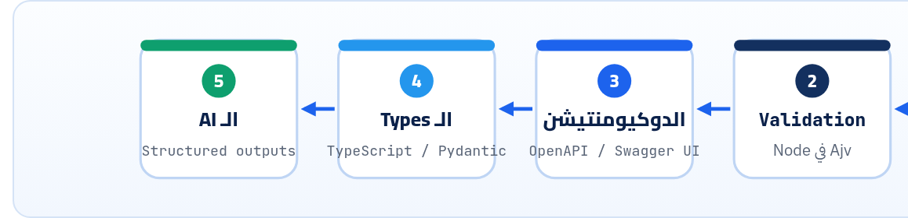

<small>المرحلة 2 · JSON بالتفصيل</small>

الـ API بتاعك مستني مقالة فيها title و status، وجاله id كـ String، و status قيمته done، و Field زيادة محدش طلبه. تكتب if لكل حالة؟ هتبقى 50 if، والدوكيومنتيشن هتقول حاجة والكود حاجة. JSON Schema بيحل الاتنين: وصف واحد للبيانات، تعمل بيه Validation، وتكتب بيه الدوكيومنتيشن، وهو نفسه اللي جوه OpenAPI.

:::note[بعد الفصل ده هتكون عارف]
- المشكلة: Validation يدوي ودوكيومنتيشن بتكدب
- شكل الـ Schema: $schema و type و properties و required
- قيود الـ Strings والأرقام والـ Arrays
- enum و const و additionalProperties
- $ref و $defs لإعادة الاستخدام، و oneOf/anyOf/allOf
- format و default: annotations مش أوامر
- Validation حقيقي في Node بـ Ajv وتقرا الأخطاء
- علاقته بـ OpenAPI و Pydantic و zod
:::

<a id="s7-1"></a>

## 7.1 المشكلة: 50 if

تخيل إن الـ API بتاعك (اللي هتبنيه في Express) بيستقبل مقالة جديدة. ولازم تتأكد إن الـ `title` موجود و String ومش قصير، وإن `status` واحدة من 3 قيم، وإن `tags` List من Strings من غير تكرار… فبتكتب:

```js
if (typeof body.title !== "string") return error("title must be a string");
if (body.title.length < 3) return error("title too short");
if (!["draft", "review", "published"].includes(body.status)) return error("bad status");
if (body.tags && !Array.isArray(body.tags)) return error("tags must be an array");
// … و 40 سطر كمان
```

وبعد شهر، زميلك زوّد حالة `"archived"` في الكود ونسي يحدّث الدوكيومنتيشن. **وهنا كانت المشكلة**: العقد مكتوب في مكانين (الكود والدوكيومنتيشن)، والاتنين بيبعدوا عن بعض. **فاتطور حل**: تكتب العقد **مرة واحدة** كـ JSON، وأدوات تعمل منه Validation، وأدوات تانية تعمل منه دوكيومنتيشن. والوصف ده اسمه **JSON Schema**.



*نفس ملف الـ Schema بيخدم أكتر من حاجة. وانت شفت آخر واحدة في كتاب Python for AI فصل 21: الـ Structured outputs في OpenAI و Gemini بتاخد JSON Schema بالظبط.*

والنسخة الحالية من المواصفة اسمها **2020-12** (والموقع الرسمي بيقول كده لحد أكتوبر 2026)، وهي اللي OpenAPI 3.1 و 3.2 مبنيين عليها.

**المصادر الرسمية:** [json-schema.org · Specification (2020-12)](https://json-schema.org/specification) · [Understanding JSON Schema](https://json-schema.org/understanding-json-schema/)

<a id="s7-2"></a>

## 7.2 أول Schema، سطر سطر

```json title="article.schema.json"
{
  "$schema": "https://json-schema.org/draft/2020-12/schema",
  "$id": "https://example.com/schemas/article.json",
  "title": "Article",
  "type": "object",
  "properties": {
    "id": { "type": "integer", "minimum": 1 },
    "title": { "type": "string", "minLength": 3, "maxLength": 120 },
    "status": { "enum": ["draft", "review", "published"] },
    "tags": {
      "type": "array",
      "items": { "type": "string" },
      "uniqueItems": true,
      "maxItems": 10
    },
    "author": {
      "type": "object",
      "properties": {
        "name": { "type": "string" },
        "email": { "type": "string", "format": "email" }
      },
      "required": ["name"]
    },
    "publishedAt": { "type": ["string", "null"], "format": "date-time" }
  },
  "required": ["id", "title", "status"],
  "additionalProperties": false
}
```

```json title="كل Keyword ومعناه"
"$schema": "…/2020-12/schema"
"$id": "https://example.com/…"
"title"
"type": "object"
"properties": { … }
"minimum": 1
"minLength" / "maxLength"
"enum": [ … ]
"items": { "type": "string" }
"uniqueItems": true
"author": { "type": "object", … }
"type": ["string", "null"]
"format": "date-time"
"required": [ … ]
"additionalProperties": false
```

1. `"$schema": "…/2020-12/schema"`: "الـ Schema ده مكتوب بأنهي نسخة من المواصفة". الـ `$` في أول الاسم معناها Keyword أساسي في المواصفة نفسها (Core). من غيره كل أداة هتفترض نسخة على مزاجها.
2. `"$id": "https://example.com/…"`: اسم فريد للـ Schema على شكل URL. **مش لازم يفتح** في المتصفح، ده مجرد معرّف، وبيستخدم لما Schema تشاور على Schema تانية.
3. `"title"`: اسم للبني آدمين والدوكيومنتيشن. ومعاه `"description"` لو عايز تشرح. مالهمش أي تأثير على الـ Validation.
4. `"type": "object"`: نوع القيمة: `object` و`array` و`string` و`number` و`integer` و`boolean` و`null`. و`integer` مش نوع في JSON نفسه، ده "number من غير كسر".
5. `"properties": { … }`: لكل Key متوقّع، Schema صغيرة بتوصفه. وخد بالك: `properties` لوحدها **مش بتقول إن الـ Key إجباري**. بتقول بس "لو موجود، يبقى شكله كده".
6. `"minimum": 1`: أقل قيمة مسموحة (شامل). وفي `maximum`، و`exclusiveMinimum` (أكبر من، مش يساوي)، و`multipleOf`.
7. `"minLength" / "maxLength"`: طول الـ String بعدد الحروف (Code points)، مش البايتات. فـ "عمر" طوله 3.
8. `"enum": [ … ]`: القيمة لازم تبقى واحدة من دول بالظبط. ولاحظ إن مفيش `type`: الـ enum كفاية. ولو قيمة واحدة بس: `"const": "ar"`.
9. `"items": { "type": "string" }`: كل عنصر في الـ Array لازم يطابق الـ Schema دي.
10. `"uniqueItems": true`: مفيش عنصرين زي بعض.
11. `"author": { "type": "object", … }`: Schema جوه Schema: نفس الكلام على Object متداخل، وليه `required` لوحده.
12. `"type": ["string", "null"]`: Array من الأنواع = "واحد من دول". كده `publishedAt` ممكن يبقى تاريخ أو `null` (لسه متنشرتش).
13. `"format": "date-time"`: شكل معروف للـ String: `date-time` (RFC 3339) و`email` و`uri` و`uuid`… بس خد بالك من الـ Box اللي تحت.
14. `"required": [ … ]`: هنا بس بتقول مين **إجباري**. Array من أسماء الـ Keys.
15. `"additionalProperties": false`: "أي Key مش مذكور في `properties` ممنوع". من غيره، أي Field زيادة بيعدّي عادي (الافتراضي `true`). وده بيحميك من الـ Typos: `"titel"` بدل `"title"` هيتمسك.

<a id="s7-3"></a>

## 7.3 Validation حقيقي في Node بـ Ajv

**Ajv** أشهر Validator لـ JSON Schema في JavaScript، وهو اللي أدوات كتير في Node بتستخدمه من جوه. خلينا نجرّبه على ملفين: واحد صح وواحد فيه كل الغلطات:

```json title="bad.json"
{ "id": "7", "title": "Hi", "status": "done", "tags": ["api", "api"], "author": { "email": "not-an-email" }, "views": 10 }
```

```js title="validate.mjs"
import { readFileSync } from "node:fs";
import Ajv2020 from "ajv/dist/2020.js";
import addFormats from "ajv-formats";

const ajv = new Ajv2020({ allErrors: true });
addFormats(ajv);

const schema = JSON.parse(readFileSync("article.schema.json", "utf8"));
const validate = ajv.compile(schema);

for (const file of process.argv.slice(2)) {
  const data = JSON.parse(readFileSync(file, "utf8"));
  if (validate(data)) {
    console.log(`${file}: valid`);
  } else {
    console.log(`${file}: ${validate.errors.length} errors`);
    for (const err of validate.errors) {
      console.log(`  ${err.instancePath || "/"} ${err.message}`);
    }
  }
}
```

```sh title="Terminal"
$ npm install ajv ajv-formats
$ node validate.mjs good.json bad.json
good.json: valid
bad.json: 7 errors
  / must NOT have additional properties
  /id must be integer
  /title must NOT have fewer than 3 characters
  /status must be equal to one of the allowed values
  /tags must NOT have duplicate items (items ## 1 and 0 are identical)
  /author must have required property 'name'
  /author/email must match format "email"
```

```js title="سطر سطر"
import Ajv2020 from "ajv/dist/2020.js"
new Ajv2020({ allErrors: true })
addFormats(ajv)
const validate = ajv.compile(schema)
validate(data)
err.instancePath
```

1. `import Ajv2020 from "ajv/dist/2020.js"`: Ajv فيه Class لكل نسخة من المواصفة. والـ Import العادي `"ajv"` بيستخدم draft-07 القديمة، فلو الـ Schema بتاعك `2020-12` لازم الـ Class ده. (اتجرب على ajv 8.20.)
2. `new Ajv2020({ allErrors: true })`: افتراضياً Ajv بيقف عند **أول** غلطة. و`allErrors` بيخليه يجمعهم كلهم، وده اللي عايزه في رد API علشان المستخدم يصلّح كله مرة واحدة.
3. `addFormats(ajv)`: من غير السطر ده، `format` **مبيتشيكش** خالص (تحت).
4. `const validate = ajv.compile(schema)`: بيحوّل الـ Schema لـ Function سريعة. اعملها **مرة واحدة** بره أي Loop أو Route، مش مع كل طلب.
5. `validate(data)`: بترجّع `true` أو `false`، والأخطاء بتتحط في `validate.errors`.
6. `err.instancePath`: مكان الغلطة في البيانات كـ **JSON Pointer** (`/author/email`). و `""` = الجذر نفسه. ودي بالظبط اللي هنرجّعها للمستخدم في رد الـ Error (فصل 17).

:::caution[خلي بالك: format و default مش أوامر]
في 2020-12، الـ `format` افتراضياً **Annotation**: معلومة بس، مش شرط. جربنا Ajv من غير `ajv-formats` على `"nope"` مع `format: "email"`: رجّع **true** (وطبع تحذير `unknown format "email" ignored`). وكمان `default` **مبيحطش القيمة** في البيانات: جربنا `views: { default: 0 }` والـ `views` فضلت مش موجودة بعد الـ Validation. لو عايز تطبيقها، Ajv عنده Option اسمها `useDefaults`، أو حطها انت في الكود.
:::

**المصادر الرسمية:** [Ajv · Getting started](https://ajv.js.org/guide/getting-started.html) · [Ajv · JSON Schema keywords](https://ajv.js.org/json-schema.html) · [Understanding JSON Schema · type](https://json-schema.org/understanding-json-schema/reference/type)

<a id="s7-4"></a>

## 7.4 $ref و $defs: متكررش نفسك

الـ Author والـ Editors والـ Reviewers كلهم "شخص". بدل ما توصف الشخص 3 مرات:

```json
{
  "$schema": "https://json-schema.org/draft/2020-12/schema",
  "$defs": {
    "person": {
      "type": "object",
      "properties": { "name": { "type": "string" } },
      "required": ["name"]
    }
  },
  "type": "object",
  "properties": {
    "author":  { "$ref": "#/$defs/person" },
    "editors": { "type": "array", "items": { "$ref": "#/$defs/person" } },
    "price":   { "type": "number", "exclusiveMinimum": 0 },
    "slug":    { "type": "string", "pattern": "^[a-z0-9-]+$" },
    "lang":    { "const": "ar" }
  }
}
```

| الأمر | بيعمل إيه |
|---|---|
| `"$defs"` | مكان تحط فيه Schemas بأسماء علشان تستخدمها تاني. مبيعملش Validation لوحده. |
| `"$ref": "#/$defs/person"` | "استخدم الـ Schema اللي هناك". والـ `#` = "الملف ده نفسه"، والباقي JSON Pointer. وممكن يشاور على ملف تاني: `"person.json"`. |
| `"pattern"` | Regex لازم الـ String يطابقه. و`^` و`$` أول وآخر النص، فده "حروف صغيرة وأرقام وشرطة بس" (شكل الـ Slug في URL). |

```sh title="Terminal"
/author must have required property 'name'
/editors/1 must have required property 'name'
/price must be > 0
/slug must match pattern "^[a-z0-9-]+$"
/lang must be equal to constant
```

(ناتج حقيقي لما بعتنا `author: {}` و editor تاني فيه `nam` بدل `name` و `price: 0` و `slug: "Hello World"` و `lang: "en"`.)

### oneOf و anyOf و allOf

**التركيب**

| Keyword | معناه | مثال استخدام |
|---|---|---|
| `allOf` | لازم يطابق **كلهم** | Schema أساسي + زيادات |
| `anyOf` | يطابق **واحد على الأقل** | ID ممكن رقم أو Slug |
| `oneOf` | يطابق **واحد بس بالظبط** | دفع بكارت **أو** محفظة، مش الاتنين |
| `not` | ميطابقش | نادراً |

:::tip[حاجة مشتركة: JSON Schema في كل حتة]
**OpenAPI 3.1 و 3.2**: الـ `schema` جوه أي Request أو Response **هو** JSON Schema 2020-12 (فصل 21). **Pydantic** في Python: `Model.model_json_schema()` بيطلّع JSON Schema (كتاب Python for AI فصل 21). **zod** في JS/TypeScript: بتكتب الـ Schema كـ كود، وفي zod 4 تقدر تطلّعه JSON Schema بـ `z.toJSONSchema()`. يعني نفس الفكرة بتلاقيها في كل أداة، والـ Keywords هي هي.
:::

:::tip[Best Practice: Schema للـ Input وللـ Output]
كتير من الناس بيعملوا Schema للي داخل بس. اعمل كمان للرد اللي خارج، وشغّله في الـ Tests: كده لو حد غيّر شكل الرد بالغلط (شال Field أو غيّر نوعه)، الـ Test يقع قبل ما الـ Clients تقع.
:::

:::tip[ملخص الفصل]
- JSON Schema = العقد مكتوب مرة واحدة، للـ Validation والدوكيومنتيشن والأنواع والـ AI.
- `$schema` النسخة (2020-12)، و`type` و`properties` و`required` الأساس.
- `properties` مش بتقول إجباري: `required` هي اللي بتقول.
- قيود: `minLength` و`pattern` و`minimum` و`enum` و`const` و`items` و`uniqueItems`.
- `additionalProperties: false` يمسك الـ Fields الزيادة والـ Typos.
- `$ref` + `$defs` لإعادة الاستخدام، و`oneOf/anyOf/allOf` للتركيب.
- `format` و`default` Annotations: محتاجين `ajv-formats` و`useDefaults`.
:::

### صح ولا غلط؟

1. أي Key مذكور في `properties` بيبقى إجباري.
2. من غير `additionalProperties: false`، الـ Fields الزيادة بتعدّي.
3. `"default": 0` بيضيف القيمة في البيانات لوحده.

### أسئلة مراجعة

1. إيه المشكلة اللي JSON Schema بيحلّها غير الـ Validation؟
2. اكتب Schema لـ `email` إجباري و`age` اختياري رقم صحيح من 13 لـ 120.
3. ليه `allErrors: true` مهمة في API؟
4. إيه الفرق بين `anyOf` و `oneOf`؟

### تحديات الفصل

<small>جرّبها بإيدك، والحلول في ملحق الإجابات.</small>

1. **[سهل]** نزّل `ajv` و`ajv-formats` في فولدر تجارب، وشغّل `validate.mjs` على الملفين.
2. **[متوسط]** اكتب Schema لـ Todo من JSONPlaceholder (`userId` و`id` و`title` و`completed`)، واعمل Validation على الـ 200 Todo كلهم (تلميح: `"type": "array", "items": {"$ref": …}`).
3. **[صعب]** اعمل Schema لـ `users.json` وخلّي `address.geo.lat` `"type": "number"`. الـ Validation هيقول إيه؟ وده بيقولك إيه عن تصميم JSONPlaceholder؟
